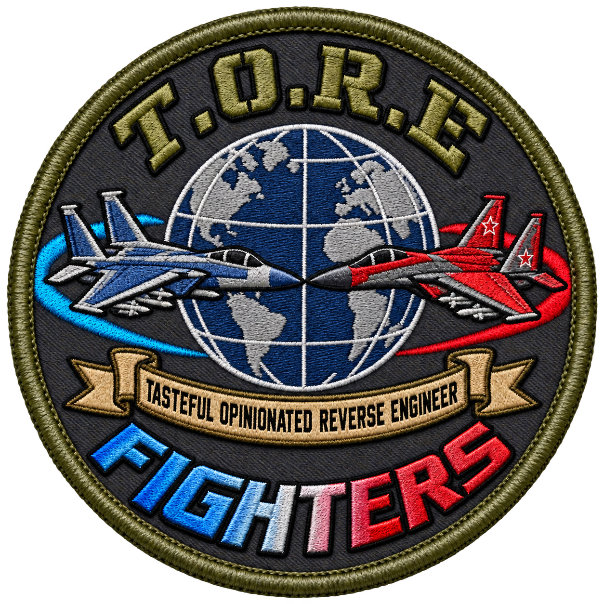
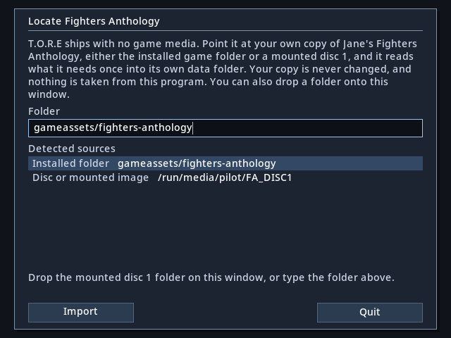
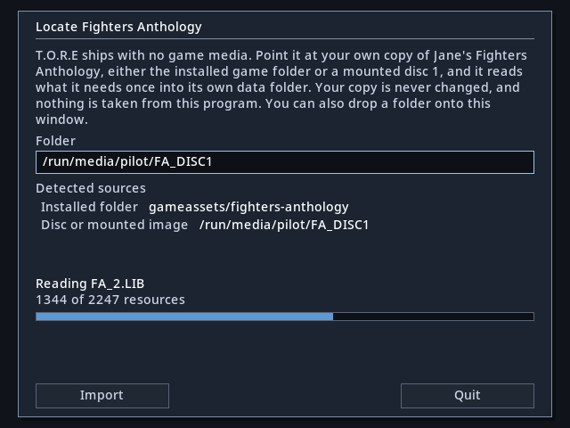
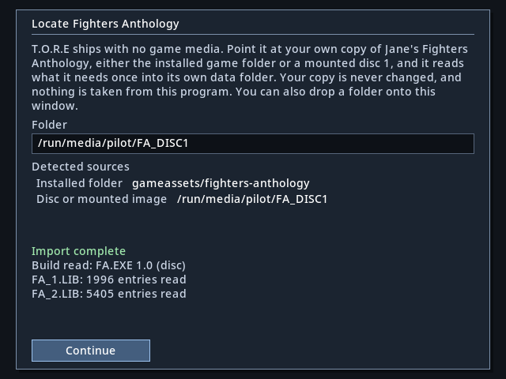
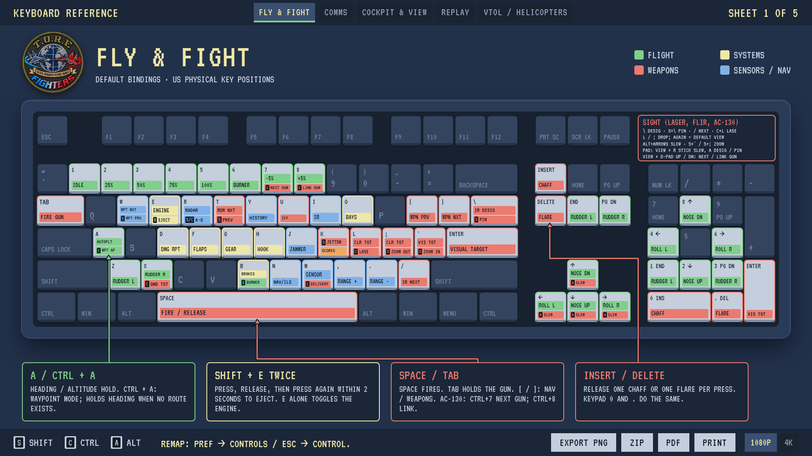

<p align="center">
  
</p>

<h1 align="center">T.O.R.E-Fighters</h1>

<p align="center"><em>Tasteful Opinionated Reverse Engineered: a native Rust rebuild of Fighters Anthology</em></p>

<p align="center">
  <a href="https://github.com/john-overton/T.O.R.E-Fighters/actions/workflows/ci.yml"></a>
  <a href="https://github.com/john-overton/T.O.R.E-Fighters/releases"></a>
  <a href="rust-toolchain.toml"></a>
  <a href="docs/DEVELOPMENT.md"></a>
  <a href="LICENSE"></a>
  <a href="docs/ROADMAP.md"></a>
</p>

<p align="center">
  <a href="docs/formats/theater.md"></a>
  <a href="docs/FLIGHT-MODEL.md"></a>
  <a href="docs/baselines/weapons-systems.md"></a>
  <a href="AGENTS.md"></a>
  <a href="MODS.md"></a>
</p>

T.O.R.E-Fighters is a ground-up rebuild of Jane's Fighters Anthology in Rust. The
target is 1:1 gameplay parity **by expression of feature**: you should experience
what you experience in the original game. It is not a recreation of the original
program's code. Bring your own retail copy, no retail game data ships in this
repository, and the original executable is never run.

Where the project is going is in [the roadmap](docs/ROADMAP.md). What is built
and what comes next is on one page in [the parity plan](docs/parity-plan.md). The
behaviour being rebuilt is described in [docs/spec/](docs/spec/).

## Getting started

You need your own copy of Jane's Fighters Anthology: either the game installed
on a computer, or disc 1. Disc 2 is not needed.

### 1. Install

Download the package for your computer from the
[latest release](https://github.com/john-overton/T.O.R.E-Fighters/releases).

| Platform | Package | First launch |
| --- | --- | --- |
| Windows (x86_64, or 32-bit x86) | `.msi` installer; `-windows-x86.msi` is the 32-bit one | The build is unsigned, so SmartScreen warns you. Choose **More info**, then **Run anyway**. |
| macOS, Apple Silicon or Intel | `.dmg` for your processor | Copy the app to Applications and open it. There is no Developer ID or notarization. If blocked, use **System Settings > Privacy & Security > Open Anyway**, then confirm **Open**. |
| Linux (x86_64) | `.AppImage`, or `.tar.gz` | Make the AppImage executable (`chmod +x`), then run it. |

On macOS, the **0.2.0 download** may say the app "is damaged". In Terminal,
run `xattr -dr com.apple.quarantine /Applications/T.O.R.E-Fighters.app`, then
open it again. Version 0.2.1 fixes the missing bundle seal. See
[first-launch help](docs/DEVELOPMENT.md#unsigned-builds-and-first-launch) for
the fallback on other builds; recent macOS no longer has the right-click Open
bypass.

The main menu's **Update Available** link opens a newer GitHub release, including
prereleases. **Leave Feedback** opens the project's issues page. Automatic
checks run in the background at most once a day per profile. They send an
anonymous request to `api.github.com`; disable them with **Pref > Check for
updates: Off**. Downloads and installation are manual. See the
[update-check details](docs/spec/main-menu-presentation.md#updates-and-project-feedback).

### 2. Point it at your game

On first launch T.O.R.E opens the **Locate Fighters Anthology** screen. There
are three ways to tell it where your game is:

- **Drag** the installed game folder, or the folder of your mounted disc 1, onto the window.
- **Pick** one of the **Detected sources**. T.O.R.E looks at mounted discs and the usual install folders for you.
- **Type** the folder path into the **Folder** box.

Then press **Import**.

<p align="center">
  
</p>

A disc image (`.iso`) is not read directly. Mount it first, then choose the
mounted folder.

### 3. Wait for the import

T.O.R.E reads what it needs from your copy once and keeps it in its own data
folder. Your copy is never changed. The import takes a few moments and shows
which archive it is reading.

<p align="center">
  
</p>

When the import finishes, press **Continue** to reach the main menu.

<p align="center">
  
</p>

Later launches go straight to the main menu. To import from a different copy,
use **Pref > Re-import media**, which opens the same screen again.

### 4. Fly

From **Choose Activity**, pick **Create Quick Mission**. Click the aircraft name
in Wing 1 to choose your aircraft, and the theater name in "You are flying
over…" to choose where. Press **OK** to fly.

<p align="center">
  <a href="https://john-overton.github.io/T.O.R.E-Fighters/tore-keyboard-map.html"></a>
</p>

Default keys follow the original game's keyboard layout. Press **F11** in
flight for keyboard help, or **Escape** for the flight menu.
The [interactive keyboard map](https://john-overton.github.io/T.O.R.E-Fighters/tore-keyboard-map.html)
has Fly &amp; Fight, Comms, Cockpit &amp; View and Replay sheets and exports to
PNG, ZIP or PDF. The [control reference](docs/FLIGHT-CONTROLS.md) lists every key, and
**Escape > Control** remaps keys, gamepads, joysticks and head tracking
([controller setup](docs/INPUT.md)).

If the game does not start, it writes logs and a crash report that help us find
out why. [Startup troubleshooting](docs/DEVELOPMENT.md#startup-logs-and-fatal-errors)
says where to find them. Bugs and questions are welcome in
[Issues](https://github.com/john-overton/T.O.R.E-Fighters/issues) and
[Discussions](https://github.com/john-overton/T.O.R.E-Fighters/discussions).

## What makes it T.O.R.E

The [feature matrix](docs/features.md) groups menus, flight models, weapons,
systems, and maps/weather. Checkboxes distinguish manual-described features from
opinionated additions; each row says what is completed, partially implemented
or planned, with remaining work and links to details.

Examples of opinionated additions: the shared radar and radar cross-section
tuning, authored landing behaviour, the modern input layer with head tracking,
graphics options such as MSAA and a spotting aid for distant aircraft, and
built-in startup diagnostics. Where the original's exact behaviour has not been
recovered yet, T.O.R.E uses a documented approximation labelled *fitted*. See
[behaviour provenance](docs/behavior-provenance.md).

## What works today

Version 0.2.1 follows the [Milestone 2: Multiplayer](docs/ROADMAP.md#milestone-2-multiplayer)
release, 0.2.0. Build a Quick Mission with friends, fly together or against each
other, and return to the lobby for the next round. 0.2.0 also brought ground
attacks, defended surface targets, more aircraft and a fuller world to single
player; 0.2.1 keeps scores across revivals, matches games by compatibility code
and fixes the macOS first launch. The release notes for
[0.2.1](docs/release/v0.2.1.md) and [0.2.0](docs/release/v0.2.0.md) describe
the changes.

**Menus.** The app launches into the original **Choose Activity** menu using
artwork, button pieces, proportional fonts, sounds and recorded music imported
from your own copy. The Quick Mission creator, Load Ordnance and debrief use the
original art too. Quick Mission keeps your setup between launches and includes
a planning map, ground targets, air defenses and ground starts for either side.
Mission systems that are not built yet are refused before launch.

**Multiplayer.** Open **Multi > Direct Connection** for a local game or a typed
address, or **Multi > Internet...** to browse online games in the Internet Lounge. Press **New** to
host, or **Join** to join. The King chooses the mission and rules; players take
slots, choose their loadouts, mark themselves **Ready** and fly. Up to 30 humans
can play co-op or PvP, with configurable sides, AI fill and respawn. Player
Choice wings let each player choose an aircraft. Chat, shared flight contacts,
observers, rejoin and host migration are built. A dedicated server can rotate
missions while keeping its players connected. See the
[multiplayer guide](docs/MULTIPLAYER.md) and
[dedicated server guide](docs/DEDICATED-SERVER.md).

**Aircraft and theaters.** Fly 36 reviewed retail aircraft plus the F/A-XX
concept. The F/A-18D, Rafale C and other original roster aircraft are joined by
Phantoms, the F-15C, F-16C, A-10, transports, radar aircraft, airliners and
[the variety roster](docs/spec/aircraft-variety.md). All 16 theaters have their
original terrain and scenery, with redrawn airports at real scale, runway and
approach lights, tower radio and ILS guidance. City buildings, trees, bushes,
rocks and grass fill out the landscape. Large fixed sites stand on level ground
pads shared by the flight model and the view.

**Flight.** Cockpit and HUD adapt to the window shape, with instrument windows,
the original view suite and animated gear, flaps, airbrakes, hooks and control
surfaces. Stalls, spins, runway wind, autopilot, wing ground starts and ejection
are built. Simulation runs at a fixed 120 Hz, independent of rendering.
Helicopters have rotor physics, collective and cyclic controls, trim and hover
hold. The V-22 converts between helicopter and airplane flight, and the AV-8B
and Yak-141 use vectored thrust. These powered-lift models include fitted
handling and still need wider flight testing.

**Combat.** Guns fire tracers, and air-to-air missiles have seeker search,
radar and infrared guidance, HUD cues and seeker tones. Aircraft use their
imported sensor equipment, with radar scopes, jammer noise and radar-warning
receivers. Air-to-ground radar, bomb sights, CCIP
(the predicted impact point), level bombing, rockets, laser designation and
buddy lasing support strikes on surface targets. Guided bombs, Mavericks, HARM,
targeting pods and weapon seeker views work in single player and online.
Loaded weapons and tanks appear on their stations and leave from those stations
when fired or jettisoned. Chaff, flares, damage, smoke, debris, blackout and
redout remain part of the fight. See the
[air-to-ground guide](docs/spec/air-to-ground.md).

**Surface world.** Ground targets include moving columns, vehicles, ships,
carriers and parked aircraft. SAM sites, anti-aircraft guns and flak defend
them; supply trucks replenish defenses. Buildings burn, destroyed objects
leave ruins and weapon craters stay for the mission. Carriers are defended
surface targets; full carrier flight operations are still ahead.

**AC-130 gunship.** Select or link the 25 mm, 40 mm and 105 mm guns, aim through
the sensor and let the orbit autopilot fly while you work the full-screen
console. It has white-hot, black-hot, TV and night-vision pictures, a ground
radar map, target tracking and gamepad controls
([gunship console](docs/spec/target-window.md#sensor-console)).

**AI.** Up to six wings and 29 AI aircraft per Quick Mission fly with their own
sensors, weapons, fuel and flight model at four skill levels. They fight, defend,
follow wing orders, take off and land, and return home. Strike wings attack
ground targets; helicopters and VTOL aircraft can be wingmen or enemies and
use vertical takeoff and landing. Wing contacts and target assignments are
shared through the flight data link ([AI spec](docs/spec/ai.md)).

**Sky and lighting.** Dawn and dusk blend smoothly, with a moving moon and
starfield at night. Fires, explosions and tracers glow after dark. Cockpit
paint darkens with the sky and weather, red flood lights illuminate it, and
HUD brightness and colour are adjustable separately from instruments. Shadows,
vegetation, grass and frame rate have their own graphics settings.

**Sound.** Radio chatter, wingman replies, crew voices and situation-based
music come from your own copy. Distant explosions and other shooters' weapons
are heard after sound travels to the listener, including in multiplayer and
replays. Large blasts throw out dust, vapor or spray according to the setting.

**Cheats.** The in-flight Cheat menu and the Load Ordnance Cheat button remain
available ([cheats](docs/spec/cheats.md)); multiplayer follows the King's rules.

**Replays.** A T.O.R.E addition: single-player flights record themselves, and
network flights become replays after the session. Watch from any aircraft, a
weapon or a free drone camera, forwards or backwards from 1/8x to 16x. The HUD
camera has an old video-tape look; Sensor View includes the AC-130 console.
New live recordings sample the HUD and console 24 times a second. Panels show
AI decisions, flight telemetry, radio calls and orders. Older recordings still
play. Exports include mission logs and Tacview files, not yet checked in Tacview
itself ([mission replays](docs/REPLAYS.md)).

**Not yet:** full carrier operations, the remaining unsupported weapons,
standalone missions, campaigns and the original's Replay Last Mission (flying
it again). Aircraft handling, multiplayer and visual features retain the
validation limits recorded in the [feature matrix](docs/features.md). Retail
comparison is unavailable; this release does not claim proven retail parity.

## Online play and anonymous statistics

T.O.R.E has two ways to find an online game. **Direct Connection** (Multi menu)
searches your local network and joins an address you type, and talks to no
server of ours. **Internet Lobby** (Multi menu) lists games on a public list
server, the *master*, at `master.jroverton.com` (UDP ports 26901 and 26902).
You can point it at another master in **Options > Master server**. **Default**
restores `master.jroverton.com:26901`; **OK** saves your choice. Listing,
hosting, relay and enabled anonymous statistics all use the chosen master.
See [running your own master](docs/DEDICATED-SERVER.md#running-your-own-master).

Listing a game on the master tells it the game's name, its mission, the
callsigns in it and the address the game answers at, which is what anyone
browsing the list sees. Browsing and joining tell it your address, as any server
sees the address you connect from.

**The game sends anonymous statistics when you use the Internet Lobby**: when
you list a game, join one through the list, or run a dedicated server that
broadcasts. They are on by default. The first time you open the Internet Lobby a
line in **Messages** says so, and **Options > Send anonymous statistics** turns
them off. When a session ends the game sends one small report:

- a random install id, drawn the first time and kept in `install-id` in the
  data folder (turning the statistics off deletes it, and turning them on again
  draws a new one that cannot be linked to the old);
- whether you joined, hosted or served, the game version and your system
  (Windows, macOS or Linux);
- how long the session lasted and the most players in it;
- how you connected (local network, typed address, forwarded port, IPv6,
  punched through, or the relay) and how long that took;
- what kind of router the game's port sits behind, and what the port forwarding
  did;
- how much traffic went through the relay, and (for a host) how many players
  connected each way.

It does not send callsigns, game names, chat, passwords, addresses or anything
about your computer beyond the system name. The master adds the report to
counts for the day and keeps no address with them (an address can appear in its
operating journal when it enforces a limit). A dedicated server has its
own `telemetry` setting ([operations](docs/MASTER-SERVER.md#what-the-master-keeps)).
Direct Connection and single player send nothing.

## Build from source

Rust 1.91.1 is pinned through rustup. From the repository root:

```sh
source "$HOME/.cargo/env"
cargo run --locked -p tore-app
```

A source build imports local `gameassets/fighters-anthology/` media, or the source it remembers, on first run without asking. If it cannot find media it opens the same **Locate Fighters Anthology** screen as the packaged game. To import another location from a terminal instead:

```sh
cargo run --locked -p tore-app -- --import /path/to/fighters-anthology
```

Use **? → Exit to Desktop** or close the window to quit. Escape dismisses a dropdown and Tab/arrows and Enter navigate. **Pref → Sound...** sets the sound and music volumes.

To check startup, render one frame, and exit without audio:

```sh
cargo run --locked -p tore-app -- --smoke-test
```

To redraw the first-run screenshots above without any game media:

```sh
cargo run --locked -p tore-app -- --snapshot locate.ppm --snapshot-state locate
```

The `locate-importing` and `locate-done` states draw the other two.

See [development setup](docs/DEVELOPMENT.md) for fresh-machine setup, Linux/Windows prerequisites, checks, and troubleshooting.

## Fly from the command line

```sh
cargo run --locked -p tore-app -- --free-flight --aircraft f18
cargo run --locked -p tore-app -- --free-flight --aircraft rafale --theater FRA
cargo run --locked -p tore-app -- --free-flight --aircraft f14
```

The default flight model is the researched hybrid adapter (`--researched-flight`).
Two research options are selected explicitly: `--legacy-flight` preserves the
older compatibility model, and `--native-flight-tables DIR` runs a restricted
build from statically extracted tables. See [the flight model](docs/FLIGHT-MODEL.md).

The development weapons range is `--live-fire --aircraft f18`, and accepts any of
the supported imported aircraft. Space fires, semicolon selects a weapon, backslash
resets the range, and T or a click on the radar page designates a contact.

## Explore the theaters

The free-camera terrain diagnostic remains available from the command line:

```sh
cargo run --locked -p tore-app -- --viewer
```

Arrow keys move, **Shift** moves 8× faster, **Q/E** or **PageDown/PageUp** lower/raise altitude, **A/D** turn and **W/S** look up/down. **Escape** returns to the creator, then the main menu. All 16 theaters are selectable. Launch a particular theater directly with `--viewer --theater TVIET` (Vietnam), for example. The diagnostic uses a fixed midday preview; normal flights have the moving sun and moon, stars and changing daylight. See [recovery findings](docs/formats/theater.md) and [viewer validation](docs/baselines/ukraine-viewer.md).

## Extract assets for research

```sh
python3 tools/extract_assets.py --dry-run
python3 tools/extract_assets.py
# All 16 defined theaters and shared environment resources:
python3 tools/extract_assets.py --theater all --exclude-archive 'disc1/LHX/*' --out .local/all-theaters
```

This discovers and unpacks all supported archives into ignored `.local/extracted/`, preserving archive boundaries and writing a report with hashes. Use `--source` for other media and `--include "*.PIC"` for filtering. The app does not require this full extraction. See [the extraction guide](docs/EXTRACTION.md) for Windows commands, limits, and repeat-run behavior.

## Export aircraft to original FA

The [asset export guide](docs/fa-xx-developer-kit.md) covers the local conversion,
packing and validation tools, plus Windows installation. The F/A-XX exporter
creates a separate aircraft definition and shape family from the F-22N, with no
F-22 resource overrides. John confirmed flight and the fin-decal fix of the
earlier F-22A-based package in original FA.
The guide documents discrete animation limits and remaining compatibility checks.
Generated retail-derived files stay local; only tools and specifications ship here.

## Project guide

- [Contributions](CONTRIBUTIONS.md): how to help through GitHub Issues and Discussions, and the current pull request policy.
- [Roadmap](docs/ROADMAP.md): milestones and what 1:1 means.
- [Parity plan](docs/parity-plan.md): what is built, what is specified, what is next.
- [Feature matrix](docs/features.md): grouped features, manual/addition checkboxes and implementation status.
- [Behaviour specs](docs/spec/): what a player experiences, with numbers. This is the parity target.
- [Development](docs/DEVELOPMENT.md): environment and everyday commands.
- [Extraction](docs/EXTRACTION.md): shared script, filtering, output layout, and supported containers.
- [Architecture](docs/ARCHITECTURE.md): baseline choices and boundaries.
- [Behaviour provenance](docs/behavior-provenance.md): how origin is labelled, and why a label is not a gate.
- [Format research](docs/formats/coverage.md): recovered file formats and decode coverage.
- [Baseline evidence](docs/baselines/environment.md): what has actually been measured and verified.
- [Frozen archives](docs/research/progress.md): superseded plans and the dated progress log, kept for their research and evidence.
- [Local references](docs/REFERENCES.md): media and TypeScript reference locations, menu starting points.
- [Agent instructions](AGENTS.md): the authoritative rules for automated contributors.
- [Prompting cheat sheet](docs/PROMPT-CHEAT-SHEET.md): phrases that keep a request pointed at player behaviour rather than the original code.
- [Mods](MODS.md): what the license means for mission, theater, art and sound content.
- [Third-party notices](THIRD_PARTY_NOTICES.md): upstream attributions for engine code.

`crates/tore-app/` contains the native shell, `crates/tore-formats/` the shared readers, `crates/tore-extract/` the headless extractor, `crates/tore-sim/` the simulation kernel, `crates/tore-world/` the mission core, and `crates/tore-input/` with `crates/tore-input-native/` the input layer. `tools/` contains portable extraction/research scripts and the asset guard. GitHub Actions builds and checks Linux, Windows, and macOS on both Apple Silicon and Intel.

Your game files belong in ignored `gameassets/fighters-anthology/`. The ignored `USNF-ATF/` checkout supplies reference specifications; it is not needed by the Rust importer or runtime. Music uses original recorded menu/briefing playlists and the NORMAL free-flight score. Optional `FA_4B.LIB` and `FA_4D.LIB` supply the recordings; MIDI and synthesis are not required. See [audio recovery](docs/formats/music.md). Run with `--no-audio` for a silent session.

## License

The engine, tools and documentation are licensed under the
[GNU General Public License v3.0](LICENSE). Mods are data the engine loads, not
derivative works of it, so your content stays under whatever license you choose;
[MODS.md](MODS.md) draws that line and explains the retail-asset rule. Playing
requires a legally owned copy of Jane's Fighters Anthology; no retail game data
ships in this repository.
