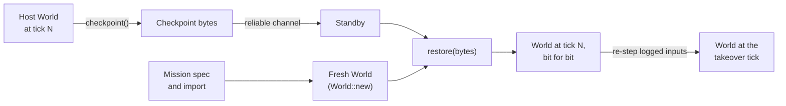

# Exact checkpoints

> **T.O.R.E: Tasteful Opinionated Reverse Engineered.**
> The thing being reverse engineered is the *experience*, not the executable. We
> trace what a player does and what the game does back, down to the numbers they
> would notice. How the original code achieved it is history: useful evidence,
> never a blueprint. If a sentence below reads like an instruction to reproduce
> the original's internals, it is out of date.
> <!-- tore-header v2 -->

Design of 2026-10-05 for stage H of the [multiplayer plan](../multiplayer-plan.md#stages)
and its section [host migration: exact checkpoints](../multiplayer-plan.md#host-migration-exact-checkpoints).
This is T.O.R.E's own format; Fighters Anthology had nothing like it. How the
work is split into slices, and what is built, is in the
[architecture guide](../ARCHITECTURE.md#exact-checkpoints). Every choice below
is an agent decision unless it is credited to John. John's binding decision is
that host migration is exact (2026-09-28): the new host continues from the
whole mission, down to each AI pilot's thinking and random numbers.

## Contents

- [What a checkpoint is](#what-a-checkpoint-is)
- [What it holds and what it leaves out](#what-it-holds-and-what-it-leaves-out)
- [Restoring](#restoring)
- [Layout](#layout)
- [Sections](#sections)
- [Coding rules](#coding-rules)
- [Versioning](#versioning)
- [Keeping it complete](#keeping-it-complete)
- [The equivalence scenarios](#the-equivalence-scenarios)
- [Measurement](#measurement)
- [The state, by area](#the-state-by-area)

## What a checkpoint is

A checkpoint is every piece of mutable mission state in a `World`, taken
between two ticks, as bytes. `World::checkpoint()` writes it.
`World::restore(bytes)` loads it into a `World` built from the same mission,
which then steps on exactly as the original would have.

- **What it is for.** A host sends one to each standby host about every 10
  seconds, and the inputs it applies in between. A standby that takes over
  restores the latest checkpoint and re-steps the logged inputs
  ([guide](../MULTIPLAYER.md#host-migration)).
- **Same build only.** Checkpoints travel only inside a session, between
  peers the handshake has already matched by build and protocol. They are not
  save files: a checkpoint from another build is refused, never converted.
- **Not a replay.** A replay records what was drawn, rounded. A checkpoint
  records what the simulation will read next, exactly.
- **Not for joining.** A joining client gets a snapshot keyframe, not a
  checkpoint. Clients never need AI internals.



## What it holds and what it leaves out

The dedicated server's rotation sequence is local operator setup. The process
keeps it across rounds; it is not serialized or migrated.

Every field of every type reachable from `World` falls in exactly one class.
The class decides how it is coded:

| Class | What it is | Coded? |
| --- | --- | --- |
| Mutable state | Anything a later tick can read: flight states, AI controllers and memories, missiles, gun rounds, random streams, counters, queues that can be non-empty between ticks, timers, and presentation state the next tick reads back (smoke outlets, the render history's devices) | Yes, exactly |
| Copied records | Imported data copied into mutable state: weapon records, ownship configurations, sensor profiles, runway views | Yes, by value, once each as a [shared record](#shared-records) |
| Mission setup | Fixed when the mission is built: the theater, terrain, airport scene, aircraft types, phrases, `Setup`, the layout, spawn plans | No: the fresh `World` built from the same mission has it |
| Why-records | Write-only explanations for the recorder and the debug panels: the AI journal, actor and controller traces, draw logs, the radio journal, a radio call's `origin`, the formation trace, decoy and device notes the app alone drains | No (see below) |
| Per-tick scratch | Rewritten every tick before anything reads it, and empty or stale between ticks | No, but only with a comment proving it |
| Local | Belongs to one machine: worker pools, file writers, the combat tape's list, render caches outside `World` | No |

**The why-records rule.** The simulation never reads a why-record, so leaving
them out cannot change any later tick. After a restore, the recorder's
explanation of a call or decision that started before the checkpoint can be
missing; nothing else differs. *Agent decision:* coding them would add about
60 more types (the journal's `Cause` alone has 40 variants) for text that no
standby needs. Small gates that only decide whether to write a journal line
(`JournalMemory`, `Journal::windows`, `CrewVoice::gate`) are why-records too.

**The scratch rule.** A field is scratch only if a comment at the skip shows
that every path writes it before any read in the next tick. When in doubt,
code it: a field that is coded needlessly costs bytes, a field skipped wrongly
costs exactness. The surveys found several "caches" that are not:
`Ownship::range_estimate` and `mounted_key` refresh only every 60 ticks or on
a change, `AiWings::last_hp` triggers the next damage report, and the render
history's devices are drawn again for an aircraft whose AI stopped, and
`formation::Guidance::trace`, a "hidden inspection hook" that `change_slot` and the
other actors' traffic read.

**Process switches.** One process-wide switch changes simulation results: the
retail stall speeds (`tore_sim::flight::retail_stall_speeds`). The header
records it, and a restore in a process with the other setting is refused. A
session refuses the switch anyway.

## Restoring

*Agent decision:* a checkpoint restores **over a fresh `World` built from the
same mission and import** (`World::new` with the same `MissionSpec` and
seating, or the same test fixture). The fresh world supplies the mission setup.
The checkpoint supplies everything else, including the structure:

- **Structure comes from the bytes.** Handoffs add and remove cockpits, combat
  ownships, AI actors, AI slots and radio channels mid-flight, so the restored
  lists are rebuilt from the checkpoint, never matched to the fresh world's.
  A fresh open mission has no cockpits; a restored one has as many as the
  checkpoint says.
- **Flight models by identity.** A flight state codes the `AircraftId` of its
  aircraft and its model's ordinal beside its exact state. On loading, the
  flight model comes from the fresh world's model table (`Models`): every
  distinct model, as the import built it, of every aircraft type and every
  flight the world holds. Handoffs move flights, never models, so the table
  is the same all mission long and on both sides. A world built from an import
  has one model per identity, so the ordinal is 0; test fixtures can carry two
  (a synthetic player beside real AI rows), which the ordinal tells apart, in
  an order fixed by a fingerprint of each model.
- **Copied records by value.** Ownship configurations, weapon records, sensor
  profiles and runway views are coded in full, once each, so a restore never
  needs the import's files.
- **In place, then discard on error.** Holders that mix setup with state
  (`World`, `Combat`, `AiWings`, the weather `Environment`) restore their
  mutable fields in place and keep their setup fields. Everything below them is
  decoded as new values. If a restore fails, the world is half-restored and
  must be thrown away: build a fresh one. *Agent decision:* atomic restore
  would need every holder to be cloneable for no use in practice.
- **Checks before writing.** The container is checked whole (magic, version,
  switches, identity, CRC-32) before any field is touched, so a damaged or
  foreign checkpoint fails before the world changes.

**For stage K** (host migration), what a standby must know about a restore:

- **The score switch comes from the bytes.** A restore sets `World::score`
  exactly as the checkpoint had it, the scoring switch included (slice
  H10). A standby that applies the session's scoring setting must call
  `World::set_scoring` after the restore, not before: a call before it is
  overwritten. The score facts waiting in the recorder are restored too, so
  the host should take its checkpoint after it drains them, or a new host
  would report them again.
- **An AI actor's last controls are restored.** Slice H4 skipped
  `AiActor::last_input` as scratch, so a restored actor reported neutral
  controls until its next step; slice H9 found that a destroyed actor never
  steps again and codes it, so a standby's replay recorder shows the same
  controls as the old host's.
- **Build the fresh world the same way.** The restore keeps the fresh
  world's setup (terrain, aircraft types, phrases, layout), so the standby
  builds it with `World::new` from the same `MissionSpec`, seating and import
  as the host did. Every test restores into a world that has not stepped
  yet; restoring over a world that has stepped is not tested.

The **mission identity** is FNV-1a 64 over what the fresh world fixes and the
checkpoint relies on: the terrain's theater and layout, the aircraft
identities of every loaded type in load order, every plane's slot, and the
setup's start. The planes are the ones the mission was built with: a
revival's new planes are left out and retired planes counted, from the
revival book (*F2-V*). It catches a restore into a different mission, not a
different import: the handshake's content manifest already guarantees the
import.

## Layout

All integers are little-endian bit fields packed least significant bit first,
with [tore-codec](../../crates/tore-codec/src/lib.rs)'s `BitWriter`, exactly as
the [wire protocol](net-protocol.md#overview). Each section starts on a byte
boundary.

| Part | Coding | Notes |
| --- | --- | --- |
| Magic | 8 bytes, `TORECKPT` | |
| Container version | 16 bits | 1 |
| Switches | 8 bits | Bit 0: retail stall speeds on. Others zero |
| Tick | 64 bits | `World::tick()`, the tick the next step runs |
| Mission identity | 64 bits | See [restoring](#restoring) |
| Section count | varint | |
| Each section | id (8 bits), byte length (varint), padding to a byte, the body | Ids in ascending order, each at most once |
| CRC-32 | 32 bits | IEEE, over every byte before it |

The shared records are section 0 and come first, so a loader has them before
any section refers to one. A loader checks that each body ends exactly at its
length with only zero padding: a coder that writes a field its reader does not
read fails here, not ticks later.

## Sections

One section per mutable field of `World`, so a new field on `World` cannot
compile without a section (see [keeping it complete](#keeping-it-complete)):

| Id | Section | What | Restored |
| --- | --- | --- | --- |
| 0 | Shared records | Copied records referred to by index | First |
| 1 | Roster | Planes' pilots, seats, crews, wing recipients; then the players' callsigns (*lobby pass follow-up F1*): each seat's, as the host named it, and each plane's, the player who flies it or flew it last | New value |
| 2 | Combat | `Combat` and its `live::State`: ownships, targets, projectiles with guidance, effects, smoke, contrails, debris, marks, the ledger, the rewind history, random streams, the combat tick (`World::tick`) | In place |
| 3 | AI wings | `AiWings` and its `AiMission`: actors with flight, controller, memory, sensors and stores; leaders (each with whether it stands in for the wing's owner, *lobby pass R2*), opportunities; the lead hold's claims and the wingmen waiting to re-form once their fight is over (*R2*); the bridge's maps and random streams | In place |
| 4 | Cockpits | Every human-flown plane's `Cockpit`: flight, turbulence and its stream, airport service, NAV mode, message clocks, tower radio, crew voice, result tracker | New value |
| 5 | Weather | The weather clock, its ticks, the fog random stream, the selection schedule, the active layers and each record's tint scalar (`Environment`'s mutable part) | In place |
| 6 | Comms | Radio channels (with each seat's battle net monitor), cooldowns, the radio random stream; a pending call's net | New value |
| 7 | Wing status | The AI wingmen's airfield report memory | New value |
| 8 | Radio | The radio call memory (hits by shooter and victim) | New value |
| 9 | Data link | The flight data link's picture: members, each flight's published tracks and member status with their publish ticks, locks, engagements, assignments, the two warning tables, the planes already announced | New value |
| 10 | Score | Whether the host has scoring on and, if so, the targets whose end is recorded and the score facts waiting for the host, with their tick | New value |
| 11 | Revival | Stage F phase 2's revival book (`revive::Book`): each abandoned plane with the tick it was abandoned and the tick its wreck came to rest, in the order they were abandoned; the retired planes' roster entries; the planes revivals added, in order; each added plane's lineage root, a map from the added plane to the plane the mission started with that it continues (*lobby pass R1*). The abandoned list also holds the AI wrecks a respawn replaced, waiting to retire (*R1*). Then the lead hold (*lobby pass R2*): whether it is on, and each owned wing (its side and index, the owner as a seat or as the away player's plane, the owner's newest plane in the wing, whether it has led). Refused: a plane twice in one list, a plane both abandoned and retired, a retired plane with a pilot, a root for a plane never added or an added plane as a root, a hold that is off with owners, one wing owned twice. *Built (F2-V, roots R1, lead hold R2)* | New value |
| 12 | City fill | The city fill's knocked-down buildings: whether the terrain has a fill (a restore refuses a world that differs), then the count of flattened buildings and their indices in the fill, ascending, the first as it is and each later one as its gap from the one before less one. The fill itself is mission setup. Refused: more buildings than the fill holds, an index past it. *Built (surface close-out review fixes, protocol 25)* | Exactly that set |

Not coded at `World` level: `setup`, `phrases` and every terrain field but
the weather and the city fill's knocked-down buildings (mission setup). Stage G added the data link's picture (section 9)
and stage F phase 2 the score recorder (section 10) and the revival book
(section 11), and the surface close-out the city fill (section 12); each new `World` field gets
the next free id, and state added inside an existing holder joins that
holder's section. A G slice that adds state to `DataLink` codes it in
`datalink_checkpoint.rs`, whose field list will not compile until it does. The
data link's journal is a why-record and is not coded. The score recorder's
waiting facts are coded although the host drains them after every step
(*agent decision*): a checkpoint taken at any other point of the host's loop is
then exact too.

### Shared records

A record is coded once into section 0 and referred to by its index, a
varint. Two records are the same when their codings are byte-identical, so
equal weapon records carried by 30 aircraft and 40 missiles cost one coding.
Each record starts with a 32-bit tag of its type, checked on loading.
Indices follow first use while the sections are written, so the same world
always writes the same bytes. A record may refer to earlier records.

### Flight states

A flight state is coded as its `AircraftId` and its model's ordinal (two
varints) and then the
[exact own-plane coding](../ARCHITECTURE.md#the-exact-state-of-a-humans-plane)
(`flight::State::write_exact`, no baseline) that the wire already uses. The
same bytes as the wire mean one coder to keep complete, not two. The write-only
trace is not coded, as on the wire. The native research adapter is refused,
as on the wire. A cockpit's `previous_flight` is per-tick scratch: the next
step overwrites it before reading it, so a restored cockpit starts with it
equal to `flight`, as a decoded own plane does.

The exact coding includes the autopilot, whose mode gained `Orbit` 4 and
which gained, after its `loops`, the AC-130 orbit hold's `orbit`
(`Option<Orbit>`: the point, the centre, the radius, height, speed and reach,
and the slewed bank, climb and throttle terms; slice nr-orbit, 2026-10-13).
That changes the wire's own-state bytes too
([the sensor console](net-protocol.md#protocol-29-the-sensor-console)).
The seat command `SensorConsole` is 15 in a checkpoint's queued seat
commands.

Protocol 30 (slice nr-cona, 2026-10-14): the `Orbit` gained, after its
throttle term, `pinned` (bool), `heading` and `altitude` (f64: the console
search's commanded heading and altitude), so the search rides the exact state
too ([the console's search and keys](net-protocol.md#protocol-30-the-consoles-search-and-keys)).
The seat command `Console` is 16 in a checkpoint's queued seat commands,
followed by two varints: its variant (0 Pin, 1 Heading, 2 Altitude, 3 Speed,
4 SpeedStep) and its value as a byte (the steps in two's complement, the
speed's percentage as is). Same-build checkpoints only, as before.

Pending protocol (slice nr-cona follow-up): `Orbit` gained `still_s` (f64)
after `altitude`, the `Console` variant 5 is GunLock (value 0), and the
gunship state (`GunshipState`) gained `gun_lock` after `notice`
(`Option<GunLock>`: the object, an `Option<u32>`, then the point).

One field follows the exact coding: a two-seater's second chute
(`crew_escape`, an `Option<Escape>` by the trait, one bit when there is
none). The wire's exact state leaves it out, since a client's prediction
never needs it (a client draws it from the host's pilot entities, slice B5),
but it is world state: each step of the flight steps it and tells the HUD
when it comes down, and the picture draws it. *Built (B6, 2026-10-06):* B5
left it out of the checkpoint too, so a world restored after an ejection
lost the chute, and the combat section's poses, rebuilt from the flight on
the next tick, differed from the original's: a cold standby's world differed
from its host's, a warm standby appointed in flight failed its Checks, and a
host taking over mid-descent lost the chute. *Agent decision:* coded here,
in `save_flight` and `load_flight`, rather than in the exact state, so the
wire's own-state bytes and the protocol stay as they were.

## Coding rules

The trait is `tore_sim::checkpoint::Checkpoint`:

```rust
pub trait Checkpoint: Sized {
    fn save(&self, s: &mut Saver, base: Option<&Self>) -> Result<(), CheckpointError>;
    fn load(l: &mut Loader<'_>, base: Option<&Self>) -> Result<Self, CheckpointError>;
}
```

`Saver` wraps a `BitWriter` with the shared-record table and the world's
flight models; `Loader` wraps a `BitReader` with the shared records and the
fresh world's flight models. Holders restored in place implement `InPlace`
(`save_in_place` and `restore_in_place(&mut self, ..)`) instead. The rules:

- **Exact values.** Every float is coded by its bits (the exclusive-or coding
  of `tore-codec`'s `write_f64_xor`, against the baseline or zero), so NaN
  payloads, signed zeros and infinities survive. `f32` the same at 32 bits.
  Integers by their bit pattern at their width; `usize` as a 64-bit value
  that must fit the platform on loading (32-bit Windows is a CI target).
- **Baselines.** `base` is an earlier value of the same field the reader also
  has, or `None`. Checkpoints code against `None` except where a coder chooses
  a baseline inside its own value: a sequence of similar records (the rewind
  history's frames, smoke puffs) may code each element against the one before.
  An unchanged 64-bit value then costs one bit.
- **Collections.** `Vec`, `VecDeque`, `BTreeMap` and `BTreeSet` code a varint
  count and then their items in order. A count larger than the bits left is
  refused before anything is allocated. Maps code each key without a baseline
  and each value against the baseline map's value at the same key. No
  `HashMap` or `HashSet` may enter mission state (none exists).
- **Strings** code a varint byte count and UTF-8 bytes, with no 255-byte cap:
  composed radio text can be longer.
- **Enums.** A field-less enum codes its variant's fixed number, a varint,
  with `checkpoint_enum!`. An enum with data is written by hand as one `match` with
  every variant and no `_` arm, so a new variant fails to compile.
- **Every field named.** A struct's coder destructures it with every field
  listed and no `..`, and builds it back the same way.
  `checkpoint_struct!(Type { a, b } shared { c } skip { d = <rebuild> })` does
  both (`shared` fields are coded as shared records, `skip` fields rebuilt by
  their expression); `checkpoint_tuple!(Type(a, b))` does it for a tuple
  struct; a hand coder does it in a `let Type { .. } = self` with every field.
  A skipped field names its class in a comment: why-record, scratch (with the
  proof), setup or local.
- **`&'static str`** in state codes as an index into a fixed table beside the
  type (the radio cooldown keys are the one case found), and an unknown string
  on saving is an error, not a silent skip.
- **Cross references** stay as the ids the simulation uses (aircraft,
  projectile, missile, seat and plane ids; station indices). They need no
  translation, because the restored world uses the same ids. Lists that the
  simulation keeps sorted are restored in the order coded, which is that order.
- **Where a coder lives.** Most state has private fields, so each module's
  coders live in a child module beside it, in a file named
  `<module>_checkpoint.rs` and declared in the module as
  `#[path = "<module>_checkpoint.rs"] mod checkpoint;` (the pattern
  `ai/mission.rs` already uses for its observation code). Coders read fields
  and never change simulation code. A type from another crate (`AircraftId`,
  `Weapon`, `NativeRng`, `PilotInput`) is coded in `tore-sim`, which owns the
  trait. Types with an `Exact` coder already (the flight state's parts,
  turbulence, cheats, sensor controls) reuse it through
  `checkpoint_via_exact!`.
- **Why a new trait.** `Exact` is the wire's own-plane coder, frozen by the
  wire's golden test. Checkpoints need a context (shared records, the import
  table) and generic collections that `Exact` does not have, and must not
  change a byte of the wire.

## Versioning

The container version changes only when the container's layout changes (the
header, the section framing, the shared-record table). A change inside a
section's coding needs no version: checkpoints never cross builds, and the
handshake already refuses a different build. *Agent decision:* a schema hash
of every coder was considered and rejected; it would make every simulation
change touch a golden value with no protection that the build check does not
already give.

## Keeping it complete

Every future change to simulation state must update the checkpoint. Three
guards turn a forgotten field into a failure instead of a silent desync:

1. **It does not compile.** Each coder names every field. A field added to a
   struct, a variant added to an enum or a field added to `World` is a
   compile error until it is coded or skipped with its class.
2. **The section does not end where it should.** A coder whose reader and
   writer disagree fails its section's length check on the first restore.
3. **The equivalence test diverges.** A field skipped as scratch or setup
   that a later tick reads makes the restored world differ from the original
   within the scenario's M ticks.

New state therefore costs: name the field in its type's coder (one word in a
macro, usually), and, for a new type, a coder in its module's
`<module>_checkpoint.rs`. Stage G's data link is the first expected user.

## The equivalence scenarios

The equivalence test steps a mission to tick N, checkpoints it, restores it
into a fresh world, steps both M more ticks with the same inputs, and requires
on every tick the same tick output (every field but the why-records) and, every
30 ticks and at the end, byte-identical checkpoints. It also checks that a
restored world checkpoints to the same bytes it was restored from, and that
truncated, damaged and random bytes are refused without a panic. It runs in
the normal `cargo test` on every CI platform (Linux, Windows 64 and 32-bit,
macOS); every scenario is built from synthetic fixtures, never retail data.

| Scenario | Fixture | At tick N the test asserts | N, M |
| --- | --- | --- | --- |
| Single player | The full-tick fingerprint mission (`world/tick_tests.rs`) with its script and drones. *Built (H0, asserted H8)* | A turbulence event begun, the airport selected and the tower's reply held, the player flying fast; the data link's pictures published with every roster plane a member (*H10*) | 600; 600 |
| Dogfight with rounds in flight | The crowd fixture (`world/crowd.rs`): four against four at 10,000 ft, four human seats. *Built (H0, asserted H8)* | Gun rounds in flight, every ownship holding radar contacts; both wings' pictures published and holding tracks (*H10*) | 600; 600 |
| Handoffs in the open mission | `World::new` with `Seating::Open` from the synthetic import, three against three; seats take planes at steps 60 and 61, one gives its plane back at 500, another takes one at 640. *Built (H0, asserted H8)* | Restored into a world fresh from `World::new`, so the structure (cockpits, ownships, actors) differs from the fresh world's; the plane given back is the AI's again | 700; 600 |
| Damaged aircraft | The crowd fixture with Realistic damage and the host's scoring on (*H10*); the damage command on a human's aircraft at steps 800 to 802, one AI aircraft shot down at 840 (its row emptied, its pilot ejected by hand) and another hurt at 850. *Built (H8)* | An ownship with hit points lost and a system fault, a wreck falling, a pilot under canopy, a hurt AI aircraft flying; scoring on with the lost aircraft recorded and its kill waiting, the link showing it dead (*H10*) | 900; 600 |
| Handoffs in the fight | The crowd fixture; seat 1 gives its plane back at step 500 and takes an AI plane at 560. *Built (H8)* | The roster, cockpits and AI actors as the handoffs left them, the leaders holding a designated contact, the data link holding those locks and engagements (*H10*) | 700; 600 |
| Missile duel | `World::new` open mission, one against one at 5 nautical miles, two seats; seat 1 fires its guns at step 1,400 and seat 0 a guided missile when in range. *Built (H8)* | A guided missile in flight, a missile warning held by a threat service, gun rounds in flight, both aircraft alive; they meet 400 ticks after the checkpoint | 1,700; 1,100 |
| Radio calls pending | The single-player fingerprint mission with three calls (delays of 5, 9 and 14 seconds) and two cooldowns put into the player's channel at step 570. *Built (H8)* | Both cooldowns running, the Comms section differing from the same mission's without the calls | 600; 900 |
| AI landing | `World::new` over the synthetic import with an airport, airborne, the wing ordered to land at step 20; the two wingmen start at the first approach gate and 16,000 ft behind it. *Built (H8)* | One wingman in the rollout on the runway, the other holding or approaching; after the run the first has cleared the runway and the second is on approach | 12,500; 1,600 |
| Ground start | `World::new` over the synthetic import with an airport, `Start::Ground`, a wing of four, the player's takeoff at step 5. *Built (H8)* | A wingman parked, one lining up on the taxiway, the player rolling at over 100 ft/s | 2,000; 1,400 |
| Changing weather | The single-player fingerprint mission with a weather configuration whose two layers both run the fog callback and whose first layer ends five seconds in. *Built (H8)* | The first layer active with a fog tint drawn; after the run the second layer is active | 300; 1,200 |
| Revivals and wrecks | `World::new` open mission, three against three; seat 0's pilot killed at step 200 and revived at 201, seat 1's plane crashed at 300 and abandoned at 301, its wreck retired by hand at 400, seat 0's new plane lost at 500 and revived at 501. *Built (F2-V)* | Planes 0 and 6 abandoned (wrecks with cockpits nobody flies), plane 5 retired, planes 6 and 7 added by revivals and seat 0 in plane 7: a structure no fresh build has, restored into one | 700; 600 |
| AI respawns, one pending | `World::new` open mission, three against three, seat 0 in plane 0 from step 60; the AI's plane 1 shot down at step 100 and respawned (`MissionCommand::Respawn`) at 110 as plane 6, which is shot down at 200 and respawned at 210 as plane 7; the enemy's AI plane 4 shot down at 300, its respawn made at 450, after the checkpoint. *Built (lobby pass R1)* | Planes 6 and 7 rooted in plane 1, the AI wrecks 1 and 6 waiting to retire, plane 4's lineage lost with its respawn pending; after the run both copies made the same plane 8 of it | 400; 300 |
| A lead held for a lost human | `World::new` open mission, a flight of four and one of one, the lead hold on (`MissionCommand::LeadHold`, step 0); seat 0 in the flight's lead from step 60, seat 1 in its plane 2 from 61; seat 0's pilot killed at 150; seat 0 revived (`Revive`) at 400, after the checkpoint. *Built (lobby pass R2)* | Seat 0 owns the lead, seat 1's plane stands in (`acting`), the mission's claim names plane 0; after the run plane 5 leads on both copies, its owner seat 0, led | 300; 200 |
| A human lead's order | The data link's assignment fight (`world/datalink_assign_tests.rs`): the crowd fixture's mission with a human lead (seat 0), a second human (seat 1) and two AI wingmen armed as a built mission arms them; the lead's radar on at step 10, an enemy AI aircraft designated at 40, "engage my target" at 60. *Built (H9)* | Three assignments of that target from the lead, one acknowledged by the wingman that locked it and two not yet; after the run the target is shot down and the assignments have ended | 1,000; 600 |
| Two-seaters' crews ejected | The crowd fixture in two-seaters (PLANE flags 0x10 and 0x4, `crowd::two_seat_crowded_mission`): AI 6 ejects both its crew at step 700 (`flight::State::eject`, its row emptied), and seat 3 presses the handle twice at 740 and 780. *Built (B6)* | Four chutes in the air, two of them second crew members', both drawn; after the run each has fallen exactly 600 ticks further | 900; 600 |

The scenarios live in `world/checkpoint_scenarios.rs`. Each has an `expect`
that asserts its state at tick N, and the test
`every_scenario_builds_twice_identically_and_reaches_its_asserted_state` runs
them. The synthetic airport is `airport_resources()` in
`test_support/resources.rs`: the import of `resources()` with one runway
airport in the theater's layout, whose shape carries the contact boxes the
AI's takeoff, landing and parking read.

The whole-world test (`a_whole_world_restores_into_a_fresh_one_and_flies_on_identically`)
runs in the normal suite since every section is coded (slice H9); it takes
about 8 seconds in a debug build on the development machine for all thirteen
scenarios. While sections were still being coded, each slice ran the **twin
restore** instead, and it stays as a second test: build the scenario twice,
step both to N, restore only the covered sections from one into the other, and
step on. The uncovered sections are already equal in the twin, so any
difference comes from the covered sections' coding. The harness finds the
covered sections itself: a section is covered when it checkpoints alone, and
any error but "not coded yet" fails the test.

A twin restore can only catch a coding error in state that matters during the
M ticks: a field that is wrongly skipped but empty at tick N, or that no
later tick reads, is invisible to it (H0 checked this by skipping fields of
the radio section on purpose: they were empty at N in every scenario, and
the test still passed). That is why each scenario asserts the state it is
meant to exercise at tick N.

## Measurement

Measured by the final slice, recorded in the
[bandwidth budget](../multiplayer-plan.md#bandwidth-budget) and a baseline:

- the size of each section and of the whole checkpoint, on the synthetic
  crowd fixture (every run) and on the 15 against 15 Ukraine mission with real
  data (an ignored test that reads `TORE_DATA_DIR`), at the start, in the
  first-minute furball and after five minutes;
- encoding and restore time, release build, on the development machine;
- the catch-up cost: a restore plus 1,200 ticks of re-stepping, against the
  plan's estimate of 1 to 3 seconds.

The plan's budget is 150 to 600 KB per checkpoint and 15 to 60 KB/s per
standby. The surveys estimate a 15 against 15 mission at about 300 to 700 KB
before any delta coding, most of it the rewind history (one second of hit
volumes for every aircraft, about 16 KB per aircraft raw) and the AI actors'
memories and sensors (3 to 6 KB each). Coding each rewind frame against the
one before is part of the combat slice. Delta coding against the previous
checkpoint is built only if the measured size needs it.

*Measured (H9, [baseline](../baselines/checkpoint-2026-10-05.md)):* on the
15 against 15 mission, 60 KB at the start, 770 KB to 1.0 MB through the
first-minute furball and about 500 KB after two and five minutes; written in
1 to 8 ms and restored in 2 to 9 ms; a catch-up costs what its ticks cost
(0.3 to 0.9 s for 10 seconds late in the mission, 1.3 to 6 s in the first 30
seconds on a loaded machine). The furball's bytes are flares and chaff, the
AI's sensor pictures (which grow with the square of the aircraft count, and
which destroyed actors keep) and the rewind history. *Agent decision:* no
delta coding against the previous checkpoint, since at the peak only 2 to 3
percent of a checkpoint is unchanged 10 seconds later; the baseline lists the
cheaper levers for stage K.

*Built (H3a):* the rewind history codes only the newest 61 frames, the ones a
gun round's rewind (at most 60 ticks) can read, and each volume's previous
position is one flag. That is about 5.7 KB per aircraft on the crowd fixture,
so about 170 KB for 30 aircraft, and about 57 KB for the whole combat state
of eight.

## The state, by area

What six read-only surveys at `884f9916` found, for the coders. Line numbers
drift; the coders, not this table, are the record.

| Area | Root | Types to code (about) | Typical size, 15 against 15 | Notes |
| --- | --- | --- | --- | --- |
| World shell | `World`, `Roster`, `Cockpit`, `Environment`, `airport::Service` | 15 | under 5 KB | Roster, cockpits and airport service fully private; only the weather clock, its fog random stream and fog tints change in `Terrain` |
| Combat core | `live::State` (with each ground object's `GroundLook`: explosion, crater, whether its wreck burns, since nr-fx2 whether that fire burns for the whole mission (a building's or fixed object's) or 15 minutes, and, since B16, whether it is pavement that keeps the craters of weapons hitting it), `Ownship`, `Target`, `Projectile`, missile `Flight` and `Seeker`, `Ledger`, `rewind::History`, the kept cockpits of aircraft the AI flies for a human (`Kept`, slice FX-J), the AI strikers' strike cockpits (`AiCockpit`, slice ST-C; ownships and kept cockpits code theirs as one `StrikeCockpit`) the set of AI-flown aircraft with a laser weapon armed (slice ST-L) and the set of AI-flown aircraft in a cockpit a human left whose tactics want the laser on (after it, ST-INT) | 60 | 100 to 500 KB | `World::tick` is combat's tick. Two xorshift streams. A round with no weapon record of its own reads its owner's station, so ownships load before projectiles are used |
| Combat effects | `Combat` wrapper, `Smoke`, `Devices`, `Piece`, `Mark`, `RenderHistory` | 30 | a few KB; up to MBs of contrail and flare puffs at worst | Presentation, but read back by the next tick or the picture. Since optimization slice S11 (protocol 53) the wrapper codes whether the world makes contrail puffs (a bool after the contrail sortie): a dedicated server's world makes none, and a standby restoring its checkpoint makes none either, so its copy codes the same. The stored `f32`s are a flare puff's opacity and a rack's underside heights. Since B3 (2026-10-12) each snapshot aircraft pose codes its `StorePose` list (hardpoint, mount, rack, shape, look, items, loaded), and each configuration `Station` codes its `Rack` (location byte and pairing). Since PY2 (2026-10-13) a `Rack` also codes `over`, the model's underside over its pylons (five optional `f32` heights, feet), and `tip`, a wingtip station's tip edge (an optional pair of `f32`, feet right and up), and each `TankStation` codes a `Rack` after its mount. Each `live::Effect` and the picture's `EffectPose` carry the explosion's drawn scale after its type (protocol 26, slice BF), and the picture's `ProjectilePose` whether its motor burns, after its speed. Each `blast::Mark` and `MarkPose` carry a crater's drawn scale last; marks have no cap since 2026-10-12, so a long mission's 20,000 gun pock marks and 1,000 craters cost about 0.9 MB in a full state |
| Records and sensors | `Weapon`, `live::Configuration`, `SensorProfiles`, `Sensors`, `ThreatService`, `RunwayView` | 40 | 10 to 30 KB shared | Shared by ownships and AI actors. Since nr-rcs (2026-10-16) a `SignatureProfile` codes its store weights (`per_store`, `per_1000_lb`) after its deployment weights, and a `Target` row's deployed `sensors::Configuration` codes its external `Stores` (`count`, `lbs`) after gear, flaps and bay ([external stores](../radar.md#external-stores)) |
| AI mission | `AiMission`, `AiActor` and its airfield sequence, memory, threats, defense, assignment, a striker's ground picture (with a class order's targets, slice ST-O), its decision seed and strike state (`Strike`, slice ST-T; with the human's attack it continues after a give-back, `Takeover`, slice ST-K; the lase in progress, whether it has a designator and laser rounds, and whether the AI turned its laser on, slice ST-L; a gun run's burst, burst opening and recovery, the cue's sideways trim and last pass (since nr-cue the last pass is where the cue lay from the aim, two f64 feet, and whether it was still closing, not a distance and an inside flag), and the height it was tasked at, slice ST-T2; new enum values: passes `Orbit` 5 and `StandOff` 6, store `Gun` 8 (the gunship's linked guns and a striker's strafing gun) and segment `Guide`, slice ST-F, passes `Laydown` 7 and `Strafe` 8, slice ST-T2, phase `Lase`, slice ST-L; the no-laze decision, its store, target and whether the radio has said it, `NoLaze` and `NoLazeCall`, slice ST-G; a helicopter's threat state `HeliThreat` after `tasked_agl_ft`: its hold-off point and start, whether the hold-off was called, whether it waited out the three minutes, the ambush ring (`Ring`) and its last engagement, the stand-off firing point and range, and the last decision (`Call`, `Decision`), with the new phase `HoldOff` 9, slice H4; the radars painting aircraft that the host hands the AI each step are not coded, `AiWings::painting` is set again before every step) and the controller's defence motion (`DefenseMotion`, which gained `rotorcraft` after `pitch_deg`, slice ST-H: a helicopter's defence is flown at maximum speed) and the object it was ordered to lase (slice ST-O); after it the rotor adapter's memory (`RotorAdapter`: the rotor laws' `autopilot::Loops` and the `Regime`, Forward 0, Pointing 1, Hover 2) and the jet-lift law's (`JetLift`: its `Loops`), slice H1 of the helicopter and VTOL AI pass; `Loops` gained a checkpoint coder beside its exact one; the airfield sequence (`Sequence`) gained, after `ground_trim`, its `lift` (`Lift`: Conventional 0, Rotor 1, Jet 2, ShortJet 3) and `hover_heading` (f64), and `Phase` the vertical values `VerticalHold` 12, `VerticalClimb` 13, `Transition` 14, `HoverApproach` 15, `VerticalDescent` 16, `Settle` 17, `AirTaxi` 18 (slice H2; additive, same-build); the wing status report memory (part 7) stores the same `Phase` values | 45 | 100 to 200 KB | Actors are inserted and removed by handoff. Two random streams per actor besides the controller's |
| AI controller | `Controller` and its manoeuvre, intents, gunnery, formation guidance, weapon service | 40 | about 20 KB | Already `Clone + PartialEq`, with traces and draw logs outside equality |
| AI wings | `AiWings`, its reports, chatter watch, result trackers, the air-to-ground tasking kept for each aircraft a human flies (`handed_tasking`, slice ST-K, after the handed-over skills: role, ordered target, class order targets and lase order) | 12 | a few KB, plus configurations as shared records | Two random streams; `ai_shots` grows with every AI round in the default rules: code it, measure it |
| Radio | `Comms`, `Radio`, `WingStatus`, `AirfieldRadio`, `CrewVoice` | 16 | under 1 KB idle | One random stream; eleven `&'static str` cooldown keys |
| Data link and score | `DataLink`, `score::Recorder` | 20 | under 1 KB | No random stream. The link is rebuilt from the world every tick except the pictures (every 30th tick), the locks' first-held ticks and the assignments, so it is coded whole. The wing, side and player-order types belong to `tore-sim`, so their coders are functions |

The skip list the surveys support, with the class of each: why-records:
`AiMission::journal`, `AiActor::trace` and `journal_memory`, `Controller::trace`,
every `DecisionRandom`'s draw log, `Comms::journal`, `Channel::recent`,
`Call::origin`, `AirfieldRadio::notes`, `CrewVoice::gate`, `DataLink::journal`,
`AiWings::{last_output, decoy_rolls, formation_trace, threat_reports}`,
`Reports::{notes, queued, activity}` (journal entries only),
`live::State::decoy_log`, `Ledger::outcomes`. Scratch:
`Cockpit::previous_flight`, `Controller::{gun_views, formation_traffic, strike, strike_handling}` (the strike steer's handling, slice ST-T2),
`Strike::inputs` (the host's per-step strike inputs, taken by the step),
`ControlAdapter`, `AiMission::{missiles, gun_rounds}`
(each with its proof at the skip); `RenderHistory::places` is rebuilt from the
coded snapshot. `AiActor::last_input` looked like scratch (every step that
flies rewrites it) but is coded: a destroyed actor stops flying and keeps its
last controls, which the replay recorder reads (found by slice H9's golden
round trip). Small outputs that a screen reads before the next step, such
as combat's hit records and the sensors' map contacts, are coded: a standby
that becomes a hosting game shows them. Setup: `World::{setup, phrases}`, `Terrain` but the weather,
`Environment::configuration`, `Combat::{dummy_types, dummy_configs,
airport_objects, mission_spawns, mission_layout, contrail_offsets, dummies,
initial_ammo, range, open, clean_recording, ground_ceiling}`, the ground
ceiling the world hands `live::State` and `AiMission` every step
(`live::State::ground_ceiling`, `AiMission::ground_ceiling`), `AiWings::{airfields,
flight_model, mission_preset, ground_ceiling}` and `Watch::{names, seats}`.
Scratch since optimization run S7: `SurfaceState::static_places` and the spare
list of an AI aircraft's incoming fire samples (the samples themselves are coded
exactly as the map they replaced). The AI test settings (slice S7b: `AiMission::test`,
`AiWings::ai_test`, `HostConfig::ai_test`) are host setup the host sets before every
step, and `AiActor::last_visual` is a why-record; none is coded. Lean sensors are
the default since slice S9, so a default AI aircraft's coded sensors hold an empty
visual list, map list and received-emitter list (a build without the settings, or
`--ai-lean-sensors off`, coded them filled): the same layout and the same decisions,
different bytes. With another observation rate the coded values differ too (an AI
aircraft's sensors clock counts ticks; the default is 60 Hz since optimization
round 2) but not the layout. Local:
`Combat::{tape, notes, last_launcher, terrain_tti}` (the last the readout's kept
fly-out times, cleared on a load). Everything else is coded.

## Paired-airport replacement

nr-apmerge adds no checkpoint field or coder change. The immutable airport
alias map is rebuilt from the mission layout. Current checkpoints contain
canonical runway references, one field's AI routes and one damage target.
Legacy replay scenes retain their earlier world geometry. This does not
extend the checkpoint container's existing same-build compatibility contract
to arbitrary checkpoints from older builds.

## Launch-call classification

The AI chatter `Release` retains the same field order and widths: flags,
seeker byte, boolean, optional target. The boolean is named `active_radar`
since 2026-10-15; it formerly meant Phoenix only. This expands its meaning to
all active-radar releases without changing the checkpoint layout. An old
checkpoint's already-queued release retains its old boolean; recorded speech
stems play as recorded. Fresh releases use the shared missile classification.
No network protocol number or wire layout changed.

## Missile and IR correction (2026-10-15)

The radio cooldown key table appends radio-bore-active, radio-bore-ir and
radio-bore-supported, indices 8, 9 and 10. Existing indices stay fixed.
AI StationSpec appends an optional (all-aspect bool, nominal seeker feet f64)
IR envelope after employment_zone. TargetView adds infrared_strength f64
following human_controlled, the observed signature times engine heat.
These change same-build checkpoint semantics and require the lead's protocol
bump. Old saved replay event streams and AA10.JT resource references remain
readable; old checkpoints are not promised cross-build compatibility.

Combat input tapes keep version 8 and their original imported-media fingerprint
when the three virtual R-27 entries are byte-for-byte AA10 donor aliases. A
variant supplied with different bytes is still hashed. This keeps old tapes
readable without weakening the guard against actual changed imports. Mission
recordings still retain their recorded event stems and frame data.

## Inert stores

Combat State now writes `jettisoned`, a map from projectile ID to `true`, after
`bombs`. These IDs bypass guidance, weapon collision and damage. Their motion
remains in `bombs`. Seat manual command 36 is `JettisonTanks`. This changes
checkpoint compatibility; the lead must bump the multiplayer protocol.

## Bomb flight state

Bomb paths include body mass, effective drag area, deployed-retarder area,
steering class and guidance duration, plus the last integrated tick, position
and velocity. These fitted-model parameters are same-build checkpoint state.
The release origin and initial velocity remain available for sight prediction.

The nine-bank external-fuel array retains its byte layout with the
[derived F-16C wet row](../spec/stores-on-pylons.md#derived-f-15c-and-f-16c-stations).
Source row 9 maps to fuel bank 0; source rows 0 to 8 keep their bank numbers.
The F-16 and Rafale C row 0 is fixed sensor equipment and cannot contain a tank.
The [optional Rafale centreline](../spec/stores-on-pylons.md#optional-carriers-2026-10-16)
also uses row 9; F-22 and MiG-29 additions use row and bank 8.
Configuration validation rejects duplicate fuel-bank allocation. Tank records
and store poses still carry source row 9, not the fuel-bank number.

## Player Choice and AI-off additions awaiting integration

The nr-mpchoice slice adds mission command tag 10, `Despawn`, followed by
`PlaneId`. The command removes live state without damage events and frees its
seat. The revival section begins with a map from cleanly removed `PlaneId` to
`AircraftId`, before the existing lost-plane list, preserving types for late joins.
These empty aircraft can retire immediately when room is needed.

Session revival pending tag 2 is `Join`, followed by seat and plane. It uses
revival placement without charging a life. The per-tick `Made.uses_life` flag is
scratch and is not checkpointed. The settings registry gains number 24 (and, with nr-minplayers, number 25,
`min-players`: the saved settings list is one entry longer, with no layout
change). Mission
strings preserve the Choice markers and per-plane aircraft map. Protocol and
checkpoint compatibility require lead integration; no version is bumped here.


The continuation adds mission command tag 11, `ReplacePlane`: seat, old PlaneId,
AircraftId and Spawn, using the existing trait coders. Plane and member numbers
are allocated when each command runs, so simultaneous revivals cannot reuse an ID.
It preserves old command tags. A lost human plane stays a wreck; a living AI
plane is removed without damage. The new plane joins the same lineage and seat.

The session revival part writes a `PlaneId -> AircraftId` map immediately after
its players map. This retains accepted aircraft choices while a revive is pending;
its loadout is retained in the existing peer lobby loadout. The world checkpoint
sections are unchanged by the continuation. Open worlds prepare optional imported
simulation types and stores outside their mission identity and manifest. Their
models are available before decoding a checkpoint, so a fresh build can restore
an aircraft absent from the starting wings. Selected content still requires the
host's common-content check. No retail bytes are embedded in commands or tapes.
