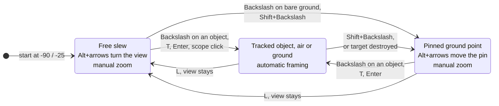
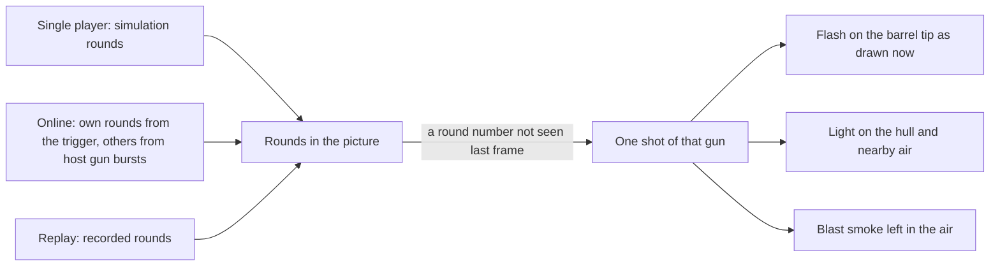
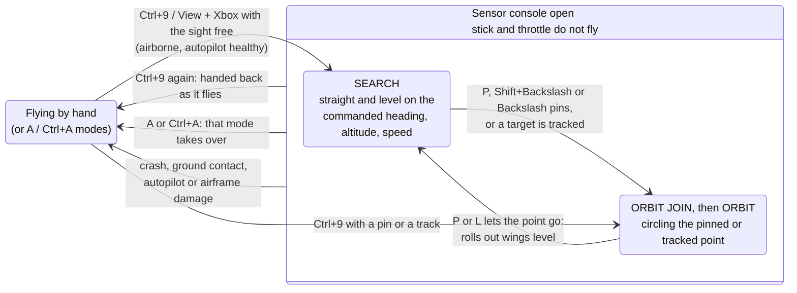

# AC-130 directed guns and linked firing

> **T.O.R.E: Tasteful Opinionated Reverse Engineered.**
> The thing being reverse engineered is the *experience*, not the executable. We
> trace what a player does and what the game does back, down to the numbers they
> would notice. How the original code achieved it is history: useful evidence,
> never a blueprint. If a sentence below reads like an instruction to reproduce
> the original's internals, it is out of date.
> <!-- tore-header v2 -->

Implementation contract, 2026-10-05, extended on 2026-10-09 with the gunsight.
John requested player-selected targets, tracking gun mounts and selectable
linked combinations, then asked for the target camera to become a gunsight with
a pipper, a pinnable ground point, always-on targeting and guns that fire
without a solution. This contract contains source-derived installation and
fitted control/aiming laws. On 2026-10-13 John asked for the sensor console:
the autopilot flies the attack orbit while the player works the guns
([below](#the-sensor-console-and-the-orbit)). The AI gunship's own orbit is in
the [AI strike spec](ai-strike.md#ac-130).

For a player: the AC-130's TARGET CAM page is a gunsight. The camera always
looks somewhere, the three guns follow that point as far as their arcs allow, a
pipper shows where rounds will land, and the trigger always works. The
[target window spec](target-window.md#ac-130-gunsight) covers the page. Retail
has no AC-130 gunsight, sensor slew or ground pin, so none of it claims retail
parity.

- [Selection and controls](#selection-and-controls): the gun group.
- [Fire rates, muzzle velocities and loads](#fire-rates-muzzle-velocities-and-loads): the three guns' real cycles.
- [Tracking and fitted limits](#tracking-and-fitted-limits): arcs, slew, barrels.
- [The gunsight](#the-gunsight): modes, keys, pod track, sensor dome, pipper, aim box.
- [Muzzle flash](#muzzle-flash): flashes, gun light, blast smoke, the 105 tracer.
- [Feedback and shared state](#feedback-and-shared-state): readiness and the network.
- [The sensor console and the orbit](#the-sensor-console-and-the-orbit): orbit hold, its numbers and where they come from.

## Selection and controls

The AC-130 owns three gun slots in the order C_25, C_40, C_105. These correspond
to the reviewed [source stations](../formats/aircraft-variety.md), with each
station's own weapon, ammunition and burst record. Source count is preserved.
Initial firing membership is the first installed gun alone. Ordinary bracket
weapon selection keeps single-gun operation until the player links more than
one member. Once linked, selecting another gun preserves that group. Selecting
NAV or a non-gun station suspends group fire.

Ctrl+7 selects the next installed gun candidate and arms gun mode. Ctrl+8 adds
or removes that candidate from the group. Removing its last member leaves an
empty group and blocks fire rather than choosing another gun. On a standard
gamepad, hold View (Select) and press the D-pad up to choose the next candidate
or down to toggle it. They sat on View plus the right stick until the gunsight
took the stick for slewing (John, 2026-10-09). Group actions are meaningful only
on AC-130; on the AC-130 the D-pad's range-reset and damage-test uses are off.
Existing combat buttons and left-stick cyclic remain available. These keys and
gestures are agent decisions dated 2026-10-05, moved on 2026-10-09.
The keys work in every flight with an AC-130 as the player's aircraft: Quick
Mission, campaign and mission files, and a multiplayer flight (the server
applies them), and a replay shows the link. They are gameplay commands, not
range fixtures, and do not need `--live-fire`. A regression on 2026-10-09 let
the world refuse them outside the range; the fix is in
`world/commands.rs` (`works_outside_range`) and the tests are in
`world/gun_link_tests.rs`.

The ordinary Fire action releases every enabled gun that has ammunition, is not
failed or lost, and whose own airframe is not in the line of fire. It needs no
ballistic solution: with no target held, a pinned point, a point out of arc or
beyond maximum range, terrain in the way, or the barrels still slewing, the
rounds leave along the actual barrels wherever they point. Those states are
advisory labels on the status line, not blocks. Only SAFE (NAV or an
unarmed selection), LAUNCHER LOST, STATION FAILED, EMPTY, the projectile limit,
an empty group and NO LINE OF FIRE (the gun's own airframe) stop a gun. Eligible
guns begin on the same fixed tick of a new trigger press; thereafter each retains
its own source cadence, ammunition and physical-round scheduling. A blocked or
empty gun does not prevent another member from firing. Trigger release clears
pending rounds for all guns. Group changes also release pending rounds. Restart
recreates initial membership and neutral mount angles.

## Fire rates, muzzle velocities and loads

Retail gives the three guns one generic record, so the 105 fired 480 rounds a
minute and the 25 and 40 fired 1,920, all at 2,933 feet a second. John asked
(2026-10-09) for realistic rates and muzzle velocities. TORE overrides the
burst and speed fields of these three records (`C_25.JT`, `C_40.JT`,
`C_105.JT`) when it loads them, and no other weapon: `gunship::apply_tore_record`,
called where the combat configuration and a mission loadout read a weapon.
Provenance: **opinionated (John, 2026-10-09)**, figures from the real AC-130U.

| Gun | Retail rate | TORE rate | Round every | Retail muzzle | TORE muzzle | Loaded | Real AC-130U load |
| --- | ---: | ---: | ---: | ---: | ---: | ---: | ---: |
| 25 mm GAU-12/U | 1,920 a minute | 1,800 a minute | 0.033 s (4 ticks) | 2,933 ft/s | 3,450 ft/s | 3,000 | about 3,000 |
| 40 mm L/60 Bofors | 1,920 a minute | 100 a minute | 0.6 s (72 ticks) | 2,933 ft/s | 2,870 ft/s | 1,000 | 256 |
| 105 mm M102 | 480 a minute | 10 a minute | 6 s (720 ticks) | 2,933 ft/s | 1,620 ft/s | 500 | about 100 |

Loads were not changed. A held trigger fires the first round at once and then
one round per interval, each gun on its own cycle, so linked guns drift apart
as they always did. A fresh press never beats the cycle: the deadline of the
next round survives a release, so tapping the trigger fires no faster than
holding it (checked at ten taps a second). A gun held back for a moment
(NO LINE OF FIRE) waits at most a quarter second after the block lifts, however
slow its cycle.

How the record expresses it: a burst of `gameRoundsInBurst` x
`actualRoundsPerGame` rounds takes `gameBurstT` quarter seconds, so the 25 is
15 x 2 rounds in 1 s, the 40 is 5 x 2 in 6 s and the 105 is 1 x 2 in 12 s.
`actualRoundsPerGame` stays 2, so every round carries the damage it did.

Muzzle velocity is the record's `initialSpeed`; the maximum and final speeds
follow it (the final speed is half the muzzle velocity, as in retail). A round
loses only 7 ft/s every second in this record, so the figures hold over its
10 second life. The 105's slowest round reaches the 13,000 foot sight limit in
about 8 seconds, so the life was not changed. The pipper and the AI both read
the speed from the record, so the lead and drop follow it (the pinned orbit
puts all 319 rounds, the 105's included, within 54.3 feet of the pin).

**Tracers.** Every round of a gun slower than four rounds a second carries a
tracer ribbon (the 40 and the 105); the 25 keeps one round in three, as every
retail gun does. A drawing layer can recognise the 105 by the projectile's
weapon, `C_105.JT` (`ProjectilePose::weapon`).

**Damage.** The cycle changes damage per second, not damage per hit. At the
retail damage figures a 105 round (damage 150 over the gun scale of 3 and 2
rounds per game round, 25 per hit) at 10 a minute delivers about a fiftieth of
what it did at 480 a minute. John has not asked for a damage pass; it is the
obvious next balance question.

**Readout.** The gun status line has no cycling state. `Ownship::gun_ready_in`
gives the ticks until a gun's next round may leave, 0 when ready, as the hook
for a "ready in" indicator beside the 105 in the gun list; nothing displays it.

**AI.** An AI AC-130 takes the same record. Its gunnery fires in half-second
bursts with half-second recoveries and keeps the record's cadence between them,
so a 105 fires every 6 seconds (720 ticks is a whole number of its 120 tick
burst and recovery cycles) and the queue never grows: nothing waits and no rounds are banked.

## Tracking and fitted limits

The guns train on the gunsight's aim point (below) every tick, in every sight
mode, with or without a target. A tracked object is aimed at with its true
position and velocity through the shared gun ballistics solver, including the
weapon's own speed, drop and available life; a pinned or free-slew ground point
is aimed at the same way with no velocity. When the solver finds no solution
(the point is beyond the rounds' reach) the guns still point along the plain
line to the aim point and report MAX RANGE. Firing does not need READY.
The launch direction follows the actual slewed mount. Projectile dispersion
retains the existing fitted 0.25-degree cone. Gun firing range is 0 through 13,000 feet for all three installed records,
using each weapon's source range rather than its longer projectile life.

The source headings establish left-facing neutral orientation at -90 degrees,
with neutral elevation 0. Source arc scalars are converted using the established
65520-angle-unit circle. Their meaning as half-widths rather than total widths
is an explicit fitted interpretation, because the original arc consumer has
not been established. Shipped limits are:

| Gun | Heading range | Elevation range |
| --- | --- | --- |
| C_25 | -150 to -30 degrees | -60 to +60 degrees |
| C_40 | -135 to -45 degrees | -45 to +45 degrees |
| C_105 | -115 to -65 degrees | -45 to +45 degrees |

Both heading and elevation slew at a fitted 30 degrees/second, independently,
at 120 Hz. A gun within a fitted 1-degree error of both desired angles reports ready;
otherwise it reads SLEWING, and it fires either way.
A demand beyond an arc is clamped for visible movement and marked CANNOT BEAR;
the gun fires along the arc limit. Every accepted direction points outward on
the left side; right-facing directions are rejected. Terrain between muzzle and
aim point reads TERRAIN MASK and does not block fire: the rounds meet the
terrain. There is no hidden path through the aircraft to keep
a group synchronized.

Projectile origins and animated barrels share fitted pivots and tips selected
from the original barrel mesh. Source X/right, Y/forward, Z/up units convert to
host feet at 2/3 scale, with host mount order right/up/forward. Raw PT offsets
are not used for this feature because the existing conversion does not align
with the visible barrels.

| Gun | Fitted source pivot | Source tip used to set barrel length |
| --- | --- | --- |
| C_25 | (-9.5, 29, -12) | (-16.5, 28, -14) |
| C_40 | (-11, -7, -11) | (-18, -7, -14) |
| C_105 | (-9, -25, -11.5) | (-21.5, -25, -14.5) |

The actual muzzle is the pivot plus barrel length along actual aim. The barrel
mesh follows the shortest rotation from its source tip-pivot vector to that
same direction. A conservative fitted left-skin plane at local right=-8 feet
blocks a release if its posed muzzle remains inward of that plane. Forward ray
checks also reject the conservative fitted source boxes: left wing
X=-99..-11, Y=-25..1, Z=5..7; inner nacelle X=-33..-18, Y=-25..19,
Z=-6..11; outer nacelle X=-59..-44 with the same Y/Z limits. The wing geometry
lies at source Z=6; the two-unit box thickness is fitted. These checks avoid
upward firing through the wing or nacelles. They can reject a shot that narrowly
clears the detailed original surface, because the boxes are conservative.
This also
blocks some combined extreme heading/elevation demands of C_25 despite their
individual arc limits. Feedback is NO LINE OF FIRE. Geometry hinges and
clearance are agent choices from the reviewed mesh, not original motion
consumers.

## The gunsight

Opinionated (John, 2026-10-09) unless marked. The AC-130's camera line of sight
is fixed-tick sim state, so single player, the multiplayer host and a restored
checkpoint all hold the same sight. It has three modes:

| Mode | Line of sight | Aim point |
| --- | --- | --- |
| Free slew | Body-relative heading and elevation the pilot slews | Where the line meets the ground; with no ground (sky), a point along it at the longest installed gun range (13,000 feet) |
| Pinned | Toward a fixed world ground point; slewing moves the point | The pin |
| Tracked | Toward an object, air or ground, at any range | The object, with lead |

How the sight moves between the modes:

In free slew with nothing held, L travels back to the default -90 / -25 at slew
speed. Backslash, T or Enter on another object while tracking switches to that
object. Whatever the mode, the guns train on the aim point inside their own arcs.

- **Default view**: free slew at heading -90 degrees (abeam left) and elevation
  -25 degrees in the aircraft's own frame, zoom step 3. It is inside every
  gun's arc and clear of the airframe at any bank. Mission start, restart and
  respawn begin there; the guns start neutral and reach it in under a second.
- **Slew**: the seat sends a normalized deflection (-127 to 127, x right, y up)
  and its zoom step (1 to 6) with every tick's input; the host integrates the
  look at 120 Hz. Full deflection turns 0.75 of the camera's vertical field of
  view a second across the screen (the heading rate is divided by the cosine of
  elevation, floored at a quarter): 22.5 degrees a second at step 1 down to
  0.7 at step 6. Heading wraps through a full turn; elevation is held inside
  the camera's gimbal (below) and stops at 89 degrees down (fitted: avoids the
  straight-down singularity). The zoom ladder is 30 degrees tall at step 1
  and halves each step (fitted, agent choice). Slewing while tracking does
  nothing and raises a one-off "L to drop" notice.
- **Backslash** (designate): the object nearest the line of sight within the
  pipper circle's angular radius (9/114 of the vertical field, 0.6 degrees at
  step 3), then the nearest, then the lowest id, is tracked; friendlies,
  destroyed and terrain-masked objects are skipped (agent choice). With no such
  object the ground under the crosshair is pinned. While tracking, Backslash
  keeps the track.
- **Shift+Backslash** (pin): the ground under the crosshair is pinned, also from
  a track (under a ground target, behind an air target). With no ground on the
  line of sight nothing changes and a one-off "no ground point" notice is
  raised.
- **L** (or `;`) drops a target or pin and slews freely from the current view.
  With nothing held, L travels back to the default view at 22.5 degrees a
  second, the fastest sight slew, whatever the zoom; it never snaps (John,
  2026-10-09; the rate is an agent choice). A slew on the way takes over.
- **Pod track**: on the AC-130, T, Shift+T, Enter and a scope click also start
  a sight track, and the radar selection follows the sight (it is set when the
  radar holds the object and cleared otherwise), so the HUD, the scope and the
  guns never disagree. A track ends only on L, a new designation, or the
  object's destruction or removal; the sight then pins the ground under its
  line of sight, so the pilot sees the hit.
- **Always-on Easy targeting**: the AC-130 has Easy targeting's effects
  whatever the session cheat says, including in multiplayer with cheats off,
  because the sight is the aircraft's sensor. Its target camera and HUD square
  follow the sight's track, ground objects included. Other aircraft are
  unchanged.
- **Sensor dome D and the gimbal** (opinionated, John, 2026-10-09). The camera
  looks from the round sensor turret under the left side of the fuselage, just
  forward of the wing root, not from the aircraft's centre. In the model it
  sits in the left belly fairing at source (-13.5, 11, -15.5), 9.0 feet left,
  10.3 feet below and 7.3 feet ahead of the aircraft's origin (fitted from the
  mesh and John's reference photo; `gunship::eye` and `gunship::eye_position`).
  Every sight ray starts there: the camera, the ground under the crosshair
  (Backslash, Shift+Backslash, free slew), the pick's terrain-mask test and the
  auto-pin after a kill. The guns still fire from their own pivots at the
  point those rays find.
  The camera's gimbal is the hemisphere below the aircraft: elevation from the
  aircraft's horizontal plane (0 degrees) down through straight down (held at
  89 degrees), heading free across the whole turn. Slewing up stops at the
  horizon and raises GIMBAL LIMIT (`Notice::GimbalLimit`) every tick the
  pilot pushes against it. A tracked object or a pin above the hemisphere (a
  banked aircraft's far side, high ground) leaves the camera stopped at the
  limit, still looking as near as it can, with GIMBAL LIMIT raised; the aim
  point stays on the true object or pin, so the guns train on it within their
  own arcs. The page shows
  the limit as an eye icon and the words GIMBAL LIMIT. The icon is a hand-drawn
  9 x 5 pixel eyeball (John's pick over the text `<o>`, which stays behind a
  one-line switch; [target window spec](target-window.md#ac-130-gunsight)). A pin above the hemisphere can be slewed down but not further up.
  The default view is inside the hemisphere. The boundary is a plain 0
  degrees: ray casts from the dome through the model (AC130.SH, all faces)
  show nothing blocking the horizon over the left half or ahead and astern,
  and only the belly across the right side, 3 to 7 degrees below the horizon
  from azimuth 15 to 165 degrees right of the nose (the real turret ball hangs
  below the skin, so this depends on how far it is placed). The wing (source
  Z 6) and nacelles (Z -6 and up) lie 20 and 9 units above the horizon plane
  and never block below it.
- The line of sight meets the ground by marching in steps of half the height
  above the ground (16 to 1,000 feet) out to 40 nmi, then halving the last
  step twenty times (fitted). Terrain within 25 feet of a point does not mask
  it, so a ground point is not masked by the ground it lies on (fitted).

### Keys

All opinionated (John, 2026-10-09, accepted from the plan's recommendations).
The gunsight is the AC-130's case of the targeting sight that every aircraft
with a laser designator or a FLIR has since the air-to-ground round
([the targeting sight](air-to-ground.md#the-targeting-sight)): the same keys
drive it there, and the code is shared (`tore_sim::combat::sight`), with the
AC-130's behaviour unchanged. An aircraft with no sight says "no targeting sight"
for Backslash, Shift+Backslash and the zoom keys.

| Action | Keyboard | Gamepad |
| --- | --- | --- |
| Designate under the crosshair (object, else ground) | Backslash | View + A, tapped |
| Pin the ground under the crosshair | Shift+Backslash | View + A, held half a second |
| Drop the target or pin; again, back to the default view | L or ; | View + B |
| Slew the sight | Alt + arrows (or Alt + keypad 4, 6, 8, 2) | View + right stick |
| Zoom in / out | Shift+' / Shift+; | none |
| Next gun candidate / link or unlink it | Ctrl+7 / Ctrl+8 | View + D-pad up / down |
| Open or close the sensor console (orbit hold) | Ctrl+9 | View + Xbox |
| In the console: picture white hot, black hot, TV, night vision | Ctrl+Backslash | none |
| In the console: radar range 5, 10, 25 nm | Ctrl+0 | none |
| In the console: next / previous radar target the sensor sees, zoomed to fill | T / Shift+T | as T |
| Live-fire range reset (developer fixture) | Ctrl+Shift+Backslash | none |

Backslash kept its retail meaning, "designate the object nearest the centre".
The live-fire range reset used to sit on it and now follows the placement rule
"kept its letter and gained Ctrl+Shift". A held slew key starts at a quarter of
full deflection for a quarter second so a short press nudges, then runs at full
rate; a stick is proportional. [Input guide](../INPUT.md#ac-130-gunsight-controls).

### The pipper

The pipper is where rounds from a gun at its actual train land. Each tick the
sim marches the same trajectory the round will fly (launch speed, drop, service
cadence, round life) from the posed muzzle along the actual barrel, for the
candidate gun and every linked gun (`gunship_impact::impact`).

- **Ground, pin or free point**: where the trajectory meets the terrain.
- **Air target**: where the round is when it reaches the target's range, minus
  the target's velocity times the flight time, so correctly led guns put the
  pipper on the target.
- **Spent**: rounds that expire (the record's 10 seconds) before reaching anything
  report no impact; the page shows MAX RANGE.

Against rounds fired through the combat step the pipper's centre line misses by
under 0.1 foot; real rounds scatter inside the fitted 0.25-degree cone (about
20 feet at 4,500 feet), which the pipper does not show. Rounds hitting objects
or the aircraft are not modelled. The march limits are agent choices. The page
draws each pipper as the fighter HUD's LCOS ring and dot; the candidate's ring
carries a range arc scaled to the gun's 13,000 foot maximum, the other linked
guns a small diamond. How the page draws the states is in the
[target window spec](target-window.md#ac-130-gunsight).

### The aim box on every view

Opinionated (John, 2026-10-09: a box on any view at any time, marking the
target or point of aim, in the style of Easy targeting). It is presentation
only and reads the readout the same way in single player and online.

- **The box** marks the aim point: a square on a tracked object (with the
  friendly X on a friendly), a square with a centre dot on a pin, corner
  brackets on a free-slew point. It is always drawn on the AC-130.
- **The diamond** marks where the guns will actually hit, only when that
  differs from the box: the candidate gun (else the lowest linked gun with a
  pipper) reads SLEWING, CANNOT BEAR, MAX RANGE or MIN RANGE, and the diamond
  is more than one box width from the box.
- **Where**: inside the HUD's square region the HUD draws it; elsewhere in the
  cockpit and in every external, chase and padlock view a floating square
  (while the HUD toggle is on, Shift+U hides it with the rest); the Front View
  and Other View pages draw a 7 pixel square. A box off the screen becomes an
  edge arrow, in the HUD's shape and drawn twice as large on full-screen views,
  sliding in along its ray to stay clear of the instrument windows. Floating
  marks paint only where the canvas is clear, so an instrument window can hide
  one (as it hides Easy targeting's square today). The target camera page is
  the gunsight itself and draws neither. A mission replay has no HUD and shows
  nothing.
- The HUD square covers about 18 degrees either side of the nose and the guns'
  arcs start 30 degrees off it, so a box inside the HUD always comes with the
  diamond.

## Muzzle flash

Opinionated (John, 2026-10-09: "some sort of muzzle flash ... and some
illumination when firing"). Every number below is an agent choice. It is
presentation only: nothing here reaches the simulation, the wire, a checkpoint
or a recording, so determinism and the golden fingerprints are untouched.

**When a gun flashes.** Each round a gun lets go flashes once, so the flash
follows whatever fire rate the gun has. The signal is a gunship round that is
new in the picture: single player sees the simulation's own rounds, a networked
client sees the rounds it makes again (its own linked guns from its trigger,
other players' AC-130s from the host's gun bursts), and a replay sees its
recorded rounds. All three keep a round's
number for its whole flight, so no new wire field or recording field is needed.
A replay seek, a restart or a stall of more than two seconds starts afresh
without flashing the rounds already in the air.

**The flash** sits on the barrel tip as the barrel is drawn this frame, along
the barrel, so it stays on the gun while the aircraft flies on and turns with
the barrel. It is a flat sprite with hard edges in three bands (a white-hot
heart, yellow, an orange rim) and no soft halo or glare, in the manner of the
original's explosion sheets. It covers what lies behind it rather than adding
light, so the orange holds against a bright sky. A plume reaches out along the
barrel with a jagged edge; a burst of four to six petals opens when the barrel
points toward or away from the eye. It is never drawn smaller than about two
pixels, so a firing gunship twinkles at a distance. It is drawn in every world
view, the gunsight camera's included, wherever the barrel tip is in frame; the
gunsight camera hangs under the belly forward of the guns, so in its default
view (90 degrees left, 25 degrees down) the flash is out of frame and shows
only when the camera looks aft along the side.

| Gun | Flash | Reach | Peak light | Smoke |
| --- | --- | --- | --- | --- |
| 25 mm | Flickers in size and brightness every tick; a shot lasts until the next is due at the cadence the gun is firing at (any gap up to 30 ticks), so a held trigger reads as one continuous flicker | 5 ft | 60 | none |
| 40 mm | A distinct pop each round, 9 ticks, full at once then fading | 9 ft | 130 | one puff, 2.5 to 9 ft, 1.5 s |
| 105 mm | A big flash held 2 ticks, gone by 16 ticks (0.13 s), growing as it fades | 20 ft | 240 | three puffs, 4 to 20 ft, 3 s |

As a flash dies its white heart shrinks first, then the yellow, and the orange
rim draws in last.

**The light** is a warm point light 30 percent of the way out along the flash,
of the same kind as a burning flare's ([flare light](countermeasures.md#flare-light)):
inverse square, no shadows, out to 1,500 feet, counting up to four times as
much at night. Its strength is in the flare's units, feet squared: the 105's
240 lights a facing panel 10 feet away about twice as brightly as full sun at
its peak, then fades with the flash. So the fuselage side, the left wing's
underside and the nacelles light up near the guns, strongly at night and dusk
and subtly by day, along with nearby smoke, clouds and any terrain or aircraft
within reach. The 105 gives one strong pulse, the 25 mm a flickering glow
while the trigger is held. Like flare light it needs the smooth lighting mode;
the original-graphics mode keeps its palette lighting.

**Blast smoke.** The 40 mm and 105 mm leave the original white smoke puff in
the air: blown out along the barrel, slowed at once, then left where the air
took it, so it drifts aft of the gunship as it flies on, swelling and fading.

**The 105 mm tracer** is drawn half as bright again as any other gun's tracer
(John, 2026-10-09) and 1.75 times as wide (John asked for 1.5 to 2 times on
2026-10-10; 1.75 is an agent choice, opinionated: the ordinary ribbon is 2.4 feet
across, the 105's 4.2). Its length is the round's one tick of flight, as for
every tracer. The rules key on the round's weapon record (C_105.JT), so they
apply to every 105 round the simulation marks as a tracer. At gunship ranges
(thousands of feet) any of the three tracers is under a pixel wide on the
138 x 114 target camera page; the extra width shows in the outside views and
the nearer sight ranges, and does not make a thin tracer at 6,000 feet more
than a faint dot.

**The 25 mm flickers.** It never holds a steady glow (John, 2026-10-10): its
size and brightness change every tick while the trigger is held, as the table
says.

**The target camera blooms on a 105 mm shot.** When the player's own 105 fires,
the sensor picture on the TARGET CAM page whites out and recovers (John asked
for a brief bloom or whiteout pulse, 2026-10-10; the numbers are agent choices,
opinionated). The picture is lifted toward white by 90 percent at its middle and
54 percent at its corners, held for 4 ticks (a thirtieth of a second), then
eased away to nothing at 40 ticks (a third of a second): about 70 percent at 8
ticks, 28 percent at 20 ticks and under 7 percent at 30 ticks. The page's text,
pipper, range arc and gun boxes are drawn over it and stay readable throughout.
Only the player's own 105 shots do it, in single player and in a multiplayer
flight, and the other two calibres do not. A second shot restarts it.
`gun_flash::BLOOM` holds every number. `--target-cam-preview bloomN` draws the
page N ticks after a shot and `--gun-flash-preview` saves page-sized stills of
the same pulse through the real sight camera.

No graphics option turns this off, as none turns flare light off.

## Feedback and shared state

The input page exposes the two group actions with AC-130 applicability. A group
label shows each included cannon and the current candidate. Weapon readiness
reports NO TARGET, CANNOT BEAR, SLEWING, MAX RANGE, MIN RANGE, NO LINE OF FIRE
(the gun's own airframe), TERRAIN MASK (terrain between muzzle and aim point),
EMPTY or GROUP EMPTY as applicable. The selected candidate's reason, blocking or
advisory, remains visible even when another group member is ready; every
member fires independently unless it is itself blocked.
The status line shows the advisory states only to tell the pilot a shot is not
solved; none of them holds the trigger.

**Readiness split.** NO LINE OF FIRE is the gun's own airframe (the fitted
boxes above) and blocks. TERRAIN MASK, terrain between muzzle and aim point,
is advisory. The status order puts the airframe check first, so it shows even
when the aim is also out of arc or range; a gun slewing through the blocked
region reads NO LINE OF FIRE for those ticks and fires on the clear ticks
either side. `Readiness::gun_may_fire` is the one place the rule lives.

**Multiplayer** (protocol 21, [wire](../formats/net-protocol.md#the-gunsight)).
The host owns the whole sight, so a seat sends only its slew deflection, zoom
step and the two sight commands, and the host's combat step does everything
else; a standby replays it bit for bit. The owner's readout carries the sight,
look, aim point, pippers and per-gun status. The client turns its own copy of
the camera from its own inputs for a smooth view and corrects to the host's
look (snapping past a tenth of the field of view); the pipper, gun marks and
status are the host's, a round trip late, like the barrels. Other players see
the barrels follow the sight through the entity's gun devices (protocol 18).
The always-on targeting applies even when the King turns cheats off.

**Rounds online** (gunsight slice G5, agent decisions). The host sends no
rounds, only gun bursts, so every client makes the rounds again
([architecture](../ARCHITECTURE.md#the-client-session)). An AC-130's round leaves the
tip of its barrel along the barrel, with the train the client draws it with,
exactly as the host fires it (`gunship::muzzle`, `gunship::direction`, the
gun's own muzzle velocity); it never leaves along the nose. The seat's own
linked guns all fire at once from its trigger, each on its own cadence, with
the readout's gun group, each gun's may-fire rule (READY or advisory) and its
rounds; another player's AC-130 fires from its burst events with the train its
pose was drawn with at each round's release tick. Since protocol 21 the six
gun angles travel at 1/32,767 of their unit (16 bits) in the entity's devices
and the owner's readout. At the old 1/127 a remade stream landed a steady 50
to 70 feet from the host's at a 6,000-foot slant (up to 0.7 degrees of train),
more than two draws of the guns' own spread differ; at 1/32,767 it lands as
the host's does (measured in `net::guns` tests: mean miss between a client's
round and the host's 27 to 35 feet, all of it spread, and the two streams'
centres within 2 to 22 feet, the same as with the host's exact train). A
readout a round trip late changes nothing while the guns hold a train, as they
do in an orbit; while they slew, the seat's rounds leave the barrels as drawn,
a round trip behind the host's.

Host, clients and replay receive actual heading/elevation and membership. The
six angle values use slot order C_25, C_40, C_105 and interleaved heading/elevation;
heading is divided by pi, elevation by pi/2 for bounded presentation transport
(1/32,767 steps on the wire since protocol 21; replays keep 1/127, which only
draws the barrels, because a replay records its rounds).
Membership is a separate three-bit mask. Tracking state is fixed-tick owned;
local animation does not choose the target or decide whether a gun can fire.

## The sensor console and the orbit

Opinionated (John, 2026-10-13: "an AI autopilot mode that circles the plane at
least the minimum optimum altitude and radius for attacking where the
targeting pod is centered, making smooth flight adjustments to keep the
optics, and all three guns available to bear"; then "the console mode just
automatically has the plane go into optimal circle AI mode"). The search, the
pin and release and the console's keys are opinionated too (John,
2026-10-14: "in console it needs slew controls. In console it needs zoom
controls. The console needs a view snap/release similar to the flight target
instrument: in release mode show a status that the view isn't pinned and the
autopilot just flies straight as a search mode; pinning will tell autopilot
to gracefully circle that point of aim; unpinned the aircraft just flies
straight. Maybe have keys to tell the aircraft heading, altitude, and control
throttle"). Parts marked *agent* are agent decisions of 2026-10-13 (the
orbit) or 2026-10-14 (the search and the keys, slice nr-cona). Retail has
none of it.

**What the player does.** On the AC-130, Ctrl+9 (gamepad View + Xbox) opens the
sensor console: the autopilot takes the aircraft and the player works the
sight and the guns (slew, pin, designate, zoom, select, link, fire) without
flying. With the sight free the autopilot **searches**: it flies straight and
level on a commanded heading, altitude and speed, which the console's keys
step. Pinning a point (P, Shift+Backslash, Backslash) or tracking an object
makes it **orbit**: it joins and circles that point. Letting the point go (P
again, or L) returns it to the search, rolling out wings level. The full-screen
black and white sensor screen is a separate presentation slice (nr-fltv, with
nr-conb's additions) that draws while the console is open; the TARGET CAM
gunsight page is unchanged. The HUD's autopilot label reads `AUTO` / `SEARCH`
or `AUTO` / `ORBIT`. Ctrl+9 again closes the console. Any other aircraft says
"No sensor console on this aircraft".

**Which point** (*agent*):

| The sight holds | The orbit circles |
| --- | --- |
| A pin | The pin. A new pin (Shift+Backslash, Backslash on bare ground, a slew of the pin) moves the orbit to it |
| A tracked object, ground or air | The ground under the object, followed as it moves |
| Nothing (free slew), when the console opens or after P or L | Nothing: the autopilot searches (below). Until 2026-10-14 the console pinned the ground under the crosshair as it opened and kept the last point after L; John's request replaced both |

The centre the autopilot flies about slides toward a new point at 200 ft/s
(about 120 kt, faster than any ground vehicle), so a pin moved miles away
becomes a gentle turn, never a snap (*agent*, fitted).

Joining from the search, the orbit's centre is the new point at once; the
bank and climb commands' slews (below) make the join a gentle turn.

**Controls in the console** (*agent*). The stick, pedals and throttle do not
fly the aircraft while the console is open: a bumped stick neither moves the
aircraft nor drops the player out (the other autopilot modes let go at 0.15
of stick; this one does not). A or Ctrl+A select those modes and close the
console. On closing, the autopilot lets go and the aircraft is handed back
exactly as it flies, in its bank and with the throttle the autopilot left, so
nothing jumps; the pilot rolls out by hand. The console refuses to open on
the ground, after a crash, or with the autopilot's systems or the airframe
damaged, with a message.

### The console's keys

Opinionated (John, 2026-10-14, above). Since the stick does not fly in the
console, the flight controls take console meanings there; the gunsight's own
keys keep working everywhere (*agent*: which keys, the steps and the
repeats):

| Key (gamepad, joystick, mouse) | In the console |
| --- | --- |
| Arrows; the stick (left stick); the mouse with the right button held (mouse look) | Slew the sight, as Alt+arrows and View + right stick do. The arrows ramp like Alt+arrows (a quarter rate for a quarter second, then full); the mouse slews one field of view per 1,000 pixels at sensitivity 1, at most at the full slew rate. Up slews up |
| Mouse wheel, = and - | Zoom the sight one step, as Shift+' and Shift+; do |
| P | Pin the ground under the crosshair (ORBIT); with a pin or a track, let it go (SEARCH). Outside the console P pins and releases the gunsight too |
| Shift+Left and Shift+Right (the look keys; the look axes, a gamepad's right stick) | Step the search heading 5 degrees. In the orbit they do nothing and say so |
| Shift+Up and Shift+Down | Step the search altitude 500 ft (on whole 500 ft), within 1,000 to 25,000 ft above sea level; in the orbit, its height above the point 500 ft, from the camera's lowest (35 degrees of depression at its radius) to the guns' highest (a slant range of 90% of their reach: about 8,000 ft at the planned radius) |
| 1 to 5 | The speed at 0, 25, 50, 75 and 100% of the band from corner to maximum speed at the aircraft's height; 3 is the orbit's planned speed |
| 6 | The top of the band |
| 7 and 8 | The speed 5 kt slower or faster (on whole 5 kt) |
| Shift+P | The gun lock, on and off ([below](#the-gun-lock)) |
| Ctrl+Insert / Ctrl+Delete | Chaff / flare: the console's own countermeasure actions, bound apart from Insert and Delete so a player can move them on their own (John, 2026-10-14; keys *agent*). They work outside the console too, on the same dispensers |

**The gamepad in the console** (John, 2026-10-14, his layout). While the
console is open the layout owns the whole gamepad, whatever the player's
profile: every other binding of the gamepad (buttons, D-pad, both sticks and
both triggers) stands aside, except menu navigation, Start (pause) and Xbox
(the flight menu). The triggers do nothing in the console (*agent*). A
console action the player bound on the gamepad themselves wins over the
layout's. Closed, the flight layout is back. The flight meanings listed are
the stock ones; on a player's own profile theirs stand aside the same way.

| Gamepad | In the console | Flight meaning it replaces |
| --- | --- | --- |
| View + Xbox | Open and close the console | (the same) |
| Left stick | Slew the sight | Pitch and roll |
| Left stick press (L3) | Pin or release (ORBIT or SEARCH) | Front view |
| Right stick left / right | Step the search heading | Look |
| Right stick up / down | Step the altitude, or the orbit's height | Look |
| D-pad up / down | Speed up / down 5 kt | Instrument controls 1 and 2 |
| A (held) | Fire | Gear |
| Y | Next target (`designate`, T) | Afterburner |
| View + Y | Drop the target (`clear-designation`, L) | Jammer |
| View + D-pad right | Previous target (`designate-previous`, Shift+T) | Flare |
| X | Select gun: the next candidate (Ctrl+7) | Flaps |
| B | Link gun: link or unlink the candidate (Ctrl+8) | Airbrake |
| LB / RB | Zoom out / in | Throttle down / up |
| D-pad right | Sensor radar range 5 / 10 / 25 nm (`console-range`, Ctrl+0) | Next instrument page |
| D-pad left | Camera mode: white hot, black hot, TV, night vision (`sight-polarity`, Ctrl+Backslash) | Previous instrument page |
| View + A / View + B | Flare / chaff (`console-flare`, `console-chaff`) | Designate (tap) and pin (held) / clear designation |
| View + right stick press (R3) | Gun lock on and off (`gun-lock`, Shift+P) | Jettison |

The other View chords keep their flight meanings in the console (View + RB
fires, View + right stick slews, View + D-pad up and down pick and link
guns).

A held heading or altitude key steps at once, then repeats after 0.3 s every
0.15 s; a look axis past half deflection counts as held. Each key answers
with a message: "Search heading 275", "Search altitude 9500 ft", "Orbit
height 6500 ft above the point", "Speed 195 kt". While a point is held the
speed stays where the orbit's minimum (the 30 degree turn seen at 35 degrees)
is still within 90% of the guns' reach, about 250 kt; a faster orbit grows its
radius and height to that minimum.

### The search

The search (*agent*, fitted) flies straight and level through the same stick
and throttle as the orbit:

| Part | Rule |
| --- | --- |
| Heading | Opening the console, or letting a point go, takes the aircraft's current heading as the commanded one (John, 2026-10-14: "reset to the aircraft's current heading, speed and altitude"). Released from the orbit's 21 degrees of bank, the roll-out still turns about 4 degrees (g (-ln cos bank) / (v x 5 deg/s)) and the search then turns gently back onto the heading |
| Bank | Toward the commanded heading: the bank whose roll-out at 5 degrees a second turns exactly the error left (cos bank = exp(-error v r / g)), at most 1.5 times the error near the heading and never past 25 degrees; the command moves at most 5 degrees a second. A heading change rolls in, holds the bank, and rolls out onto the heading |
| Altitude | Opening or letting go takes the altitude now (John, 2026-10-14); the climb law is the orbit's (15 s, 1,500 ft/min, 3 ft/s each second), never lower than 1,000 ft above the ground |
| Speed | One commanded speed for the search and the orbit, held on the throttle as the orbit's. Opening the console with the sight free, or letting a point go, takes the current speed (John, 2026-10-14; the opening *agent*, to match); opening on a pin or a track takes the orbit's planned speed. A pin keeps the commanded speed, within the orbit's cap |

**Moving the point** (John, 2026-10-14; thresholds *agent*, fitted):

- A slew of the pin moves the sight's point with it, but the orbit's centre
  stays put while the pin moves and for 5 s after it stops; then the centre
  slides to it at 200 ft/s. So slewing around never drags the aircraft.
- A tracked object is followed at once.
- A point more than 1,000 ft from the last one in a single step (the next
  target, a new pin elsewhere, the guns let go onto a far sight) is a new
  point: the orbit is joined about it at once, as from the search, rather
  than slid to. A full-rate slew at the widest zoom moves a pin some tens of
  feet a step and a ground vehicle a foot or two, so neither counts.
- In the console a slew off a tracked object drops the track to a pin on the
  ground under the object, which the slew then moves (*agent*); outside the
  console a slew while tracking still says L TO DROP.
- The phase reads ORBIT only on the circle about the centre with the centre
  on the point; while the centre waits or slides, or the aircraft is still
  far out, it reads ORBIT JOIN (nr-conb saw ORBIT with the target 5 nm out).

### The gun lock

Opinionated (John, 2026-10-14: "separate guns from sensor slew: pin guns to
target or location, and allow the player to slew away to look for other
targets or for situational awareness"). Shift+P, or View + right stick press
in the console, locks the guns on what the sight holds: its tracked object,
its pin, or the ground under its crosshair. While locked:

- the linked guns stay laid on the locked object (followed as it moves) or
  point, and the trigger fires them there; the sight slews, pins and tracks
  freely;
- the console's orbit circles the locked point, not the sight's;
- the console shows GUNS LOCKED under its autopilot block and a square with a
  diamond where the guns lie (`GunsightReadout::gun_lock`).

Shift+P again, dropping the target (L, P's release), or the locked object's
destruction lets the guns go: they slew back to the sight at their normal
rate, with no snap. It works on the AC-130 inside and outside the console
(*agent*), and online through the console's seat command.

### The orbit

The orbit is the AI gunship's ([AI strike, "AC-130"](ai-strike.md#ac-130),
`tore_sim::ai::strike::gunship::orbit_plan`), planned once when the console
opens from the aircraft's speed limits there and the shortest reach of its
installed guns:

| Rule | Value on the shipped AC-130 | Label |
| --- | --- | --- |
| Direction | Left-hand pylon turn, guns toward the centre | sourced (real gunship tactic, below); spec-derived arcs |
| Slant range to the centre | 80% of the guns' 13,000 ft reach: 10,400 ft | fitted (AI strike) |
| Depression of the centre | 35 degrees | fitted (AI strike) |
| Radius and height above the centre | 8,520 ft and 5,965 ft | fitted (AI strike) |
| Speed | Halfway between corner and maximum: 191 kt at 4,000 to 6,000 ft | retail rule (AI strike) |
| Bank | About 20 to 21 degrees in a steady orbit (measured), never above the AC-130's 30 | measured; retail `maxBank` |

**The minimum** (`Orbit::minimum`, *agent* derivation from the game's own
limits). The centre must be inside the camera's gimbal, inside every gun's
arcs and within reach, and the aircraft out of the guns on the ground:

| Limit | What it needs | Source |
| --- | --- | --- |
| Camera gimbal | The centre below the wing line: depression at least the bank. At the full 30 degrees of bank plus a 5 degree margin, **35 degrees** | gimbal above; margin *agent* |
| Gun elevation | Depression no more than the bank plus 45 degrees (the 40 and 105 mm; the 25 mm has 60): at 35 degrees and 0 to 30 of bank the centre sits 5 to 35 degrees below the wing line | arcs above |
| Gun heading | Abeam left within 25 degrees (the 105 mm). A steady orbit holds the centre abeam; crab in a 40 kt crosswind is under 12 degrees | arcs above |
| Range | Slant range within 13,000 ft (all three guns) | records |
| Turn | Radius at least the turn at the orbit speed and 30 degrees of bank: 5,590 ft at 191 kt | AC-130 `maxBank` |
| Threat | Slant range beyond the 7,500 ft fire range of the anti-aircraft guns at the centre (the M163 and ZSU-23), capped at 90% of the AC-130's own reach so its guns still reach | [surface defenses](surface-defenses.md); cap *agent* |

So the minimum is a radius of the larger of the turn and the threat's
7,500 ft x cos 35 = **6,144 ft**, at 35 degrees: **4,302 ft** above the
centre. The planned orbit (8,520 by 5,965) is above it; were it ever below (a
short-ranged gun), the orbit grows to the minimum at the same depression. The
orbit is never flown lower than 1,000 ft above the ground under the aircraft
(a centre in a deep valley; fitted).

**The real gunship** (for scale, not parity). The AC-130 attacks in a
left-hand pylon turn, the guns on the left side held on one ground point;
the geometry is set by the bank, the speed and the height, with the turn
radius `R = v^2 / (g tan(bank))`, and crews choose these "nominals" for a
wanted slant range (US patent 10,591,254, "Ballistic wind correction to
improve artillery accuracy"; [pylon turn](https://en.wikipedia.org/wiki/Pylon_turn)).
Published figures of 7,000 to 15,000 ft above the ground, 30 to 40 degrees
of bank and about 180 kt come from popular pages and are unverified. The
game's guns reach only 13,000 ft, so the orbit here is lower and closer than
a real AC-130U's; it keeps the real bank-and-speed relationship.

### Flying it

Orbit hold (`tore_sim::autopilot::orbit`, autopilot `Mode::Orbit`) flies
through the same stick and throttle a pilot would, before the flight model
sees them, so the flight model is untouched. All fitted, *agent*:

| Part | Rule |
| --- | --- |
| Bank | The AI's circle law (`orbit_steer`): heading the bearing to the centre plus 90 degrees, less 45 per radius of distance error (45 to 135), the error closed in 4 s plus the orbit's own turn rate, never past 30 degrees. The bank command then moves at most 5 degrees a second, and the stick rolls toward it as the heading autopilot does |
| Height | The orbit's height over the centre; the climb closes the error in 15 s within 1,500 ft/min, and the climb command changes at most 3 ft/s each second; the stick pulls for it as the altitude hold does |
| Speed | The throttle holds the orbit speed (proportional 0.01 and integral 0.002 per ft/s of error, moving at most a fifth of its travel a second) |
| Entry | From anywhere: the same laws turn the aircraft onto the circle and climb or descend to the height. From 3 nm at 4,000 ft the shipped AC-130 is on the orbit in about 60 s |

Measured on the shipped AC-130 (`flight-ac130-orbit-*`,
[baseline](../baselines/ac130-gunsight.md#the-sensor-console-and-the-orbit)):
after entry the aircraft stays 8,150 to 9,150 ft from a standing centre (7,700
following the moving tank) and 5,465 to 5,995 ft above it (the low end while
it is still climbing in), every gun and the camera bear 100% of the time, bank
under 27 degrees, bank rate under 5.1 degrees a second and pitch rate under 2.1, no
stall warning; a pin slewed 4,500 ft and a tank moving 14,000 ft are followed.

**Status for the screens.** `flight::State::console_status()` returns a
`ConsoleStatus` while the console is open: the phase (`SEARCH`, `ORBIT JOIN`
or `ORBIT`), the commanded heading, altitude and speed, the orbit's commanded
height above its point, and, holding a point, the orbit's status.
`flight::State::orbit_status()` returns that `OrbitStatus` while a point is
held: the point and the centre, the
planned radius, height and speed, the minimum radius and height, the current
distance, height and slant range, whether the aircraft is on the circle, and
whether each gun and the camera bear on the point (the plain line from each
gun's pivot against its arcs, its airframe and the reach). The console screen
and the HUD read it; it is the same in single player, on a client and in a
check.

**Online and replays.** Multiplayer needs protocol 29, the search and the
console's keys protocol 30, and the gun lock and the centre's pause the next
one (pending, numbered by the lead). The host owns
it. The console key is a seat command (code 28 on the wire), the console's
keys another (code 29, protocol 30); the host engages the console's autopilot
and, before each flight step, gives it the sight's point, or lets it search
when the sight is free. The orbit's plan and memory ride in the
exact own-plane state, so a client's prediction flies the same law from the
last point it was given and agrees with the host while the point stands
still; following a moving track it differs a little each tick and is
corrected as any prediction is. Wire changes are listed under
[the sensor console](../formats/net-protocol.md#protocol-29-the-sensor-console).
The search's commanded heading, altitude and speed ride in the same exact
state, so a client searches exactly as the host; a key's change reaches the
client's prediction with the host's next exact state (about one round trip).
A mission recording keeps the flight as flown, the autopilot's "orbit mode"
in the flight telemetry, and a `player.orbit` event when the orbit starts
(the console opens on a point, or a point is pinned) or ends (closed, or the
point let go) and when its point moves ([replays](../REPLAYS.md)).

## Acceptance and known limits

Use synthetic gun records and targets to check each single cannon, mixed groups,
first-tick linked releases and distinct subsequent cadence, tracking slew/limits,
target changes/loss, trigger release, empty/failed stations, empty groups and
restart. Check command tapes and replicated actual mount angles/membership.
For the gunsight: the default view inside every arc and clear of the airframe,
exact repeatable slew integration, the pin, drop and return rules, the pick,
the pipper against fired rounds, fire with no solution in every advisory state,
a checkpoint restored mid-slew, a client that slews and pins while a second
client's barrels follow, and the headless battery scenarios `ac130-pin-orbit`,
`ac130-fire-no-target` and `ac130-track-out-of-arc`
([baseline](../baselines/ac130-gunsight.md)); for the sensor console,
`flight-ac130-orbit-pin`, `-slew`, `-track` and `-close`, and for its search
and keys `flight-ac130-console-search`, `-console-pin-release` and
`-console-gun-lock`.
The unavailable retail comparison does not establish retail parity. Original
mount slew, the arc interpretation, gun geometry hinges and muzzle-to-art scale
remain approximate. The next research step is the reviewed bounded hardpoint
arc consumer and explicit source muzzle/shape correspondence.
