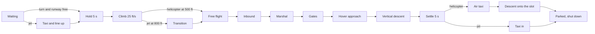

# AI takeoff, landing and return to base

> **T.O.R.E: Tasteful Opinionated Reverse Engineered.**
> The thing being reverse engineered is the *experience*, not the executable. We
> trace what a player does and what the game does back, down to the numbers they
> would notice. How the original code achieved it is history: useful evidence,
> never a blueprint. If a sentence below reads like an instruction to reproduce
> the original's internals, it is out of date.
> <!-- tore-header v2 -->

Implementation mode. AI work requested by John on 2026-09-23. This page says
what a player sees AI aircraft do on and around an airfield, with the numbers.
Retail evidence is the static trace of the takeoff and landing handlers in
[AI source notes](../formats/ai.md#airfield-takeoff-and-landing-sequences) and
the airport anchor roles in
[STRIP notes](../formats/native-strip.md#remaining-template-callback-boundaries).
Nothing here was compared against a running retail copy.

Labels: **spec-derived** (retail handler or manual page), **fitted** (agent
decision, 2026-09-23, where retail is unknown or the hybrid flight model cannot
hold the retail target; the retail value is given alongside), **opinionated**
(named requester and date). Code: `tore-sim::ai::airfield` (the sequence) and
`ai::mission` (the gates between aircraft). Every number is a named constant in
`airfield.rs`.

## Airport anchors

An airport's STRIP shape supplies taxi-out points, a takeoff spot and heading,
a landing point and heading, taxi-back points and nine parking slots. With
anchors the AI uses them exactly as below. Without anchors (a runway known only
by its centre, heading and length) the AI uses the fitted runway-only fallback
described in each section. With the redrawn airports (the default) the points
come from the airport's plan, and since slice CL-AP every runway but the dirt
strips (vertical pads, which no conventional AI uses) has them, second tiles
included ([the AI's points](../formats/redrawn-airports.md#the-ais-points)).

## Short strips

Opinionated, John 2026-09-30. A runway under 2,000 ft (the 22 strips of about
1,074 ft, [short strips](airports.md#short-strips)) is nobody's home runway or
landing field, and no wing starts on one, so no AI aircraft takes off from or
lands at a short strip. A wing ordered to land at the selected airport is refused
one. An aircraft's home is the nearest runway that its side may use and that is
not a short strip.

## Sides

Requested by John, 2026-10-10 (slice AL1). Every airport takes its runway's
layout side ([allegiance](airports.md#allegiance)). An AI aircraft's home
runway, landing field and return point are its own side's or neutral, never
the other side's: Blue aircraft go home to Blue fields and Redfor aircraft to
Red ones. A side with no field in the theater (Blue in North Vietnam and the
Falklands) has no home runway there, so bingo and bug out fall back to the
start point, as for any aircraft without a usable runway. A wing ordered to
land at the selected airport is refused a field hostile to the pilot who gives
the order, and a wing never starts at an enemy field. Neutral fields serve both
sides (agent decision, AL1); no retail field is neutral.

## Quick Mission taxiway queue

John requested on 2026-09-23 that Quick Mission wingmen begin queued near the
runway. [Placement and distances](quick-mission-menu.md#player-ground-start)
use the taxi-out anchors. Queued aircraft resume their current taxi leg,
never drive back through the parking route, and always require a clear runway,
including within 475 ft of the takeoff spot. A queued aircraft taxis its legs
out even when it waits within 475 ft of the spot, never skipping them by the
shortcut below (fitted, agent decision, slice CL-AP 2026-10-11: the fourth of
a wing waits on the parallel taxiway abeam the spot and went straight to its
takeoff roll from there, on the taxiway). Their taxi and line-up occupy the
runway gate until liftoff. Parking starts retain the recovered sequence below.

## Takeoff from the ground

- **Hold** (spec-derived, retail state 1): stopped, brakes set, gear down,
  takeoff flaps down, idle. The gates below are re-tested on entry and then
  every 5 seconds.
- **Turn gate** (spec-derived, manual p.209: one at a time, leader first):
  every earlier member of the wing must be past its first taxiway leg. When a
  human leads the wing, AI wingmen also wait while the player is on the ground,
  so they stay parked until the player is airborne. A human leader who never
  takes off keeps them waiting.
- **Runway-free gate** (spec-derived): no other aircraft at the airport is on
  the ground within 125 ft of the takeoff spot, rolling for takeoff (the player
  counts as rolling from 7 ft/s), lining up, taxiing its first two legs, flying
  the approach gates or final, or rolling out. Climbing out, holding at marshal,
  taxiing clear and parked aircraft do not block. With anchors, an aircraft
  already within 475 ft of the takeoff spot needs only the turn gate.
- **No timed interval** (spec-derived): spacing comes only from the two gates
  and the 5 second re-test. An eligible wingman starts within
  5 seconds of the gates clearing. Taxi distance and other aircraft still
  occupying the runway can make liftoff gaps much longer.
- **Taxi out** (spec-derived): at 50 ft/s (30 kt) to taxi-out point 0, stopping
  there, then on to points 1, 2 and 3; a leg ends within 50 ft of the line
  through its point running back along the reversed runway heading, or within
  475 ft of the takeoff spot. Retail pivots a stopped aircraft toward the next
  point. The hybrid ground model cannot turn a stopped aircraft, so it creeps
  round at 12.5 ft/s instead (fitted). How it steers along a leg is below
  ([taxiing on the pavement](#taxiing-on-the-pavement)).
- **Line up** (spec-derived): aim at the centerline point 50 ft closer than the
  current distance to the spot, but with anchors never farther back than the
  last taxi-out point when that point stands on the centerline behind the
  spot (fitted, slice CL-AP: from the cross taxiway the old aim took a
  queued wingman across the grass behind it); 50 ft/s when within 5 degrees of that aim,
  otherwise 12.5 ft/s (retail stops and pivots at 45 degrees or more, fitted as
  above). On the centerline (within 50 ft) taxi straight to the spot and stop
  within 10 ft. More than 26,400 ft from the spot goes back to holding. Without
  anchors the spot is on the centerline 200 ft ahead of the aircraft's parking
  place (fitted), and the runway-free gate always applies.
- **Roll** (spec-derived): brakes off, full military power, runway heading,
  wings level. After reaching minimum speed it runs 5 seconds at full power,
  then raises the nose 4 degrees for 4 seconds. B44 still forbids pitching up
  below minimum speed. Fitted: an aircraft still on its wheels after that asks
  for 8 degrees of nose; an afterburning aircraft lights the burner only if it
  passes half the runway below minimum speed (retail burner use is unknown).
- **Climb-out** (spec-derived): runway heading, flight path 4 degrees, full
  military power, gear and flaps still down, until 650 ft above the terrain.
  Then gear and flaps come up and the aircraft returns to free flight; wingmen
  rejoin their leader. Fitted safety: the climb-out ends 90 seconds after
  liftoff in any case.

## Taxiing on the pavement

Fitted, agent decisions of slice CL-AP (2026-10-11) for John's "ensure AI
actually taxi on taxiways instead of grass". Probes at the redrawn airports
counted the AI's ground ticks off the drawn pavement: at 10 of 12 fields the
AI left it, and these rules took it to none at 31 probe runs
([validation](../formats/redrawn-airports.md#validation-2026-10-10-surface-data-import)).

- **Along the leg.** Taxiing out and in, the aircraft aims at the point
  120 ft ahead of it on the line from the leg's start (the previous point,
  its start position on the first leg out, the landing aim point on the first
  leg in) to the leg's point, not at the point itself. Aiming at a point
  thousands of feet away turned a steady nosewheel bias, a crosswind, into a
  drift of more than 100 ft off the runway or taxiway; along the line it is
  a few feet. The heading loop is well damped at taxi speed with 120 ft.
- **Rudder trim.** On the ground a heading error held within 15 degrees of
  the heading wanted builds a rudder trim at 0.06 per degree per second (0.02 let
  a Redfor wingman at Burevestnik creep 110 ft off the centre line), up
  to 0.6, while rolling faster than 5 ft/s; each airfield phase starts with
  none. A Vladivostok takeoff in a crosswind held a heading 7 degrees off
  and ran 158 ft off the centre line before it; a turn onto the next leg does
  not wind it up.
- **Slowing for a stop.** Approaching a point it stops at (the first point
  out, every point in), the aircraft holds the speed from which 2 ft/s per
  second stops it there, never below 12.5 ft/s. At 50 ft/s it used to stop
  about 90 ft past the point, off the end of a taxiway corner.

The takeoff roll and rollout keep their own steering; the rudder trim helps
them hold the centre line in a crosswind as well.

## Landing

Landing starts from four causes. Each ends with the aircraft parked for good:
it stays alive on the ground, never takes off again, takes no part in combat or
formation, is not an air target, and refuses wing orders.

| Cause | Trigger | Provenance |
| --- | --- | --- |
| Bingo fuel | Bingo or critical fuel (B48) with a known home runway | Spec-derived for an AI wingman of an AI leader; fitted for leaders, singletons and wingmen of a human leader |
| Bug out | The player's bug-out order (manual p.160) | Spec-derived |
| Land at selected airport | The player's order naming the tower's selected airport | Opinionated, requested by John 2026-09-23 |
| Join the leader | An AI wingman within 10,000 ft of a landing leader and 40,000 ft of its airport (B48) | Spec-derived; for a human leader the wingman's home runway is used as the leader's airport (fitted) |

Without a home runway, bingo keeps the older behaviour: the aircraft turns for
its home airport at cruise speed.

- **Route home** (spec-derived for bingo and bug out, fitted for an ordered
  landing): a private route to the airport at 5,000 plus a random 0 to 5,000 ft
  and B48 cruise speed. Within 60,000 ft of the airport the aircraft hands over
  to the marshal. This leg is free flight for missile warnings. A joining
  wingman goes straight to the marshal.
- **Marshal** (spec-derived, manual p.65: "all other aircraft will hold marshal
  while you land"): cleared when it holds a parking slot, every earlier member
  of its wing landing at the same airport is on the ground (fitted scope: other
  wing members are not waited for), and the runway is free. Otherwise it holds
  on a square with corners 52,800 ft (10 statute miles) out on each world axis
  from the landing point, flying corner to corner clockwise from above, at
  6,000 ft plus 1,000 ft per wing position (absolute; fitted floor 1,000 ft
  above the airfield) and (maximum + corner speed) / 2. The clearance and the
  corner are re-planned every 5 seconds. The human player's landing blocks the
  runway: the host reports it through `AiMission::set_priority_landing`
  ([player priority](airports.md#wing-landing-orders-and-player-priority)).
- **Approach** (spec-derived gates, opinionated path): gear down; three gates
  back along the landing heading from the landing point, 35,200, 17,600 and
  8,800 ft out. They lie on the player's ILS glide path
  (`airport::glide_path_height_ft`, 3 degrees, shared), about 1,845, 922 and
  461 ft above the landing point (opinionated, requested by John on 2026-09-29 to match a
  typical ILS; retail used a 6 degree path, +0x10d, about 3,700, 1,850 and
  925 ft, recorded in [the AI format notes](../formats/ai.md)). An aircraft
  arriving high descends toward each gate at no more than 10 degrees over at
  least 5,000 ft. Speed (maximum + corner) / 2
  to the first gate, then at most 366 ft/s (217 kt). A gate is done within
  250 ft horizontally; fitted addition: or once it is abeam or behind within
  5,000 ft, because the hybrid model's turn radius at these speeds is far wider
  than 250 ft. Fitted: flaps come down below 200 kt and the speedbrake opens
  when more than 50 ft/s fast in the marshal, approach and final.
- **Terrain clearance** (fitted, agent decision 2026-09-23): during climb-out, on the route
  home, at marshal, on the approach gates and during a go-around, sample the
  ground at seven equally spaced points along the next 12,000 ft of track.
  When terrain there is more than 300 ft above the landing point, stop
  descending within 1,000 ft of it and request at least a 20 degree climb
  within 500 ft. During either correction level the wings and hold the current
  heading, so a turn cannot consume the lift needed to clear the terrain.
  Use full military power and close the speedbrake during the climb. Resume
  the route once clear. This is a forward sampling rule, not terrain routing.
  On the approach gates (fitted, agent decision 2026-09-29) only the ground on
  the straight line to the gate being flown to counts, and the 1,000 ft rule
  stops the descent without holding the heading, so the aircraft keeps
  steering for its gate above the terrain and joins the path once past it;
  the 500 ft climb still levels the wings. On the lower 3 degree gates the
  12,000 ft sample reached hills beyond the gate, and holding the heading flew
  a pair away from its gates for 700 s at NSK 6 (now 284 s).
- **Final** (opinionated path, fitted speed and flare): down the same 3 degree
  path to the landing point (retail 6 degrees), wings level below 50 ft. Retail flies at most 293 ft/s
  with the nose 17 degrees above the path and has no flare. The AI flies 1.1
  times its minimum speed (since 2026-09-29 the speed at which the loaded
  aircraft can hold 1 G in its flap setting, see the AI spec's speed limits),
  but never slower than the speed at which the loaded aircraft with flaps down
  still has 1.15 G of lift in hand (fitted, agent decision 2026-09-29; 1.3 G
  before the weight-scaled stall speeds, when it gave 137 kt; now 162 kt for a
  fuelled F/A-18D, against 144 kt to hold 1 G and a first final built on the
  0 G row's 94 kt that could not hold its path),
  under that 293 ft/s cap. The speedbrake stays closed while the aircraft is
  below the final path (fitted, same date). Short of the threshold, with the
  wheels less than 40 ft above the ground below, it holds level instead of
  descending (fitted, same date: at KURILE 3 and NSK 6 the ground before the
  threshold stands 65 to 71 ft above the runway, higher than the 3 degree
  path; see [ILS checks](../testing/ils.md)). It lets the hybrid model
  set its own angle of attack, and eases its descent toward height above the
  wheels divided by 4 seconds, with a minimum 1.5 degree downward path, so a
  fast final has time to flare. On the 3 degree path at 162 kt that is a
  14 ft/s sink eased to about 7 ft/s at the wheels, and the flare begins
  about 60 ft up (re-derived 2026-09-29: 6 seconds before the weight-scaled
  stall speeds; at the faster finals it floated the F/A-18D past a go-around
  point at KURILE 3's 5,532 ft runway).
  Below 60 ft it reduces the speed target to the clean minimum. The speedbrake
  stays closed during the flare. These flare constants are fitted.
- **Rollout** (spec-derived end, fitted method): brakes on, idle, flaps down,
  held on the centerline until below 1 ft/s. Retail holds the nose 8 degrees up
  at 146 ft/s for 2 seconds; on the hybrid model that lifts the aircraft off
  again, so the AI holds half nose-down elevator instead.
- **Clear and park** (spec-derived with anchors): flaps up, taxi at 50 ft/s to
  the rollout end, runway exit, return taxiway and parking entry points,
  stopping at each, then to its parking slot; the throttle closes within 200 ft
  of the slot and it stops there. The runway counts as free as soon as it starts
  taxiing clear. Retail turns to the parking heading; the hybrid ground model
  cannot turn a stopped aircraft, so the AI parks on whatever heading it arrives
  (fitted). Without anchors (fitted): it taxis on toward the far end to a spot
  400 ft before it, 250 ft further back for each higher slot, alternating 40 ft right
  and left of the centerline, never less than 150 ft ahead of where it stopped.
- **Landing end without anchors** (fitted): the end with at least a knot more
  headwind, otherwise the end facing the aircraft's arrival, unless the
  ground stands above the 3 degree path to that end within the first gate's
  35,200 ft and less so to the other end, which is then used (fitted, agent
  decision 2026-09-29: on the 3 degree path a ridge under the gates can need
  a descent steeper than the final can fly, and the aircraft went around
  without end). With anchors the airport's landing heading is always used
  (spec-derived).
- **Landing point** (opinionated, requested by John on 2026-09-29): the
  player's ILS aim point, `airport::AIM_PAST_THRESHOLD_FT` (1,000 ft) past the
  landing end's threshold on the runway plane, so the path crosses the
  threshold about 52 ft above the wheels, exactly as the player's ILS.
  Retail aimed at the airport's landing anchor (box 0x12), or without anchors
  a quarter of the way down (manual p.65-68). The marshal square and the
  go-around rules measure from this point. Heights on the path are wheel
  heights: the aircraft origin sits its ground clearance (about 8 ft for the
  Hornet) above them.
- **Parking slots** (spec-derived): nine per airport. A ground-started aircraft
  sitting on a slot holds it until its climb-out ends; a lander takes the lowest free slot
  when it leaves the marshal and keeps it.
- **Go-around** (fitted safety; retail has none): within 6,000 ft of the landing
  point a final more than 300 ft off the centerline or 30 degrees off the
  landing heading, an aircraft still airborne 35% of the runway length past the
  landing point, a final more than 150 ft below its path while still more than
  100 ft above the runway (fitted, agent decision 2026-09-29, so a sinking
  final climbs away with height in hand), or a bounce above 15 ft during the
  rollout goes back to the marshal and flies the gates again.
  The ejection assessment also requests a go-around for a hazardous final
  steeper than 6 degrees down, including one over the runway. This fitted
  threshold is the steepest commanded final (3 degrees plus 3 degrees of
  glide correction). The aircraft uses full military power on the landing
  heading, level below minimum speed and at an 8 degree climb above it.
  Gear rises at 200 ft above the runway and flaps above 200 kt. The climb
  ends at 1,000 ft above the runway or after 60 seconds, then it tries again.

## Vertical takeoff and landing

Slice H2 of the helicopter and VTOL pass (AI work requested by John on
2026-10-12; vertical landing for all three VTOL types, John 2026-10-12). Retail
gives vertical types their own engine states (0xa..0xc for takeoff, 0x18 for
landing; [AI source notes](../formats/ai.md#airfield-takeoff-and-landing-sequences)).
Code: `ai::airfield` (`Lift`, the vertical phases), `ai::airfield::vertical`
(their transitions and commands), flown by the rotor adapter and the jet-lift
law (`docs/spec/ai.md`, rotorcraft and jet-lift control).

**Who flies what.** The aircraft's lift decides, when the sequence starts:

| Aircraft | Takeoff | Landing |
| --- | --- | --- |
| AH-64, Mi-24, CH-47, V-22 | vertical, from where it stands; no taxi | vertical at the landing point, then an air taxi to its parking slot |
| AV-8, Yak-141 that can hover | taxi to the takeoff spot, then vertical | vertical at the landing point, then a taxi in on its wheels |
| AV-8, Yak-141 too heavy to hover | taxi, then retail's short takeoff | the runway landing above |

A jet "can hover" when its engines hold its weight, stores included, at no
more than 90% throttle (fitted, agent; the manual's "fully loaded ... never be
able to fully hover"). The takeoff decides at the takeoff spot, with the stores
on; the landing when it starts. A Yak-141 on full internal fuel needs 99%, so
it makes the short takeoff; a light AV-8 (87%) hovers.

**Takeoff.** Retail's turn and runway-free gates apply. The 5 s hold blocks
the runway (state 0xa); the climb does not (0xb), so the next wingman's hold
starts as the one before lifts off. A helicopter holds with its engines
governed and the collective down, climbs straight up over its spot at 25 ft/s
to 500 ft above the ground and flies on (spec-derived). A jet holds with its
nozzles vertical, climbs to 800 ft (spec-derived), then accelerates to its
minimum speed plus 73 ft/s (spec-derived): on its hover law to 60% of its
minimum speed, then wingborne at full power on a 2 degree climb with the
nozzles going aft from 60 degrees to none (fitted: the hover law holds the
nozzles at 60 degrees or more, which cannot reach wingborne speed). The short
takeoff (spec-derived states 0xd..0x10): the nozzles come down to 60 degrees
at 70% of the minimum speed on the roll (fitted; retail rolls with them
down), a 10 degree climb with 40 degrees to 250 ft, then 20 degrees until the
minimum speed plus 73 ft/s, then aft.

**Landing.** Every landing (home, the land order, bug out, bingo, damage, a
wingman joining its leader) flies it.

| Step | Numbers | Label |
| --- | --- | --- |
| Inbound (helicopters) | its own cruise (slice H3), 2,000 ft over the field, round the threat rings it knows (below) | fitted |
| Marshal (helicopters) | square 10,000 ft out (5,000 ft inner), (3 maximum + corner)/4 | spec-derived |
| Marshal height (helicopters) | 2,000 ft over the field plus 500 ft per wing position (retail's helicopter height not recovered) | fitted |
| Gates | 500 ft higher than the fixed-wing gates, a fourth 6,000 ft out | spec-derived |
| Gates flown | a helicopter only the two inside its marshal square (8,800 and 6,000 ft out); a jet all four | fitted |
| Gate speed | a helicopter at most 146 ft/s (86 kt); a jet as a fighter, its final speed for the fourth | spec-derived / fitted |
| Hover approach | to a hover over the landing point at the fourth gate's height; a helicopter on its forward law slowing at 2 ft/s² until under 35 kt or within 200 ft, then the hover law; a jet on its hover law slowing at 4 ft/s²; down at up to 20 ft/s if it arrives high | fitted |
| Start down | within 50 ft of the point, under 10 ft/s | fitted |
| Vertical descent | no faster than 20 ft/s, a twentieth of the wheel height a second, 5 ft/s at the wheels, the sink built up at 5 ft/s² | fitted (retail 50 ft/s) |
| Touchdown | below 30 ft it goes on only while the [shared touchdown rule](touchdown.md) would accept a touchdown now, at its off-field limits (10 ft/s, 20 kt; 10 kt for a jet) even on an airfield | opinionated (John's limits) / fitted |
| On the ground | 5 s, the runway still busy | spec-derived |
| Air taxi (helicopters) | straight up to 20 ft, then to its slot at up to 25 ft/s (15 kt), down within 15 ft, onto the slot on the parking heading, then shut down | opinionated (the lead's default, accepted by John 2026-10-12); numbers fitted |
| Shut down (helicopters, V-22) | parked for good on its slot: collective down, throttle closed and the engine switch off, so the engines stop and the rotor runs down (the engine-off state the replay and the sound show). Until slice HF1 only the throttle and collective came down and the governed engines kept the rotor turning. A fixed-wing aircraft parks at idle; pads as homes are later | opinionated (John, 2026-10-13: "parked AI helicopters shut down") |
| Taxi in (jets) | the runway taxi-back route, nozzles aft | fitted |

Retail's 50 ft/s descent is out of the hybrid physics' reach: at full
collective an AH-64 makes about 1.05 G and touched down at 28 ft/s from it, an
AV-8 at 26 ft/s. On the real data every type now touches down at 1.5 to 5 ft/s.
The V-22 converts to helicopter mode on the way in (the rotor adapter's nacelle
schedule at the gates' 86 kt) and lands with its nacelles at 87 degrees.

A wingman in the air taxi counts as down for the "earlier members down" gate,
so the next can come in. The vertical phases are ejection-guarded like the
runway phases (a planned hover is not a hazard), and the damage response's
hold on the ground spares them, so a damaged helicopter still parks.

**Home past threats** (slice H2, the follow-up to the
[helicopter threat awareness](ai-strike.md#helicopter-threat-awareness)): a
helicopter flying home first leaves any known threat ring it is in, straight
away from the site, then flies along the tangent of a circle 1,000 ft outside
the first ring across its way home, on the side away from that ring's centre,
and straight home once the line is clear. A ring round home itself is
ignored. Fitted (agent); a pure function of the rings and positions.

**Radio.** The tower calls reuse the runway words: the hold is "Cleared for
takeoff", the climb "Airborne", the hover approach "On final", the landing
"Landed" with the landing grade's stem, the air taxi "Air taxiing to parking".

**Unknown.** Retail's helicopter marshal height and air-taxi behaviour, how
retail treats a STOVL jet too heavy to hover (the short takeoff is retail's;
the runway landing is the agent's), and whether retail's 50 ft/s descent was
ever flown to the ground. Pads (the 22 dirt strips) are still nobody's home.

## Recovery after system damage

[Damage responses](systems-damage.md#ai-pilot-response-to-faults) use the same
landing sequence and runway/traffic gates. A damaged departure holds on the
ground. Airborne recovery keeps defensive reactions, then resumes landing;
formation/attack orders cannot cancel it, but an explicit new landing destination
is accepted. Slower recovery speed makes the restricted bank compatible with
the approach geometry. No damage response grants a nonexistent runway or repairs
jammed gear, controls or throttle. Legacy aircraft use the existing switch to
researched flight for landing; restricted native research flight retains its
existing fallback.

## Orders and warnings

- **Bug out** (spec-derived): ignored while taking off, landing (from the
  marshal on) or on the ground. Otherwise the wingman leaves the wing, drops its target and flies home
  to land. From then on it refuses every wing order (manual p.160: "wingman will
  no longer respond to commands").
- **Land at selected airport** (opinionated, requested by John 2026-09-23;
  cancel rule fitted): a later disengage or formation order cancels an ordered or join-the-leader landing while the
  aircraft is still on its route, holding at marshal or flying the gates. From
  final on it is committed. Cancellation raises gear and flaps and closes the
  speedbrake. A cancelled join remains cancelled while the leader is recovering.
  A wingman still on the ground or in its takeoff (waiting, taxiing, lining
  up, rolling or climbing out) answers unable ("N unable, still on the ground
  or taking off"), keeps its place, and after takeoff rejoins its leader;
  only airborne aircraft count as landing (opinionated, requested by John
  2026-09-29).
- **Wing abort** (spec-derived): a joining wingman on its route, at marshal or on
  the gates whose leader is neither landing nor on the ground raises gear and
  flaps and returns to free flight.
- **Missile warnings** (B47, spec-derived): ignored while taking off and from
  final on. At marshal or on the gates a warning or a defensive reaction
  abandons the approach; the aircraft defends in free flight and resumes the
  landing, from its route or the marshal, once the threat has gone (resume
  fitted). Abandoning the approach raises gear and flaps and closes the
  speedbrake. The route leg reacts like any free flight.
- **Formation** (fitted): a wingman does not formate on a human leader who is on
  the ground; it flies free until the leader is airborne. Aircraft on the ground
  are not air targets.

## Ejection during an airfield sequence

John requested on 2026-09-23 that a landing aircraft try again instead of
abandoning a recoverable aircraft. The agent also applies the guard during
takeoff roll and climb-out. Outside those phases the
[ordinary ejection assessment](ejection.md#fitted-ai-decision) is unchanged.

First the ordinary assessment must find an unrecoverable descent or destroyed
aircraft. During takeoff roll, climb-out, marshal, approach, final and rollout,
only a catastrophic assessment reaches the existing ejection chance monitor.
The fitted catastrophe thresholds, chosen by the agent on 2026-09-23, are:
structural failure, fire, wing damage, damage fraction at least 0.5, a dead
engine with the landing point farther than six times the height above ground,
a spin, bank beyond 90 degrees below 1,000 ft, or impact within one second
with no landable surface, gear below 99% deployed, or an exceeded imported
landing limit. This remains an estimate, not proof of physical inevitability.

Other assessed hazards on the approach gates request a go-around. On final
that happens if the projected touchdown is off the runway, gear is below 99%,
or the descent path is steeper than 6 degrees (9 degrees before the 3 degree
path, 2026-09-29). An ordinary low, sinking final
over the runway continues to flare and land. Takeoff continues at full power.
The existing healthy-aircraft guard above 200 ft and the once-per-second
70% ejection chance remain in effect; a catastrophic judgement does not
promise that an ejection will happen before impact.

## Validation

Synthetic integration tests in `ai::mission::airfield_integration_tests` fly
actual input-driven departures and landings, cancellation, priority, bug out,
bingo, wing joins, missile warnings, go-arounds, catastrophic ejection and a
ridge approach. The steering regression also checks a flap-down descent and
exact physical replay. Imported-aircraft runs and their limits are recorded
in the [ground-start baseline](../baselines/ground-start.md#whole-wing-ground-start-2026-09-23).
The vertical sequences are flown by `ai::mission::vertical_field_tests`
(a ground-started wing of three of each vertical type, and each type's vertical
landing to parking, on the powered-lift physics) and the battery's
`ai-heli-ground-start-wing`, `ai-heli-land-home`, `ai-v22-conversion-land` and
`ai-stovl-ground-start-wing` on the imported data
([lane AI](../testing/lane-ai.md)). Retail comparison, broad crosswind
coverage and multi-wing airport contention remain unmeasured.
