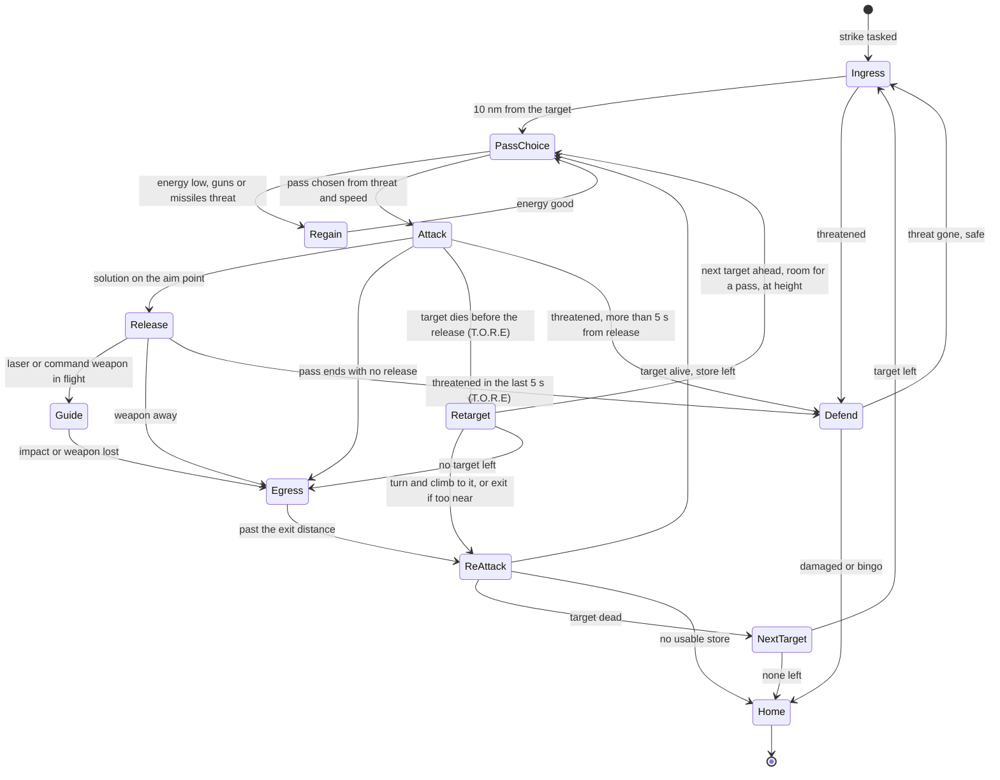
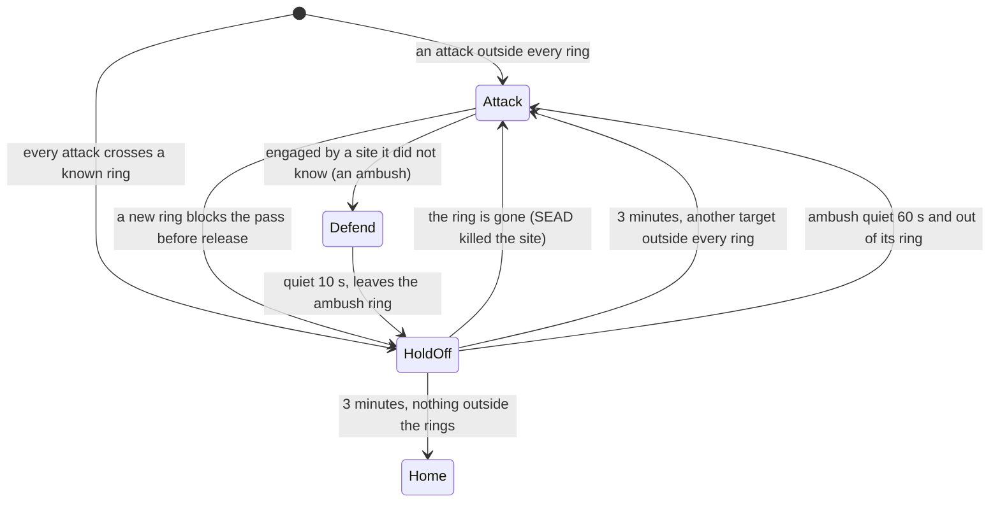

# AI strike behaviour

> **T.O.R.E: Tasteful Opinionated Reverse Engineered.**
> The thing being reverse engineered is the *experience*, not the executable. We
> trace what a player does and what the game does back, down to the numbers they
> would notice. How the original code achieved it is history: useful evidence,
> never a blueprint. If a sentence below reads like an instruction to reproduce
> the original's internals, it is out of date.
> <!-- tore-header v2 -->

Specification, 2026-10-11, for the AI strike round (slice ST-S). Status:
**specified, partly built**: the ground picture ([What the AI
knows](#what-the-ai-knows), and the threat inputs of [Perceived threat and
available speed](#perceived-threat-and-available-speed)) is built (ST-P), the
strike cockpit and shared release (ST-C), and the strike tactics for
fighters, attack jets and heavies (ST-T: target, store and pass choice, the
skill circle, release, exit, re-attack, defence and home; [How the AI flies a
pass](#how-the-ai-flies-a-pass)), its attack maneuvers (ST-T2: the
inverted roll-in and planned dive, gun runs, rocket pop-ups and dives, drag
bomb laydowns, the lead on moving targets, the heavies' mission height), the
helicopters' and the AC-130's
families (ST-F: [Helicopters](#helicopters), [AC-130](#ac-130)), AI lasing
and buddy lasing (ST-L: the hold on its own bomb, the lase duty a wing order
calls, a designator lasing for its wing, dropping on a buddy's spot;
[Lasing](#lasing)), the flight lead's ground orders and Quick Mission roles
(ST-O), the takeover of a human's attack (ST-K) and the helicopters' own
defence and their place as Quick Mission wingmen (ST-H: [Helicopter
defence](#helicopter-defence), [AI helicopters in Quick Mission](#ai-helicopters-in-quick-mission)). John asked for AI that attacks the ground and
authorised the work for this round (answers of 2026-10-11, folded in below). The
slices that build it are listed in [Source notes](#source-notes).

For a player: AI aircraft learn to bomb. A strike wing flies to its target,
picks a pass, drops, gets out, comes back until the target is dead or the
stores are gone, then goes home. Your wingmen strike on your orders. A pod
carrier can light the target for you or for a laser bomb carrier. If you give
your plane back mid-attack, the AI can finish the attack with your settings.
Fighters, attack jets, heavy bombers, helicopters and the AC-130 all do it,
each in a way that suits it.

The AI uses the player's weapon systems in [air-to-ground](air-to-ground.md).
[AI behaviour](ai.md#b14-surface-attack-and-egress) records what the retail
scripts establish and what remains open.

An unfinished ground assignment survives the loss of the last hostile aircraft.
The whole strike wing stays on that assignment until its strike controller
finishes, including egress. Absence of air threats is not mission completion.
Fuel, damage and explicit return orders still take priority. This implements
John's correction of 2026-10-15; no new fuel threshold is introduced.

## How to read the labels

Every rule below carries one label, as [AGENTS.md](../../AGENTS.md) defines
them.

| Label | Meaning |
| --- | --- |
| **retail** | Established from the retail scripts, records or executable ([AI behaviour](ai.md), [AI formats](../formats/ai.md)) |
| **spec-derived** | Taken from another spec in this directory |
| **fitted** | Chosen by an agent because the original's value is not known; the rule and constants are written down |
| **opinionated (John, date)** | A design John asked for or approved |
| **opinionated (agent)** | A design choice an agent made, never attributed to John |
| **unknown** | Insufficient evidence; see [Unknowns](#unknowns) |

## What retail does, and what changes

Retail FA's AI does strike, simply. A script picks one of four passes by dice
(straight run, pop-up, fast-high, dive bomb), the weapon service releases
whenever its check passes, and each AI bomb is re-aimed to land within 100 ft
of its target ([B14](ai.md#b14-surface-attack-and-egress), [B42](ai.md),
[bomb notes](../formats/weapons.md)). It has no buddy lasing and no AI lasing for
players. Its Quick Mission already sends friendly bomber-class wings at ground
targets ([Who strikes](#who-strikes)).

John's answers change the shape of it. All of these are opinionated (John,
2026-10-11):

| Retail | This spec |
| --- | --- |
| AI bombs are moved to land within 100 ft of the target | **No re-aim.** The AI flies the pass through control inputs and releases from the same delivery and guided solutions a player uses. Skill sets the release circle for unguided weapons ([Skill](#skill-and-release-precision)) |
| The pass is a random choice | **No dice.** The pass is a fixed function of perceived threat and available speed, limited by bombing class and weapon ([Pass choice](#pass-choice)) |
| A heavy bomber flies a high pass at 10,000 ft or more | Heavies bomb level from a minimum of 5,000 ft AGL, or the mission's airborne height if higher, raised by perceived threat ([Heavies](#heavy-bombers)) |
| No buddy lasing | The AI lases for its wing and for you, and drops on your spot ([Lasing](#lasing)) |
| Orders reach air targets only | Wingmen strike on the flight lead's orders, ground targets included ([Orders](#orders-from-the-flight-lead)) |

Randomness is kept as low as it can be (John, decision 13). Every choice below
is a function of the situation. The only dice left in a strike are the ones the
player's weapons already have: a bomb's up to 1.5 degree scatter in heading and
pitch ([bomb motion](air-to-ground.md#bomb-motion), half of retail's 3, John 2026-10-11), and the existing
seeded draws for hit rolls and countermeasures.

## Who strikes

| Rule | Label |
| --- | --- |
| Every AI family can strike: fighters, attack jets, heavies, helicopters and the AC-130 | opinionated (John, 2026-10-11) |
| The behaviour is side neutral. Any side's wing with the Strike role strikes | opinionated (John, 2026-10-11) |
| Quick Mission gives each wing a role, **CAP** (today's behaviour) or **Strike**. It is the wing's objective in the creator: "Strike the ground target" is a choice for friendly wings 2 and 3 (not the player's wing, not Redfor) and takes effect once a ground target is set; "Combat air patrol" and the other objectives are CAP. The default objective, "Use mission setting", gives a wing of **bomber-class** aircraft (the type's class word 0x4000, retail's own test) the Strike role when a ground target is set, and every other wing CAP (John, 2026-10-11, answering item 9). A Strike wing flies to the objective, strikes, goes home. Its loadout is the loadout page; a Strike wing with no surface stores is told so. An aircraft that carries no store that can attack a ground target never takes the role, whatever its class word or its wing's objective (slice H3, agent, for the CH-47: its wing flies CAP and is not sent home as a striker with nothing to strike with) | opinionated (John, 2026-10-11); the bomber-class default is retail's rule |
| **Retail's rule, recorded beside it** ([ST-R](../formats/ai.md#strike-maneuvers-steering-frame-and-orbit)). Retail Quick Mission has no role setting. When a ground target is set, every *friendly* bomber-class wing (A-4E, A-6, F-117, B-52, AC-130U, AH-64, Mi-24, Su-24, Tornado) is given ground classes (ship, tank, vehicle, structure) to attack and defend and fighters to evade, and attacks what it sees within about 26,400 ft. Fighter-class wings (A-10, A-7, AV-8B, Su-25 included) stay air only. No wing is ever given SAMs or AAA, so retail has no SEAD. Enemy wings never strike. How the wings reach the area is open. T.O.R.E follows the bomber-class default and adds the per-wing choice on top; the player can set any friendly wing 2 or 3 to Strike or to CAP | retail (rule), opinionated (John, 2026-10-11) for the choice |
| Redfor can strike but Quick Mission gives Redfor no air-to-ground objectives, so no Redfor wing is tasked in Quick Mission. Imported missions can task any side later | opinionated (John, 2026-10-11) |
| PvP: a Blue Strike wing goes after Redfor's protected objects ([objectives](surface-defenses.md#objectives-scoring-and-debrief)); Redfor wings stay CAP and defend | opinionated (agent) |
| The player's own wingmen follow the player and strike on orders only. They never wander off to bomb on their own, even on loose control | opinionated (John, 2026-10-11) |
| An AI lead that inherits a wing whose human was striking continues that target, then the objective, before any air search (extends [the lost human leader rule](ai.md)) | opinionated (agent) |

Reactions while striking use the Mission Creator's vocabulary (retail manual
p. 169): ground targets **attack**, aircraft **defend**, SAMs and missiles
**evade**.

| Reaction | Rule | Label |
| --- | --- | --- |
| Attack | The striker works its target until it dies or no usable store is left, then the next target, then home | retail (waypoint completion, [B48](ai.md#b48-routes-fuel-and-recovery)) and manual |
| Defend | It engages an aircraft only if that aircraft has fired at the wing or locked it, or is inside 5 nm and facing it (the [B02](ai.md) test). Otherwise it presses on | fitted |
| Evade | Existing [B47](ai.md#b47-threat-warnings-countermeasures-and-reason-priority) reactions and countermeasures, unchanged. With a ground target retail evades by climbing on the same course to at least 20,000 ft | retail |
| Out of surface stores | A wing with missiles left and loose control may take up free air engagement | opinionated (John, 2026-10-11) |

## One cockpit, two pilots

The ground-attack state a human uses is one record per aircraft, the **strike
cockpit**: the target (a ground object, a sight pin point, or none), the
selected station and armed state, the delivery mode (CCIP or LVL), the seeker
mode (CUED or BORE), the sight (track, pin, look, zoom) and the laser with its
hand setting. It holds what the kept cockpit of a given-back plane already holds, made the
single home of the state.

- A human edits it with keys, as today.
- The AI edits it from its strike controller (target, station, laser on or
  off) and leaves everything else alone.
- One release function serves every launcher, human or AI: packs, pod rounds,
  scatter, guided flights, laser spots. AI rows no longer build a plain
  projectile.
- Guided flights find their launcher by aircraft, not by "the player", so an AI
  laser bomb, JDAM or AT-2 guides exactly as a player's does.

All opinionated (John, 2026-10-11: "one cockpit, two pilots" and
[takeover](#takeover-and-handback)); the record layout is an agent design.

Built (slice ST-C): the record, the shared release and the AI's entry to it
are described in [architecture](../ARCHITECTURE.md#the-strike-cockpit). The AI
releases on the shared solution with no re-aim; when it releases, and its
skill's aim for unguided weapons, are the strike tactics' ([How the AI flies a
pass](#how-the-ai-flies-a-pass)).

## What the AI knows

| Rule | Label |
| --- | --- |
| Briefed targets (the objective's template objects, flagged for Redfor in Quick Mission) are known from the start. This is the briefing, not a sensor | fitted (retail missions name a target object) |
| Anything else must be seen. A strike actor builds the same ground lists as a player (A-G radar, FLIR, eye) at the retail 6 s rebuild, from its own aircraft | spec-derived ([air-to-ground](air-to-ground.md#ground-contacts-and-channels)), rebuild cadence retail |
| Air-to-air actors are unchanged: surface objects enter only a Strike actor's picture, so CAP wings behave as before | opinionated (agent) |
| A wing tasked as SEAD (a Wild Weasel assignment, retail manual p. 169) has the objective's air defences in its briefed set | retail manual, opinionated (agent) for the set |
| Target order: nearest first, at most two attackers on one object (the [B41](ai.md#b41-target-retention-eligibility-and-ranking) allowance) | spec-derived |
| After the briefed targets are gone, a striker with stores left attacks hostile ground objects it has seen within 10 nm of the objective, then goes home | fitted |
| The briefing is Quick Mission's destroy targets (flagged 0x80) of another side than the striker's, with their centre as the objective point. Redfor's are its own, so a Redfor striker is briefed on nothing (the capability is the same on both sides) | opinionated (John, 2026-10-11) for the sides; centre opinionated (agent) |
| A briefed or ordered object's place and whether it stands are known (retail's preferred-target test reads them directly). Its sensors decide only whether it is *perceived* | fitted |
| A SEAD striker is one carrying an anti-radiation store; its briefing adds the hostile armed units and radars within 5 nm of the objective point (the distance Quick Mission's Red defends within) | opinionated (agent), radius fitted |
| An ordered ground target (a flight lead's order, a taken-over designation) is known like a briefed one and outranks the briefing; it gives even a CAP wingman a ground picture while it stands | retail (the ordered object is the only candidate) |
| The A-G radar list (radar on and working) and the FLIR list follow the player's page rules (class, listing flag, visibility distance, range box, volume, signature, weather, clear line). The AI reads both, and its eye, at once, without switching its scope | spec-derived; reading all at once opinionated (agent) |
| The eye sees a standing, listable object on the ground inside the visual sensor's volume and range, with a clear line, and no farther than its own visibility distance (`maxVisDist`) when the type gives one; at most 50, nearest first | fitted |
| Between rebuilds, listed contacts follow their objects every quarter second, as the player's pages do | spec-derived |
| Neutral scenery never enters the picture (it would fill the 50-entry lists ahead of sided objects) | opinionated (agent) |
| A perceived object stays known at its last perceived place until it is destroyed or leaves the world | fitted |
| Every briefed target fully attacked (two others on each): the striker waits for one to free up, rather than taking a third place or an opportunity target | opinionated (agent) |

Built (ST-P): the picture is `tore_sim::ai::awareness::ground::GroundPicture`,
one per striker (`AiActor::ground_picture`), refreshed by
`AiMission::observe_ground`; the selector is
`tore_sim::ai::targeting::select_strike_target`. The bridge
(`tore_world::ai_wings::ground`) briefs strikers and describes the ground
objects. The role is `engagement::StrikeRole`, CAP by default; the Quick Mission
objective "Strike the ground target" (`GroupObjective::Strike`) and the
bomber-class default set it (`AiWings::apply_strike_roles`).

## Perceived threat and available speed

The two inputs to every tactical choice. They are read from what the AI
actually has: its sensors, its RWR and its warnings. An object it has not seen
does not count. Both are opinionated (John, 2026-10-11, "base tactics around
perceived threat and available speed"); the levels and numbers are agent
choices (opinionated, agent) unless marked.

**Perceived threat** is the highest level that applies. A defence "covers" a
point when that point lies within the defence's own maximum engagement range
(its weapon record) of it.

| Level | Name | Applies when |
| --- | --- | --- |
| 0 | Clear | None of the below |
| 1 | Air | A hostile fighter is in the picture within 30 nm, or an air-to-air warning sounded in the last 10 s |
| 2 | Guns | A known AAA site covers the target point or the planned release point |
| 3 | Missiles | A known SAM site with a working radar or seeker covers the target point or the planned release point, or a surface-to-air missile warning sounded in the last 10 s |

**Available speed (energy)** is **Good** when the aircraft's speed is at least
its corner speed at the current altitude, loaded (the corner query of
[B05](ai.md)), and **Low** otherwise. The **dive gate** is the retail dive
condition with the dice removed: altitude AGL and horizontal distance to the
target both at least max(10,000 ft, twice the turn radius) ([B14](ai.md#b14-surface-attack-and-egress),
retail).

**Retail's threat geometry**, the only one it has ([ST-R](../formats/ai.md#strike-maneuvers-steering-frame-and-orbit); it reads no threat rings or weapon ranges): a ship threat is ignored beyond 40,000 ft and any other beyond 30 statute miles; between 20,000 ft and 30 miles it is ignored unless the aircraft is within 100 degrees of the threat's nose; inside 20,000 ft it is always evaded (if its class is in the evade set). Speed enters retail's pass choice only through turn radius. These bands (20,000 ft, 30 miles, 100 degrees) are the inputs the levels above are built from, not the levels themselves: the levels stay opinionated (agent), and the Air level's 30 nm is close to retail's 30 statute miles (26 nm).

The picture is rebuilt at the 6 s cadence. Inputs are read when a pass is
chosen and again before each re-attack, never in the middle of a pass, so the
choice cannot flicker.

How the inputs are built (ST-P, `awareness::ground::ThreatPicture`):

| Input | Rule | Label |
| --- | --- | --- |
| Known defences | Every briefed defence that stands and every perceived armed unit or radar, of any side, with its missile reach (the farthest launch zone of its missiles), its gun reach (the farthest launch zone of its guns), whether it is a radar and whether it can guide (its battery's radar stands, or it guides by itself) | spec-derived; reach from the launch zones fitted |
| Covers | A point lies within the reach as a straight-line distance from the site; a missile site covers only while it can guide | spec-derived |
| Fighters | The hostile fighters of the striker's current air picture within 30 nm, nearest first, with the angle off each one's nose | spec-derived |
| Retail geometry | Each known defence and fighter answers retail's ignore-or-evade test; the angle off the nose is measured in the horizontal | retail bands; horizontal angle fitted |
| Warnings | The caller supplies whether an air-to-air or surface-to-air warning sounded in the last 10 s | spec-derived |

## Pass choice

The pass is chosen once per attack run, 10 nm from the target and again before
each re-attack. The four retail passes keep their retail shapes
([B14](ai.md#b14-surface-attack-and-egress), retail); only the choice is new.

| Pass | Shape | Label |
| --- | --- | --- |
| Straight run | Fly at the target until 2,000 ft horizontal, then exit | retail |
| Pop-up | Approach 500 ft above the target until within 10,000 ft, pull up 25 degrees, then point at the target until 1,500 ft or it is no longer ahead. Aim is the target's own position (0 to 359 ft right of it in retail, see below) | retail |
| Fast-high | Approach 5,000 ft above, straight on at maximum speed after 2,000 ft | retail |
| Dive bomb | Entry only at the dive gate. Approach at a point H = max(2R, AGL at entry) above the target at corner speed until horizontal distance is under 1.5R. Roll-in: hold the bearing to the target at that moment, level, bank 180 (inverted), corner speed, until under R. Pull to 90 degrees nose down (flown at the aircraft's `maxDive`, -80 on every fighter and attack jet) and hold until AGL is under max(2R, 2,000 ft). Roll out on the roll-in heading plus 180 at corner speed, a split-S pull-through to level. Then climb 25 degrees for 10 s, then the exit run. R is the turn radius, V squared over 43.6 G ft | retail ([ST-R](../formats/ai.md#strike-maneuvers-steering-frame-and-orbit)) |
| Level run | Straight and level at or above the release floor, with the LVL cue, for bombs dropped from altitude | opinionated (agent); the heavies' retail high pass is the model |
| Laydown | Down to a low level height (at least 500 ft, higher if the fuze's arming or the bomb's fragments need it) 8,000 ft short of the aim, then level with the LVL cue: the drag (retarded) bomb delivery | opinionated (agent, ST-T2) |
| Strafe | Approach 3,000 ft above the target, roll into a 15 degree dive at the aim, gun bursts on the cue, cease fire at 2,000 ft slant or 500 ft above the ground, exit | opinionated (agent, ST-T2) |
| Orbit | Left-hand pylon turn around the target | retail for the family, numbers [fitted](#ac-130) |

**The choice** for fighters and attack jets with unguided bombs, first row that
applies:

| Order | Condition | Pass |
| --- | --- | --- |
| 1 | Energy Low and threat Guns or Missiles | **Regain**: do not enter; fly the exit leg (climb 10 degrees at maximum speed) until energy is Good, then choose again |
| 2 | Threat Missiles | Pop-up (a low approach under the radar, a short climb, release, down) |
| 3 | The dive gate holds | Dive bomb |
| 4 | Otherwise | Straight run |

**Other weapons and a kept delivery mode**, applied before the table:

| Case | Pass |
| --- | --- |
| Seeker missiles and HARM (stand-off) | Fast-high when energy is Good, else straight run; the approach ends at the store's release range. Retail's guided release rule is the model: a guided round only inside 10,000 ft or half the weapon's maximum range, one guided round in flight at a time (retail, [weapons](../formats/weapons.md#ai-release-against-ground-targets)) |
| Rockets | The bombs' table (slice ST-T2): pop-up under threat Missiles, dive at the dive gate (from 6,000 ft, rolled in at 25 degrees), else a straight run with a shallow dive. ST-T flew rockets straight only, because the push that points the nose down after a pop was too slow; the roll and pull ([How the AI flies a pass](#how-the-ai-flies-a-pass)) fixed that |
| Guns (strafing) | Strafe (slice ST-T2); attack jets strafe after their bombs and rockets are gone; regain first, as the table's row 1 |
| Drag (retarded) bombs | Laydown (slice ST-T2): the low level pass is what a drag bomb is for; regain first, as the table's row 1. The retained launch-retard classification (under 95%, the Mk 82 Snakeye's 66%) selects a drag bomb; its actual release inherits full aircraft velocity |
| Laser bombs, JDAMs | Level run (or a shallow run) to the weapon's reach. A glide bomb the sight says cannot reach from the aircraft's height or speed (its life runs out first) is approached in a descent of 400 ft/s, never below the release floor (fitted, agent, ST-L) |
| Taken over with LVL kept | Level run whatever the table says |
| Taken over with CCIP kept | The table's pass, flown as CCIP |

**Retail quirks the pass copies and does not copy.** Retail's pop-up pull (`homeAngle 0 25 0 corner 4`, helicopter 30 degrees for 6 s) is written with the speed in an ignored slot, so it requests *minimum* speed during the pull and bleeds speed for 4 s (6 s). The final pop-up leg aims 0 to 359 ft right of the target because a bearing was used as feet. **Recommendation, opinionated (agent): do not copy either.** The pull holds corner speed, or the speed the pass choice needs, and the final leg aims at the target, because John asked that tactics follow perceived threat and available speed (decision 3), and a pass that throws away its own speed under threat Missiles contradicts that. The pass shape (offsets, angles, durations) is retail's. Say so to John if he would rather have the retail bleed (item 10).

**The steering frame** (retail, same source): a pass offset is added to the target's position (in feet, x to the target's right, z ahead, rotated by the *target's* heading; y straight up from the target's height) and the aircraft flies straight at that point. A "low approach" is therefore a straight line to the point, level only because pitch requests within 3 degrees snap to level while the point is 3,000 ft or more away. Pitch is clamped to the aircraft's climb and dive limits. The AI takes this frame for the offset passes; its pilot flies the line through control inputs ([Skill](#skill-and-release-precision)).

Release floor, a minimum altitude AGL for dive and level releases, taken from
the retail manual's advice (3,000 ft lightly defended, 5,000 ft or more
defended; advice, not enforced by retail) and made a rule here: **3,000 ft**
under threat Clear or Air, **5,000 ft** under Guns or Missiles. Opinionated
(agent). Pop-up releases are below it by design and are the Missiles answer.

The bombing class limits the choice (next section). Every pass is also
available to the headless driver by name, so a test can force each one; that
changes nothing in play.

## Bombing class

Each aircraft's class comes from its imported record, so a new aircraft needs
no code (John, 2026-10-11: "maybe we go by weight so we don't have to keep
programming it in"; thresholds accepted by John, decision 19). The test runs in
this order. Fields are in [the aircraft table](../formats/fa-aircraft.csv).

| Order | Class | Test on the record | Passes allowed |
| --- | --- | --- | --- |
| 1 | Helicopter | Lift kind helicopter or tiltrotor (retail `no_lift`) | Pop-up and stand-off fire; never dive |
| 2 | Gunship | The record gives it the linked-gun gunsight ([AC-130 guns](ac130-linked-guns.md)) | Orbit |
| 3 | Heavy | Maximum takeoff weight 150,000 lb or more, or positive G limit 3 or less | Level run only; stand-off missiles from level flight; no dive, pop-up, rockets or strafe |
| 4 | Attack | Top speed 700 kt or less | Retail fighter passes, plus strafe and rocket re-attacks after the bombs, and a lower ingress |
| 5 | Fighter | Everything else | The four retail passes and the level run |

- **Retail check.** Over the 145 retail aircraft records the rule agrees with
  retail's own AI script binding for 142. The three differences are the B-1B
  (retail binds the fighter script; the rule makes it a Heavy, as John wanted),
  the Aurora (rule: Fighter; carries no ground stores) and the Blimp (rule:
  Helicopter by lift; no stores). A test pins this census.
  Class thresholds are **opinionated (John, 2026-10-11)**, the order and the
  top-speed test **opinionated (agent)**; retail has only the script binding
  (retail: fighter, bomber, helicopter and the AC-130's own).
- **The current import.** Helicopter: AH-64, Mi-24, V-22, CH-47 (the CH-47 and the V-22 carry no surface store, so they never strike). Gunship:
  AC-130U. Heavy: C-130, E-3, Il-76, E-2C, B747, A310 (none carries ground
  stores today). Attack: A-4E, Su-25, AV-8B, A-7, A-10, MiG-17F. Fighter: every
  other imported aircraft, the F/A-18D included. The F-22 uses its bay as in
  [weapons](air-to-ground.md#weapon-classes).
- **Override.** An optional per-aircraft override, a data table keyed by PT
  resource name (`OVERRIDES`, empty for every current aircraft), for the day
  the rule is wrong for one (the F-117, which retail flies at 5,000 ft level,
  is the likely first). A new import adds nothing to it; only a wrong class
  does. Opinionated (agent).
- **The player's default.** The class sets only the **default** bomb mode: a
  Heavy selects LVL whatever its attitude (retail heavies have no CCIP); every
  other class keeps the [H1 rule](air-to-ground.md#status-word-and-mode-choice).
  Both modes stay available to the player on every aircraft. Opinionated (John,
  2026-10-11); no imported aircraft is a Heavy with bombs today. How the two
  combine:

  | Class | Bomb mode when a bomb is selected |
  | --- | --- |
  | Heavy | LVL always: with or without a designated ground target, level or diving. A Heavy also starts the mission in LVL |
  | Helicopter, Gunship, Attack, Fighter | The H1 rule: LVL if a ground target is designated and the flight path is within 10 degrees of level, else CCIP |

  Ctrl+M switches CCIP and LVL for every class after the choice, and nothing
  re-chooses until the next selection.
- **Where it lives.** `crates/tore-sim/src/models/strike_class.rs`
  (`StrikeClass`, `Record`, `OVERRIDES`, `default_delivery`). The class is read
  once from the imported record into the combat configuration
  (`combat::live::Configuration::strike_class`), so the player's selection rule
  and the AI strike controller read the same field. Tests pin the imported
  roster above, the 145-record census (the `ai_script` column of the [aircraft
  table](../formats/fa-aircraft.csv)) and the Heavy LVL default.

## Skill and release precision

**The principle (opinionated, John, 2026-10-11):** the AI flies the pass
through control inputs and releases from the shared solutions. A better pilot
puts the weapon closer to the target. John's rule is a circle around the target
that grows as skill goes down.

**The release circle (opinionated, John, 2026-10-11).** The radius `R` comes
from the aircraft's experience level ([AI experience](ai-experience.md)), 25 m
more for each level down. John tightened the circles on 2026-10-11 (they were
100, 175, 250 and 325 m): "keep the Ace accuracy within 10 m and increase by 25
m for each band".

| Level | `R` (m) | `R` (ft) |
| --- | ---: | ---: |
| Ace | 10 | 33 |
| Experienced | 35 | 115 |
| Average | 60 | 197 |
| Novice | 85 | 279 |

- **The AI releases only when the aim cue puts the predicted impact inside its
  circle**: the pipper in CCIP, the T in LVL, the rocket impact for rockets. It
  flies the cue to the aim point drawn below with its stick and rudder and
  drops when it arrives. An Ace therefore holds the pipper within 10 m of the target; a
  Novice lets it be 85 m off. (Opinionated, John, 2026-10-11.)
- **A seeded draw picks the aim offset for each pass.** The draw is a
  deterministic function of the mission seed, the aircraft id and the pass
  number (the first pass at a target is 1, each re-attack adds one), so every
  host and every replay agrees. It gives a point on the ground, an offset from
  the target, that the AI aims the cue at. In 90% of passes the offset is
  inside the circle, uniform by area (distance `R x sqrt(u)`, a uniform
  bearing); in 10% it is in the ring from `R` to `2R` (distance
  `R x sqrt(1 + 3u)`, a uniform bearing). The mean offset inside the circle is
  two thirds of `R`. The 90% and the circle are John's; the ring's extent and
  the seed inputs are an agent choice (opinionated, agent; see
  [Confirm with John](#confirm-with-john)). The AI flies the cue to the
  drawn point and releases when the cue is within the gate of it, 10% of `R` but at least 10 ft (fitted, agent; it was 5% of `R` for the 100 m Ace, and a 33 ft Ace would step over a 1.6 ft gate), so
  a ring draw releases outside the circle: that is the 10% John asked for.
  (Opinionated, agent.)
- **The weapon's scatter is on top**, as for the player: up to 1.5 degrees in
  heading and pitch for bombs (0.0262 of the range; retail's is 3 degrees,
  0.0524, and John halved it for every bomb, player and AI, on 2026-10-11,
  opinionated), the rocket and gun spreads of their records. The bomb scatter
  is the retail dice at half the angle ([bomb
  motion](air-to-ground.md#bomb-motion)).
- **Unguided weapons only.** The circle applies to unguided bombs, packs,
  rockets and gun bursts (each burst its own seeded draw, slice ST-T2; John,
  2026-10-11, later, whose rounds then walk onto the target, slice ST-G; John,
  2026-10-12). Smart weapons use the targeting and laser systems as the player
  does, which are hard to get wrong at any skill (opinionated, John,
  2026-10-11): an AI that lases holds its **laser spot** on the target, a
  JDAM's stored point is the designated target, and seeker missiles and HARM
  are judged by their lock. Skill does not move a guided weapon's aim point.
  The reach window and lock rules for release are unchanged ([guided
  reach](air-to-ground.md#guided-bomb-release-range-indicator)).
- **No retail re-aim.** Nothing moves a bomb after it leaves; the circle is
  where the pilot aims.

**Worked numbers** (arithmetic of this spec, not a measurement; the draws shown
are chosen to illustrate; the scatter is TORE's 1.5 degrees, 0.0262 of the
range, half of retail's 3):

| Case | Ace (33 ft) | Experienced (115 ft) | Average (197 ft) | Novice (279 ft) |
| --- | --- | --- | --- | --- |
| Mk 82 dive: 30 degrees, 6,000 ft slant. Scatter alone about 155 ft across the track | Aim 16 ft out for a draw `u` = 0.25; bombs land about 16 ft plus up to 155 ft scatter from the target, inside the slick's 300 ft fuze radius | Aim 57 ft out; inside the fuze radius | Aim 98 ft out; inside the fuze radius | Aim 139 ft out; still inside it, though a bad scatter on a 279 ft edge draw reaches 434 ft |
| Mk 82 level: 6,000 ft AGL, 450 kt, 19.4 s fall, 15,900 ft slant. Scatter alone about 385 ft across the track | Aim 16 ft out; scatter dominates | Aim 57 ft out; scatter dominates | Aim 98 ft out | Aim 139 ft out; scatter is still the larger part |
| The same pass with a ring draw (10%), `u` = 0.25 | `R x sqrt(1.75)` = 43 ft | 152 ft | 260 ft | 369 ft |

Every distance in the first two rows is `R x sqrt(0.25)`, half of `R`; a draw
of `u` = 1 would put the aim on the circle's edge (R). Reading: with the
tighter circles and scatter the bomb's own scatter is most of the miss at every
skill, and most of a Mk 82 dive's bombs land inside its 300 ft fuze radius even
for a Novice; a level release spreads over about 385 ft whatever the skill, so
the skill shows mostly in how often the 10% ring draw pushes the aim beyond the
fuze radius. Guided weapons are not in the table: they aim at the target at
every skill.

## Weapons and releases

| Store | Pass | Releases when | Circle |
| --- | --- | --- | --- |
| Unguided bombs, packs | Table above | CCIP mean impact, or the LVL cue, on the aim point (a pack leaves in one instant, [packs](air-to-ground.md#release-modes-and-packs)) | Cue inside `R` |
| Rockets | Straight run, shallow dive, or pop-up | Rocket impact on the aim point, at the record's cadence | Cue inside `R` |
| Guns | Strafe | Bursts opened by the gun's ground cue near the target, rounds walked in onto it (below) | Each burst opens on a point inside `R` and walks onto the target |
| Laser bombs, laser missiles | Level or shallow run; then an offset turn holding the target inside the designator's gimbal until impact (fitted) | Target inside the reach and a spot will exist (own designator, or a same-side spot); and not while the sight shows MASK, a spot hidden from the launcher by terrain (agent, 2026-10-12); with none, a laser bomb is [dropped by hand](#no-laze-support) as an unguided bomb and a laser missile goes home | none: spot on the target (by hand: the unguided circle) |
| JDAM | Level run | Target point stored, inside the reach | none: point on the target |
| Mavericks, AS-14, AS-30 | Fast-high or straight | Seeker locked on the target inside zone 1 ([lock flow](air-to-ground.md#the-seekers-and-the-lock-flow)) | Lock |
| Radar AGMs (AS-7, AS-15, AGM-84A, AM-39, AS-16) | Straight run | Radar track at release, held through the flight (the AI support rule, [B45](ai.md#b45-seeker-visibility-launch-eligibility-and-ammunition)) | Lock |
| HARM | Fast-high; fire at maximum range, exit | A HARM candidate inside the zone ([HARM cue](air-to-ground.md#missiles-and-the-harm-boresight-cue)) | Lock |
| AT-2 (Mi-24) | Helicopter pop-up; hold the line until impact | Target inside the launcher's cone with a clear line | Lock |

Store choice is retail's ([B45](ai.md#b45-seeker-visibility-launch-eligibility-and-ammunition)):
bombs, rockets and ground missiles only against the surface; air-to-air
missiles only against aircraft; guns against both. Label: retail, spec-derived.
The delivery modes, solutions and guided flights are the player's, so this
spec adds none (spec-derived).

## Stand-off reach

**T.O.R.E opinionated change requested by John on 2026-10-29:** "If an attack
aircraft can hit outside of range safely of known threats AI should do that."
Retail has no such rule; before 0.2.2 a striker released where its usual rule
said, inside a known threat's reach or not. Built for the helicopters'
stand-off ([Helicopter threat awareness](#helicopter-threat-awareness), "Farther
out, to the store's reach").

How far a guided store can reach is the question the AI's own release gate
asks, so a plan never counts on a shot the gate would not take or that would
strike the ground. The host answers it range by range (`tore_world::ai_wings`,
the strike's shot table), for a static target on flat ground and a level launch
toward it:

- under the energy rules, a store with a motor: the energy model's exact-point
  answer, the same launch question, hit radius and kernel the prediction
  service answers for the gate, flown at once;
- a guided bomb: its glide reach from that launch (the sight's reach);
- under the other missile rules, a seeker missile: its zone 1; a guided missile
  on the sight: its zone out to the sight's release bar, where the gate lets it
  go. A helicopter gets no answers under these rules (its usual range is
  already the bar).

A plan takes a range only when the shot hits from there and from one step
nearer and one step farther: a **reliable** range. That keeps out a band where
the round strikes the ground (the AT-2 from a low hover strikes the ground from
about 1 km to 7,900 ft out, [missile energy](../baselines/missile-energy.md#contiguous-range-advice-validation))
and the last step of the reach. The answers are cached by store, launch band
and range step, so a plan asked again every step costs a lookup: the target's
height in 250 ft bands, the launch's height over it in 250 ft bands up to
2,000 ft and 1,000 ft bands above, the speed in 50 ft/s bands, and ranges on a
500 ft grid. The cache is a fixed function of the records and is never
checkpointed.

| Rule | Value | Label |
| --- | --- | --- |
| Reliable reach | The shot hits from the range and from 500 ft nearer and farther; no farther than the zone-1 maximum (slant) | rule opinionated (John, 2026-10-29); the test fitted (agent) |
| The answer's launch | Level, toward the target, no wind, no terrain between; target static on flat ground, 8 ft over it | fitted (agent) |
| Bands | Target height 250 ft; launch height 250 ft to 2,000 ft, then 1,000 ft; speed 50 ft/s; range 500 ft | fitted (agent) |

## Heavy bombers

| Rule | Label |
| --- | --- |
| Heavies bomb level only. They never dive, pop up, fire rockets or strafe | retail (the bomber script flies a high pass), opinionated (John, 2026-10-11) for the class test |
| Minimum release altitude: **max(5,000 ft AGL, the mission's airborne height)** | opinionated (John, 2026-10-11); retail uses max(altitude, 10,000 ft) |
| Raised by perceived threat: Clear and Air +0, Guns +5,000 ft, Missiles +10,000 ft, never above 90% of the aircraft's ceiling | opinionated (John, 2026-10-11) for "raised by threat"; the amounts are fitted |
| "The mission's airborne height" is the Quick Mission altitude setting ([Quick Mission](quick-mission-menu.md)); for an imported mission (none yet) or a striker tasked outside one, the height above the ground the striker was first tasked at. Read as AGL over the target area. Built (slice ST-T2): the host hands the setting to every striker each step | fitted; confirm with John |
| Release is the weapon record's own burst (rounds and spacing from the record), centred on the aim point as a stick. There is no ripple setting | retail (burst fields), fitted (centring) |
| Exit climbs toward 50,000 ft (never above the ceiling), then turns back | retail |
| Stand-off missiles are fired from level flight at the reach | opinionated (agent) |

## Egress, re-attack and going home

After release the aircraft exits and decides again. All fitted from the retail
exit unless marked.

- **Exit** (retail, [ST-R](../formats/ai.md#strike-maneuvers-steering-frame-and-orbit)).
  Inside 10,000 ft horizontal, jink: four legs of 3 s at maximum speed, heading
  the current heading plus or minus 10 degrees, climbing 10 to 14 degrees, a
  weave of 10 degrees to one side, repeated while still inside 10,000 ft.
  Beyond 10,000 ft: hold heading, climb 10 degrees at maximum speed. At
  max(30,000 ft, twice the turn radius) away, turn back level at corner speed
  and choose again. Retail draws the weave's side and heading by random; T.O.R.E
  uses the existing seeded channel or a fixed side (John, decision 13).
- **Re-attack.** At the exit distance the aircraft runs the choice again with
  fresh threat and energy. Target alive and a usable store: attack. Target
  dead: the next target. No target left, or no usable store: home (the existing
  return to base, [B48](ai.md#b48-routes-fuel-and-recovery)).
- **Defend.** A missile warning or an attacking fighter hands control to the
  existing B47 reactions. The pass is abandoned, countermeasures and breaks run
  as today, and the striker resumes at ingress when the threat is gone and the
  picture says safe (below). Damage or low fuel sends it home. Inside the
  committed-to-release window (below) a new trigger waits for the release.
- **Safe** (also used by takeover): no warning in the last 10 s, no known SAM
  covering the target, and no hostile fighter inside 15 nm. Fitted.
- **Target dies early: retarget at once** (T.O.R.E opinionated change
  requested by John on 2026-10-28). When another aircraft, for example a
  guided-store wingman, destroys the striker's target before the striker's
  pass reaches it, the striker does not fly the exit. It picks the next target
  at once, with the same target choice and the same attacker allowance as at
  the exit distance, and sets up a new pass. With that target at least half
  the exit distance away (15,000 ft, 25,000 ft for a heavy, or the turn
  radius if larger), it turns toward it at once, climbing back to the height
  it cruises at, and chooses its store and pass once it points at it (within
  15 degrees, as at the end of an exit) and is back within 300 ft of that
  height, or is inside half the exit distance: at once when it already is.
  Nearer than that, it flies the exit on its heading, but turns back at half
  the exit distance from the new target instead of the full one. The climb
  back is there because a straight run begun from the old run's low height
  flew the line to the target down to about 500 ft, where FRAG held the bomb
  (Vladivostok HQ, A-10, 2026-10-28). This holds only for a striker that has not released on its pass and is not
  past its release point (the cue beyond the aim, a dive's pull-out, or with
  no estimate the target behind it). A striker that released, or is past the
  point, keeps the normal exit, and with no target left it egresses as before
  and goes home. The half exit distance and the 300 ft are fitted (agent). Retail, and
  T.O.R.E before this change, flew the full exit straight on and chose again
  at the exit distance: in the Vladivostok HQ Quick Mission (A-10, Mk 82,
  2026-10-28) the striker's bunker was killed by its wingman while the
  striker was about 25,000 ft from it, and the striker flew some 30,000 ft on
  over the defended site, about 140 s, before it chose the HQ.
- **Committed to the release, 5 s** (T.O.R.E opinionated change requested by
  John on 2026-10-28). Once an attack run is 5 s or less from its computed
  release point, a new defence trigger (a missile or gunfire defence, or a
  fighter inside 5 nm facing it) does not break the run off: the striker
  flies on, releases, and then reacts (it defends if the threat is still
  there, else it egresses as usual). Countermeasures still go as before, and
  hits still damage or kill the aircraft as before; only the decision to
  break off waits. The time to release comes from what the pass already
  flies by: for a bomb or rocket, the cue's distance short of the aim along
  the track over the cue's measured closing speed (filtered over 0.5 s; at
  first the ground speed, as the level release T has it); for a guided bomb,
  the host's sight, its distance to the T's bar over the ground speed; for a
  seeker missile, its range less its fire range over the closing speed. It
  covers every pass with a release point: straight, level, fast-high,
  laydown, dive, pop-up (its pull too), rockets (the window holds through the
  rocket burst) and guided stores. The window opens only in the pass's final
  or a pop-up's pull, before anything has left (or during a rocket burst),
  and closes at the release, when the cue is more than 0.5 s past the aim,
  when the pass ends, or at the latest 8 s after it opened, whatever the
  estimate says. The 0.5 s, the filter and the 8 s are fitted (agent). Not
  applied to a gun run (it has no single release point, only bursts), nor to
  the helicopters and the AC-130, which fly their own families and their own
  defence (a helicopter hides, and John's rule for it is to leave always).
  Before this change an anti-aircraft burst broke a straight Mk 82 run 0.2 s
  before its release in the same Vladivostok HQ run.

## How the AI flies a pass

Built in slices ST-T and ST-T2 (`tore_sim::ai::strike`, the bridge
`tore_world::ai_wings::strike`). The AI flies every pass through the same
input-only steering adapter as every other AI maneuver (a heading, a
flight-path pitch and a speed; [AI behaviour](ai.md)). Its attack segments
alone (a dive's or a pop-up's roll-in and final, a strafe, a pull-out) ask the
adapter for two more handlings ([input-only control](ai.md#input-only-aircraft-control)):
the **roll and pull**, which rolls inverted and pulls for a big nose-down
change as retail's dive bomb does, and the **planned dive**, whose terrain
floor is its own planned pull-out. Air combat, formation, routes and every
other motion are flown as before. The retail pass shapes above are kept; the
rules below are how they are flown. All fitted (agent, 2026-10-11) unless
marked.

| Rule | Value |
| --- | --- |
| Who | An AI aircraft with a ground picture (the Strike role or an ordered ground target) of the Fighter, Attack or Heavy class. Helicopters and the gunship fly their own families ([Helicopters](#helicopters), [AC-130](#ac-130)) |
| Choice point | 10 nm from the target, or at once inside it; again at each turn back |
| Target | The ordered one; else for an anti-radiation carrier the objective's SAM radars, then AAA radars, then other radars, nearest first, two attackers at most (SEAD); else the selector's (nearest briefed, then seen opportunity targets) |
| Store | Anti-radiation at a radar first; under threat Missiles stand-off first (seeker, radar AGM, JDAM, laser, bombs, rockets, gun); otherwise bombs, JDAM, laser, seeker, radar AGM, rockets, gun. A laser store only with the aircraft's own designator, its laser on by hand while selected (other spots are the lasing slice's). A heavy carries no rockets into a pass; only an attack jet takes its gun |
| Weapons hold | Under the hold preset or a hold fire order the striker flies no pass: the rest of the controller flies (formation, CAP), and the strike starts again from its ingress when the hold lifts (opinionated, agent, ST-T2) |
| Aim | The pass's seeded draw (mission seed: the aircraft's roster seed; aircraft id; pass number), unguided only; a gun run draws again for each burst (the pass's rule keyed also on the burst number), the burst's start point, which its rounds walk off onto the target (see Gun bursts). **Lead**: a moving target is aimed at where it will be when the round lands, its tracked ground velocity times the cue's time of flight (bombs, rockets and gun bursts alike; John, 2026-10-11: "add lead for moving targets"). The driver prints it as `lead_ft` |
| Approach | Flown at the aim point. A pop-up comes down to 500 ft over the target by its pull point, 11,000 ft out for bombs (16,000 ft for rockets), then pulls 25 degrees over the line of sight at corner speed for at least 4 s and until the target is 15 degrees down. A bomb dive approaches at the dive's height (at least max(10,000 ft, 2R)) and rolls in once the aim is 45 degrees down: rolled inverted and pulled onto the line to the target, it settles in a dive of 55 to 65 degrees (retail rolls in with the target 63 degrees down and pulls to its 80 degree `maxDive`). A rocket dive starts 6,000 ft over the target and rolls in at 25 degrees. A strafe approaches 3,000 ft over the target and rolls in at 15 degrees. A laydown comes down to its height by 8,000 ft short of the aim |
| Flying the cue | **Across:** bomb runs use the shared model's actual impact cue and ground track (fitted, agent, 2026-10-15). The heading error is `atan2(cross miss, max(horizontal throw, 1500 ft))`, multiplied by 0.6 for a plain run, or by `4 / max(cos(dive angle), 0.25)` for a rolled dive or pop-up. Before that gain, add one second of observed cross-error rate converted to angle at the current throw; this damps overshoot without altering the skill circle or gate. The correction is limited to 30 degrees. The input-only bank controller reads ground track for bomb attack runs, including their approach, so a nose/velocity offset does not leave a steady cue error. Rockets and guns keep their prior track-line trim. Bomb pop-ups start their pull 1,000 ft earlier than the previous 10,000 ft rule, allowing the velocity vector to build the launch angle. While rolling in, the wanted heading is still the aim's bearing. Bomb dives command a flight path 5 degrees above the target sight line during roll-in, allowing the low-G aircraft to roll out before its velocity-based cue stays short at the safety pull-out. The pull-out floor and skill gate are unchanged. **Along**: in a straight run, pop-up or dive the flight path is turned by three times the angle between the cue and a point short of the aim (600 ft; 1,500 ft in a dive, whose cue creeps faster), no more than 8 degrees over the line to the target, until the cue is that margin (plus 300 ft) short, then held, so the cue creeps across the aim; a cue that overshoots by the circle is flown again. While the cue is more than 3,000 ft short the pass flies its own line. A straight run's push that would ask the adapter for less than 0.3 G is flown wings level (a banked push turns the wrong way); a dive and a pop-up roll and pull instead. Level runs, laydowns, fast-high bomb runs and guided weapons hold their height and steer the cue (or the aim) across. A level run, laydown or fast-high bomb run does not use the trim: its cue lies 10,000 ft or more ahead, where the trim, learning through the adapter's lag, swung the cue 180 ft either side of the aim for a whole fast pass and met it 44 ft off at the release (nr-bombs, 2026-10-13). It points the cue instead: the track turns by 0.6 of the angle the cue's miss across subtends from the aircraft (the cue's range at least 1,500 ft, no more than 30 degrees), one first-order loop on the miss itself, so the drift of the wind and the pylon's offset are flown out without being learnt. In the battery's fast-high run (4 nm out at 450 kt, 57 ft off at the start) the cue is on the aim within 2 s and stays within 13 ft of it, within 2 ft from the sixth second on (fitted, agent) A gun run tracks: the flight path turns by three times the angle between the gun's ground cue and the burst's aim, the heading as above. A heavy's slow level run is held on its line the same way |
| Release | When the host's shared release test passes (the cue, a bomb's mean path to the terrain in CCIP, the pipper's own point, or brought down to the aim point's ground in LVL, within the gate of the aim, 10% of R and at least 10 ft, or a guided weapon's reach), or (ST-T2) when an unguided cue that sweeps by faster than the gate can catch it has passed its closest point to the aim, that closest point lies inside John's circle around the aim, and the cue there lies inside John's circle around the led target (the ring's outer edge 2R for a ring draw), give or take the gate. The closest point is solved inside the tick (nr-cue, John's answer 12 of 2026-10-13; fitted, agent): between two ticks the cue's position against the aim is a straight line, so the time and distance of its closest approach are exact, the two tests are made at that moment rather than on the tick's samples, and the answer is the same at any tick rate and wherever the ticks fall on the cue's path (the earlier test read the sample before the closest point and flipped on one tick: 125.2 ft off on one sample, 128.3 ft on the next, with a 126 ft circle). A closest point is counted in exactly one tick, and the store leaves at the end of that tick (at most one tick, 8.3 ms or about 6.6 ft of a 470 kt cue, after the true closest point). The first sample counts as a possible closest point, so a cue that first appears inside the circle and opens is released as before. A cue that is still wandering (a dive's rockets) is released at the first closest point whose cue lies inside the ring, not as it opens again afterwards, so rockets in a dive or pop-up may leave up to a second later than before, with the cue about 4 ft nearer the target; in the pass's final or a pop-up's pull, with the cue inside the store's zone 1 range, above the floor for a bomb's dive or level release (a level run may be 200 ft under it where the ground under it rises), and not while the sight warns LOW or FRAG. One trigger call a pass (a pack leaves whole); rockets fire one at the record's cadence while the cue stays inside the circle, at most 8. Seeker missiles fire on the lock (inside zone 1 from the mount, within 10,000 ft or half the zone-1 maximum, an emitting target for a HARM, one guided round at a time) through the AI's own missile release, observed on the ground target |
| Gun bursts | The run is flown onto the target (and its lead): the flight path turns by three times the angle between the gun's ground cue (the round path of the gunsight, followed to the ground) and it. A burst opens when the cue lies within the pilot's fine-tracking reach of the target, 1 degree (at least 25 ft) at the slant range, and inside the gun's reach, and fires at the gun's own cadence for the AI gun employment's 0.5 s burst while the cue stays within that reach, then recovers 0.5 s ([AI guns](ai-gun-employment.md)). **The rounds walk in** (John, 2026-10-12: "gun bursts should lead into the target and Ace just has fewer lead time"): each burst has its seeded draw (the skill circle, 90% inside `R`, 10% in the ring to `2R`), folded to lie short of the target along the track, and its rounds leave from that start point; the aim then walks in a straight line onto the target (and its lead) over the skill's walk-in time, 0.1 s for an Ace, 0.2 s experienced, 0.3 s average and 0.4 s for a Novice, and the rest of the burst lands on the target. The gunner lays each round on that walked aim by turning the barrel's line by the angle from the cue to the target, held to the same 1 degree, plus the angle from the target to the walked aim. Rounds leave from the gun's mount as every AI gun round does; there is no air target to track. Opinionated (John for the walk-in and its dependence on skill, agent for the times, the 1 degree reach and the fold short of the target) |
| Dive pull-out (ST-T2) | A dive pulls out where its pull-out at the present speed and the AI's G limit (radius V² / (g (G - 1)), plus 1 s of sink) bottoms out 1,000 ft over the ground, never below retail's 2,000 ft; retail's max(2R, 2,000 ft) is replaced, its turn radius being far tighter than the aircraft flies (opinionated, agent). While diving, the terrain floor is that plan instead of the general one (whose glide-slope term held ST-T's dives to about 50 degrees): the planned dive exception John allowed |
| Laydown height (ST-T2) | The lowest 50 ft step from 500 ft at which a level release at the present speed clears the sight's LOW rule (the fall lasts the fuze's arming time, with 20% margin) and its FRAG rule (the aircraft, flying on level, is beyond the fragments' reach when the bomb bursts, with 10% margin). Fall time and travel use the shared [bomb flight model](air-to-ground.md#bomb-motion) with the store's body and the target's elevation. Skill offsets and release tolerances are unchanged. |
| Strafe end | Cease fire and break off at 2,000 ft slant to the target, 500 ft above the ground, the target no longer ahead, or the gun empty. A gun run's terrain floor is the planned pull-out with a 200 ft clearance (a bomb dive's is 1,000 ft), so the run can keep the gun on the target down to the break-off height (fitted, agent, ST-G) |
| Exit | Retail's: a jink of four 3 s legs at maximum speed (12 degrees up, 10 degrees to the side the draw picks) inside 10,000 ft, then 10 degrees up at maximum speed, levelling 2,000 ft over the altitude the strike began at (a dive's exit climbs back to the dive's height), turning back at max(30,000 ft, 2R) (a heavy at 50,000 ft). A target that dies before the pass releases is not followed by the exit: the next target is chosen at once ([Egress, re-attack and going home](#egress-re-attack-and-going-home); John, 2026-10-28) |
| Defend | A B47 defence (missile or gunfire) or a fighter inside 5 nm within 45 degrees of its nose hands the flying back, except inside the 5 s committed-to-release window, where it waits for the release ([Egress, re-attack and going home](#egress-re-attack-and-going-home); John, 2026-10-28). Once no warning has sounded for 10 s it resumes at ingress if [safe](#egress-re-attack-and-going-home) (the safe test as written, confirmed by John on 2026-10-11); if not, it egresses to the exit distance and resumes only if safe by then, else goes home |
| Home | No target or no usable store left: the mission's own return (a landing order with a runway, else the leader flies home) |

Known limits, each an effect of flying through the input-only adapter rather
than a rule: an Ace's 10 m circle is rarely met on a level run's first pass
(the cue must pass within 33 ft of the target; it releases on the re-attack), nor on a short straight rocket run (no release within two passes in the driver runs);
and the column's own guns can bring a striker down at a pop-up's low altitude.
(ST-T2's "level runs land 300 to 350 ft short at every skill" was not the
sight: every run's first bomb took the same scatter draw, 1.25 degrees left
and 1.31 low. Slice ST-LV gives each bomb its own draw and judges the cue at
the aim point's ground, so a release over sloping ground no longer falls
short or long by the slope.)

A gun burst used to land on its own aim draw (slice ST-LV measurement, A-10
GAU-8 on the column's 150 hit point vehicle, whose volume is 15 ft across the
centre): the rounds fell about the drawn aim point and the burst of a skill
below Ace put none of its rounds in the vehicle. John's answer (2026-10-12) is
the walk-in above: each burst opens on its start point and its rounds walk onto
the target over the skill's time. A GAU-8 round that enters the volume takes
13 hit points (80 against armour, a third for a gun, shared by the record's two
rounds a game round), so twelve hits kill the vehicle. The driver's gun run at
the column's vehicle (slice ST-G, one pass, a burst a second from about 7,300
ft out down to the break-off):

| Skill | Start offsets, ft | Bursts | Rounds | Hits | Damage | Vehicle |
| --- | --- | ---: | ---: | ---: | ---: | --- |
| Ace | 11 to 30 | 7 | 140 | 12 | 150 | killed |
| Experienced | 38 to 106 | 7 | 140 | 11 | 143 | 7 of 150 left |
| Average | 65 to 182 | 7 | 140 | 12 | 150 | killed |
| Novice | 92 to 258 | 7 | 140 | 8 | 104 | 46 of 150 left |

The hits come in the later bursts: dispersion at 6,000 to 7,000 ft is wider
than a 15 ft vehicle, so the first three bursts hit nothing at any skill. The
run ends where it breaks off at 2,000 ft slant; a second pass finishes a
vehicle that survives (the Experienced run and the Novice run above).

## SEAD

HARM carriers in a Strike wing take the objective's radars first: SAM radars,
then AAA with radar, then the rest of the briefed set. They fly the fast-high
pass and fire at the HARM's maximum range, then exit. A HARM already flying
keeps homing while the object stays in the missile's 45 degree cone, even if
the radar shuts down ([air-to-ground edge cases](air-to-ground.md#edge-cases)).
The retail Wild Weasel idea ("attack enemy air defenses", manual p. 169) is the
source; the order of radars and the fire range are opinionated (John,
2026-10-11, decision 15) with the details agent. HARM eligibility for the AI
follows retail ([weapons](../formats/weapons.md#ai-release-against-ground-targets)):
any surface target, the lock only while it emits; T.O.R.E fires it inside
the AI's fire range (100,000 ft for the AGM-88) while the target's radar
emits.

## Helicopters

Retail gives helicopters one ground pass: a pop-up with a 1,500 ft offset, a 30
degree pull, point down until 1,500 ft, then exit to 20,000 ft
([B20](ai.md#b20-other-aircraft-families), retail). The class (above) keeps
them to it and to stand-off fire. The AH-64 fires rockets in the pop-up and
the Mi-24 fires AT-2s, holding the line to the target until impact. Rockets and
the AT-2 use the player's release and guided rules. Under threat Missiles a
helicopter stays at the weapon's release range rather than closing to 1,500
ft (fitted).

Built in slice ST-F (`tore_sim::ai::strike::helicopter`). Every choice is a
fixed function of the store and the perceived threat; nothing is drawn but the
rockets' aim offset (the [skill circle](#skill-and-release-precision)).

| Rule | Value | Label |
| --- | --- | --- |
| Store | The AT-2 (or any guided or seeker store) first, then rockets; a laser store only with its own designator. Guns are not used against the ground | fitted (agent) |
| Pass | Under threat Missiles with a guided store: the stand-off attack. Otherwise the pop-up. Either only when it stays outside every threat ring the helicopter knows ([threat awareness](#helicopter-threat-awareness)): a ring on the target turns a pop-up into a stand-off from outside it, and with neither it holds off | fitted (agent), spec rule above; rings opinionated (John, 2026-10-12) |
| Pop-up | Toward a point 1,500 ft above the target until 10,000 ft out, a pull 30 degrees over the line of sight for 6 s, then the nose on the target until 1,500 ft or the target is behind. The pull does not bleed speed: retail's operand slip asks for minimum speed there, T.O.R.E does not copy it | retail shape; no bleed opinionated (John, 2026-10-11, "maintain proper speed for defense and quick exfil") |
| Speed | Every leg, the exit, the hold-off and the break ask for the helicopter's **strike speed**: 80% of its envelope's maximum at its height, never under its minimum (`helicopter_defense::strike_speed`): at 1,500 ft over the ground in a Quick Mission probe the AH-64's maximum is 139 kt and its strike speed 111 kt, the Mi-24's and CH-47's 144 and 115 kt; the Mi-24 nearer the ground about 150 and 120 kt. Not corner: before slice H1 the fighters' adapter slowed a helicopter asked for corner speed until it sank (a Mi-24 on the pop-up went from 120 to 85 kt and into the ground). From slice H1 to slice HF1 every leg asked for the maximum, which the [rotor adapter](ai.md#rotorcraft-and-jet-lift-control) flies (about 150 kt on the Mi-24); passes came too fast for some threats' warnings | keeping speed opinionated (John, 2026-10-11); about 120 kt opinionated (John, 2026-10-13); the 80% share that scales it to each type fitted (agent) |
| Stand-off attack | Masked: toward the target, down toward 200 ft above the ground, to 60% of the weapon's zone-1 range (about where the guided T bar stands, 40% of the reach in from its far edge; 10,800 ft for the AT-2). Unmask: climb 500 ft, nose on the target, for at most 10 s while the shot comes up. Fire, hold the line, then mask again turning away from the target and run out to the weapon's range plus 6,000 ft before turning back | fitted (agent) |
| No hover | The unmask is flown at speed, not from a hover: a moving helicopter keeps its speed for defence. The rotor adapter (slice H1) can now hold a hover on request, so a hovering unmask is possible; the pass does not ask for it yet | fitted (agent) |
| The AT-2 | Leaves when the shared release test passes (the target inside the launcher's 45 degree cone with a clear line, inside the reach). The helicopter then holds its nose on the target, level, until the missile has hit or is gone (the [launcher sight rule](air-to-ground.md): command guidance needs the target in the cone every tick), and only then exits | spec-derived |
| Rockets | The cue is flown onto the pass's drawn aim point: heading at the aim, flight path at the line to the aim plus three times the angle between the aim and the cue, no steeper than 20 degrees down. The first rocket leaves when the cue is within 25% of the circle of the aim, never less than 40 ft (with John's tighter circles a quarter is 8 to 29 ft at the top skills, closer than the AH-64's cue ever came; agent, at the integration) (a fighter's gate is 5%: a helicopter's cue moves slowly and its adapter holds it only to about this), then up to eight at the record's cadence while the cue stays inside the circle | fitted (agent); the circle opinionated (John) |
| Run floor | A pop-up's final ends 500 ft above the ground whatever the cue says (the adapter cannot pull a helicopter out of a steep dive near the ground) | fitted (agent) |
| Exit | The helicopter leaves the target area, always, as if under threat whether or not one is near (John, 2026-10-13: no straight-on exit): it turns away from the target (the heading from the target to itself), round every ring it knows and the ambush ring of a threat that engaged it, and masks at 200 ft over the highest ground under and ahead of it, at its strike speed, out to max(20,000 ft, 2R); then it turns back and chooses again. Retail's exit is 5 degrees up at maximum speed straight on, levelling at the pass's height: after a pop-up that carried an AH-64 on over the Ukraine column at 1,800 ft, where a site it had not seen engaged it and shot it down 87 s into the driver's run (slice HF1) | leaving, always, opinionated (John, 2026-10-13); its shape fitted (agent); the distance retail |
| Defence | The helicopter's own break ([below](#helicopter-defence)); the fighters' break sank a helicopter | opinionated (John, 2026-10-11) |
| After a defence | Back to the ingress, where the rings it knows (and the ring it was ambushed in) decide whether it attacks or holds off ([below](#helicopter-threat-awareness)); the fighters' safe test and withdrawal are not used | opinionated (John, 2026-10-12) |
| Home | The mission's return: a landing order with a home runway, flown as the [vertical landing](ai-airfield.md#vertical-takeoff-and-landing) since slice H2, the way home routed round the threat rings it knows ([below](#helicopter-threat-awareness)); with no runway the leader flies home and holds | spec-derived (the return); the landing and the routing fitted (agent, slice H2) |

### Helicopter defence

*Built in slice ST-H (`tore_sim::ai::helicopter_defense`, the controller's
`DefenseMotion::rotorcraft`, `AiActor::update_defense`).* The fighters' reactions
to a missile or gunfire (B47 and the missile-defence rules) fly a jink or a notch
at corner speed, with a dive of up to 20 degrees when the ground allows. A
helicopter flying them loses its lift and sinks: a Mi-24 under the Ukraine
column's SAMs went into the ground 41 s into the driver's run, without a hit on
it. Retail's helicopter script answers a launch with a break of plus or minus
90 degrees ([B20](ai.md#b20-other-aircraft-families), `H.AI`); T.O.R.E builds
that, keeps the helicopter's speed and height, and adds the terrain masking
John asked for (2026-10-11).

| Rule | Value | Label |
| --- | --- | --- |
| When | From the warning on: the warning of a missile aimed at the helicopter (the B47 delay, receiver gates and countermeasures are the fighters'), or incoming gunfire. A fighter jinks at the last moment its missile-defence rules allow; a helicopter hides at once, so it breaks while any missile is tracked at it | spec-derived; timing opinionated (agent) |
| The break | Heading = the threat's compass bearing plus or minus 90 degrees, on the side that needs the smaller turn from the present heading; at an equal turn (a threat dead ahead or astern) the side the missile's id decides, so it is the same every time. With no bearing known (a hit, a warning without one) plus or minus 90 degrees from the present heading, as retail | retail (the 90 degrees); beam to the threat, opinionated (John, 2026-10-11); the side rule, John's decision 13 (no dice) |
| Not toward the threat | Retail turns toward its target when that is ahead (off-beam under 90 degrees) and breaks only when it is not. A launch warning names no target, so T.O.R.E beams the threat whichever side it is on | opinionated (agent) |
| Turn kept | A turn already begun (bank over 10 degrees) is kept when the break needs more than 45 degrees, so the helicopter does not reverse when the missile selected changes | fitted (agent) |
| Speed | The strike speed ([above](#helicopters): 80% of the maximum, about 120 kt on the Mi-24; the maximum until slice HF1), not corner. Asked for corner speed the adapter lets a helicopter slow until it sinks (the same finding as the pass's). It comes down no faster than it can hold: past its maximum speed it flies level | opinionated (John, 2026-10-11, "keep speed"; 2026-10-13, "about 120 kt"); the numbers fitted (agent) |
| Height | The flight path is held within 10 degrees of level either way: no dive and no zoom. It settles to 200 ft over the highest ground in the next 6 s at that rate | opinionated (John, 2026-10-11, "keep height" and "drop to the masking height"); the numbers fitted (agent) |
| Terrain masking | It tries the break at 90, 60 and 120 degrees off the threat's bearing, on both sides, flies each ten seconds ahead on the terrain, and takes the one that hides it from the threat's site for the most seconds, less a point for each 90 degrees of turn, a point for each 60 degrees it strays from the beam and two points for each second the ground blocks its climb. With no cover anywhere it is the plain beam | fitted (agent) |
| Where the threat sees from | The nearest hostile site the helicopter knows that reaches it (a missile site's missile reach for a missile warning, a gun site's gun reach for gunfire); else the missile itself; a helicopter with no ground picture (a CAP wing) and no missile position masks nothing | fitted (agent) |
| Between the warning and the break | While a threat is up but the controller flies no break of its own (the break has not begun, or the ten quiet seconds after it), the strike flies the course at its strike speed, down toward 200 ft over the highest ground ahead. The fighters' air logic would fly this time at corner speed | fitted (agent) |
| Damage | The engine-protection throttle cut (a quarter of the throttle) is not applied to a helicopter: its throttle is the collective, and a quarter of it is a fall. A helicopter hit in the engine keeps the throttle the AI asks for | opinionated (agent) |

Measured on the strike driver (`--a2g-run UKR QUCOL --pilot ai`, Mi-24 AT-2 and
AH-64 rockets from 4 nm at 1,500 ft, light to heavy SAMs and AAA, 16 runs at
skill 2): before, three helicopters with no damage dived into the ground (41.0,
41.0 and 79.6 s); after, none did. Under the heavy AAA the Mi-24 used to sink at
79.6 s with nothing fired; it now breaks for 38 s, fires both AT-2s, kills the
tank and lives until 108 s, when a hit that broke its flight controls (system
fault 19) put it into a spiral. Under the light SAMs of surface seed 19 it
breaks for 9 s, fires and lives; before, it crashed at 91 s. The break is
retail's 90 degrees off the threat, held at 85 to 147 knots with the flight path
within 10 degrees of level: the numbers are in the `BREAK` lines of the
[driver](../testing/lane-flight.md#ai-strike-driver).

What it does not do. The break alone does not save a helicopter that has to
cross SAMs which cover its whole approach (the column's SA-9s and SA-14
out-range the AT-2). Slice H4 stops it flying into them when it knows of them
([threat awareness](#helicopter-threat-awareness)). A hit that breaks a
helicopter's controls or engine ends in a spiral or a fall whatever the AI does.

### Helicopter threat awareness

*Built in slice H4 (`tore_sim::ai::helicopter_threat`, the helicopter family's
hold-off; John's rule, 2026-10-12).* A helicopter is slow and low: a SAM or gun
site it knows about is somewhere it does not go. What it knows decides what it
does.

| Rule | Value | Label |
| --- | --- | --- |
| Aware | A defence in its ground picture: briefed, seen by its sensors, or a surface radar that painted it (the radar, and for a battery's radar the launchers it guides for, become known as if seen, from the next quarter-second refresh). A radar busy with another aircraft gives nothing away | opinionated (John, 2026-10-12) |
| Ring | A threat's reach for that helicopter, plus a 2,000 ft margin, measured on the ground: for its missiles while it can guide, the farthest it may launch at a helicopter; for its guns (a SAM or AAA site or a ship; a tank's gun does not count), their launch zone. **Since 0.2.2 a missile's reach is its real launch gate's** (T.O.R.E opinionated change requested by John, 2026-10-29): under the energy rules a site launches whenever the energy model says the round reaches the aircraft, which against a slow, low helicopter lies past the record's zone (SA-14 launches were seen from 15,600 to 16,600 ft with a 13,500 ft zone, SA-7 launches from 10,500 to 14,300 ft with an 8,100 ft zone, so a known site's shot from outside its ring read as an ambush). The host asks the site's own launch gate the same question, flown at once: the helicopter closing head on at 160 kt (above every AI helicopter's maximum), at 0, 1,000 and 2,500 ft above the launcher, the wind along the line either way, no terrain in the way, the launcher at the top of its 250 ft altitude band, at the site's skill. The farthest distance that still hits (to 100 ft, on the far side) is the reach, never less than the launch zone. It is worked out once per record, skill, mount pitch, altitude band and wind. With the Ukraine column's sites (skill 1, near sea level, a light wind) the rings are SA-7 18,300 ft, SA-14 19,500 ft, SA-9 18,600 ft, SA-15 43,600 ft and SA-6 80,500 ft, against 10,100, 15,500, 18,200, 34,400 and 69,500 ft from the zones. Under the other missile rules the launch zone is the gate, and the ring | rule opinionated (John, 2026-10-12; the real launch reach John, 2026-10-29); the bound's numbers and the margin fitted (agent) |
| Attack outside the rings | The pop-up needs the target, and the straight line to it, outside every ring. A line that starts inside a ring counts only when it leads straight out: it ends outside and never comes nearer the site than where it starts (since 0.2.2; before, a pop-up that ran on deeper into a known SA-14 ring and left it later counted as leaving). A guided store (the AT-2) may instead fire from a point outside the rings: tried at its usual stand-off range (60% of the zone) and just inside the AI's fire range (95% of 10,000 ft or half the zone), on bearings from the target that start at the helicopter's own and step 15 degrees either way round; the point, the line to it and the stretch it carries on toward the target while it unmasks and guides (the **advance**) must all be outside the rings. Since 0.2.2 the advance is the store's time of flight from the firing point at the helicopter's guiding speed (its strike speed plus the 10 kt the rotor adapter may stand over it) plus 1,000 ft for the unmask's climb, never less than the 2,500 ft it was before (T.O.R.E opinionated change requested by John, 2026-10-29: the energy rules' AT-2 was measured flying 16.5 to 24.3 s from 10,800 to 12,200 ft, and the Mi-24 carried on 3,700 to 5,400 ft into the SA-14 ring it had planned to stay out of). The host flies the time of flight once per record: the energy model's flight from 700 ft over flat ground at 120 kt, level, to a vehicle at 25, 50, 75 and 100% of the zone (a range it does not reach at the last reached one's pace), straight lines between; under the other rules the range at the record's top speed. For the AT-2: 7.7 s at 4,500 ft, 14.6 s at 9,000 ft, 24.7 s at 13,500 ft, so 18.6 s from the usual 10,800 ft and an advance of about 5,100 ft (about 4,500 ft from 9,500 ft). The unmask's longest climb, 10 s, can carry it about 300 ft past the advance: inside a ring's margin, never a threat's reach. Off the straight line, it flies to that point masked, turns its nose onto the target and fires only within 15 degrees of it | fitted (agent) |
| Farther out, to the store's reach | **Since 0.2.2** (T.O.R.E opinionated change requested by John on 2026-10-29: "If an attack aircraft can hit outside of range safely of known threats AI should do that"). With no firing point clear at the usual ranges, the stand-off looks farther out: the ranges on a 500 ft grid past the usual ones, nearest first, each at every bearing as above, out to the store's reliable reach. The first firing point that stands outside every ring with its way in and its advance is the plan. The AT-2 flies faster than the helicopter, so the advance's end moves out as the range grows: from 10,800 ft its end lies about 5,700 ft from the target, from 13,500 ft about 7,100 ft. A range counts only when the host says the shot hits from there and from 500 ft nearer and farther (the [stand-off reach](#stand-off-reach) answers, asked from the top of the unmask, 700 ft over the ground under the helicopter, at its strike speed). So the AT-2's ground band from a low hover and the last 500 ft of its reach are never planned, and under rings a usual range whose shot would not hit is skipped too. The nearest range is taken (a better chance and a shorter flight); it holds off only when no range within reach stands clear. With no ring at all the run is unchanged. The energy rules' AT-2 from its unmask at 120 kt hits out to 15,000 ft, so it plans to 14,500 ft. Under the other missile rules the AI lets a guided round go no farther out than the sight's bar (60% of the zone), its usual range, so nothing changes there | rule opinionated (John, 2026-10-29); the grid and the reliability test fitted (agent) |
| This covers SAMs that out-range the weapon | A SAM whose ring covers every firing point blocks the attack: the helicopter holds off instead of flying the stand-off under it (the open ST-H question) | opinionated (John, 2026-10-12) |
| Not pressed through | A ring that appears (a new site perceived, a radar painting it) before anything has left blocks the pass in hand: the helicopter turns away to hold off. This holds even when another attack stands clear (a pop-up whose target a newly seen gun covers, while a stand-off from outside the gun's ring would do): the hold-off then chooses that attack at once, without a radio call. Before 0.2.2 the pass in hand was given up only when no attack at all stood clear, so the pop-up flew on into the gun. A pass already fired is finished (its AT-2 held to impact) | opinionated (John, 2026-10-12) |
| Hold off | It circles a point outside every ring (with room for its 3,000 ft circle), at its strike speed, 200 ft over the highest ground under and ahead of it: the nearest such point, or one slid round the nearest site by 30 or 60 degrees where the terrain hides it from the site | rule opinionated (John, 2026-10-12); numbers fitted (agent): the AI's adapter cannot hover a helicopter |
| Wait for SEAD | Up to 3 minutes. Each step it looks again; once an attack outside the rings exists (the site destroyed or no longer able to guide), it attacks | opinionated (John, 2026-10-12; 3 minutes the lead's number) |
| Then | Another target an attack outside every ring can reach (the nearest briefed, then an opportunity target near the objective); with none, home. From then on it does not wait again | opinionated (John, 2026-10-12) |
| Not aware | Engaged (a missile warning or gunfire) by a site it did not know, it breaks (the [helicopter defence](#helicopter-defence)) and marks an ambush ring of 3 nm round a point 1 nm from where it was engaged toward the threat's bearing (or round that place with no bearing), and says "Engaged, leaving the threat ring" (`threat_leave`). **Only an unknown shooter is an ambush** (T.O.R.E opinionated change requested by John, 2026-10-29; before, any engagement from outside every ring it knew was one, so a known site's long shot read as an ambush). The helicopter tells the shooter as a pilot would, from what it sees: a known site's ring whose site lies within 20 degrees of the threat's bearing and near enough to have fired (inside the ring widened by another 2,000 ft margin; within 1,000 ft of the site the bearing is not needed) is the shooter; with no bearing, the known ring it is inside. It judges this as the defence starts and again at each tick of the break that has the threat's bearing (a tick without one is no evidence of a new shooter). A shot from a known site is no ambush: inside that site's ring it leaves by the shortest way out (below), and the ring keeps it out, with no ambush ring and no `threat_leave`. Only a site the terrain hid until it unmasked within its reach can ambush a helicopter that lists every site in the open (about 19,000 ft) | opinionated (John, 2026-10-12 and 2026-10-29); ring, bearing window fitted (agent) |
| Leave and stay out | Once the break's 10 quiet seconds are over it leaves the ambush ring (the hold off above) and stays out while the threat engages it. A minute with no warning or gunfire, outside the ring, and the ring is forgotten: it may resume. A threat it now knows is a ring of its own | opinionated (John, 2026-10-12); 60 s fitted (agent) |
| Exit | An exit heading that would carry it into a ring within 4,000 ft turns by 15 degree steps to the nearest heading that does not | fitted (agent) |
| No dice | Every choice is a fixed function of the threats, the positions, the store and the terrain | John's decision 13 |

**Radio and replay.** The decisions use the wingman's text line to its lead
(the "Winchester" style): "Threat on target, holding off" (once the hold-off
has lasted 5 s, so a plan that comes clear at once says nothing), "Threat
clear, resuming", "Target defended, switching targets", "Target defended, RTB"
and "Engaged, leaving the threat ring". Each is an `ai.strike` replay event with
the reason `threat_hold_off`, `threat_resume`, `threat_retarget`, `threat_home`
or `threat_leave`, like the no-laze decisions; the strike driver prints them as
`THREAT` lines ([driver](../testing/lane-flight.md#ai-strike-driver)).

Measured on the strike driver (`ai-strike-heli-defended`, Mi-24 with AT-2s from
4 nm at 1,500 ft, slice H4). Under the column's heavy AAA (skill 1) it flies to
a firing point off the straight line, outside the guns' rings, fires from
11,000 ft and hurts the tank without a shot fired at it (before, it flew the
pop-up through the guns and was lost). It guided on into the ring of the
column's ZSU-23 3,660 ft from the tank, ending 7,269 ft from the tank; since the
advance follows the AT-2's flight (2026-10-29) every firing point at its usual
ranges would carry it there, and it held off 20 s in. Since it also looks out to
the AT-2's reach (2026-10-29) it keeps attacking from farther out while the
column drives on among the guns, which stand still: its plan moves out from
10,800 ft at the start to 14,500 ft at 105 s, each plan spoiled within seconds as
the column moves, and at 113 s no range within the AT-2's reach stands clear. It
holds off there, untouched and without firing. At the factory, with its ZSU-23 moved from 2,650
to 4,500 ft from the factory, it gives up the pop-up for a stand-off once it sees
the gun and kills the factory. Under a SAM that out-ranges the AT-2
(surface seed 19) and under an SA-14 on the target (seed 4) every attack crosses
a ring: it holds off for three minutes and goes home untouched. With the seed 4
sites destroyed a minute in (the driver's SEAD stand-in) it resumes at once and
hurts the tank. Under seed 15 an SA-14 it had not seen engages it at 155 s: it
breaks, leaves the ring, holds, resumes at 266 s, once the threat has been quiet
a minute, and hurts the tank from outside the rings it now knows. Since slice H1 the
Mi-24 flew its real 150 kt and fired before that ambush, which then came on its
exit straight on over the column. Since slice HF1 it flies about 115 kt and its exit
turns away from the target, and that ambush no longer comes. The run now moves the
seed's SA-14 5,000 ft south-west of the column (the driver's `--place-site`, John
2026-10-13): the Mi-24 holds off that ring, resumes once the column has driven out
of it and fires (234 s); on its way out an SA-7 it had not seen engages it (252 s):
it breaks, leaves that ring, holds off, resumes (321 s) and fires again, killing
the tank (352 s). With the 0.2.2 slower AT-2 it fired late and drifted into the
SA-14's ring after the resume, and that SA-14's long shot (16,438 ft against its
15,500 ft ring) read as an ambush. Under John's rules of 2026-10-29 the SA-14's
ring is 19,500 ft, the column does not leave it, and the Mi-24 holds off and goes
home; an ambush layout needs a site the terrain hides until it unmasks within its
reach of the Mi-24 on its way out (pending).

**Leaving a ring and going home** (slice H2, fitted, agent). Inside a ring it
knows, after a break it leaves by the shortest way out, straight away from the
site, instead of holding its course deeper in, and the hold-off circle does the
same near its centre. The flight home leaves any known ring first, then flies
round the rings across the way home on a circle 1,000 ft outside each, on the
side away from its centre, and straight home once the line is clear
([home past threats](ai-airfield.md#vertical-takeoff-and-landing)). What it still
cannot do: a helicopter that starts inside a lethal ring (the driver's 4 nm start
under some SAM layouts) is often in a missile's reach before it is out, and the
ambush ring it does not know yet is not routed round.

### AI helicopters in Quick Mission

*Built in slice ST-H (John, 2026-10-11, "AI helicopters as Quick Mission AI
wingmen").* The AH-64 and the Mi-24 are offered in every AI wing of the creator
(friendly wings 2 and 3, enemy wings 1 to 3) and in friendly wing 1 on an
airborne start. Since slice H3 (John, 2026-10-12) so are the CH-47, the V-22, the
AV-8 and the Yak-141 (`AircraftId::ai_flyable` is true for every aircraft). The AI
flies them on the same powered-lift physics a player uses ([AI
wingmen](variety-flight.md#ai-wingmen)).

| Rule | Value | Label |
| --- | --- | --- |
| Role | The bomber-class default applies: the AH-64 and the Mi-24 carry the class word 0x4000, like the A-4E, so a friendly wing 2 or 3 of helicopters strikes when a ground target is set (or when "Strike the ground target" is chosen) and flies CAP otherwise; the player's wing and every Redfor wing stay CAP. The CH-47 and the V-22 carry the same word and no surface store: they never strike. The CH-47 (unarmed, an AI wing choice only, John 2026-10-12) flies the mission's route, defends with the helicopter break, and answers a ground order "Winchester" (no usable surface store) | retail (the class word), opinionated (John, 2026-10-11 and 2026-10-12); the no-store rule agent (slice H3) |
| Start, AI wings | A helicopter of the AI's own wings starts 1,500 ft over the ground under it, in trimmed forward flight, not at the mission altitude and not raised to the 5,000 ft sea-level floor of the other aircraft, at the height the pop-up flies. It was a workaround (the fighters' adapter could not make a helicopter climb or descend by much); since slice H1 the AI climbs and descends on the collective, and the start is kept because John liked it (2026-10-12). A helicopter of the player's wing starts with the player | opinionated (agent; kept, John 2026-10-12) |
| Start, ground | Since slice H2 the AI takes every vertical type off the ground ([vertical takeoff](ai-airfield.md#vertical-takeoff-and-landing)): a player in a helicopter, the V-22, the AV-8 or the Yak-141 on a ground start keeps the AI wingmen of friendly wing 1 (before, it led wing 1 alone), and an enemy ground start of these types takes off. The other wings start airborne at any start | opinionated (John, 2026-10-12: ground starts with AI wingmen) |
| Fuel | A helicopter and the V-22 keep a fuel schedule of their own since slice H3, and since slice HF2 they burn by the power the rotor draws (the record's flow is no longer read; the Mi-24 flies about two hours, the AH-64 and the V-22 an hour or more at a hover, not 18 to 33 minutes). Time home is at 80 percent of the envelope's top speed (the fighters' fifth of the envelope is 55 knots for the AH-64), bingo under it plus 5 minutes (B48's, John 2026-10-13), caution plus 10, critical under 4; a home a full tank could not fly to and back from with the reserve is no home (no schedule). Bingo flies the way home at that speed and lands (slice H2). Details and why in [the AI's fuel](ai.md#rotorcraft-fuel-slices-h3-and-hf2) | fitted (agent, slices H3 and HF2); the 5 minute reserve opinionated (John) |
| Landing | Since slice H2 every landing (Land, Bug Out, bingo, the end of the mission, damage, a wingman joining its leader) flies the [vertical landing](ai-airfield.md#vertical-takeoff-and-landing): the helicopter marshal and gates, a hover over the landing point, a vertical descent under the shared touchdown rule, an air taxi to a parking slot, engines off | opinionated (John, 2026-10-12); numbers fitted (agent) |
| Air combat | Unchanged: the fighters' air logic, which in the 5 v 5 probes keeps a helicopter within 16 degrees of level at under 135 knots. The probes (`ai-fight-heli-*`) found no helicopter that dived or overspeed without a hit | spec-derived |
| Pass | The pop-up and the stand-off, defence and exit above | as above |

### Helicopters on the rotor adapter

*Slice H1 of the helicopter and VTOL AI pass (2026-10-12).* The helicopters now
fly the strike's steer requests through the [rotor
adapter](ai.md#rotorcraft-and-jet-lift-control) on their powered-lift physics, in
single player too, instead of the fighters' adapter. What changed for the pass and
the defence, measured on the strike driver:

| Rule | Value | Label |
| --- | --- | --- |
| Masking height | The B44 terrain floor's minimum height is 100 ft for a rotorcraft (the fighters' 300 ft kept a helicopter at 300 ft or more, above the 200 ft masking height), so the defence and the stand-off attack now fly at 200 ft | fitted (agent) |
| Defence speed | The defence's "no descent past the maximum speed" allows the rotor adapter 10 kt over the maximum, which it holds on the cyclic whatever the path (it levelled off every other second at 150 kt) | fitted (agent) |
| Pointing | A pop-up's pull and a rocket run's steep dive at speed are flown with the nose on the path and the speed on the collective, so the rockets leave along the path the run asks for | fitted (agent) |
| Faster | A helicopter now reaches the speed asked (the Mi-24 about 150 kt at its maximum, against 120 to 140 kt before): it reaches its firing point sooner, before some SAMs launch at it, and closes further on the target while it holds an AT-2's line. Since slice HF1 it asks for its strike speed, 80% of the maximum | consequence, see the measurements |

### Helicopters and lasing

Slice ST-L's lase duty is not flown by a helicopter, and cannot be: none that
the AI flies has a designator. The AH-64 carries a FLIR only, the Mi-24 no
sight at all, and the one rotorcraft with a built-in laser (the V-22's KA50L) is
not an AI aircraft ([air-to-ground](air-to-ground.md#the-targeting-sight)).
`AiWings::order_lase` therefore refuses them for want of a designator whether
or not the class is excluded; the exclusion in `can_lase` is kept so a helicopter
that gained a pod would not inherit a fixed-wing hold by accident. A helicopter
hold would need its own tactics, not the pod orbit: the orbit's bank limit (the
target's depression less 5 degrees) is zero for a pod at the helicopter's 1,500
ft and a 3 nm radius (4.7 degrees down), so the hold would be a close slow orbit
or a masked unmask-and-lase, which wants the hover the adapter does not have.
Not built.

## AC-130

Retail circles a target on a left pylon turn (`circle 0 4000 2000 35`, at a
speed halfway between corner and maximum, re-issued every 5 s; [B20](ai.md#b20-other-aircraft-families),
[formats](../formats/ai.md#strike-maneuvers-steering-frame-and-orbit)). Its
numbers are script constants, not derived from the guns: radius **4,000 ft**
horizontal about the moving target, **2,000 ft** above it, heading to the
centre plus 90 degrees (45 to 135 as it converges), and a requested bank of 35
degrees that the AC-130's `maxBank` of **30 degrees** caps (it banks 20 to 30).
On that orbit the target is 4,472 ft slant, 26.6 degrees down and abeam left,
about a third of the 13,000 ft gun zone, inside every mount arc (retail). The arcs ST-R
confirmed, as half-widths about the left-facing neutral: C_25 60/60, C_40 45/45,
C_105 25 in heading and 45 in pitch. John asked
that the gunship "know range and circle targets appropriately based on where
guns can hit" (opinionated, John, 2026-10-11). The orbit is therefore chosen
from the guns:

| Rule | Value | Label |
| --- | --- | --- |
| Gun reach used | The shortest range of the guns it will fire. All three installed guns have **13,000 ft** | spec-derived ([linked guns](ac130-linked-guns.md)) |
| Slant range to the target | 80% of the reach: **10,400 ft** | fitted |
| Depression angle | **35 degrees**, inside the 105 mm's elevation limit of 45 degrees and the 25 and 40 mm's | fitted on the shipped arcs |
| Orbit height and radius | `h = slant x sin 35 = 5,965 ft` above the target, `r = slant x cos 35 = 8,520 ft` | fitted |
| Minimum radius | If the aircraft's turn radius at the orbit speed and at most `maxBank` (about 6,200 ft at 200 kt and 30 degrees of bank) exceeds `r`, raise `r` to it and `h` with it, keeping 35 degrees | fitted |
| Direction | Left-hand, guns toward the target (the guns' arcs are left side only) | retail direction, spec-derived arcs |
| Bank limit | The orbit never asks for more bank than the aircraft's `maxBank` (30 degrees for the AC-130). When the radius for the planned speed and bank is larger than `r`, the radius grows (and the height with it, keeping 35 degrees); the bank does not. This replaces the 35 degree bank of the earlier draft | opinionated (agent); retail also caps bank at `maxBank` |
| Mount limits | The target stays inside the arcs above (C_25 60/60, C_40 45/45, C_105 25 heading, 45 pitch); 35 degrees of depression is inside every pitch limit | retail (arcs), fitted (orbit) |
| Retail orbit, for comparison | 4,000 ft radius, 2,000 ft high, slant 4,472 ft (34% of reach), fixed. T.O.R.E departs on purpose: John asked for the orbit from gun reach, which puts the aircraft farther out and higher | retail, opinionated (John, 2026-10-11) for the departure |
| Speed | Halfway between corner and maximum | retail |
| Firing | Gunship sight on the target; guns fire inside their arcs and the 13,000 ft range, as the player's | spec-derived |
| Threat | With a known SAM covering the target it does not ingress and holds off; under AAA it continues | opinionated (agent); confirmed by John (2026-10-11) |

How it is built (slice ST-F, `tore_sim::ai::strike::gunship`, the bridge
`tore_world::ai_wings::gunship`, the gun train in
`tore_sim::combat::live::gunship_fire`). All fitted (agent, 2026-10-11) unless
marked:

| Rule | Value |
| --- | --- |
| Planning bank | The orbit is planned at the maximum bank less 5 degrees (25 for the AC-130), leaving the bank law room to correct; the radius grows past `r` when the turn at that bank needs it |
| Speed cap | The radius grows only until the slant range is 90% of the reach (11,700 ft, a 9,584 ft radius); beyond that the speed comes down from the retail midpoint until the turn fits, never below corner. Retail's midpoint at the AC-130's limits in the driver is about 191 kt, which fits the 8,520 ft radius at about 21 degrees of bank |
| Flying the orbit | Retail's circle law for the heading (the bearing to the target plus 90 degrees, less 45 degrees per radius of distance error, held to 45 to 135), flown with an explicit bank: the heading error closed in 4 s plus the orbit's own turn rate, blended in by retail's on-orbit score, never past the maximum bank. Height held at the orbit's, at most 10 degrees of climb or dive. The orbit follows a moving target |
| On the orbit | Within 25% of the radius of it and within 30 degrees of the circle law's heading; firing only there |
| Bursts | A burst every 2 s on the orbit. The 25 mm fires in the first second of each (30 rounds); the 40 and 105 mm fire every round they are due at their own rates, 100 and 10 a minute |
| Skill for guns | Each burst opens at the target plus an offset drawn like a bomb pass's ([skill circle](#skill-and-release-precision): the same seeded draw with the burst's number, 90% inside `R`, 10% in the ring to `2R`), and the aim walks in a straight line onto the target over the skill's walk-in time, the same rule as a fighter's gun run (0.1 s for an Ace to 0.4 s for a Novice, [gun bursts](#how-the-ai-flies-a-pass)). The 25 mm's second of fire is mostly on the target; the slow guns (40 and 105 mm) fire when due, so most of their rounds leave after the walk-in (a Novice's first 0.4 s of each 2 s cycle is the only part off the target). Replaces the earlier halving per burst. Opinionated (John for the rule, agent for the times and for applying it to the slow guns as the same cycle) |
| Aim | Each gun is trained on the burst's aim with its own ballistics, as the player's gunsight trains it: led by the round's time of flight and raised by its drop; then the train is walked until the gunsight's pipper (the march of the trajectory the simulation flies) sits on the aim, as a gunner puts the pipper on the target (the lead-and-drop solution alone left the rounds 50 to 65 ft off at 10,400 ft). This replaces retail's AI aim, 20 ft above the target with no drop (about 17 ft low at 4,470 ft). A round fired along the train lands within 20 ft of its aim plus the gun's own dispersion cone, the same cone a player's rounds have (unit test, all three guns from a 330 ft/s orbit) |
| Mount arcs | A gun fires only when its train lies inside its arcs (25 mm 60/60, 40 mm 45/45, 105 mm 25 in heading and 45 in elevation, about abeam left), the aim inside its zone-1 range, its own airframe clear and the terrain line open. The AI trains its guns at once rather than slewing at 30 degrees a second: on the orbit the target moves through the arcs far slower than that |
| Hold-off | While a known hostile SAM covers the target, it circles the target outside that SAM's reach (the SAM's distance from the target plus its reach plus 2 nm) and comes in once no SAM covers it |
| Target | The ordered target, else the selector's; when it dies, the next; with none, or with no gun rounds left, home |

Measured in the driver (`ai-strike-ac130`, the moving T-90 of `~QUCOL`, 240 s
from 3 nm at 6,000 ft): on the orbit 30 s after the start, at about 191 kt,
5,965 ft over the target, 8,800 to 10,600 ft from it horizontally (the target
moves), 21 to 24 degrees of bank; the tank (200 hit points) killed at 123 to
165 s at skills 0, 2 and 3. The 25 mm does little to a tank (3 damage a round);
the 105 mm's 150 does most of the work.

## No laze support

**Opinionated (John, 2026-10-11 and 2026-10-12; the numbers are the agent's).**
A laser bomb falls on the bomb equation when it is let go with no spot to home
on ([air-to-ground](air-to-ground.md#the-laser)), so it can
be dropped like a dumb bomb. An AI that carries laser stores and nothing else
it can drop (no other bomb, rocket, seeker or gun), has no designator and no
designator in its wing, and finds no same-side spot on its target by the time
it has closed to 1.5 times the store's fire range (the spot wait above), no
longer gives the store up. It decides, once, and says what it decided:

| Its laser store | It does | It says (radio call and text) | Replay `ai.strike` reason |
| --- | --- | --- | --- |
| A laser bomb (a glide bomb: GBU-10 and its kin) | Drops it by hand as an unguided bomb on the target it would have lased for: the pass the bomb table gives, **CCIP or LVL on the ballistic solution**, the **unguided skill circle** around the aim, the **1.5 degree scatter** every dumb bomb takes and the **lead** on a moving target. The sight is the bomb sight (no laser, no guided reach test), the bomb is let go with no spot and waits for one | "No laze support, dropping manual" | `no_laze_manual` |
| A laser missile (AS-14, AS-30, AT-12) or any case the bomb equation cannot serve | Goes home: the strike ends, as for an aircraft with nothing left to drop | "No laze support, RTB" | `no_laze_rtb` |

- **A spot ends it.** If a same-side spot appears on a target (a player lases,
  another AI lases, a designator joins its wing), the next pass is guided again
  and the decision is over. A spot that appears during the fall still guides
  the falling bomb under the existing rule (a laser weapon let go with no spot
  waits and locks once on a spot inside its nose cone, never again).
- **A mixed load drops the bombs first.** With a laser bomb and a laser
  missile it drops the bombs by hand; when they are gone only the missile is
  left, and it goes home with the second call.
- **Said once, to the flight.** The call is text only (no retail recording
  says it), sent to the aircraft's flight like a launch warning, and is
  journalled with its cause (`laser stores and no laze support`). Each
  decision is also a replay event, `ai.strike`, with the decision in words, the
  fixed reason key above, the aircraft, the target, the station and the store
  (see [replays](../REPLAYS.md#reasons-for-ai-decisions)); the text export, the
  summary (`AI strike decisions: no_laze_manual x1`) and Tacview's debug events
  show it, and the viewer's timeline marks it as an order.
- **Its limits.** A laser bomb's launch retard (90%) is the glide bomb's, not a
  drag chute's, so the manual drop flies the dive, level or pop-up pass of a
  slick bomb, never the drag-bomb laydown. The Ace's 10 m circle is rarely met
  by the F-14's GBU-10 dive in the driver (two passes, the cue 55 to 85 ft off
  the aim); the other skills release on the first pass.

Driver (`ai-strike-no-laze`, an F-14 over the Ukraine column, 12,000 ft at
450 kt, 2 GBU-10 and nobody lasing, a dive onto the T-90 `QUCOL` leads): the
NOLAZE line comes at the choice, 20 s in, the bomb leaves guiding `Waiting`
with no spot owner, and the tank dies. The AS-14 run says "No laze support,
RTB" at 10 s and flies no pass.

## Lasing

Retail has no buddy lasing and its AI lasing is implicit
([lasers](../formats/missiles.md)). The buddy rules come from
[air-to-ground](air-to-ground.md#buddy-lasing) (opinionated, John,
2026-10-10); the AI follows them (opinionated, John, 2026-10-11). Built (slice
ST-L, 2026-10-11) except where a line says otherwise.

- **AI lases its own target.** An AI with a designator (built in, or a Pave
  pod) turns its laser on by hand for the pass of a laser store, with its sight
  tracking the target, so the spot is up when the bomb leaves. It is the
  player's laser, with the same gimbal (60 degrees search and 45 degrees track
  built in; hemisphere for a pod) and the same reach (10 nm).
- **It holds the spot through the fall.** A laser bomb or missile released on
  its own spot sends the aircraft from the pass into **the hold** instead of
  the exit: an offset turn about the target, the spot kept on it, until the
  weapon has landed (or the target is dead, or two minutes have passed), then
  the exit. The turn is an orbit of radius max(3 nm, 1.2 turn radii), kept
  inside 80% of the laser's reach, above the release floor, turning toward the
  side the target lies on at the release. For a **pod** the gimbal is the
  hemisphere under the wing plane, so the target must stay below the wings:
  banked toward the target by `phi`, a target `delta` below the horizon at
  azimuth `theta` from the nose is under the wings while `tan(phi) <= tan(delta) /
  sin(theta)`. The hold limits its bank to that, less 5 degrees, and flies the
  speed at which the orbit needs no more bank than the target's depression
  gives (`v^2 = g r tan(delta - 5 degrees)`, at most corner speed). A
  masked-by-gimbal laser levels the wings. For a **built-in cone** the hold
  keeps the nose on the target and ends inside 2,000 ft of it (the target
  leaves the cone), as an own-bomb hold; the bomb keeps following the spot's
  last point, as a masked laser does. Fitted (agent); the radius is the
  spec's.
- **Its spot is an ordinary spot.** Players' laser weapons can home on it, and
  the target page shows BUDDY with the AI's callsign: the wing and member the
  messages use ("Friendly 2-1"; a player's callsign in a networked game).
- **AI drops on a buddy spot.** An AI laser-bomb carrier with no designator
  chooses a laser store only when a same-side spot is on its target: a player
  lasing it, another AI's, or (below) a designator in its wing. With only laser
  stores it looks for such a spot while it closes on the target, and gives up
  at 1.5 times the store's fire range, and then [says "No laze
  support"](#no-laze-support) and drops a laser bomb by hand or goes home. With a
  non-laser store as well it takes that instead. It releases when the sight's
  range cue says so, on the nearest same-side spot, as a player does.
- **"Lase my target"** is a new wingman order on Alt+G (listed in
  [controls](../CONTROLS.md)). A wingman with a designator flies the orbit
  above the release floor and lases the target you designated, until it dies,
  the order changes or the wingman is threatened (threat Missiles): a threat
  that makes it defend ends the duty and the order, and the wingman rejoins (a
  Strike-role wingman goes back to its strike). Helicopters and the gunship do
  not lase (their families fly no hold, and of them only the V-22 carries a
  laser; the AC-130's sight is a FLIR) and answer "No designator" (agent
  decision at the integration; why a helicopter cannot, in
  [Helicopters and lasing](#helicopters-and-lasing)). Opinionated (John,
  2026-10-11); orbit numbers
  fitted. The order calls `AiWings::order_lase(id, target,
  LaseUntil::TargetDies)`; the call also takes `LaseUntil::Seconds(n)` and
  `Impact` (until every weapon guided on its spot has landed, after at least
  one was; two minutes if none ever is), beside `cancel_lase`, `can_lase` and
  `lasing_for`. A duty gives an aircraft with no ground picture the target as
  an order, cleared with the duty. A pod duty climbs until the orbit sees the
  target at least 20 degrees below (capped at 90% of the ceiling) and flies
  85% of the speed whose bank just fits the pod's cap, so the circle closes
  rather than drifting outward; beyond the laser's reach (a duty given far
  away) the turn toward the orbit is not held to the pod's bank cap. Fitted
  (agent, ST-INT): at 5,000 ft over the factory an F-16C's duty orbit at the
  speed that just fits drifted from 18,500 to 28,700 ft in 90 s; with these it
  holds 19,600 to 21,900 ft lasing throughout. A take and give-back of a lasing
  wingman keeps the order and starts the duty again.
- **A designator lases for its wing** (fitted). In a Strike wing, a designator
  aircraft with no ground store to use lets itself be the wing's light: when a
  wing mate with laser rounds and no designator has chosen its target, the
  designator flies the hold on that target until the carriers have no more
  need of a spot and no weapon is guiding on its own. Until a carrier has chosen
  it waits at the choice rather than going home. A designator with stores of
  its own strikes with them (its spot serves the carriers if the timing fits).
- **Order changes.** If the lasing wingman leaves, a laser weapon guiding on its
  spot goes blind, as for a player who stops lasing. The AI turns the laser on
  by hand and off again itself; in a cockpit a human left it turns off only
  what it turned on, and leaves a human's own setting alone (off stays off).
  In any AI-flown cockpit (one a human left, an AI striker's own) with a laser
  weapon selected and armed, the laser's automatic rule is on as a player's is,
  so the spot is up before the release and not only after it (the player's rule
  is unchanged).

## Orders from the flight lead

Actions are given by the flight lead (John, 2026-10-11): the player for the
player's wingmen, an AI lead for an AI wing. A Strike wing's AI lead gives the
same orders to its wingmen by the target rules above (nearest briefed target,
two to an object, designator carriers lase).

| Key | Order | Label |
| --- | --- | --- |
| Alt+E | Engage my target. An aircraft designation as before; else a ground designation, else the ground object nearest the sight's pin (within 1,000 ft, fitted). The wingman attacks it with its best surface store, answers "Engaging", and the lead's call is "Two, attack tank, bearing 270, 15 miles" | opinionated (John, 2026-10-11) on retail keys |
| Alt+R | Engage from formation, the same with the ground target; also sets at least medium formation | opinionated (John, 2026-10-11) |
| Alt+F | Engage the IR/laser target. Retail: the contact you picked with `/` and `\` while IR/Laser advanced targeting is on, air or ground; with no hostile contact the wingmen attack whatever they find. T.O.R.E matches this (decision 7). Taking the target from your sight track, pin or laser spot, as well as the picked contact, is an addition | retail (meaning), opinionated (John, 2026-10-11) on the key, opinionated (agent) for the sight, pin and spot sources |
| Alt+G | **Lase my target.** New; see [Lasing](#lasing). A wingman with a designator holds the lead's ground target as its lase order and flies it as slice ST-L's lase duty until the target dies, another order or a threat (wired at the integration, ST-INT). Taken: "Lasing". No designator aboard: "No designator". No ground target designated or in the sight: refused at the lead with "No target" | opinionated (John, 2026-10-11); key and lines opinionated (agent) |
| Alt+W | Engage every target of my target's class, as retail's key does ("Attack SAMs", "Attack tanks"). The class is the designated ground object's (SAM, AAA, ship, tank, vehicle, structure), taken from the designation, else the sight pin; the targets are every hostile standing object of that class within 15 nm of it, the nearest 32, and each wingman takes the nearest with two to an object. Attack SAMs gives a HARM carrier its SEAD order (the radars first). The lead's call is "Attack SAMs". A designated aircraft, or no designation, is "Attack bandits", attack on contact (what the key did until 2026-10-11) | retail (key and meaning), opinionated (John, 2026-10-11) for the ground classes; scan and cap fitted (agent) |
| (no key) | Attack on contact keeps no key of its own: it is Alt+W with no ground target designated and Alt+F with nothing in the sight, both retail's meanings | opinionated (agent): recommended by this slice, John may want it back on a key |
| Others | Unchanged. A wingman with no usable surface store (or only laser stores with no spot assured: no designator of its own or in its wing, and no same-side spot on the ordered object, so a laser-only wingman takes Alt+E/R while its lead lases the target; slice ST-L's rule, integration) refuses with the reason shown ("no usable surface store") and says "Winchester" (text only, no recording). Every bombing class takes ground orders since slice ST-F: a helicopter's AT-2 and the gunship's linked guns count as usable stores | spec-derived, line opinionated (agent) |

Explicit ground attack orders check each wingman's remaining weapons against
the ordered objects. Friendly and neutral objects are excluded for every ground
class. With no hostile ground anchor from the designation or sight pin, an
explicitly selected invalid object is refused rather than converted to an air
attack order. An anti-radiation missile alone is not a usable weapon against a truck;
the order requires a radar emission for that weapon. An unsupported order clears
an earlier ground assignment and uses the existing text-only "Winchester" reply.
A class assignment with no remaining usable target ends instead of waiting for
another attacker indefinitely. Waiting is for targets occupied by two other
wingmen, not for an incompatible or empty inventory.

For a CAP-role wingman explicitly ordered onto the ground, a suitable seeker
weapon takes priority over unguided bombs. With only slick bombs, a straight-run
choice becomes a level pass at the existing release floor. The skill circle,
release gates, bomb prediction and bomb motion are unchanged. Strike-role wings,
forced development passes and human takeovers retain their own tactics. These
are fitted agent decisions for John's A-7 wingman report of 2026-10-15: the old
straight bombing run repeatedly missed the Ace release window while carrying
unused Mavericks. They are not a claim about retail weapon preference.
Validation is in the [wingman order baseline](../baselines/ai-wing-attack-orders.md).

A wingman that took a ground order keeps it until its object (or every object of the class) is gone, then ends it and rejoins the formation; a Strike-role wing goes home instead. A later order that is not a setting (formation, spacing, stacking and wing control keep it) replaces it, and Disengage ends it. Every order is a rebindable action in the controls screen (keyboard, joystick and gamepad); the new ones are `key:Alt-f`, `key:Alt-w` (its action is unchanged, its meaning is retail's) and `key:Alt-g`.

Alt+F: the retail manual calls Alt+F "attack on contact" and the executable's
key table calls it "engage the IR/laser target" ([keyboard](keyboard.md)).
Research (ST-R) settled it: both are true. Alt+F sends the IR/laser contact you
picked, and when there is no hostile contact it sends the free order, which is
attack on contact. T.O.R.E follows it. A ground target is accepted by retail's
receiver (Alt+E, Alt+R and Alt+F alike), so ordering wingmen onto the ground
needs no new order, only the target source above. Retail Alt+W is the class
order, and T.O.R.E has it back there (item 11 below).

## Takeover and handback

When a human gives a plane back (drop, leave, away, kick), the AI takes the
strike cockpit as its own, and when the human takes it back, they find what the
AI did. All opinionated (John, 2026-10-11, decisions 10 to 12) unless marked.

- **It continues only if it thinks it is safe** (the [safe](#egress-re-attack-and-going-home)
  test). If not, it defends and egresses, then resumes at ingress when safe. The
  kept target, store, mode and laser are held meanwhile.
- **Target.** The kept ground designation, else the sight pin. A kept air
  target is as today.
- **Store.** The kept station if it is a usable surface store, else the AI's
  choice. Armed state kept.
- **Pass.** Kept LVL flies a level run; kept CCIP the [table's pass](#pass-choice).
  The AI never changes the mode.
- **Laser.** The hand setting stands: hand off stays off, the automatic rule
  runs. With a laser weapon in flight the AI holds the target inside the gimbal
  until impact. A radar AGM in flight keeps its support.
- **Pages.** The AI flies with its own pages and its radar on (the existing
  handback rule).
- **On return.** The cockpit as the AI left it: the designation follows the AI's
  current target (a dead target is replaced by the next), rounds are what is
  left, and the AI never changed the delivery mode or the laser hand setting.
- **First take of an AI striker.** The human gets the AI's target designated, its
  selected store, delivery mode and laser state.

Built in slice ST-K (`tore_sim::ai::strike::Takeover`, the bridge
`tore_world::ai_wings::takeover`, the handoff in `tore_world::world::handoff`;
[architecture](../ARCHITECTURE.md#a-ground-attack-the-ai-takes-over)). How the
rules above are met, all agent decisions (2026-10-11) unless marked:

| Rule | Value |
| --- | --- |
| When it starts | At the give-back, when the cockpit the human left holds a ground target, the aircraft carries a surface store with rounds (not the AT-2), and it is a fighter, attack jet or heavy (a helicopter's or the gunship's attack is not continued: their families do not fly the takeover rules yet; agent decision at the integration) |
| Target | The designated object when it is a standing ground object of another side; else, with the sight pinned, the standing hostile ground object nearest the pin within 1,000 ft (fitted). The AI gets an order onto it and the Strike role, so a dead target is followed by the mission's next briefed one ([What the AI knows](#what-the-ai-knows)) |
| Store | The kept station while it has rounds (a laser store only with the aircraft's own designator, decision 9), then the AI's own choice |
| Pass | Kept LVL: a level run with a bomb, a laser bomb or a JDAM. Kept CCIP, rockets and seekers: the [table](#pass-choice) |
| Safe | Checked every step from the give-back until something leaves on the pass, and at every choice. Not safe: it turns straight away from the target and stands off on a left circle about it, outside the reach of every known missile site covering the target plus 1 nm, never inside the exit distance, at corner speed holding its height, the heading blending from the tangent toward the centre by how far out it is (45 to 135 degrees off the bearing, retail's circle rule). Once safe it turns back and chooses again. Where an ordinary striker goes home after an unsafe defence, a takeover stands off instead |
| Guiding | While one of its laser weapons is in flight the exit holds a level line on its release heading at corner speed (no jink, no climb), so the target stays below the wings, inside a pod's gimbal, until impact; no second laser weapon leaves while one guides |
| Mode and laser | The bridge never sets a kept cockpit's bomb sight mode or laser hand setting. A kept sight that is not pinned tracks the AI's target, so the laser lands on it; a pin stays where the human put it. A laser left on automatic comes on at the release (the kept cockpit's automatic rule counts weapons in flight only, slice FX-J). Where the tactics want a spot (a laser pass, the hold, a lase duty) the want goes to combat on the AI side, counted beside the automatic rule and never written into the kept cockpit, so a hand off stays off and the human taking the plane back finds the setting as left (John's decision 11, integration) |
| Done | No target or store left, and neither fuel, damage nor the mission sends it home: the takeover ends and the aircraft takes up its ordinary role again (CAP, no order) instead of going home |
| On return | The kept designation follows the target the AI attacked last while it stands (the sensors take it as held by the sight's track and kept by the ground rules); everything else as left, rounds as the AI left them |
| First take | The striker's own cockpit becomes the human's: its store, armed, seeker and bomb sight modes, sight and laser, and its target designated on the A-G page (the page only with a working radar) |
| Role and orders | An aircraft's Strike role and ground orders (a target, a class order, a lase order) are kept while a human flies it and come back at the give-back, so a Strike wing's plane a human borrowed strikes again (the human's own ground target, when it left one, comes first) |

Known limit (an effect of the level run's steering, not a rule): from a line
that is not already on the aim, the level run's cue may not come inside its
release gate (5% of the skill circle) on the first pass, and the release comes
on the re-attack. Seen online in `net-ai-strike-handback`; the driver and world
tests, which hand back on the line, release on the first pass.

## Online and replays

AI strike runs on the host like all AI. Strike state and the strike cockpit go
in the checkpoints so that standby, migration and resume carry a pass in
progress, a laser spot and a guiding bomb. Clients see AI spots as buddy spots
in the readout. New order codes and the Quick Mission role in the lobby are a
protocol change, made by the multiplayer slice. Replays keep format 3 and record
AI lasing, designations and releases as events, which also records the laser of
a given-back plane that is not recorded today; the viewer draws AI spots by
side and says "guided on Blue 2-1's laser". Opinionated (John, 2026-10-11,
decisions 17); wire and event details are agent.

Single-player output stays as it is unless a mission uses the Strike role, a
strike order or a takeover of a striking plane.

## Numbers

| Figure | Value | Label |
| --- | --- | --- |
| Release circle radius (Ace, Experienced, Average, Novice) | 10 m (33 ft), 35 m (115 ft), 60 m (197 ft), 85 m (279 ft) | opinionated (John, 2026-10-11; replaces 100, 175, 250 and 325 m) |
| Aim offset draw | 90% inside the circle, uniform by area; 10% in the ring R to 2R | 90/10 opinionated (John, 2026-10-11); ring extent opinionated (agent) |
| Draw seed | mission seed, aircraft id, pass number | opinionated (agent) |
| Guided weapons | no offset: the JDAM stores the target's point, the laser spot sits on the target, seekers lock on it | opinionated (John, 2026-10-11) |
| Release on the aim point within | 10% of `R`, at least 10 ft | fitted (agent, 2026-10-11, with the tighter circles) |
| Scatter | up to 1.5 degrees in heading and pitch (273 units), as the player; retail's is 3 degrees (546 units) | opinionated (John, 2026-10-11) |
| Threat levels | Clear, Air (fighter within 30 nm), Guns, Missiles | opinionated (agent) |
| Energy | Good at or above corner speed | opinionated (agent) |
| Dive gate | altitude and distance both at least max(10,000 ft, 2 turn radii) | retail |
| Pass choice point | 10 nm from the target | fitted |
| Release floor | 3,000 ft (Clear, Air), 5,000 ft (Guns, Missiles) | retail manual advice, opinionated (agent) |
| Heavy minimum release altitude | max(5,000 ft AGL, mission airborne height), +0 / +5,000 / +10,000 ft by threat, at most 90% of ceiling | opinionated (John, 2026-10-11); raises fitted |
| Heavy exit | toward 50,000 ft | retail |
| Exit | jink inside 10,000 ft (4 legs of 3 s, 10 to 14 degrees up, 10 degree weave), then climb 10 degrees to max(30,000 ft, 2 turn radii) | retail |
| Guided release | inside 10,000 ft or half the weapon's maximum range | retail |
| Striker defends against | an aircraft that fired, locked, or is inside 5 nm facing it | fitted |
| Safe | no warning in 10 s, no SAM covering the target, no fighter inside 15 nm | fitted |
| Bombing class | helicopter by lift, gunship by gunsight, Heavy at 150,000 lb or G limit 3 or less, Attack at 700 kt or less, else Fighter | opinionated (John, 2026-10-11) |
| AC-130 orbit | 10,400 ft slant, 35 degrees, 5,965 ft high, 8,520 ft radius, bank at most the aircraft's `maxBank` (radius grows instead, planned at `maxBank` less 5, up to a 90% slant, then the speed comes down) | fitted; bank cap opinionated (agent) |
| AC-130 bursts | every 2 s on the orbit; the 25 mm for 1 s of it, the 40 and 105 mm at their rates; each burst opens on a point drawn in the skill circle and walks onto the target over 0.1 s (Ace) to 0.4 s (Novice) | fitted; circle opinionated (John), the walk-in opinionated (John, agent for the times) |
| Helicopter stand-off | masked at 200 ft AGL to 60% of the zone-1 range, unmask 500 ft for up to 10 s | fitted |
| Helicopter rocket gate | 25% of `R`, at least 40 ft | fitted |
| Helicopter break | the threat's bearing plus or minus 90 degrees (60 and 120 for cover), flight path within 10 degrees of level, 200 ft over the highest ground in 6 s, the strike speed (80% of the maximum) | retail (90), opinionated (John, 2026-10-11 and 2026-10-13), fitted |
| Helicopter start | 1,500 ft over the ground in an AI wing; fuel schedule of its own (slice H3); no airfield sequence yet | opinionated (agent) |
| Helicopter threat ring | the threat's reach plus 2,000 ft; a missile's reach its launch gate's at a helicopter closing at 160 kt, at 0, 1,000 and 2,500 ft above it, in 250 ft altitude bands, the wind either way, never less than its zone | rule opinionated (John, 2026-10-12 and 2026-10-29), margin and bound fitted |
| Helicopter hold-off | up to 3 minutes for SEAD, circling 3,000 ft at 200 ft over the ground outside every ring; then another target outside the rings, else home | opinionated (John, 2026-10-12), numbers fitted |
| Helicopter stand-off points | 60% of the zone or 95% of the fire range, bearings in 15 degree steps, the advance clear (the store's flight time at the strike speed plus 10 kt, plus 1,000 ft, at least 2,500 ft), nose within 15 degrees to fire; with neither clear, the 500 ft grid out to the store's reliable reach, nearest first (the AT-2: 14,500 ft) | fitted; the advance from the flight time and the search to the reach opinionated (John, 2026-10-29) |
| Helicopter ambush ring | 3 nm round a point 1 nm toward the threat, only for a site it did not know (none within 20 degrees of the threat's bearing and in reach); forgotten after 60 s quiet and outside it | fitted; unknown shooter only opinionated (John, 2026-10-29) |
| AC-130 retail orbit | 4,000 ft radius, 2,000 ft high, 4,472 ft slant, bank 20 to 30 (`maxBank` 30) | retail |
| Lase orbit | radius max(3 nm, 1.2 turn radii), at most 80% of the laser's reach | fitted |
| Lase bank limit | the target's depression below the horizon less 5 degrees, divided by the sine of its azimuth (pod hemisphere) | fitted (agent) |
| Lase hold ends | the weapon landed (not before 2 s), the target dead, or 2 minutes | fitted (agent) |
| Glide descent | 400 ft/s toward the release floor while the glide bomb cannot reach | fitted (agent) |
| Spot wait | a laser carrier with no spot closes on the target to 1.5 fire ranges, then says "No laze support" and drops a laser bomb by hand or goes home | fitted (agent), the manual drop and the call opinionated (John, 2026-10-12) |
| Gun walk-in | 0.1 s Ace, 0.2 s experienced, 0.3 s average, 0.4 s Novice; start points short of the target | opinionated (John, agent for the times) |
| Gun fine tracking | a burst opens and its rounds are laid on the walked aim while the cue is within 1 degree (at least 25 ft) of the target | fitted (agent) |
| Gun run pull-out clearance | 200 ft | fitted (agent) |
| Ground picture | rebuilt every 6 s, contacts followed every 0.25 s | retail |
| SEAD briefing | hostile armed units and radars within 5 nm of the objective point | fitted |
| Attackers per object | two | spec-derived |

## Unknowns

| Unknown | Fallback | Next step |
| --- | --- | --- |
| How retail's AC-130 rounds hit from its orbit (aim 20 ft above the target, no drop; hit test `_PROJHitChance`) | T.O.R.E aims with the player's gun ballistics instead (ST-F): its rounds land on their aim | Only if John wants retail's aim back |
| A helicopter takeoff, hover and landing | A helicopter starts in the air, never lands, and a ground start leaves the player's helicopter wing to the player | A hover controller for the AI adapter |
| How retail's Quick Mission strike wings reach the target area (placement) | Strike wings fly to the objective (Who strikes) | Read the wing placement code if John wants retail parity |
| The wing message sent when an order deadline passes (20 s) | None | Low priority |
| Retail's choice of jink side and heading | Seeded channel or a fixed side | None |

Closed by ST-H, no longer unknown: a helicopter's defence against SAMs and guns
(retail breaks plus or minus 90 degrees, B20). Closed by H4: a stand-off attack
against SAMs that out-range the weapon (John's rule: the helicopter holds off
outside the ring, waits for SEAD, takes another target or goes home).

Closed by ST-R, no longer unknown: the steering frame, dive rollout, jink path,
AC-130 circle and mount arcs, how retail gives the AI a ground target, Alt+F,
Alt+E, Alt+R and Alt+W receiver behaviour, HARM and missile release gates, skill
(retail strikes ignore it), AI guided bombs with no designator (they glide at
-20 degrees below 293 ft/s) and retail's Quick Mission strike wings.
| Whether heavy burst spacing from the record gives a sensible stick on the first imported heavy | The record's spacing | Test when a heavy with bombs is imported |

## Confirm with John

These are agent choices that carry a decision of John's. Each has a default
and is open to change.

1. **The ring, R to 2R.** John said 90% of passes inside the circle and 10%
   outside. The spec puts the 10% in the ring from `R` to `2R`, uniform by
   area, with the same seeded draw (mission seed, aircraft id, pass number).
   Alternatives: a wider ring (3R), a miss only along the track, or no ring and
   a simple 10% chance of no release on that pass.
2. **Skill source.** The aircraft's own experience level, the same four levels
   as air combat. Alternative: the wing's or the mission's skill setting.
3. **Threat and energy levels, the release floor, and the order in the
   pass table**, especially "Missiles gives a pop-up" and "Guns gives a dive
   from above".
4. **Heavy minimum altitude.** "Mission airborne height" read as the Quick
   Mission altitude setting, as AGL, plus the threat raise of +5,000 and +10,000
   ft.
5. **AC-130 under a SAM** holds off instead of attacking, and the 35 degree,
   80%-of-reach orbit (with the bank held to `maxBank`, the radius growing
   instead).
6. **Alt+F** matches retail (the IR/laser contact, else attack on contact);
   the sight, pin and spot as extra sources are the departure. Answered (John,
   2026-10-11): yes.
7. **Safe** for takeover: no warning in 10 s, no covering SAM, no fighter
   inside 15 nm.
8. **Lase my target** orbit and key. The key is Alt+G (agent choice, next to
   Alt+F); the orbit is slice ST-L's.
9. **Default role for bomber-class wings.** Answered (John, 2026-10-11):
   a bomber-class wing defaults to Strike when a ground target is set, as
   retail does; everything else is CAP. Built that way.
10. **Pop-up speed quirk.** Retail's pop-up pull requests minimum speed by an
    operand-order mistake. The spec recommends not copying it (tactics follow
    threat and speed). Say if the retail bleed is wanted.
11. **Alt+W.** Answered (John, 2026-10-11): retail's class order is back
    ("Attack SAMs" gives wingmen a SEAD order). Attack on contact is dropped as
    a key: it is Alt+W with no ground target and Alt+F with nothing in the
    sight. Say if it should have a key of its own.

12. **Lasing details (ST-L).** A pod's hold limits its bank and slows the
    orbit so the target stays under the wings, a cone cannot hold a target it
    flies over, a designator with nothing to drop lases for its wing's laser
    carriers, and a carrier with only a laser bomb waits for a buddy's spot
    while it closes (to 1.5 fire ranges) and then goes home. Say if a carrier
    should drop on no spot at all, or hold off at a distance and wait.

13. **Helicopters (ST-H).** Agent choices carrying John's decisions of
    2026-10-11. The break beams the threat rather than turning toward it (retail
    turns toward its target when ahead); the AH-64 and Mi-24 are offered to the AI;
    AI helicopters start 1,500 ft over the ground and never land, and the AI
    cannot take one off the ground, so a player's helicopter wing needs an
    airborne start. Answered since: John (2026-10-12) offered the CH-47 as an AI
    wing choice only (unarmed, never strikes), and slice H3 gave helicopters a
    fuel schedule. Open: whether a helicopter should fly home to a pad in a
    hover (slice H2 builds the landing).

## Source notes

- Retail evidence: the AI scripts and records summarised in [AI
  behaviour](ai.md) and the [AI formats](../formats/ai.md) (B14, B20, B41, B42,
  B45, B47, B48), the weapon notes in [weapons](../formats/weapons.md), the
  retail manual text (pp. 120, 159, 160, 169, 170) and the aircraft table
  ([aircraft table](../formats/fa-aircraft.csv)). Build identity FA.EXE 1.02F.
- John's request and answers (2026-10-11) are in the AI strike planning notes
  outside the repository; the design behind every opinionated row is summarised
  here, not restated elsewhere.
- Related specs: [AI behaviour](ai.md), [air-to-ground](air-to-ground.md),
  [surface defenses](surface-defenses.md), [AI experience](ai-experience.md),
  [AI guns](ai-gun-employment.md), [AC-130 guns](ac130-linked-guns.md),
  [keyboard](keyboard.md).
- Built in H3: `ai/route.rs` (`rotorcraft_cruise_speed`, `rotorcraft_fuel_state`,
  `rotorcraft_home_in_range`), `ai/mission.rs` (the time home and the full-tank range),
  `ai/controller.rs` (`OwnState::rotorcraft`), `ai_wings/ground_orders.rs` and
  `ai_wings/strike.rs` (`armed_for_ground`: no store, no Strike role),
  `AircraftId::ai_flyable`. Evidence: the `ai-fight-*-friendly-wings`,
  `ai-fight-*-enemy-wing`, `ai-fight-*-player-wing` and `ai-fight-heli-fuel-bingo-ah64`
  probes.
- Built in ST-H: `ai/helicopter_defense.rs` (the break, the masking search),
  `ai/mission.rs` (`update_defense`, the helicopter's fuel, landing and damage
  rules), `ai/family_helicopter.rs` (the run between the warning and the break),
  `ai/controller.rs` (`DefenseMotion::rotorcraft`), `tore-world/src/combat.rs`
  (the start height), `tore-formats` (`AircraftId::ai_flyable`) and the
  creator's wing rule. Evidence: the scenarios `ai-strike-heli`,
  `ai-strike-heli-defended` and `qmc-strike-heli`, and the lane-ai probes
  `ai-fight-heli-*` and `ai-rtb-heli-land-order`.
- Built in ST-L: `ai/strike_lase.rs` (the hold, the duty, the wing's lase),
  `ai_wings/strike.rs` (the cockpit's sight and laser, the order calls),
  `live/sighting.rs` (`release_ai_lasers`). Evidence: the scenarios
  `ai-strike-laser-self` and `ai-strike-laser-buddy`
  ([driver](../testing/lane-flight.md#ai-strike-driver)).
- Slices that build it: ST-R research, ST-D driver, ST-Y bombing class, ST-P
  ground picture, ST-C strike cockpit, ST-T tactics, ST-L lasing, ST-O orders
  and roles, ST-K takeover, ST-F helicopters and AC-130, ST-N multiplayer,
  ST-RA replay, ST-B baseline, ST-A acceptance. The evidence will be a baseline
  at `docs/baselines/ai-strike.md` when the round is accepted.

## Defensive store jettison

John requested AI defensive jettison on 2026-10-15. The shared
[jettison contract](jettison.md#replay-network-and-ai) defines tank shedding,
merge range, skill-dependent strike-load retention and inert recording behavior.
Since John's 2026-10-20 revision a fight drops only the tanks; the
air-to-ground load goes only when the pilot must save the aircraft (damaged or
short of fuel going home, or losing a close defensive fight).
