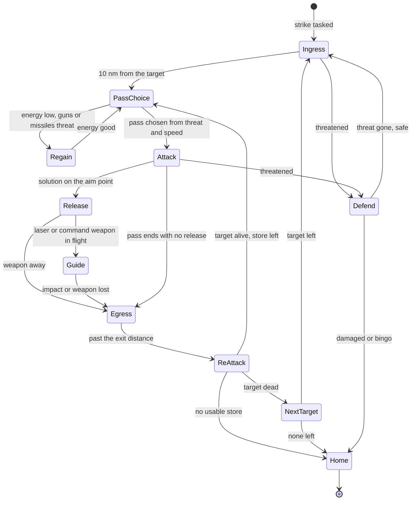

# AI strike behaviour

> **T.O.R.E: Tasteful Opinionated Reverse Engineered.**
> The thing being reverse engineered is the *experience*, not the executable. We
> trace what a player does and what the game does back, down to the numbers they
> would notice. How the original code achieved it is history: useful evidence,
> never a blueprint. If a sentence below reads like an instruction to reproduce
> the original's internals, it is out of date.
> <!-- tore-header v2 -->

Specification, 2026-10-11, for the AI strike round (slice ST-S). Status:
**specified, partly built**: the ground picture ([What the AI
knows](#what-the-ai-knows), and the threat inputs of [Perceived threat and
available speed](#perceived-threat-and-available-speed)) is built (ST-P), the
strike cockpit and shared release (ST-C), and the strike tactics for
fighters, attack jets and heavies (ST-T: target, store and pass choice, the
skill circle, release, exit, re-attack, defence and home; [How the AI flies a
pass](#how-the-ai-flies-a-pass)), and the helicopters' and the AC-130's
families (ST-F: [Helicopters](#helicopters), [AC-130](#ac-130)). AI lasing
beyond its own designator, orders and takeover are later slices. John asked for AI that attacks the ground and
authorised the work for this round (answers of 2026-10-11, folded in below). The
slices that build it are listed in [Source notes](#source-notes).

For a player: AI aircraft learn to bomb. A strike wing flies to its target,
picks a pass, drops, gets out, comes back until the target is dead or the
stores are gone, then goes home. Your wingmen strike on your orders. A pod
carrier can light the target for you or for a laser bomb carrier. If you give
your plane back mid-attack, the AI can finish the attack with your settings.
Fighters, attack jets, heavy bombers, helicopters and the AC-130 all do it,
each in a way that suits it.

Today the AI carries bombs and Mavericks and never uses them ([AI
behaviour](ai.md#b14-surface-attack-and-egress) records what the retail
scripts say and what is open). This spec adds the missing behaviour on top of
the player's own weapon systems in [air-to-ground](air-to-ground.md), which the
AI now shares.

## How to read the labels

Every rule below carries one label, as [AGENTS.md](../../AGENTS.md) defines
them.

| Label | Meaning |
| --- | --- |
| **retail** | Established from the retail scripts, records or executable ([AI behaviour](ai.md), [AI formats](../formats/ai.md)) |
| **spec-derived** | Taken from another spec in this directory |
| **fitted** | Chosen by an agent because the original's value is not known; the rule and constants are written down |
| **opinionated (John, date)** | A design John asked for or approved |
| **opinionated (agent)** | A design choice an agent made, never attributed to John |
| **unknown** | Insufficient evidence; see [Unknowns](#unknowns) |

## What retail does, and what changes

Retail FA's AI does strike, simply. A script picks one of four passes by dice
(straight run, pop-up, fast-high, dive bomb), the weapon service releases
whenever its check passes, and each AI bomb is re-aimed to land within 100 ft
of its target ([B14](ai.md#b14-surface-attack-and-egress), [B42](ai.md),
[bomb notes](../formats/weapons.md)). It has no buddy lasing and no AI lasing for
players. Its Quick Mission already sends friendly bomber-class wings at ground
targets ([Who strikes](#who-strikes)).

John's answers change the shape of it. All of these are opinionated (John,
2026-10-11):

| Retail | This spec |
| --- | --- |
| AI bombs are moved to land within 100 ft of the target | **No re-aim.** The AI flies the pass through control inputs and releases from the same delivery and guided solutions a player uses. Skill sets the release circle for unguided weapons ([Skill](#skill-and-release-precision)) |
| The pass is a random choice | **No dice.** The pass is a fixed function of perceived threat and available speed, limited by bombing class and weapon ([Pass choice](#pass-choice)) |
| A heavy bomber flies a high pass at 10,000 ft or more | Heavies bomb level from a minimum of 5,000 ft AGL, or the mission's airborne height if higher, raised by perceived threat ([Heavies](#heavy-bombers)) |
| No buddy lasing | The AI lases for its wing and for you, and drops on your spot ([Lasing](#lasing)) |
| Orders reach air targets only | Wingmen strike on the flight lead's orders, ground targets included ([Orders](#orders-from-the-flight-lead)) |

Randomness is kept as low as it can be (John, decision 13). Every choice below
is a function of the situation. The only dice left in a strike are the ones the
player's weapons already have: a bomb's up to 3 degree scatter in heading and
pitch ([bomb motion](air-to-ground.md#bomb-motion), retail), and the existing
seeded draws for hit rolls and countermeasures.

## Who strikes

| Rule | Label |
| --- | --- |
| Every AI family can strike: fighters, attack jets, heavies, helicopters and the AC-130 | opinionated (John, 2026-10-11) |
| The behaviour is side neutral. Any side's wing with the Strike role strikes | opinionated (John, 2026-10-11) |
| Quick Mission gives each wing a role, **CAP** (today's behaviour, the default) or **Strike** (offered only when a ground target is set). A Strike wing flies to the objective, strikes, goes home. Its loadout is the loadout page; a Strike wing with no surface stores is told so | opinionated (John, 2026-10-11) |
| **Retail's rule, recorded beside it** ([ST-R](../formats/ai.md#strike-maneuvers-steering-frame-and-orbit)). Retail Quick Mission has no role setting. When a ground target is set, every *friendly* bomber-class wing (A-4E, A-6, F-117, B-52, AC-130U, AH-64, Mi-24, Su-24, Tornado) is given ground classes (ship, tank, vehicle, structure) to attack and defend and fighters to evade, and attacks what it sees within about 26,400 ft. Fighter-class wings (A-10, A-7, AV-8B, Su-25 included) stay air only. No wing is ever given SAMs or AAA, so retail has no SEAD. Enemy wings never strike. How the wings reach the area is open. T.O.R.E's per-wing CAP or Strike role is a departure from this, and the default is CAP for every wing; see [Confirm with John](#confirm-with-john) item 9 | retail (rule), opinionated (John, 2026-10-11) for the departure |
| Redfor can strike but Quick Mission gives Redfor no air-to-ground objectives, so no Redfor wing is tasked in Quick Mission. Imported missions can task any side later | opinionated (John, 2026-10-11) |
| PvP: a Blue Strike wing goes after Redfor's protected objects ([objectives](surface-defenses.md#objectives-scoring-and-debrief)); Redfor wings stay CAP and defend | opinionated (agent) |
| The player's own wingmen follow the player and strike on orders only. They never wander off to bomb on their own, even on loose control | opinionated (John, 2026-10-11) |
| An AI lead that inherits a wing whose human was striking continues that target, then the objective, before any air search (extends [the lost human leader rule](ai.md)) | opinionated (agent) |

Reactions while striking use the Mission Creator's vocabulary (retail manual
p. 169): ground targets **attack**, aircraft **defend**, SAMs and missiles
**evade**.

| Reaction | Rule | Label |
| --- | --- | --- |
| Attack | The striker works its target until it dies or no usable store is left, then the next target, then home | retail (waypoint completion, [B48](ai.md#b48-routes-fuel-and-recovery)) and manual |
| Defend | It engages an aircraft only if that aircraft has fired at the wing or locked it, or is inside 5 nm and facing it (the [B02](ai.md) test). Otherwise it presses on | fitted |
| Evade | Existing [B47](ai.md#b47-threat-warnings-countermeasures-and-reason-priority) reactions and countermeasures, unchanged. With a ground target retail evades by climbing on the same course to at least 20,000 ft | retail |
| Out of surface stores | A wing with missiles left and loose control may take up free air engagement | opinionated (John, 2026-10-11) |

## One cockpit, two pilots

The ground-attack state a human uses is one record per aircraft, the **strike
cockpit**: the target (a ground object, a sight pin point, or none), the
selected station and armed state, the delivery mode (CCIP or LVL), the seeker
mode (CUED or BORE), the sight (track, pin, look, zoom) and the laser with its
hand setting. It holds what the kept cockpit of a given-back plane already holds, made the
single home of the state.

- A human edits it with keys, as today.
- The AI edits it from its strike controller (target, station, laser on or
  off) and leaves everything else alone.
- One release function serves every launcher, human or AI: packs, pod rounds,
  scatter, guided flights, laser spots. AI rows no longer build a plain
  projectile.
- Guided flights find their launcher by aircraft, not by "the player", so an AI
  laser bomb, JDAM or AT-2 guides exactly as a player's does.

All opinionated (John, 2026-10-11: "one cockpit, two pilots" and
[takeover](#takeover-and-handback)); the record layout is an agent design.

Built (slice ST-C): the record, the shared release and the AI's entry to it
are described in [architecture](../ARCHITECTURE.md#the-strike-cockpit). The AI
releases on the shared solution with no re-aim; when it releases, and its
skill's aim for unguided weapons, are the strike tactics' ([How the AI flies a
pass](#how-the-ai-flies-a-pass)).

## What the AI knows

| Rule | Label |
| --- | --- |
| Briefed targets (the objective's template objects, flagged for Redfor in Quick Mission) are known from the start. This is the briefing, not a sensor | fitted (retail missions name a target object) |
| Anything else must be seen. A strike actor builds the same ground lists as a player (A-G radar, FLIR, eye) at the retail 6 s rebuild, from its own aircraft | spec-derived ([air-to-ground](air-to-ground.md#ground-contacts-and-channels)), rebuild cadence retail |
| Air-to-air actors are unchanged: surface objects enter only a Strike actor's picture, so CAP wings behave as before | opinionated (agent) |
| A wing tasked as SEAD (a Wild Weasel assignment, retail manual p. 169) has the objective's air defences in its briefed set | retail manual, opinionated (agent) for the set |
| Target order: nearest first, at most two attackers on one object (the [B41](ai.md#b41-target-retention-eligibility-and-ranking) allowance) | spec-derived |
| After the briefed targets are gone, a striker with stores left attacks hostile ground objects it has seen within 10 nm of the objective, then goes home | fitted |
| The briefing is Quick Mission's destroy targets (flagged 0x80) of another side than the striker's, with their centre as the objective point. Redfor's are its own, so a Redfor striker is briefed on nothing (the capability is the same on both sides) | opinionated (John, 2026-10-11) for the sides; centre opinionated (agent) |
| A briefed or ordered object's place and whether it stands are known (retail's preferred-target test reads them directly). Its sensors decide only whether it is *perceived* | fitted |
| A SEAD striker is one carrying an anti-radiation store; its briefing adds the hostile armed units and radars within 5 nm of the objective point (the distance Quick Mission's Red defends within) | opinionated (agent), radius fitted |
| An ordered ground target (a flight lead's order, a taken-over designation) is known like a briefed one and outranks the briefing; it gives even a CAP wingman a ground picture while it stands | retail (the ordered object is the only candidate) |
| The A-G radar list (radar on and working) and the FLIR list follow the player's page rules (class, listing flag, visibility distance, range box, volume, signature, weather, clear line). The AI reads both, and its eye, at once, without switching its scope | spec-derived; reading all at once opinionated (agent) |
| The eye sees a standing, listable object on the ground inside the visual sensor's volume and range, with a clear line, and no farther than its own visibility distance (`maxVisDist`) when the type gives one; at most 50, nearest first | fitted |
| Between rebuilds, listed contacts follow their objects every quarter second, as the player's pages do | spec-derived |
| Neutral scenery never enters the picture (it would fill the 50-entry lists ahead of sided objects) | opinionated (agent) |
| A perceived object stays known at its last perceived place until it is destroyed or leaves the world | fitted |
| Every briefed target fully attacked (two others on each): the striker waits for one to free up, rather than taking a third place or an opportunity target | opinionated (agent) |

Built (ST-P): the picture is `tore_sim::ai::awareness::ground::GroundPicture`,
one per striker (`AiActor::ground_picture`), refreshed by
`AiMission::observe_ground`; the selector is
`tore_sim::ai::targeting::select_strike_target`. The bridge
(`tore_world::ai_wings::ground`) briefs strikers and describes the ground
objects. The role is `engagement::StrikeRole`, CAP by default; the Quick Mission
setting that chooses Strike comes with the orders and roles slice.

## Perceived threat and available speed

The two inputs to every tactical choice. They are read from what the AI
actually has: its sensors, its RWR and its warnings. An object it has not seen
does not count. Both are opinionated (John, 2026-10-11, "base tactics around
perceived threat and available speed"); the levels and numbers are agent
choices (opinionated, agent) unless marked.

**Perceived threat** is the highest level that applies. A defence "covers" a
point when that point lies within the defence's own maximum engagement range
(its weapon record) of it.

| Level | Name | Applies when |
| --- | --- | --- |
| 0 | Clear | None of the below |
| 1 | Air | A hostile fighter is in the picture within 30 nm, or an air-to-air warning sounded in the last 10 s |
| 2 | Guns | A known AAA site covers the target point or the planned release point |
| 3 | Missiles | A known SAM site with a working radar or seeker covers the target point or the planned release point, or a surface-to-air missile warning sounded in the last 10 s |

**Available speed (energy)** is **Good** when the aircraft's speed is at least
its corner speed at the current altitude, loaded (the corner query of
[B05](ai.md)), and **Low** otherwise. The **dive gate** is the retail dive
condition with the dice removed: altitude AGL and horizontal distance to the
target both at least max(10,000 ft, twice the turn radius) ([B14](ai.md#b14-surface-attack-and-egress),
retail).

**Retail's threat geometry**, the only one it has ([ST-R](../formats/ai.md#strike-maneuvers-steering-frame-and-orbit); it reads no threat rings or weapon ranges): a ship threat is ignored beyond 40,000 ft and any other beyond 30 statute miles; between 20,000 ft and 30 miles it is ignored unless the aircraft is within 100 degrees of the threat's nose; inside 20,000 ft it is always evaded (if its class is in the evade set). Speed enters retail's pass choice only through turn radius. These bands (20,000 ft, 30 miles, 100 degrees) are the inputs the levels above are built from, not the levels themselves: the levels stay opinionated (agent), and the Air level's 30 nm is close to retail's 30 statute miles (26 nm).

The picture is rebuilt at the 6 s cadence. Inputs are read when a pass is
chosen and again before each re-attack, never in the middle of a pass, so the
choice cannot flicker.

How the inputs are built (ST-P, `awareness::ground::ThreatPicture`):

| Input | Rule | Label |
| --- | --- | --- |
| Known defences | Every briefed defence that stands and every perceived armed unit or radar, of any side, with its missile reach (the farthest launch zone of its missiles), its gun reach (the farthest launch zone of its guns), whether it is a radar and whether it can guide (its battery's radar stands, or it guides by itself) | spec-derived; reach from the launch zones fitted |
| Covers | A point lies within the reach as a straight-line distance from the site; a missile site covers only while it can guide | spec-derived |
| Fighters | The hostile fighters of the striker's current air picture within 30 nm, nearest first, with the angle off each one's nose | spec-derived |
| Retail geometry | Each known defence and fighter answers retail's ignore-or-evade test; the angle off the nose is measured in the horizontal | retail bands; horizontal angle fitted |
| Warnings | The caller supplies whether an air-to-air or surface-to-air warning sounded in the last 10 s | spec-derived |

## Pass choice

The pass is chosen once per attack run, 10 nm from the target and again before
each re-attack. The four retail passes keep their retail shapes
([B14](ai.md#b14-surface-attack-and-egress), retail); only the choice is new.

| Pass | Shape | Label |
| --- | --- | --- |
| Straight run | Fly at the target until 2,000 ft horizontal, then exit | retail |
| Pop-up | Approach 500 ft above the target until within 10,000 ft, pull up 25 degrees, then point at the target until 1,500 ft or it is no longer ahead. Aim is the target's own position (0 to 359 ft right of it in retail, see below) | retail |
| Fast-high | Approach 5,000 ft above, straight on at maximum speed after 2,000 ft | retail |
| Dive bomb | Entry only at the dive gate. Approach at a point H = max(2R, AGL at entry) above the target at corner speed until horizontal distance is under 1.5R. Roll-in: hold the bearing to the target at that moment, level, bank 180 (inverted), corner speed, until under R. Pull to 90 degrees nose down (flown at the aircraft's `maxDive`, -80 on every fighter and attack jet) and hold until AGL is under max(2R, 2,000 ft). Roll out on the roll-in heading plus 180 at corner speed, a split-S pull-through to level. Then climb 25 degrees for 10 s, then the exit run. R is the turn radius, V squared over 43.6 G ft | retail ([ST-R](../formats/ai.md#strike-maneuvers-steering-frame-and-orbit)) |
| Level run | Straight and level at or above the release floor, with the LVL cue, for bombs dropped from altitude | opinionated (agent); the heavies' retail high pass is the model |
| Orbit | Left-hand pylon turn around the target | retail for the family, numbers [fitted](#ac-130) |

**The choice** for fighters and attack jets with unguided bombs, first row that
applies:

| Order | Condition | Pass |
| --- | --- | --- |
| 1 | Energy Low and threat Guns or Missiles | **Regain**: do not enter; fly the exit leg (climb 10 degrees at maximum speed) until energy is Good, then choose again |
| 2 | Threat Missiles | Pop-up (a low approach under the radar, a short climb, release, down) |
| 3 | The dive gate holds | Dive bomb |
| 4 | Otherwise | Straight run |

**Other weapons and a kept delivery mode**, applied before the table:

| Case | Pass |
| --- | --- |
| Seeker missiles and HARM (stand-off) | Fast-high when energy is Good, else straight run; the approach ends at the store's release range. Retail's guided release rule is the model: a guided round only inside 10,000 ft or half the weapon's maximum range, one guided round in flight at a time (retail, [weapons](../formats/weapons.md#ai-release-against-ground-targets)) |
| Rockets | Straight run with a shallow dive. The pop-up under threat Missiles is not flown with rockets (fitted, agent, ST-T): a rocket flies along the nose, and after a low pop the dive that points the nose at the target is steeper than the AI's terrain floor allows, so the run would end with no rocket fired |
| Guns (strafing) | Straight run; attack jets strafe after their bombs and rockets are gone |
| Laser bombs, JDAMs | Level run (or a shallow run) to the weapon's reach |
| Taken over with LVL kept | Level run whatever the table says |
| Taken over with CCIP kept | The table's pass, flown as CCIP |

**Retail quirks the pass copies and does not copy.** Retail's pop-up pull (`homeAngle 0 25 0 corner 4`, helicopter 30 degrees for 6 s) is written with the speed in an ignored slot, so it requests *minimum* speed during the pull and bleeds speed for 4 s (6 s). The final pop-up leg aims 0 to 359 ft right of the target because a bearing was used as feet. **Recommendation, opinionated (agent): do not copy either.** The pull holds corner speed, or the speed the pass choice needs, and the final leg aims at the target, because John asked that tactics follow perceived threat and available speed (decision 3), and a pass that throws away its own speed under threat Missiles contradicts that. The pass shape (offsets, angles, durations) is retail's. Say so to John if he would rather have the retail bleed (item 10).

**The steering frame** (retail, same source): a pass offset is added to the target's position (in feet, x to the target's right, z ahead, rotated by the *target's* heading; y straight up from the target's height) and the aircraft flies straight at that point. A "low approach" is therefore a straight line to the point, level only because pitch requests within 3 degrees snap to level while the point is 3,000 ft or more away. Pitch is clamped to the aircraft's climb and dive limits. The AI takes this frame for the offset passes; its pilot flies the line through control inputs ([Skill](#skill-and-release-precision)).

Release floor, a minimum altitude AGL for dive and level releases, taken from
the retail manual's advice (3,000 ft lightly defended, 5,000 ft or more
defended; advice, not enforced by retail) and made a rule here: **3,000 ft**
under threat Clear or Air, **5,000 ft** under Guns or Missiles. Opinionated
(agent). Pop-up releases are below it by design and are the Missiles answer.

The bombing class limits the choice (next section). Every pass is also
available to the headless driver by name, so a test can force each one; that
changes nothing in play.

## Bombing class

Each aircraft's class comes from its imported record, so a new aircraft needs
no code (John, 2026-10-11: "maybe we go by weight so we don't have to keep
programming it in"; thresholds accepted by John, decision 19). The test runs in
this order. Fields are in [the aircraft table](../formats/fa-aircraft.csv).

| Order | Class | Test on the record | Passes allowed |
| --- | --- | --- | --- |
| 1 | Helicopter | Lift kind helicopter or tiltrotor (retail `no_lift`) | Pop-up and stand-off fire; never dive |
| 2 | Gunship | The record gives it the linked-gun gunsight ([AC-130 guns](ac130-linked-guns.md)) | Orbit |
| 3 | Heavy | Maximum takeoff weight 150,000 lb or more, or positive G limit 3 or less | Level run only; stand-off missiles from level flight; no dive, pop-up, rockets or strafe |
| 4 | Attack | Top speed 700 kt or less | Retail fighter passes, plus strafe and rocket re-attacks after the bombs, and a lower ingress |
| 5 | Fighter | Everything else | The four retail passes and the level run |

- **Retail check.** Over the 145 retail aircraft records the rule agrees with
  retail's own AI script binding for 142. The three differences are the B-1B
  (retail binds the fighter script; the rule makes it a Heavy, as John wanted),
  the Aurora (rule: Fighter; carries no ground stores) and the Blimp (rule:
  Helicopter by lift; no stores). A test pins this census.
  Class thresholds are **opinionated (John, 2026-10-11)**, the order and the
  top-speed test **opinionated (agent)**; retail has only the script binding
  (retail: fighter, bomber, helicopter and the AC-130's own).
- **The current import.** Helicopter: AH-64, Mi-24, V-22, CH-47. Gunship:
  AC-130U. Heavy: C-130, E-3, Il-76, E-2C, B747, A310 (none carries ground
  stores today). Attack: A-4E, Su-25, AV-8B, A-7, A-10, MiG-17F. Fighter: every
  other imported aircraft, the F/A-18D included. The F-22 uses its bay as in
  [weapons](air-to-ground.md#weapon-classes).
- **Override.** An optional per-aircraft override, a data table keyed by PT
  resource name (`OVERRIDES`, empty for every current aircraft), for the day
  the rule is wrong for one (the F-117, which retail flies at 5,000 ft level,
  is the likely first). A new import adds nothing to it; only a wrong class
  does. Opinionated (agent).
- **The player's default.** The class sets only the **default** bomb mode: a
  Heavy selects LVL whatever its attitude (retail heavies have no CCIP); every
  other class keeps the [H1 rule](air-to-ground.md#status-word-and-mode-choice).
  Both modes stay available to the player on every aircraft. Opinionated (John,
  2026-10-11); no imported aircraft is a Heavy with bombs today. How the two
  combine:

  | Class | Bomb mode when a bomb is selected |
  | --- | --- |
  | Heavy | LVL always: with or without a designated ground target, level or diving. A Heavy also starts the mission in LVL |
  | Helicopter, Gunship, Attack, Fighter | The H1 rule: LVL if a ground target is designated and the flight path is within 10 degrees of level, else CCIP |

  Ctrl+M switches CCIP and LVL for every class after the choice, and nothing
  re-chooses until the next selection.
- **Where it lives.** `crates/tore-sim/src/models/strike_class.rs`
  (`StrikeClass`, `Record`, `OVERRIDES`, `default_delivery`). The class is read
  once from the imported record into the combat configuration
  (`combat::live::Configuration::strike_class`), so the player's selection rule
  and the AI strike controller read the same field. Tests pin the imported
  roster above, the 145-record census (the `ai_script` column of the [aircraft
  table](../formats/fa-aircraft.csv)) and the Heavy LVL default.

## Skill and release precision

**The principle (opinionated, John, 2026-10-11):** the AI flies the pass
through control inputs and releases from the shared solutions. A better pilot
puts the weapon closer to the target. John's rule is a circle around the target
that grows as skill goes down.

**The release circle (opinionated, John, 2026-10-11).** The radius `R` comes
from the aircraft's experience level ([AI experience](ai-experience.md)), 75 m
more for each level down:

| Level | `R` (m) | `R` (ft) |
| --- | ---: | ---: |
| Ace | 100 | 328 |
| Experienced | 175 | 574 |
| Average | 250 | 820 |
| Novice | 325 | 1,066 |

- **The AI releases only when the aim cue puts the predicted impact inside its
  circle**: the pipper in CCIP, the T in LVL, the rocket impact for rockets. It
  flies the cue to the aim point drawn below with its stick and rudder and
  drops when it arrives. An Ace therefore holds the pipper within 100 m of the target; a
  Novice lets it be 325 m off. (Opinionated, John, 2026-10-11.)
- **A seeded draw picks the aim offset for each pass.** The draw is a
  deterministic function of the mission seed, the aircraft id and the pass
  number (the first pass at a target is 1, each re-attack adds one), so every
  host and every replay agrees. It gives a point on the ground, an offset from
  the target, that the AI aims the cue at. In 90% of passes the offset is
  inside the circle, uniform by area (distance `R x sqrt(u)`, a uniform
  bearing); in 10% it is in the ring from `R` to `2R` (distance
  `R x sqrt(1 + 3u)`, a uniform bearing). The mean offset inside the circle is
  two thirds of `R`. The 90% and the circle are John's; the ring's extent and
  the seed inputs are an agent choice (opinionated, agent; see
  [Confirm with John](#confirm-with-john)). The AI flies the cue to the
  drawn point and releases when the cue is within 5% of `R` (fitted) of it, so
  a ring draw releases outside the circle: that is the 10% John asked for.
  (Opinionated, agent.)
- **The weapon's scatter is on top**, as for the player: up to 3 degrees in
  heading and pitch for bombs (the retail 0.0524 of the range), the rocket and
  gun spreads of their records. The scatter is the retail dice and stays as it
  is.
- **Unguided weapons only.** The circle applies to unguided bombs, packs and
  rockets. Smart weapons use the targeting and laser systems as the player
  does, which are hard to get wrong at any skill (opinionated, John,
  2026-10-11): an AI that lases holds its **laser spot** on the target, a
  JDAM's stored point is the designated target, and seeker missiles and HARM
  are judged by their lock. Skill does not move a guided weapon's aim point.
  The reach window and lock rules for release are unchanged ([guided
  reach](air-to-ground.md#guided-bomb-release-range-indicator)).
- **No retail re-aim.** Nothing moves a bomb after it leaves; the circle is
  where the pilot aims.

**Worked numbers** (arithmetic of this spec, not a measurement; the draws shown
are chosen to illustrate; the scatter is the retail 3 degrees, 0.0524 of the
range):

| Case | Ace (328 ft) | Experienced (574 ft) | Average (820 ft) | Novice (1,066 ft) |
| --- | --- | --- | --- | --- |
| Mk 82 dive: 30 degrees, 6,000 ft slant. Scatter alone about 310 ft across the track | Aim 164 ft out for a draw `u` = 0.25; bombs land about 164 ft plus up to 310 ft scatter from the target | Aim 287 ft out; the slick's 300 ft fuze radius is hit by the lucky bombs | Aim 410 ft out | Aim 533 ft out, bombs spread beyond a fuze radius |
| Mk 82 level: 6,000 ft AGL, 450 kt, 19.4 s fall, 15,900 ft slant. Scatter alone about 770 ft across the track | Aim 164 ft out; scatter dominates | Aim 287 ft out | Aim 410 ft out | Aim 533 ft out; scatter and aim are of the same order |
| The same pass with a ring draw (10%), `u` = 0.25 | `R x sqrt(1.75)` = 434 ft | 759 ft | 1,085 ft | 1,410 ft |

Every distance in the first two rows is `R x sqrt(0.25)`, half of `R`; a draw
of `u` = 1 would put the aim on the circle's edge (R). Reading: an Ace's
unguided bombs land within a few hundred feet and the scatter is most of the
miss; a Novice's aim alone can lose the fuze radius of a Mk 82 (300 ft) on most
passes. Guided weapons are not in the table: they aim at the target at every
skill.

## Weapons and releases

| Store | Pass | Releases when | Circle |
| --- | --- | --- | --- |
| Unguided bombs, packs | Table above | CCIP mean impact, or the LVL cue, on the aim point (a pack leaves in one instant, [packs](air-to-ground.md#release-modes-and-packs)) | Cue inside `R` |
| Rockets | Straight run, shallow dive, or pop-up | Rocket impact on the aim point, at the record's cadence | Cue inside `R` |
| Guns | Straight run | The existing gun employment ([AI guns](ai-gun-employment.md)), unchanged | none |
| Laser bombs, laser missiles | Level or shallow run; then an offset turn holding the target inside the designator's gimbal until impact (fitted) | Target inside the reach and a spot will exist (own designator, or a same-side spot); with none, the store is not chosen | none: spot on the target |
| JDAM | Level run | Target point stored, inside the reach | none: point on the target |
| Mavericks, AS-14, AS-30 | Fast-high or straight | Seeker locked on the target inside zone 1 ([lock flow](air-to-ground.md#the-seekers-and-the-lock-flow)) | Lock |
| Radar AGMs (AS-7, AS-15, AGM-84A, AM-39, AS-16) | Straight run | Radar track at release, held through the flight (the AI support rule, [B45](ai.md#b45-seeker-visibility-launch-eligibility-and-ammunition)) | Lock |
| HARM | Fast-high; fire at maximum range, exit | A HARM candidate inside the zone ([HARM cue](air-to-ground.md#missiles-and-the-harm-boresight-cue)) | Lock |
| AT-2 (Mi-24) | Helicopter pop-up; hold the line until impact | Target inside the launcher's cone with a clear line | Lock |

Store choice is retail's ([B45](ai.md#b45-seeker-visibility-launch-eligibility-and-ammunition)):
bombs, rockets and ground missiles only against the surface; air-to-air
missiles only against aircraft; guns against both. Label: retail, spec-derived.
The delivery modes, solutions and guided flights are the player's, so this
spec adds none (spec-derived).

## Heavy bombers

| Rule | Label |
| --- | --- |
| Heavies bomb level only. They never dive, pop up, fire rockets or strafe | retail (the bomber script flies a high pass), opinionated (John, 2026-10-11) for the class test |
| Minimum release altitude: **max(5,000 ft AGL, the mission's airborne height)** | opinionated (John, 2026-10-11); retail uses max(altitude, 10,000 ft) |
| Raised by perceived threat: Clear and Air +0, Guns +5,000 ft, Missiles +10,000 ft, never above 90% of the aircraft's ceiling | opinionated (John, 2026-10-11) for "raised by threat"; the amounts are fitted |
| "The mission's airborne height" is the Quick Mission altitude setting ([Quick Mission](quick-mission-menu.md)); for an imported mission, the wing's start altitude. Read as AGL over the target area | fitted; confirm with John |
| Release is the weapon record's own burst (rounds and spacing from the record), centred on the aim point as a stick. There is no ripple setting | retail (burst fields), fitted (centring) |
| Exit climbs toward 50,000 ft (never above the ceiling), then turns back | retail |
| Stand-off missiles are fired from level flight at the reach | opinionated (agent) |

## Egress, re-attack and going home

After release the aircraft exits and decides again. All fitted from the retail
exit unless marked.

- **Exit** (retail, [ST-R](../formats/ai.md#strike-maneuvers-steering-frame-and-orbit)).
  Inside 10,000 ft horizontal, jink: four legs of 3 s at maximum speed, heading
  the current heading plus or minus 10 degrees, climbing 10 to 14 degrees, a
  weave of 10 degrees to one side, repeated while still inside 10,000 ft.
  Beyond 10,000 ft: hold heading, climb 10 degrees at maximum speed. At
  max(30,000 ft, twice the turn radius) away, turn back level at corner speed
  and choose again. Retail draws the weave's side and heading by random; T.O.R.E
  uses the existing seeded channel or a fixed side (John, decision 13).
- **Re-attack.** At the exit distance the aircraft runs the choice again with
  fresh threat and energy. Target alive and a usable store: attack. Target
  dead: the next target. No target left, or no usable store: home (the existing
  return to base, [B48](ai.md#b48-routes-fuel-and-recovery)).
- **Defend.** A missile warning or an attacking fighter hands control to the
  existing B47 reactions. The pass is abandoned, countermeasures and breaks run
  as today, and the striker resumes at ingress when the threat is gone and the
  picture says safe (below). Damage or low fuel sends it home.
- **Safe** (also used by takeover): no warning in the last 10 s, no known SAM
  covering the target, and no hostile fighter inside 15 nm. Fitted.

## How the AI flies a pass

Built in slice ST-T (`tore_sim::ai::strike`, the bridge
`tore_world::ai_wings::strike`). The AI flies every pass through the same
input-only steering adapter as every other AI maneuver (a heading, a
flight-path pitch and a speed; [AI behaviour](ai.md)), so what it can fly is
what that adapter and the AI's terrain floor (6 s of travel ahead) allow. The
retail pass shapes above are kept; the rules below are how they are flown.
All fitted (agent, 2026-10-11) unless marked.

| Rule | Value |
| --- | --- |
| Who | An AI aircraft with a ground picture (the Strike role or an ordered ground target) of the Fighter, Attack or Heavy class. Helicopters and the gunship fly their own families ([Helicopters](#helicopters), [AC-130](#ac-130)) |
| Choice point | 10 nm from the target, or at once inside it; again at each turn back |
| Target | The ordered one; else for an anti-radiation carrier the objective's SAM radars, then AAA radars, then other radars, nearest first, two attackers at most (SEAD); else the selector's (nearest briefed, then seen opportunity targets) |
| Store | Anti-radiation at a radar first; under threat Missiles stand-off first (seeker, radar AGM, JDAM, laser, bombs, rockets); otherwise bombs, JDAM, laser, seeker, radar AGM, rockets. A laser store only with the aircraft's own designator, its laser on by hand while selected (other spots are the lasing slice's). A heavy carries no rockets into a pass |
| Aim | The pass's seeded draw (mission seed: the aircraft's roster seed; aircraft id; pass number), unguided only. A moving target is also led by its ground speed times the cue's time of fall |
| Approach | Flown at the aim point. A pop-up comes down to 500 ft over the target by its pull point, 10,000 ft out (16,000 ft for rockets), then pulls 25 degrees over the line of sight at corner speed for at least 4 s and until the target is 15 degrees down. A dive approaches its roll-in point (the dive's height, at least max(10,000 ft, 2R), where the aim is 30 degrees down) and starts the dive there, since the adapter noses over wings level instead of retail's inverted pull |
| Flying the cue | Across the track the heading turns by the angle between the aim and the line the cue sweeps along. In a straight run, pop-up or dive the flight path is turned by three times the angle between the cue and a point 600 ft short of the aim (no more than 8 degrees over the line to the target) until the cue is within 600 to 900 ft short, then held, so the cue creeps across the aim; a cue that overshoots by the circle is flown again. While the cue is more than 3,000 ft short the pass flies its own line. A push that would ask the adapter for less than 0.3 G is flown wings level (a banked push turns the wrong way). Level runs, fast-high bomb runs and guided weapons hold their height and steer the cue (or the aim) across |
| Release | When the host's shared release test passes (the cue within 5% of R of the aim, or a guided weapon's reach), in the pass's final or a pop-up's pull, with the cue inside the store's zone 1 range, above the floor for a dive or level release, and not while the sight warns LOW or FRAG. One trigger call a pass (a pack leaves whole); rockets fire one at the record's cadence while the cue stays inside the circle, at most 8. Seeker missiles fire on the lock (inside zone 1 from the mount, within 10,000 ft or half the zone-1 maximum, an emitting target for a HARM, one guided round at a time) through the AI's own missile release, observed on the ground target |
| Exit | Retail's: a jink of four 3 s legs at maximum speed (12 degrees up, 10 degrees to the side the draw picks) inside 10,000 ft, then 10 degrees up at maximum speed, levelling 2,000 ft over the altitude the strike began at (a dive's exit climbs back to the dive's height), turning back at max(30,000 ft, 2R) (a heavy at 50,000 ft) |
| Defend | A B47 defence (missile or gunfire) or a fighter inside 5 nm within 45 degrees of its nose hands the flying back. Once no warning has sounded for 10 s it resumes at ingress if [safe](#egress-re-attack-and-going-home) (the safe test as written, confirmed by John on 2026-10-11); if not, it egresses to the exit distance and resumes only if safe by then, else goes home |
| Home | No target or no usable store left: the mission's own return (a landing order with a runway, else the leader flies home) |

Known limits, each an effect of flying through the input-only adapter and the
terrain floor rather than a rule: the dive is held to about 50 degrees at
5,000 ft by the floor; a pop-up from low with rockets cannot dive steeply
enough (hence the straight run above); and the column's own guns can bring a
striker down at a pop-up's low altitude.

## SEAD

HARM carriers in a Strike wing take the objective's radars first: SAM radars,
then AAA with radar, then the rest of the briefed set. They fly the fast-high
pass and fire at the HARM's maximum range, then exit. A HARM already flying
keeps homing while the object stays in the missile's 45 degree cone, even if
the radar shuts down ([air-to-ground edge cases](air-to-ground.md#edge-cases)).
The retail Wild Weasel idea ("attack enemy air defenses", manual p. 169) is the
source; the order of radars and the fire range are opinionated (John,
2026-10-11, decision 15) with the details agent. HARM eligibility for the AI
follows retail ([weapons](../formats/weapons.md#ai-release-against-ground-targets)):
any surface target, the lock only while it emits; T.O.R.E fires it inside
the AI's fire range (100,000 ft for the AGM-88) while the target's radar
emits.

## Helicopters

Retail gives helicopters one ground pass: a pop-up with a 1,500 ft offset, a 30
degree pull, point down until 1,500 ft, then exit to 20,000 ft
([B20](ai.md#b20-other-aircraft-families), retail). The class (above) keeps
them to it and to stand-off fire. The AH-64 fires rockets in the pop-up and
the Mi-24 fires AT-2s, holding the line to the target until impact. Rockets and
the AT-2 use the player's release and guided rules. Under threat Missiles a
helicopter stays at the weapon's release range rather than closing to 1,500
ft (fitted).

Built in slice ST-F (`tore_sim::ai::strike::helicopter`). Every choice is a
fixed function of the store and the perceived threat; nothing is drawn but the
rockets' aim offset (the [skill circle](#skill-and-release-precision)).

| Rule | Value | Label |
| --- | --- | --- |
| Store | The AT-2 (or any guided or seeker store) first, then rockets; a laser store only with its own designator. Guns are not used against the ground | fitted (agent) |
| Pass | Under threat Missiles with a guided store: the stand-off attack. Otherwise the pop-up | fitted (agent), spec rule above |
| Pop-up | Toward a point 1,500 ft above the target until 10,000 ft out, a pull 30 degrees over the line of sight for 6 s, then the nose on the target until 1,500 ft or the target is behind. The pull does not bleed speed: retail's operand slip asks for minimum speed there, T.O.R.E does not copy it | retail shape; no bleed opinionated (John, 2026-10-11, "maintain proper speed for defense and quick exfil") |
| Speed | Every leg asks for the helicopter's maximum speed. Asked for corner speed, the AI's input-only adapter slows a helicopter until it sinks (a Mi-24 on the pop-up went from 120 to 85 kt and into the ground), and the adapter holds a helicopter at about 85 to 140 kt on maximum | opinionated (John) for keeping speed; the value fitted (agent) to what the adapter can fly |
| Stand-off attack | Masked: toward the target, down toward 200 ft above the ground, to 60% of the weapon's zone-1 range (about where the guided T bar stands, 40% of the reach in from its far edge; 10,800 ft for the AT-2). Unmask: climb 500 ft, nose on the target, for at most 10 s while the shot comes up. Fire, hold the line, then mask again turning away from the target and run out to the weapon's range plus 6,000 ft before turning back | fitted (agent) |
| No hover | The unmask is flown at speed, not from a hover: the AI's adapter cannot hold a helicopter in a hover (asked for its slowest speed it noses over into the ground), and a moving helicopter keeps its speed for defence | fitted (agent), a limit of the adapter |
| The AT-2 | Leaves when the shared release test passes (the target inside the launcher's 45 degree cone with a clear line, inside the reach). The helicopter then holds its nose on the target, level, until the missile has hit or is gone (the [launcher sight rule](air-to-ground.md): command guidance needs the target in the cone every tick), and only then exits | spec-derived |
| Rockets | The cue is flown onto the pass's drawn aim point: heading at the aim, flight path at the line to the aim plus three times the angle between the aim and the cue, no steeper than 20 degrees down. The first rocket leaves when the cue is within 25% of the circle of the aim (a fighter's gate is 5%: a helicopter's cue moves slowly and its adapter holds it only to about this), then up to eight at the record's cadence while the cue stays inside the circle | fitted (agent); the circle opinionated (John) |
| Run floor | A pop-up's final ends 500 ft above the ground whatever the cue says (the adapter cannot pull a helicopter out of a steep dive near the ground) | fitted (agent) |
| Exit | Retail's: 5 degrees up at maximum speed on the exit heading, levelling at the pass's height, to max(20,000 ft, 2R); then turn back and choose again | retail |
| Defence, safe, home | The fighters' (above) | spec-derived |

Known limit: a defence hands the helicopter to the existing B47 reactions,
which fly fighter breaks at corner speed; a helicopter flying them sinks into
the ground (a Mi-24 under the column's SAMs did, in the driver). Helicopter
defence is open (the retail helicopter break, B20, is not built).

## AC-130

Retail circles a target on a left pylon turn (`circle 0 4000 2000 35`, at a
speed halfway between corner and maximum, re-issued every 5 s; [B20](ai.md#b20-other-aircraft-families),
[formats](../formats/ai.md#strike-maneuvers-steering-frame-and-orbit)). Its
numbers are script constants, not derived from the guns: radius **4,000 ft**
horizontal about the moving target, **2,000 ft** above it, heading to the
centre plus 90 degrees (45 to 135 as it converges), and a requested bank of 35
degrees that the AC-130's `maxBank` of **30 degrees** caps (it banks 20 to 30).
On that orbit the target is 4,472 ft slant, 26.6 degrees down and abeam left,
about a third of the 13,000 ft gun zone, inside every mount arc (retail). The arcs ST-R
confirmed, as half-widths about the left-facing neutral: C_25 60/60, C_40 45/45,
C_105 25 in heading and 45 in pitch. John asked
that the gunship "know range and circle targets appropriately based on where
guns can hit" (opinionated, John, 2026-10-11). The orbit is therefore chosen
from the guns:

| Rule | Value | Label |
| --- | --- | --- |
| Gun reach used | The shortest range of the guns it will fire. All three installed guns have **13,000 ft** | spec-derived ([linked guns](ac130-linked-guns.md)) |
| Slant range to the target | 80% of the reach: **10,400 ft** | fitted |
| Depression angle | **35 degrees**, inside the 105 mm's elevation limit of 45 degrees and the 25 and 40 mm's | fitted on the shipped arcs |
| Orbit height and radius | `h = slant x sin 35 = 5,965 ft` above the target, `r = slant x cos 35 = 8,520 ft` | fitted |
| Minimum radius | If the aircraft's turn radius at the orbit speed and at most `maxBank` (about 6,200 ft at 200 kt and 30 degrees of bank) exceeds `r`, raise `r` to it and `h` with it, keeping 35 degrees | fitted |
| Direction | Left-hand, guns toward the target (the guns' arcs are left side only) | retail direction, spec-derived arcs |
| Bank limit | The orbit never asks for more bank than the aircraft's `maxBank` (30 degrees for the AC-130). When the radius for the planned speed and bank is larger than `r`, the radius grows (and the height with it, keeping 35 degrees); the bank does not. This replaces the 35 degree bank of the earlier draft | opinionated (agent); retail also caps bank at `maxBank` |
| Mount limits | The target stays inside the arcs above (C_25 60/60, C_40 45/45, C_105 25 heading, 45 pitch); 35 degrees of depression is inside every pitch limit | retail (arcs), fitted (orbit) |
| Retail orbit, for comparison | 4,000 ft radius, 2,000 ft high, slant 4,472 ft (34% of reach), fixed. T.O.R.E departs on purpose: John asked for the orbit from gun reach, which puts the aircraft farther out and higher | retail, opinionated (John, 2026-10-11) for the departure |
| Speed | Halfway between corner and maximum | retail |
| Firing | Gunship sight on the target; guns fire inside their arcs and the 13,000 ft range, as the player's | spec-derived |
| Threat | With a known SAM covering the target it does not ingress and holds off; under AAA it continues | opinionated (agent); confirmed by John (2026-10-11) |

How it is built (slice ST-F, `tore_sim::ai::strike::gunship`, the bridge
`tore_world::ai_wings::gunship`, the gun train in
`tore_sim::combat::live::gunship_fire`). All fitted (agent, 2026-10-11) unless
marked:

| Rule | Value |
| --- | --- |
| Planning bank | The orbit is planned at the maximum bank less 5 degrees (25 for the AC-130), leaving the bank law room to correct; the radius grows past `r` when the turn at that bank needs it |
| Speed cap | The radius grows only until the slant range is 90% of the reach (11,700 ft, a 9,584 ft radius); beyond that the speed comes down from the retail midpoint until the turn fits, never below corner. Retail's midpoint at the AC-130's limits in the driver is about 191 kt, which fits the 8,520 ft radius at about 21 degrees of bank |
| Flying the orbit | Retail's circle law for the heading (the bearing to the target plus 90 degrees, less 45 degrees per radius of distance error, held to 45 to 135), flown with an explicit bank: the heading error closed in 4 s plus the orbit's own turn rate, blended in by retail's on-orbit score, never past the maximum bank. Height held at the orbit's, at most 10 degrees of climb or dive. The orbit follows a moving target |
| On the orbit | Within 25% of the radius of it and within 30 degrees of the circle law's heading; firing only there |
| Bursts | A burst every 2 s on the orbit. The 25 mm fires in the first second of each (30 rounds); the 40 and 105 mm fire every round they are due at their own rates, 100 and 10 a minute |
| Skill for guns | Each burst aims at the target plus an offset drawn like a bomb pass's ([skill circle](#skill-and-release-precision): the same seeded draw with the burst's number, 90% inside `R`, 10% in the ring to `2R`), which the gunner walks in: the offset is halved for every burst already fired at that target, down to a sixteenth. An Ace's first burst lands within 328 ft and its fifth within 21 ft; a Novice's within 1,066 ft and 67 ft. Opinionated (agent) for applying John's circle to gun bursts and for the walk-in, which stands for a gunner correcting onto his own impacts |
| Aim | Each gun is trained on the burst's aim with its own ballistics, as the player's gunsight trains it: led by the round's time of flight and raised by its drop; then the train is walked until the gunsight's pipper (the march of the trajectory the simulation flies) sits on the aim, as a gunner puts the pipper on the target (the lead-and-drop solution alone left the rounds 50 to 65 ft off at 10,400 ft). This replaces retail's AI aim, 20 ft above the target with no drop (about 17 ft low at 4,470 ft). A round fired along the train lands within 20 ft of its aim plus the gun's own dispersion cone, the same cone a player's rounds have (unit test, all three guns from a 330 ft/s orbit) |
| Mount arcs | A gun fires only when its train lies inside its arcs (25 mm 60/60, 40 mm 45/45, 105 mm 25 in heading and 45 in elevation, about abeam left), the aim inside its zone-1 range, its own airframe clear and the terrain line open. The AI trains its guns at once rather than slewing at 30 degrees a second: on the orbit the target moves through the arcs far slower than that |
| Hold-off | While a known hostile SAM covers the target, it circles the target outside that SAM's reach (the SAM's distance from the target plus its reach plus 2 nm) and comes in once no SAM covers it |
| Target | The ordered target, else the selector's; when it dies, the next; with none, or with no gun rounds left, home |

Measured in the driver (`ai-strike-ac130`, the moving T-90 of `~QUCOL`, 240 s
from 3 nm at 6,000 ft): on the orbit 30 s after the start, at about 191 kt,
5,965 ft over the target, 8,800 to 10,600 ft from it horizontally (the target
moves), 21 to 24 degrees of bank; the tank (200 hit points) killed at 123 to
165 s at skills 0, 2 and 3. The 25 mm does little to a tank (3 damage a round);
the 105 mm's 150 does most of the work.

## Lasing

Retail has no buddy lasing and its AI lasing is implicit
([lasers](../formats/missiles.md)). The buddy rules come from
[air-to-ground](air-to-ground.md#buddy-lasing) (opinionated, John,
2026-10-10); the AI follows them (opinionated, John, 2026-10-11).

- **AI lases its own target.** An AI with a designator (built in, or a Pave
  pod) lases while its laser weapon is selected or in flight: the player's
  automatic rule, through the same laser, with the same gimbal (60 degrees
  search and 45 degrees track built in; hemisphere for a pod).
- **Its spot is an ordinary spot.** Players' laser weapons can home on it, and
  the target page shows BUDDY with the AI's callsign.
- **AI drops on a buddy spot.** An AI laser-bomb carrier with no designator
  chooses a laser store only when a same-side spot is on its target: a player
  lasing it, or a wingmate.
- **"Lase my target"** is a new wingman order (a free Alt key, chosen by the
  slice and listed in [controls](../CONTROLS.md)). A wingman with a designator
  flies an offset orbit of radius max(3 nm, 1.2 turn radii) above the release
  floor and lases the target you designated, until it dies, the order changes or
  the wingman is threatened (threat Missiles). Opinionated (John, 2026-10-11);
  orbit numbers fitted.
- **A designator lases for its wing.** A Strike wing with one designator
  aircraft and laser-bomb carriers lets the designator lase the lead's target.
  Fitted.
- **Order changes.** If the lasing wingman leaves, a laser weapon guiding on its
  spot goes blind, as for a player who stops lasing.

## Orders from the flight lead

Actions are given by the flight lead (John, 2026-10-11): the player for the
player's wingmen, an AI lead for an AI wing. A Strike wing's AI lead gives the
same orders to its wingmen by the target rules above (nearest briefed target,
two to an object, designator carriers lase).

| Key | Order | Label |
| --- | --- | --- |
| Alt+E | Engage my target. Accepts a ground designation, else the sight pin. The wingman attacks with its best surface store and answers "Engaging" | opinionated (John, 2026-10-11) on retail keys |
| Alt+R | Engage from formation, the same with the ground target | opinionated (John, 2026-10-11) |
| Alt+F | Engage the IR/laser target. Retail: the contact you picked with `/` and `\` while IR/Laser advanced targeting is on, air or ground; with no hostile contact the wingmen attack whatever they find. T.O.R.E matches this (decision 7). Taking the target from your sight track, pin or laser spot, as well as the picked contact, is an addition | retail (meaning), opinionated (John, 2026-10-11) on the key, opinionated (agent) for the sight, pin and spot sources |
| Lase my target | New; see [Lasing](#lasing) | opinionated (John, 2026-10-11) |
| Alt+W | Unchanged: attack on contact. No target-class orders now. Retail's Alt+W is the class order ("Attack SAMs", attack all of the target's class); keeping attack on contact here is a departure | opinionated (John, 2026-10-11); the departure from retail is opinionated (agent) |
| Others | Unchanged. A wingman with no usable surface store refuses with the reason shown ("no usable surface store") | spec-derived |

Alt+F: the retail manual calls Alt+F "attack on contact" and the executable's
key table calls it "engage the IR/laser target" ([keyboard](keyboard.md)).
Research (ST-R) settled it: both are true. Alt+F sends the IR/laser contact you
picked, and when there is no hostile contact it sends the free order, which is
attack on contact. T.O.R.E follows it. A ground target is accepted by retail's
receiver (Alt+E, Alt+R and Alt+F alike), so ordering wingmen onto the ground
needs no new order, only the target source above. Retail Alt+W is the class
order; T.O.R.E keeps attack on contact there for now (item 11 below).

## Takeover and handback

When a human gives a plane back (drop, leave, away, kick), the AI takes the
strike cockpit as its own, and when the human takes it back, they find what the
AI did. All opinionated (John, 2026-10-11, decisions 10 to 12) unless marked.

- **It continues only if it thinks it is safe** (the [safe](#egress-re-attack-and-going-home)
  test). If not, it defends and egresses, then resumes at ingress when safe. The
  kept target, store, mode and laser are held meanwhile.
- **Target.** The kept ground designation, else the sight pin. A kept air
  target is as today.
- **Store.** The kept station if it is a usable surface store, else the AI's
  choice. Armed state kept.
- **Pass.** Kept LVL flies a level run; kept CCIP the [table's pass](#pass-choice).
  The AI never changes the mode.
- **Laser.** The hand setting stands: hand off stays off, the automatic rule
  runs. With a laser weapon in flight the AI holds the target inside the gimbal
  until impact. A radar AGM in flight keeps its support.
- **Pages.** The AI flies with its own pages and its radar on (the existing
  handback rule).
- **On return.** The cockpit as the AI left it: the designation follows the AI's
  current target (a dead target is replaced by the next), rounds are what is
  left, and the AI never changed the delivery mode or the laser hand setting.
- **First take of an AI striker.** The human gets the AI's target designated, its
  selected store, delivery mode and laser state.

## Online and replays

AI strike runs on the host like all AI. Strike state and the strike cockpit go
in the checkpoints so that standby, migration and resume carry a pass in
progress, a laser spot and a guiding bomb. Clients see AI spots as buddy spots
in the readout. New order codes and the Quick Mission role in the lobby are a
protocol change, made by the multiplayer slice. Replays keep format 3 and record
AI lasing, designations and releases as events, which also records the laser of
a given-back plane that is not recorded today; the viewer draws AI spots by
side and says "guided on Blue 2-1's laser". Opinionated (John, 2026-10-11,
decisions 17); wire and event details are agent.

Single-player output stays as it is unless a mission uses the Strike role, a
strike order or a takeover of a striking plane.

## Numbers

| Figure | Value | Label |
| --- | --- | --- |
| Release circle radius (Ace, Experienced, Average, Novice) | 100 m (328 ft), 175 m (574 ft), 250 m (820 ft), 325 m (1,066 ft) | opinionated (John, 2026-10-11) |
| Aim offset draw | 90% inside the circle, uniform by area; 10% in the ring R to 2R | 90/10 opinionated (John, 2026-10-11); ring extent opinionated (agent) |
| Draw seed | mission seed, aircraft id, pass number | opinionated (agent) |
| Guided weapons | no offset: the JDAM stores the target's point, the laser spot sits on the target, seekers lock on it | opinionated (John, 2026-10-11) |
| Release on the aim point within | 5% of `R` | fitted |
| Scatter | up to 3 degrees in heading and pitch, as the player | retail |
| Threat levels | Clear, Air (fighter within 30 nm), Guns, Missiles | opinionated (agent) |
| Energy | Good at or above corner speed | opinionated (agent) |
| Dive gate | altitude and distance both at least max(10,000 ft, 2 turn radii) | retail |
| Pass choice point | 10 nm from the target | fitted |
| Release floor | 3,000 ft (Clear, Air), 5,000 ft (Guns, Missiles) | retail manual advice, opinionated (agent) |
| Heavy minimum release altitude | max(5,000 ft AGL, mission airborne height), +0 / +5,000 / +10,000 ft by threat, at most 90% of ceiling | opinionated (John, 2026-10-11); raises fitted |
| Heavy exit | toward 50,000 ft | retail |
| Exit | jink inside 10,000 ft (4 legs of 3 s, 10 to 14 degrees up, 10 degree weave), then climb 10 degrees to max(30,000 ft, 2 turn radii) | retail |
| Guided release | inside 10,000 ft or half the weapon's maximum range | retail |
| Striker defends against | an aircraft that fired, locked, or is inside 5 nm facing it | fitted |
| Safe | no warning in 10 s, no SAM covering the target, no fighter inside 15 nm | fitted |
| Bombing class | helicopter by lift, gunship by gunsight, Heavy at 150,000 lb or G limit 3 or less, Attack at 700 kt or less, else Fighter | opinionated (John, 2026-10-11) |
| AC-130 orbit | 10,400 ft slant, 35 degrees, 5,965 ft high, 8,520 ft radius, bank at most the aircraft's `maxBank` (radius grows instead, planned at `maxBank` less 5, up to a 90% slant, then the speed comes down) | fitted; bank cap opinionated (agent) |
| AC-130 bursts | every 2 s on the orbit; the 25 mm for 1 s of it, the 40 and 105 mm at their rates; aim drawn in the skill circle, halved per burst down to a sixteenth | fitted; circle opinionated (John), its use for guns opinionated (agent) |
| Helicopter stand-off | masked at 200 ft AGL to 60% of the zone-1 range, unmask 500 ft for up to 10 s | fitted |
| Helicopter rocket gate | 25% of `R` | fitted |
| AC-130 retail orbit | 4,000 ft radius, 2,000 ft high, 4,472 ft slant, bank 20 to 30 (`maxBank` 30) | retail |
| Lase orbit | radius max(3 nm, 1.2 turn radii) | fitted |
| Ground picture | rebuilt every 6 s, contacts followed every 0.25 s | retail |
| SEAD briefing | hostile armed units and radars within 5 nm of the objective point | fitted |
| Attackers per object | two | spec-derived |

## Unknowns

| Unknown | Fallback | Next step |
| --- | --- | --- |
| How retail's AC-130 rounds hit from its orbit (aim 20 ft above the target, no drop; hit test `_PROJHitChance`) | T.O.R.E aims with the player's gun ballistics instead (ST-F): its rounds land on their aim | Only if John wants retail's aim back |
| A helicopter's defence against SAMs and guns (retail breaks +/-90 degrees, B20) | The fighters' B47 reactions, which a helicopter cannot fly | A helicopter defence slice |
| How retail's Quick Mission strike wings reach the target area (placement) | Strike wings fly to the objective (Who strikes) | Read the wing placement code if John wants retail parity |
| The wing message sent when an order deadline passes (20 s) | None | Low priority |
| Retail's choice of jink side and heading | Seeded channel or a fixed side | None |

Closed by ST-R, no longer unknown: the steering frame, dive rollout, jink path,
AC-130 circle and mount arcs, how retail gives the AI a ground target, Alt+F,
Alt+E, Alt+R and Alt+W receiver behaviour, HARM and missile release gates, skill
(retail strikes ignore it), AI guided bombs with no designator (they glide at
-20 degrees below 293 ft/s) and retail's Quick Mission strike wings.
| Whether heavy burst spacing from the record gives a sensible stick on the first imported heavy | The record's spacing | Test when a heavy with bombs is imported |

## Confirm with John

These are agent choices that carry a decision of John's. Each has a default
and is open to change.

1. **The ring, R to 2R.** John said 90% of passes inside the circle and 10%
   outside. The spec puts the 10% in the ring from `R` to `2R`, uniform by
   area, with the same seeded draw (mission seed, aircraft id, pass number).
   Alternatives: a wider ring (3R), a miss only along the track, or no ring and
   a simple 10% chance of no release on that pass.
2. **Skill source.** The aircraft's own experience level, the same four levels
   as air combat. Alternative: the wing's or the mission's skill setting.
3. **Threat and energy levels, the release floor, and the order in the
   pass table**, especially "Missiles gives a pop-up" and "Guns gives a dive
   from above".
4. **Heavy minimum altitude.** "Mission airborne height" read as the Quick
   Mission altitude setting, as AGL, plus the threat raise of +5,000 and +10,000
   ft.
5. **AC-130 under a SAM** holds off instead of attacking, and the 35 degree,
   80%-of-reach orbit (with the bank held to `maxBank`, the radius growing
   instead).
6. **Alt+F** matches retail (the IR/laser contact, else attack on contact);
   the sight, pin and spot as extra sources, and attack on contact on Alt+W
   rather than retail's class order, are departures (see item 11).
7. **Safe** for takeover: no warning in 10 s, no covering SAM, no fighter
   inside 15 nm.
8. **Lase my target** orbit and key.
9. **Default role for bomber-class wings.** Retail Quick Mission sends a
   friendly bomber-class wing (A-4E, A-6, F-117, B-52, AC-130U, AH-64, Mi-24,
   Su-24, Tornado) at the ground target automatically when one is set, with
   fighter-class wings (A-10 and A-7 included) air only. Should a bomber-class
   wing default to Strike when a ground target is set, as retail does, instead
   of CAP? Default here: CAP for everyone, as John answered, with the player
   free to set Strike.
10. **Pop-up speed quirk.** Retail's pop-up pull requests minimum speed by an
    operand-order mistake. The spec recommends not copying it (tactics follow
    threat and speed). Say if the retail bleed is wanted.
11. **Alt+W.** Retail's Alt+W is "attack all of the target's class" (Attack
    SAMs, bandits, tanks). The spec keeps attack on contact there. Say if the
    class order should return, which would also give wingmen a SEAD command.

## Source notes

- Retail evidence: the AI scripts and records summarised in [AI
  behaviour](ai.md) and the [AI formats](../formats/ai.md) (B14, B20, B41, B42,
  B45, B47, B48), the weapon notes in [weapons](../formats/weapons.md), the
  retail manual text (pp. 120, 159, 160, 169, 170) and the aircraft table
  ([aircraft table](../formats/fa-aircraft.csv)). Build identity FA.EXE 1.02F.
- John's request and answers (2026-10-11) are in the AI strike planning notes
  outside the repository; the design behind every opinionated row is summarised
  here, not restated elsewhere.
- Related specs: [AI behaviour](ai.md), [air-to-ground](air-to-ground.md),
  [surface defenses](surface-defenses.md), [AI experience](ai-experience.md),
  [AI guns](ai-gun-employment.md), [AC-130 guns](ac130-linked-guns.md),
  [keyboard](keyboard.md).
- Slices that build it: ST-R research, ST-D driver, ST-Y bombing class, ST-P
  ground picture, ST-C strike cockpit, ST-T tactics, ST-L lasing, ST-O orders
  and roles, ST-K takeover, ST-F helicopters and AC-130, ST-N multiplayer,
  ST-RA replay, ST-B baseline, ST-A acceptance. The evidence will be a baseline
  at `docs/baselines/ai-strike.md` when the round is accepted.
