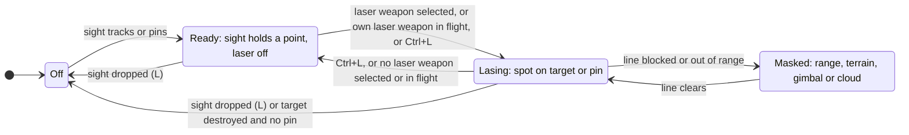
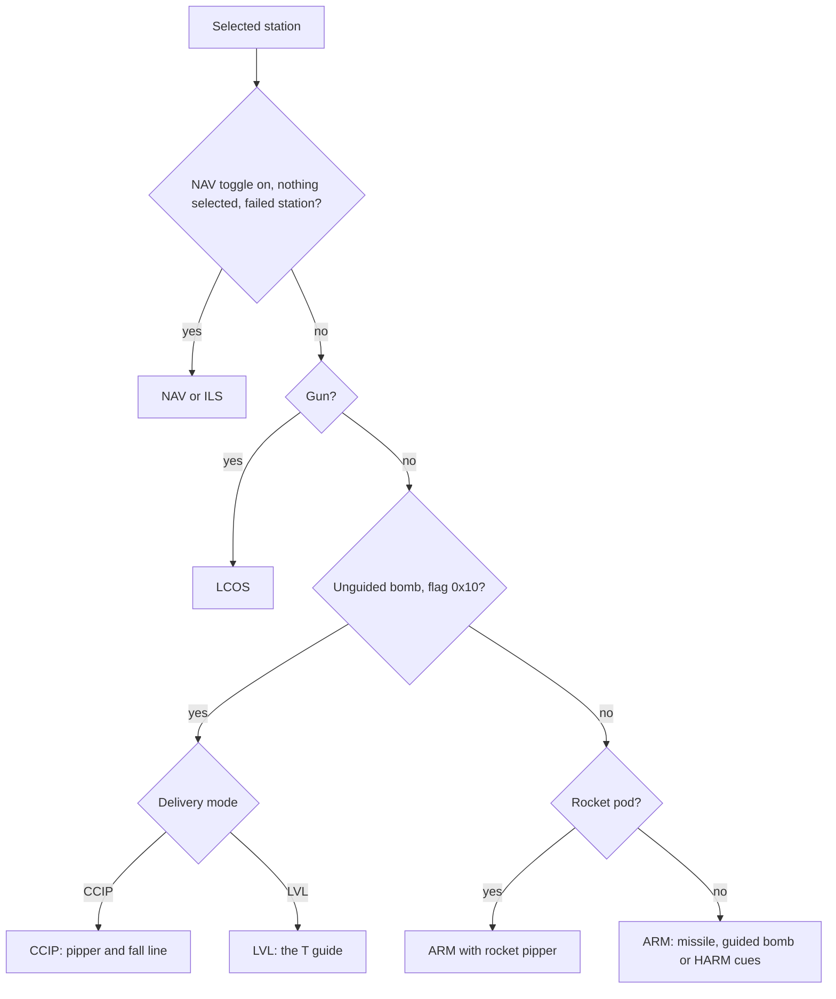
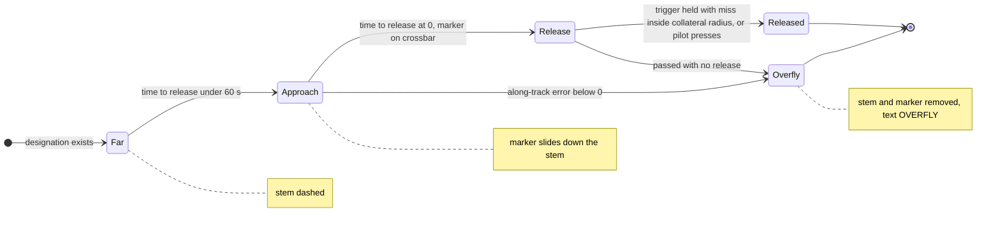
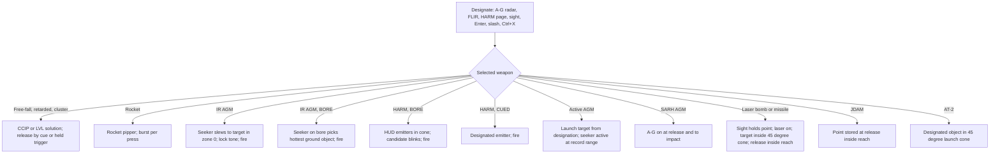

# Air-to-ground radar, designation and weapons

> **T.O.R.E: Tasteful Opinionated Reverse Engineered.**
> The thing being reverse engineered is the *experience*, not the executable. We
> trace what a player does and what the game does back, down to the numbers they
> would notice. How the original code achieved it is history: useful evidence,
> never a blueprint. If a sentence below reads like an instruction to reproduce
> the original's internals, it is out of date.
> <!-- tore-header v2 -->

Status: **implemented** (the A2G round, 2026-10-10 and 11: the specification
came first, then the slices below built every section, and the acceptance pass
flew every weapon class on two carriers; see the
[baseline](../baselines/air-to-ground.md)). Sections marked "Built" name the
slice that built them. What is not built is listed in
[Not built](#not-built). Each section says what the player sees and does, with
the numbers, and labels where every number comes from. The slices that built it
are listed in [Source notes](#source-notes). The two research slices, R2 (A-G
page, HARM page, laser, optical) and R1 (bomb motion, bomb sight), are folded in
below, and the retail facts they found are labelled **retail data** (see
[Fold-in record](#fold-in-record)). Where the research found that retail
differs from the first plan (no 90 kt rule, no buddy lasing, JDAMs are optical,
bombs scatter, the CCIP arc rule), the sections say so. Online, a client sees
the ground pages, the sights and the guided-weapon scale under protocol 23
(slice NA, [online](../MULTIPLAYER.md#air-to-ground-online)); the weapons and
their effects need no change.

## What the player gets

Before this round a player could carry Mavericks, HARMs, Mk 82s and rockets,
but could not use them on the ground: nothing on the ground could be
designated, bombs flew straight along the nose and never fell, rocket pods
fired one rocket per pod, and the HUD drew nothing for a bomb or rocket. This
round made every air-to-ground store the 36 imported aircraft can carry work:
40 real weapon records in twelve weapon classes, plus the Pave Spike and Pave
Knife pods.

- **Ground targeting.** Ctrl+R puts the radar in the retail air-to-ground mode
  (ground objects by class, drawn as dots). The FLIR (I) sees hot ground
  targets. T, Shift+T, a scope click, Enter and ' designate them, and the
  target window shows them as it shows aircraft.
- **Two bomb sights** for unguided bombs, as John asked: a dive pipper (the
  retail CCIP, a continuously computed impact point with a dotted fall line and
  a range arc) and a level-flight "T" release guide with automatic release
  while the trigger is held. Rockets get a pipper too.
- **Laser designation.** An aircraft with a laser designator lases its
  designated target or a pinned ground point, automatically when a laser weapon
  is selected (retail) or by hand with a laze key (John). The target display
  becomes a targeting pod page with a flashing LASE cue, the laser range and
  the weapon's time to impact. The HUD marks the laser point with a box and a
  laser range readout. When the spot is a wingman's or another player's, both
  displays say so (BUDDY).
- **Guided bombs.** Laser bombs home on the spot and fall blindly without it.
  The JDAMs are GPS bombs that fly to the point designated at release (retail
  JDAMs are "optical"; the GPS treatment is John's). Both get a release range
  indicator on the HUD range scale.
- **HARM like boresight.** With a HARM selected the HUD shows every radar
  emitter the missile can see. The one nearest the bore blinks as the
  candidate and the trigger fires at it without designation, exactly as an
  air-to-air missile in BORE. The retail HARM scope page (M) designates too.
- **Missiles.** Mavericks lock a designated ground target, or the hottest one
  near the bore. Harpoon and Exocet go after ships. AS-7 and AS-15 ride the
  radar track. The laser missiles ride the spot.
- **Bomb motion that matches the game**, read from the original's own bomb
  routine (a plain parabola with a small random scatter); multi-bomb packs
  released in one instant with their retail offsets; pods holding their real
  rocket count; cluster bombs with their retail wide burst.

Out of scope this round: AI wings attacking ground targets (John, 2026-10-10:
the player's systems come first; the AI wings stay air-to-air), ground map or
moving target radar pictures, remote ground targeting from an E-8C (Shift+G,
no such aircraft is imported), the bombers' HAB camera, drawing stores on
pylons, ripple or salvo settings, and weapons FA has no records for (napalm,
fuel-air, runway cratering, dispensers, cruise missiles).

## How to read the labels

Every number or rule below carries one of these labels, as
[AGENTS.md](../../AGENTS.md) defines them.

| Label | Meaning |
| --- | --- |
| **retail data** | A decoded JT, PT, SEE or HUD record, or a static read of FA.EXE 1.02F. Shown with its address or record where it matters |
| **retail manual** | The 1999 EA manual text, with its printed page |
| **spec-derived** | An existing TORE spec in this directory |
| **fitted** | Chosen by an agent because the original's value is not known; the rule and constants are recorded |
| **opinionated (John, date)** | A design John asked for |
| **opinionated (agent)** | A design choice an agent made; never attributed to John |
| **unknown** | Insufficient evidence; see [Unknowns](#unknowns) |

Manual and data disagree in places. John accepted (decision 17) that the
records' seekers and ranges win and the manual is quoted next to them.

## Ground contacts and channels

A ground contact is a surface row (a unit, a building with a combat row, a
ship) seen by one of five channels. The retail rules below were read from the
executable ([A-G page](../formats/radar.md#a-g-page)); the manual's own wording
differs in places and is quoted as a conflict.

| Channel | What it sees | Label |
| --- | --- | --- |
| A-G radar | Ground units, ships and structures inside the radar's range with a clear terrain line, by class and visibility distance (below). Aircraft show only while airport-attached | retail data |
| FLIR (I) | Hot ground objects by infrared signature inside the IR sensor's range (the IR page lists ground objects out to 4.97 nmi), terrain line of sight, 10 percent of range in cloud and fog | retail data (page cap), retail manual pp. 25, 100, 111; contrast model spec-derived ([missiles](missiles.md#minimum-engagement-and-target-role)) |
| Targeting sight | The object under the sight's line (see [the sight](#the-targeting-sight)) | opinionated (John, 2026-10-10), AC-130 rules |
| HARM page | Ground emitters the HARM seeker receives | retail data |
| Visual | Ground objects in view; only a filter on the channels above (Enter, ') | retail manual p. 112, John's air rule ([radar](radar.md#target-selection-keys)) |

## The air-to-ground radar

**Ctrl+R** toggles the A-G mode on the aircraft's own radar (retail manual
p. 99; the executable binds the handler to Shift+R and scan code 0x1302, whose
modifier is undecoded, so both Ctrl+R and Shift+R work). Any aircraft with a
signature-3 radar has it; without one the message is "No working radar found"
(retail data). The scope label is **A-G** (the binary's string; the manual's
"G-R" is a conflict). Turning A-G on shows "Air-Ground Radar on", **turns the
air radar off**, clears the IR channel (unless the IR/Laser advanced targeting
preference is on) and the HARM page, and **does not touch the designated target**
(retail data; the earlier survey reading "A-G clears the air target" was wrong).
Turning A-G off leaves the air radar off; R turns the air radar on and A-G off,
so the two are exclusive. The range ladder is unchanged: 5, 10, 25, 50, 100 and
150 nmi, reset 10 (retail data, spec-derived [radar](radar.md#scope-range-and-targeting-modes)).

In A-G with the jammer off the player's radar does not emit for enemy
anti-radiation seekers (retail data: the seeker's signature reads only the air
radar's emission time and the jammer). Whether the RWR reads the same fields is
not traced.

**What the page lists** (retail data, eligibility routine 0x43df70):

| Contact | Rule |
| --- | --- |
| Ground units, SAM and AAA sites, tanks, vehicles, structures | Only when the type's visibility distance (`maxVisDist`) is 75 or more, and within three times that distance (unit 256 ft). Retail ground units are 78 (9.9 nmi), the GCI radar 195 (24.6 nmi), the SA-2 391 (49.4 nmi). Men and the officer never show |
| Ships | Always, inside the page's range; no visibility test |
| Aircraft | Only while attached to an airport: the takeoff sequence (states 1 to 0x12) or the landing sequence (0x13 to 0x1e), within the visibility distance. An aircraft in free flight never shows on A-G, whatever its speed |
| Everything | Terrain line of sight; detection range scaled by 100 / effective signature, the signature being the object's radar signature times the weather layers' radar percent, less a look-down penalty (a vehicle on the ground loses the radar's full look-down value: 0 for F-18, F-22, MiG-29, Su-27; 30 for A-10, AV-8B, F-14, F-15; 50 for F-4, F-104). Ships take a third of the penalty |

Range and refresh (retail data): contacts are drawn out to the least of twice
the selected range, the radar's search range (zone 0) and **45 nmi**. The list is
rebuilt every 6 seconds and holds 50 entries (when full, the farthest is replaced
by a nearer one); positions refresh from the live objects every quarter second.
Ground objects closer together than 5 percent of their range merge into one dot.

**The 90 kt rule is not in the code.** The manual says air mode ignores anything
slower than 90 kt and ground mode anything faster (retail manual pp. 96, 99,
109). The page code compares no speed: the class and airport rules above decide.
So the retail A-G page does not show a hovering helicopter, whatever the manual
says. See [decisions pending](#decisions-pending) for whether to add the manual's
rule as an opinionated addition.

**Symbols** (retail data; one character of the window font, centred; colour 0x2c):

| Contact | Symbol |
| --- | --- |
| Ground unit, structure, ship | 2 by 2 pixel dot (the manual's "single-pixel dots", p. 97) |
| SAM or AAA unit | 5 by 5 pixel X, drawn on every page and for every such unit in the list (not only with remote targeting, as the manual implies) |
| Aircraft (when listed) | 5 by 5 filled square |
| Designated contact | Two vertical bars: 14 pixels apart for an aircraft or SAM, AAA site; 10 pixels apart for everything else |

(The window font at the lower pixel size draws a 1-pixel dot, a 3 by 3 square and
X, and narrower bars.) The page draws no TWS direction lines, jammer strobes or
chaff circles.

**Selection** (retail data, with TORE's air rule over it). T picks the nearest
listed contact beyond the current target, wrapping to the nearest. **Shift+T picks
the farthest contact nearer than the current one**, wrapping to the farthest
(farthest first, not "previous"). The retail routine has no side test, so it
cycles friendly objects too; TORE keeps its air rule of skipping friendlies,
which a scope click bypasses, so a friendly target window still works (opinionated,
agent). The cycle acts only while the radar window is open. A scope click picks
a contact (the click rule is an [unknown](#unknowns)). Whether a ground
designation survives the contact leaving the list is also unknown; the fallback
is that a designated ground contact drops when every channel loses it, except
that the targeting sight's track keeps it (as the AC-130 pod track does).
Built (G1): it stays while the page lists it, while the pilot sees it (inside
the visual sensor's range and view with a clear terrain line), while the sight's
track holds it, or under Easy targeting while it stands; otherwise it drops at
the next step (opinionated, agent). Selecting the IR or HARM page turns A-G
off; turning A-G on switches a radar that was off on (retail's ground radar
has no switch); the HARM page also lists emitting aircraft as squares, as the
retail page does by the air rules.

**Support (retail data).** AGM-84A, AM-39, AS-16, AS-7 and AS-15 are
surface-target radar weapons: **A-G must be on at release**. AS-7 and AS-15 (flag
0x200) need A-G on for the whole flight and the target inside their zone 1 (45
degrees, range included) as seen from the launcher. The gun's LCOS solves against
a designated ground object as it does for an aircraft, so strafing a designated
tank shows the pipper on it. Tab fires the gun whatever is selected ([the gun key](#the-gun-key)).

**Remote ground targeting.** A friendly aircraft with the J-STARS plane flag above
1,000 ft feeds the A-G and HARM pages (retail data). None is imported; out of
scope this round.

### FLIR ground contacts

The IR channel (I) adds ground contacts by infrared signature beside its air
contacts, labelled "IR" (retail manual p. 100). On the page ground objects and
ships are listed out to 4.97 nmi (retail data). T cycles them when the IR
channel is the scope channel. T used to select nothing on IR; the ground list
changed that for ground contacts only (built, G1), and air IR contacts stay
Enter-only as John's air rule says. Only the aircraft that carry an infrared
sensor have this page: the Rafale, X-31, MiG-29, Su-27, Su-35, F-22, F-22N,
AV-8B, AH-64 and AC-130. **The imported A-10 has no infrared sensor** (its only
sensors are a radar, a visual sensor and its Pave Spike laser): it designates a
Maverick target on the A-G page, with Enter or with the targeting sight, and
the FLIR designation run in the acceptance pass is the AV-8B's. The Mi-24,
MiG-17F, V-22 and CH-47 have neither a radar nor an infrared sensor, so Enter,
Ctrl+X (Easy targeting) and the AC-130 or pod sights are all they have. Sensor
ranges are retail data (AAS-38 15 nmi, AV8IR 15, SU27I 9 or 10). Weather: radar 100 percent except cloud 75,
IR 10 percent in cloud and fog, laser 50 percent in cloud and fog (retail
manual p. 111; the executable's weather selector equals the seeker signature, 0
visual, 1 laser, 2 IR, 3 radar, 4 anti-radiation).

### The HARM scope page

**M** cycles the scope channels Radar, IR and, when an anti-radiation missile is
aboard, HARM (retail: M is the HARM seeker; TORE's cycle keeps both meanings).
Without a HARM aboard the message is "No HARM seeker found"; on, "HARM seeker
on" (retail data). Selecting HARM turns the air radar, A-G and (unless the
preference) IR off. "HARM" appears in the upper left.

- **What it lists** (retail data): **emitters only**. A ground unit or aircraft
  shows only while its radar is on (or its jammer is), because the anti-radiation
  seeker's signature is zero for anything else. Ships never show. Aircraft follow
  the air rules (altitude 189 ft or more, not landing). Ground objects need a
  clear terrain line and the seeker's range, to a cap of **30 nmi**. The seeker
  looks **45 degrees** in heading and pitch about the nose, the same for the
  AGM-45 and AGM-88. The list rebuilds every second.
- **Which seeker**: of the anti-radiation types aboard, the one with the smaller
  range sets the page. With both an AGM-45 (60,000 ft) and an AGM-88 (200,000 ft)
  the page uses the AGM-45 (retail data).
- **Symbols**: as the A-G page (X for SAM and AAA, dot for other ground
  emitters, square for aircraft). The page makes no painting or tracking
  distinction; that is the RWR's ([RWR](rwr.md)).
- T, Shift+T and a scope click designate an emitter, as on the A-G page. The
  designation drops when the emitter leaves the list at the next rebuild and
  stays off past the seeker's memory (the drop rule is an unknown; fallback
  opinionated, agent).
- **After launch** the HARM is fire and forget. At release its target must be
  emitting. In flight the lock reruns every half second on angles only, so the
  missile **keeps homing on the object after its radar stops**, while the object
  stays inside the missile's 45 degree cone (retail data). The manual says it
  flies to the last known location and detonates (retail manual p. 120); the
  data is what ships.

### Visual and sight designation

- **Enter** cycles visible ground objects left to right (retail) that are also
  current ground contacts on some channel (John's air rule kept for the ground);
  **'** picks the one nearest the centre. Aircraft keep today's Enter rule.
  Built (G1) with one action for both keys, as today: with no aircraft to pick,
  the first press takes the visible ground contact nearest the centre and each
  further press steps to the next one to the right, wrapping to the leftmost
  (opinionated, agent).
- **`/`** (retail "IR/laser target", next visible object) cycles the targeting
  sight through visible ground objects on aircraft with a sight. Backslash
  stays "nearest the centre" (retail and the AC-130).
- **Ctrl+X** (retail cheat "nearest ground target") designates the nearest
  hostile ground object, only with the Easy targeting cheat on.
- The AC-130 sight's track really designates its ground object (today it
  clears the selection), so the HUD, the scope and the weapons agree.

## The targeting sight

### Who has a sight

An aircraft has a sight when it carries a sensor record with signature 1
(laser) or 2 (FLIR). Records are retail data. The gimbal limits for pods and
internal FLIRs are fitted from the SEE fields (the record fields give 60 degree
search and 45 degree track for built-ins and 360 for pods).

| Sensor | Aircraft | Laser | Gimbal |
| --- | --- | --- | --- |
| PAVESPK Pave Spike (fixed row) | F-16C, A-10 | yes, 10 nmi | pod: the hemisphere below the aircraft, as the AC-130 dome (fitted) |
| PAVESPK, PAVEKNF as loaded pods | any aircraft with a pod station (flag 0x400) | yes, 10 nmi | pod hemisphere |
| SU24L, KA50L (built in) | Su-25, V-22 | yes, 10 nmi | 60 degree search, 45 degree track cone about the nose (record fields) |
| AAS38 pod, AV8IR, MIG29I, SU27I, AC130I (FLIR) | Rafale (pod), X-31, F-22, F-22N, AV-8B, AH-64, MiG-29, Su-27, Su-35, AC-130 | no | FLIR pods: hemisphere; internal FLIR: 60 degree cone (fitted) |

Other aircraft have no sight. They designate by radar, FLIR channel or visually
and cannot laze, but they can still drop laser bombs on a buddy's spot (see
[buddy lasing](#buddy-lasing)). Pave Knife is on no imported aircraft by
default; Pave Spike and Pave Knife load on any pod station from the
Air-to-Surface group, as the manual instructs (retail manual p. 120, decision 7).
In retail a laser weapon needs only that its own launcher carries a working
signature-1 sensor with a nonzero count, so a loaded pod counts.

Built (T1). Which gimbal a record gets is one rule over the SEE fields (fitted):
a record with weight (an external store: PAVESPK and PAVEKNF 425 lb, AAS38
350 lb) or an all-round zone is a pod with the hemisphere below the aircraft;
any other is built in, with a cone of its zone 0 heading (search, 60 degrees on
every retail record) and zone 1 heading (track, 45 degrees). The cone is
measured as the root sum square of the body heading and elevation. A laser
record wins over a FLIR record on the same aircraft, and a loaded pod wins over
both. A pod's eye sits 4 ft below the aircraft's centre, a built-in sensor's at
the centre (fitted). The laser's reach and a FLIR sight's `/` range are the
record's zone 0 maximum (60,760 ft on every laser, 91,140 ft on AAS38, AV8IR and
SU37I, 54,684 ft on the MiG-29, Su-27 and AC-130 FLIRs; retail data). The
AC-130 keeps its gunsight and has no separate targeting sight.

A loaded pod takes a weapon station whose flags carry 0x400, under the retail
equipment rule (the station's bit 1 needs the record's bit 1; the station's
weight class over the pod's 425 lb caps it), one pod an aircraft; it replaces
the station's weapon and any tank on that hardpoint, adds its weight, and comes
off when a weapon or a tank takes the station. Cheat loading puts it on any
station. The sim side is built (`Loadout::load_designator`); the Load Ordnance
page does not offer the pods yet (the catalog card is a follow-up).

### The sight

The AC-130 sight is generalised for every aircraft with a sight and the
AC-130 behaves as it does today ([AC-130 linked guns](ac130-linked-guns.md#the-gunsight)).
It has three modes: free slew, a pinned ground point, and a tracked object, with
the same keys (Backslash, Shift+Backslash, L or ;, Alt+arrows, Shift+' and
Shift+;), the same ground march and the same masking rule. A fighter's default
look is straight ahead, 10 degrees down (fitted). The tracked object becomes the
designation. Label: opinionated (John, 2026-10-10: the target display shows
lasing), reusing the AC-130 design.

Built (T1), each an agent choice unless marked:

- The sight of a fighter sees only objects on the ground (units, structures,
  ships, parked aircraft). It never tracks a flying aircraft, so the air-to-air
  designation rules are unchanged on every FLIR aircraft.
- A designated ground object (T or a click on a ground page, Enter, Ctrl+X)
  becomes the sight's track, and the sight's track designates its object while
  it holds it. When the track ends (a pin, L, or the object destroyed, which
  leaves the sight pinned on the ground it looked at) the designation that was
  the track clears.
- **`/`** lists the visible ground objects: standing, not friendly, within the
  sensor's reach, inside its gimbal and with a clear terrain line from the eye.
  The first press takes the one nearest the line of sight; each further press
  steps to the next one to the right by body heading, wrapping to the leftmost
  (the Enter rule of the ground pages). It works on the AC-130's gunsight too.
- Outside a built-in sensor's search cone the camera stops at the edge with the
  gimbal notice; a pod stops at the aircraft's horizontal plane as the AC-130's
  dome does.

### The laser

**What retail does** (retail data, [laser and designator](../formats/missiles.md#laser-and-designator)).
There is no laser spot, no laze key and no laser on or off state. A laser weapon
(signature 1 with flag 0x400: GBU-10 family, GBU-27, GBU-28, AS-14, AS-30, AT-12)
homes on its **target object**, the object the player designated at release, and
needs only that its **own launcher is alive and carries a working signature-1
sensor** (a Pave pod or a built-in designator). The designator's range, field of
view and line of sight are never checked. At release the target must be inside the
weapon's zone 1 (45 degrees in heading and pitch about the mount, and the 50 ft
or 0 to 30,000 ft range) or the weapon leaves unguided. In flight the lock reruns
every half second on angles only; loss is permanent (the launcher dies or loses
its designator, the target dies, or the target leaves the 45 degree cone) and the
weapon then holds its heading and pitch. **Retail never reacquires.**

**Retargeting** (retail data): when the player designates a new target, every
laser (and SARH) weapon of the player's in flight retargets to it if the new
target lies inside the weapon's 45 degree cone, and is blinded otherwise.
Clearing the designation (;) leaves them guiding on the old target. A weapon
already in its terminal hit roll is not retargeted. AI launchers never retarget.
The manual's "switch targets and the bomb will fall blindly" (retail manual
pp. 120, 123, 125) describes only the failing case.

**Weather** (retail data): at release only, the weapon's range is divided by the
laser signature, 100 percent normally and 50 percent in cloud or fog, so a
GBU-10's 30,000 ft release range becomes 15,000 ft when the line from launcher to
target spans cloud or fog. In flight weather never breaks a lock. No night rule
applies to laser weapons in the retail data.

**What TORE adds (opinionated, John, 2026-10-10: the laze button and the lasing
displays).** A laser spot exists while the laser is on and the sight holds a
tracked object or a pin. It sits on the tracked object, moving with it, or on
the pin.

- **On.** Automatically while a laser weapon is selected and armed and the sight
  holds a point (retail manual, "automatically activated"), and also while one of
  the aircraft's own laser weapons is in flight. **Ctrl+L** turns it on or off by
  hand at any time. A manual off overrides the automatic rule until Ctrl+L again
  or a new laser weapon release.
- **Limits at release** (agent design on the retail records): range from the
  sensor record (10 nmi; retail has the figure but never reads it), halved in fog
  or when the line passes through cloud (the retail 50 percent, release only);
  terrain line of sight (the AC-130's 25 ft rule, spec-derived); the sensor's
  gimbal. Outside them the laser is MASKED, the spot goes away and a laser weapon
  released then falls ballistic.
- **In flight.** As retail, a weapon already guiding is not broken by weather or
  by MASK; it follows the spot, and loses guidance when the laser is switched off,
  the sight drops, its target dies without a pin, or the spot leaves its 45 degree
  cone. **It never reacquires**, as retail. A new designation retargets as above.
  (The earlier plan's reacquisition rule has no retail basis and is dropped.)

Whether "LASER SEEKER DAMAGED" (a retail damage message) switches the designator
off is an [unknown](#unknowns); the fallback is that the designator works while
its aircraft lives.

Built (T1), agent choices on the rules above:

- The laser's limit is the record's reach times the retail laser weather
  selector on the line from the eye to the point (50 percent when the altitudes
  between them meet a cloud deck or fog, the same test the ground pages use).
  The checks run in order, reach, gimbal (a built-in sensor's 45 degree track
  cone, a pod's hemisphere), then terrain, and the first that fails names the
  mask.
- Ctrl+L before the sight holds anything is remembered: the laser lases as soon
  as the sight tracks or pins. A manual on ends when the sight stops holding a
  point, so the next track starts in Ready; a manual off ends at Ctrl+L or the
  next laser weapon release.
- "A laser weapon" is signature 1 with flag 0x400 (retail data). The automatic
  rule reads the selected station while armed, and any of the aircraft's own
  laser weapons still in flight.
- The laser is off while its aircraft is destroyed.
- Weapons read `State::laser_spot_for` (own first, else a buddy's) and the
  laser's point while masked (`Laser::point`); the release range halving for a
  laser weapon is `laser::weather_scale` (slice W1 applies it).

Built (slice W1, `live::guided`), the laser weapons, agent choices on the rules
above:

- **At release** a spot must lie inside the weapon's zone 1 about the aircraft
  (45 degrees in heading and pitch, the record's range times the laser weather
  share on the line to the spot): the plane's own spot first, else the nearest
  same-side spot. With a spot in reach the weapon guides on it. With no spot at
  all (no laser on, no buddy lasing) it waits: it may lock **once** onto a spot
  that comes inside its 45 degree nose cone (lead ruling, 2026-10-10, following
  this spec's warnings table: "can still pick one up"). With spots that are all
  out of reach it leaves blind, as retail.
- **In flight** it follows the laser of the aircraft whose spot it took: the spot
  while that laser lases, the laser's point while it is masked (retail: weather
  and masking never break a lock already made). Guidance is lost for good when
  that laser is off or ready (Ctrl+L, the sight dropped, the target destroyed
  with no pin, the aircraft gone) or its point leaves the weapon's 45 degree
  cone, checked every tick. A new designation moves the laser to the new
  target, so the weapon follows it if it lies inside the cone and goes blind if
  not: retail's retargeting, with no separate rule.
- **Not guiding**, a laser bomb (waiting or blind) falls on the bomb equation
  from where it is (fitted; see [unknowns](#unknowns)); a laser missile flies
  straight on with its motor and sag.
- The spot a weapon homes on is its aircraft's or a buddy's by aircraft id and
  side, so the buddy rule and a later AI round use the same code.

### Buddy lasing

**Retail has no buddy lasing**: a laser weapon needs its own launcher's
designator, and another aircraft's never helps. **Buddy lasing, and a display
that shows the spot is someone else's, are opinionated additions (John,
2026-10-10, decision 6 and his note that the target display and the HUD must show
when the spot is buddy-designated).** The rule is an agent design:

- Every spot belongs to an actor (the aircraft that lases), not to "the player",
  and to that actor's side.
- A laser weapon homes on its own aircraft's spot first, otherwise on the
  nearest same-side spot inside its 45 degree cone. A spot of the opposing side is
  never used.
- A spot is shown to the player, as a buddy spot, when a laser weapon is
  selected and a same-side spot (not the player's own) lies inside that weapon's
  seeker range (zone 0 maximum, 8.23 nmi for the GBU-10, retail data; the
  display rule is fitted).

What the player sees, own spot against buddy spot:

| Display | Own spot | Buddy spot |
| --- | --- | --- |
| Targeting page laser row | **LASE** (flashing, 2 Hz) | **BUDDY** (flashing, 2 Hz), with the lasing pilot's callsign on the name row |
| HUD box marker | rectangular box with a small **L** | the same box with a small **B** |
| HUD weapon text | `LSR 4.3` (nm, flashing while lasing) | `BUD 4.3` (nm from the player's aircraft to the spot, flashing) |
| Range | laser range from the player's aircraft to the spot | the same, to the buddy's spot |
| Both exist | the row reads LASE and a second small BUDDY row sits beneath it | |

Built (T1): "nearest" is nearest the aircraft whose weapon asks, then the lower
aircraft id. Only human-flown aircraft lase this round (no AI strike), so a
buddy is another player or, in single player, nobody yet. The readout carries
the spot the plane's weapons home on, whether it is its own, its range and its
owner, plus a second buddy spot when both exist.

An aircraft with no sight of its own (a MiG-23 with an F-16C overhead) still
gets the page: with a laser weapon selected and a buddy spot valid, the target
display shows the targeting page in its buddy form, looking from the aircraft at
the spot, with the BUDDY row, the range and the weapon's time to impact. Without
a buddy spot it is the plain target window. This extension to the page rule is
opinionated (agent), following John's note. The page's buddy layout is in the
[target window spec](target-window.md#the-page-138-x-114-screen-pixels) (slice P1).

## The targeting page

On an aircraft with a sight the target display (camera slot 4, Shift+4) shows
the targeting page, instead of the plain [target window](target-window.md),
whenever the sight is pinned, slewed off its default, lasing, or an
air-to-ground weapon is selected. Otherwise it is the target window as today.
The AC-130 keeps its gunsight page. Label: opinionated (John, 2026-10-10;
agent for the layout).

- **Picture.** The camera looks along the sight from the aircraft (the pod or
  the nose; the eye point is fitted per type as the AC-130's dome is), with the
  AC-130 zoom ladder, 24 Hz, grayscale, and, when the city-fill branch's
  full-detail rule lands, full building detail.
- **Symbology** (ink with a white halo, in the AC-130 page's style):

| Element | Content |
| --- | --- |
| Crosshair | Camera centre |
| Track box, pin square | As the AC-130 page |
| Name row | Target name, PIN, SLEW (the lasing pilot's callsign for a buddy spot) |
| Laser row | **LASE** blinking at 2 Hz while lasing; **BUDDY** while the spot is someone else's; **LSR RDY** when ready; **MASK** when masked; nothing without a laser |
| Range | Laser range to the spot (nm with one decimal, feet under 1 nm) while lasing; else sight range |
| Time to impact | **TTI m:ss** for the aircraft's oldest laser or GPS weapon in flight, counting down; **IMPACT** for one second at the hit |
| Objective row, clock, damage bar | As the target window |
| Gimbal limit | The AC-130 eye icon |

Retail shows the weapon's own view in the IR/Laser window after launch (Shift+2,
retail manual p. 88). The weapon camera in the flight views already does that,
so the page keeps the pod view (opinionated, agent; John asked for the page to
show the lasing).

## The HUD in air-to-ground modes

### Status word and mode choice

The HUD status word follows retail (static read: printer 0x409030, mode byte set
at 0x406e2a to 0x406f6c, dispatch 0x4075b0) with John's level mode added.

For a bomb-flag store retail picks CCIP when a HUD module byte (+0x239) is set,
else HAB (a bomber camera, byte +0x23a), else ARM. Ctrl+M switches CCIP and LVL
for bombs (and BORE and CUED for missiles, the existing action). CCIP is the
default. LVL is chosen automatically when a bomb is selected while a ground
designation exists and the flight path is within 10 degrees of level (fitted),
and Ctrl+M overrides it. A heavy bomber ([bombing class](ai-strike.md#bombing-class))
is the exception: it selects LVL whatever its attitude or target and starts in
LVL (opinionated, John, 2026-10-11). The choice is made at the moment of selection only: a
dive or a climb afterwards keeps the mode, so the "T" never vanishes mid-run
(agent). The status word reads CCIP or LVL for an unguided bomb, ARM for a
rocket pod and every guided store, LCOS or SAFE for a gun and NAV with NAV
selected.

Retail gives the MiG-21, MiG-17F, Mi-24 and Yak-141 no bomb sight (their bombs
show ARM). **Every aircraft that can carry bombs gets both modes** (opinionated, John accepted decision 1,
2026-10-10): a jet with no sight cannot bomb usefully. Retail CCIP aircraft
(retail data, partly matched by file name): F/A-18D, Rafale, F-14, A-4E, MiG-29,
Su-25, MiG-23, Su-27, Su-35, F-22, F-22N, AV-8B, the F-4s, A-7, F-15, F-16C,
F-104 and A-10. The F-14's PT names `f14cc.HUD`, which is CCIP, and several PTs
carry an empty HUD name and were matched by file name. None of the imported
aircraft uses HAB.

All air-to-ground cues come from one deterministic solution computed on the host
for the seat's own aircraft every tick, so single player and online show the
same picture.

### CCIP, the dive pipper

Everything here is retail data from the bomb sight routine (0x409760) unless
labelled; the full reading is in [bomb sight](../formats/weapons.md#bomb-sight).

- **Impact point.** Where the selected bomb would hit the ground (or the sea) if
  released now, from the same release position and direction as a real release
  (the aircraft's **nose**, not its flight path) and the same motion (see
  [bomb motion](#bomb-motion)), over the ground below the release point. It is
  the **mean** impact: each real bomb is scattered up to 3 degrees in heading and
  in pitch, so the pipper is where the bombs land on average.
- **Pipper.** One glyph centred on the impact point: a 23-pixel ring with twelve
  clock marks and a centre dot. Let R be the record's zone-1 maximum range and d
  the distance from the aircraft to the impact point. Inside 0.4 R the glyph
  carries a **full inner arc**; from 0.4 R to R the arc unwinds, growing
  clockwise from 12 o'clock as the range closes, in fourteen steps; at R and
  beyond only the **bare ring and centre dot** remain. Nothing is blank while the
  impact point is on screen (the earlier survey reading "blank beyond" was wrong).
  R by record: 20,000 ft for the Mk 82 family and Mk 84 (full arc inside 8,000
  ft), 10,000 ft for the FABs (4,000 ft), 30,000 ft for the cluster bombs
  (12,000 ft). The manual (p. 85) says the arc is a full circle at 10,000 ft or
  more and half at 5,000 ft, in the opposite sense; **the code wins** (decision 3,
  accepted, confirmed by the lead after the research). TORE draws the glyph from
  its measurements rather than from the font: a ring of radius 11 reference
  pixels, the four cardinal clock marks out to radius 14 and the other eight to
  13, the inner arc at radius 8 and a one-pixel centre dot (retail data, the
  HUDSYM11 render). The range d is retail's approximate distance (the largest
  axis difference plus a quarter of the other two), so the steps fall where the
  original's do.
- **Fall line.** A dotted line from the HUD reference point to the pipper. The
  reference point is the flight path marker when the HUD module has the
  flight-path option and the aircraft is above a minimum speed (146 ft/s in the
  AV-8B, F-4, MiG-17, MiG-21 and Yak-141 modules, 0 in the others), otherwise the
  boresight point; the X-31 family has no flight-path option. The line pattern is
  alternate pixels (rhythm fitted).
- **Dot trail.** On the **F-16C, F-22, F-22N and X-31** the line is replaced by a
  trail of dots along the fall path, one every quarter second of fall from now to
  impact. Dots nearer the eye than 1,000 ft are left out: in the first moments
  of the fall the station's offset from the eye sweeps them across the HUD
  (fitted). These options, the flight path reference and its minimum speed are
  taken from R1's reading of each HUD module, transcribed by module name.
- **Off the HUD.** Retail draws nothing beyond trail dots that land on screen.
  TORE draws the fall line to the HUD's lower edge and a downward caret there,
  where the line to the impact crosses the edge, so a level pass still shows
  where the bombs would go (fitted). An impact that cannot be projected (far
  below the nose) puts the caret under the line's start; an impact above the
  HUD (a climb) draws nothing.
- **Text.** CCIP status, count and short name, IN RNG inside the zone-1
  maximum, the warnings below that, and on the right the slant range to the
  impact point (`R 1.8`) and, while a released bomb falls, `IMP 0:05`, its time
  to impact (fitted layout; the "IN RNG" string is retail data). The retail
  routine prints no text.
- **Release.** The pilot releases when the pipper is on the target. A pack
  leaves in one instant (see [packs](#release-modes-and-packs)).

### The level release "T" (LVL)

**Opinionated (John, 2026-10-10).** Retail has no level cue; John asked for a
level-flight "T" release guide. The design is an agent decision. It needs a
designated ground object or a pinned point from any channel, the sight or Enter.

- **Solution.** The impact point if released now (as CCIP) is compared with the
  target. D is the along-track error (target beyond the impact point is
  positive), C the cross-track error. Time to release is D divided by ground
  speed, assuming the current flight path is held (fitted).
- **The T.** The stem is the **azimuth steering line**, a vertical line on the
  HUD at the bearing that puts the impact point through the target (the
  cross-track correction). Fly the flight path marker onto it. The **crossbar**
  is a short horizontal bar fixed across the flight path marker. The **release
  marker** is a small circle that rides down the stem: at the top of the HUD
  while time to release is 15 s or more, linear to the crossbar at 0 s. Together
  they read as a T that closes.
- **Text.** `LVL` status, `REL 0:07` time to release, `R 3.4` slant range to the
  target; after release `IMP 0:12` time to impact for the last bomb.
- **Release.** When the marker meets the crossbar. If the trigger is held
  (pickle and hold), the release happens automatically at 0 s when the
  cross-track miss is inside the record's collateral radius (decision 2,
  accepted), or its fuze radius if that is larger, so a record without splash
  still releases (fitted). While the cue lies ahead the trigger only arms the
  release: a press that is let go before the cue drops nothing. The cue counts
  as reached from the tick the impact point passes the target until three ticks
  of ground travel past it, so a cue between two ticks is not missed, and one
  pass releases once: not again while a bomb from that station released in the
  last second is falling (both fitted). Once the cue has passed, or with the
  miss outside the radius, the trigger is a plain press again and the pilot
  releases by hand.
- **Drawing** (agent). The crossbar is 32 reference pixels wide and stands 12
  pixels above the flight path marker, clear of its fin. The stem stands at the
  flight path's track turned by the steering correction and runs from just
  under the heading readout down to the crossbar; when it lies beyond the
  HUD's side it stays at the edge with an arrowhead toward the turn. The
  release marker is a circle of radius 3.
- **Without a target.** LVL with nothing designated says `NO TARGET` and draws
  the CCIP pipper, so the bombs can still be aimed (agent).
- **Overflown** (D below zero): the stem and marker go and the text reads
  OVERFLY. More than 60 s out, the stem is dashed.
- The same T serves guided bombs in level flight, built on the guided
  reach instead of the unguided impact point: see
  [Guided bomb release range indicator](#guided-bomb-release-range-indicator)
  (built, slice FX-H).

### Guided bomb release range indicator

For laser and GPS bombs the right-hand weapon range scale (x=390, today's
missile scale, [missiles](missiles.md#weapon-hud-delivery)) shows the bomb's
reach from the current altitude and speed: the minimum and maximum ground range
at which the bomb can still reach the target with its own turn and glide (a
fly-out of the guided motion, as the missiles' maximum range is computed), the
target caret, and IN RNG when the target lies between them. Above the scale,
`R 6.2` target range. In LVL the T's release marker reaches the crossbar when
the target enters the maximum reach, so a level pass with a JDAM is "fly the
stem, release at the bar" (see "The level T for guided bombs" below for where
the bar stands). This is John's "range indicator for when to drop"
(opinionated, John, 2026-10-10, decision 4); the reach computation is an
opinionated (agent) design (below). Retail gives only "when you're in range and have a
good hit probability" (retail manual p. 125) and no release range cue.

Built (slice W1, `combat::guided`, `weapon_hud/guided.rs`), agent choices:

- **The glide** (retail data): a laser bomb or JDAM leaves along the nose at
  the record's launch speed (`launchRetard` 90: 90 percent of the aircraft's
  speed), slows at 14 ft/s squared toward 278 ft/s and turns at 6,370 units a
  second (about 35 degrees a second), and does not fall while it guides (the
  records have neither the bomb flag 0x10 nor the gravity flag 0x4). Its life
  is 60 s. So the reach is a slant distance fixed by the release speed: about
  22,500 ft from 450 kt, a little more from faster releases. A higher release
  spends more of it going down: from 8,000 ft level at 450 kt the reach runs
  8,000 to about 19,000 ft ahead, from 15,000 ft at 480 kt 15,000 to about
  18,100 ft, and above about 20,000 ft at 350 kt nothing ahead is reachable.
- **The reach**: the ground ranges straight ahead along the ground track that
  lie inside zone 1 at release (45 degrees in heading and pitch about the
  nose, the record's range times the laser weather share for a laser weapon)
  and that the glide reaches within its life. The fly-out flies the turn tick
  by tick, as the bomb does, then works out the straight rest from the
  record's slowdown. 32 samples across the zone's ground range, then 12
  bisections on each edge of the first good stretch. The near edge is the 45
  degree cone (in level flight, the height), the far edge the glide. A laser
  missile or the AT-2 shows its zone 1 instead (no fly-out; fitted). Slice
  H1's `Reach::search` starts from the unguided throw, which a glide with no
  fall does not make good, so W1 searches the samples instead and returns
  H1's `Reach` type.
- **The aim**: the laser spot (the plane's own, else a buddy's), the JDAM's
  point (the designated ground object, else the sight's held point) or the
  AT-2's designated object. `R` is its ground range. IN RNG means the aim
  itself lies in zone 1 and the glide reaches it (and for the AT-2 that the
  launcher sees it).
- **The scale**: the missiles' scale at x=390 (y 230 to 282), the far edge's
  ground range in nautical miles at the top (y 218), the near edge's below
  (y 284), the caret at the aim's ground range (clamped to the scale), `R 6.2`
  above (y 206); IN RNG blinks at 2 Hz on the line below the store name, else
  the advisory (NO LASER, MASK, OUT OF REACH, NO TARGET) takes it.

**The level T for guided bombs** (built, slice FX-H, 2026-10-11; John asked for
"release at the bar" and whether it is the same as hold to release: it is the
same feature, now also for guided bombs). It applies to the guided bombs
(laser bombs and the JDAMs, not the laser missiles or the AT-2) and uses the
status word LVL, chosen by the same rule as for an unguided bomb: on selecting
the bomb with a ground target designated (for a JDAM, the sight's held point
also counts; for a laser bomb, a laser spot) and the flight path within 10
degrees of level, else the plain scale (the status word stays ARM). Ctrl+M
switches between the two.

- **The bar.** Stands at a ground range of the **reach's far edge less two
  fifths of the reach** from the aircraft (opinionated, agent: John's words
  were "when the target enters the reach", but the far edge is where the glide
  only just gets there at the end of its 60 s life, and a release a little
  inside it shortens the flight and the time a laser must hold; the choice was
  measured, see the [baseline](../baselines/air-to-ground.md)). Time to
  release is the aim's ground range less the bar's, over the ground speed
  (the track held).
- **Drawing** (as the unguided T, same crossbar, stem and marker): the stem
  stands at the aim's bearing from the ground track, the marker rides down it
  to the crossbar at 0 s (top at 15 s or more, dashed beyond 60 s). The text
  row below the store name reads `REL 0:12`; once the bar is passed it is the
  IN RNG cue as before; `OVERFLY` when the aim is nearer than the reach's
  near edge or behind the aircraft. A laser bomb draws the T only with a spot
  to home on (the NO LASER and MASK advisories take the row otherwise); a
  weapon with no reach (too high or too fast: OUT OF REACH) has no T and the
  trigger is a plain press.
- **Release.** A held trigger releases once, on the tick the aim reaches the
  bar (within three ticks of ground travel, as the unguided T), when the aim
  lies inside the reach and within 10 degrees of the ground track (opinionated,
  agent: the stem says where to point and the glide's own turn does the
  rest). A press let go before the bar drops nothing. After the window, or in
  the plain scale, the trigger is a plain press. It is host simulation (the
  fire loop reads the guided sight the same tick), so it works online and in
  replays; the cues reach clients in the guided sight group.
- **Measured** (`--a2g-run --release bar`, level passes): F-16C GBU-30 and
  GBU-10, F/A-18D GBU-29/P and A-10 GBU-30 and Pave Way at 4,000 to 15,000 ft
  and 350 to 550 kt: every release came within 8 ft of the bar and every bomb
  hit within 56 ft and killed its target (see the baseline).

**Retail JDAMs are "optical", not GPS** ([optical](../formats/missiles.md#optical)):
GBU-29, GBU-29/P and GBU-30 home on the object designated at release, follow it
if it moves and need no designator (fire and forget). Their release range is cut
by visibility: the zone-1 limit of 30,000 ft becomes 7,500 ft at night and 3,000
ft in cloud or fog, at release only (retail data). Treating them as GPS bombs
that fly to the point designated at release, in any weather, with a moving target
missed, is an **opinionated addition (John, 2026-10-10)** that replaces the
retail behaviour; the reach scale serves both.

### Rockets and guns

- **Rockets** (ARM status, retail): a rocket pipper at the predicted ground
  impact of the next rocket, flown through the rocket's motor, speed command and
  gravity (opinionated, agent, decision 12; without it rockets are unaimable).
  The prediction takes the very steps combat gives the round, on combat's own
  quarter-second clock, so a rocket fired on that tick lands on the pipper. The
  rocket pipper has no fall line.
  Retail rockets carry the gravity flag, so they sink at 32 ft/s squared to an
  80 ft/s cap after burnout (retail data). The range arc follows the record's
  zone-1 maximum, as CCIP.
- **Guns.** The LCOS solves against a designated ground object (see
  [support](#the-air-to-ground-radar)).

### The gun key

Built (slice FX-T, 2026-10-11). Tab, held, fires the aircraft's gun whatever
store is selected, so a pilot can strafe between bomb runs without cycling
weapons. The key is retail (decision 21); the rules below are opinionated
(agent decision, John asked for the key to fire the gun on 2026-10-11) because
the retail routine was not traced.

- **Same gun as the trigger.** The gun fires exactly as it does with the gun
  selected and the trigger held: the record's rate and burst, the ammunition
  count (it falls round by round), the dispersion cone, the tracers, the sound
  and the muzzle flash. A held Tab and a held trigger on the gun do not add up;
  they are one trigger.
- **The selected store is left alone.** The selection, the bay request, the
  seeker lock, the delivery mode and the selected store's READY text do not
  change. With a bomb selected, Tab strafes and the trigger still drops the
  bomb, the two together if both are held. The gun is internal, so Tab never
  opens a weapon bay.
- **Armed only.** Tab follows the trigger's own gates: the system must be armed
  (NAV and SAFE stay safe), the aircraft alive and the gun loaded. The station
  is the first gun that has rounds left, else the first gun. An aircraft with
  no gun does nothing, silently.
- **The AC-130.** Its selected station is already a gun, so Tab is a second
  trigger on the linked guns, with the same cadence; it adds no gun.
- **The HUD.** While Tab is down and the selected store is not a gun, the weapon
  area of the HUD shows the gun's readout in place of the store's: the round
  count and name, LCOS (or SAFE), the pipper or NO SOL, and the range arc. It
  goes back to the store when the key comes up. Opinionated: a pilot strafing
  wants the gun sight, and the store's cue would only compete with it.
- **Keys.** `fire-gun` is a hold action, remappable in the controls screen
  like the trigger, with no gamepad default. Ctrl+Tab is a different key
  (instrument next). A pause, a menu or losing focus lets go of it, as of the
  trigger.
- **Online and in replays.** Tab goes to the host as a combat command pair,
  `GunKeyDown` and `GunKeyUp` (extended combat codes 3 and 4;
  [net protocol](../formats/net-protocol.md)). The host fires; the client
  draws its own tracers from the key and its readout (armed, rounds), as it
  does for the trigger, and the host decides every hit. A replay holds the
  commands as `player.command` events ("gun-key-down", "gun-key-up") and the
  rounds as ordinary gun rounds. A flight resumed or rejoined starts with the
  key up.

### Missiles and the HARM boresight cue

- **IR AGMs** (Maverick AGM-65A and G, SLAM). Retail cues: the seeker diamond
  floats to the designated target's rectangular TD box; a ringing lock tone; the
  range scale; IN RNG; hit percent (retail manual pp. 83, 84; a Maverick solid
  box at 10 nmi, fire above 70 percent). Retail requires a designation and that
  stays the default. **Maverick boresight** (opinionated, John accepted
  decision 10): with BORE selected the seeker looks along the bore and the
  diamond blinks on the hottest ground object in the seeker cone, exactly as
  air-to-air BORE ([missiles](missiles.md#weapon-hud-delivery)).
- **HARM boresight cue** (opinionated, John, 2026-10-10: "act kind of like
  boresite on a2a weapons where it shows a radiation source you can shoot at").
  While an anti-radiation missile is armed, the HUD draws every ground emitter
  the missile's seeker receives (emitters only, inside its 45 degree cone about
  the nose and its range, retail data) as the RWR ground square at its direction
  (at most 8, nearest the bore first; painting ones bright).
  The candidate (painting first, then nearest the bore, inside the launch cone
  and range) gets the blinking diamond, the range scale and BORE, and the
  trigger launches at it without designation. A designation from the HARM page
  or the A-G radar turns it CUED (solid box). An emitter that goes off dims.
  A launched HARM keeps homing on the object after its radar stops while the
  object stays inside its 45 degree cone (retail data; the manual says it flies
  to the last known position, p. 120). The geometry rules are fitted.
- **Active and SARH AGMs.** The A-G designation's box, range scale, readiness
  (`NO TRACK` when the A-G track is lost for a SARH missile).
- **Laser AGMs.** The laser box and laser range (below), range scale.

Built (W2), with these rules (opinionated, agent, where not labelled):

- **BORE waits for the lock.** A Maverick or a HARM in BORE fires only once its
  seeker holds the BORE candidate (a quarter second, the seekers' existing
  dwell): `ACQUIRING` until then, `NO TARGET` (Maverick) or `NO EMITTER` (HARM)
  with nothing in the cone, so an air-to-ground missile never leaves without a
  target. Retail releases a HARM only at an emitting target and a Maverick only
  at a designated one; air-to-air BORE keeps its old rule. The Maverick's bore
  circle is the air-to-air 5 degrees; the HARM's is its whole seeker cone, and
  its candidate must also lie inside the launch zone's angles.
- **CUED.** A designation turns a Maverick or a HARM to CUED, as it does an
  air-to-air infrared missile, and the seeker mode key cannot take it back to
  BORE while the designation stands.
- **The HARM cue.** Up to 8 emitters, nearest the bore first, are drawn as the
  RWR's 7 pixel ground square; a radar painting the plane carries a centre dot
  (the bright square; painting is the surface fire control's Track or Fire on
  the plane, as the RWR shows it); the designated or held radar after it stops
  emitting shows only its corners (dim). The weapon diamond marks the
  candidate, blinking in BORE, and the word BORE or CUED sits above the bore
  ring. The candidate is the painting radar first, then the one nearest the
  bore, then the nearest.
- **The A-G track.** A surface radar weapon is released only while the A-G page
  is up and lists its designated target (`NO TRACK` otherwise, retail data); it
  leaves for the point the page gives and the page refreshes its midcourse
  point. The AS-7 and AS-15 need the page and the target inside their zone 1
  from the launcher for the whole flight; once that fails the missile loses its
  target for good and flies on unguided (retail data: the lock clears the
  target and nothing gives it a new one).
- **Target switch.** A new designation sends the player's AS-7 and AS-15 in
  flight to the new target when it is inside their zone-1 cone about the nose
  and on the A-G track, and blinds them otherwise; clearing the designation
  leaves them guiding (retail data). The air-to-air supported missiles, which
  retail retargets too, keep today's rule; the laser weapons are slice W1's.
- **HARM after shutdown.** A launched HARM keeps homing on its radar after the
  radar stops, on angles only, while it stays inside the missile's zone-1 cone
  (retail data). So a SAM radar's HARM shutdown no longer saves it from a HARM
  already locked on it.
- **Surface seekers.** The active surface seekers (AGM-84A, AM-39, AS-16) see a
  ground object or ship by range and radar signature alone, without the air
  radar's clutter notch (fitted).

### Laser on the HUD

- The laser point is marked with the retail IR/laser **rectangular TD box**
  (12 by 8 reference pixels, fitted) beside the radar square, with a small **L**
  when lasing (**B** for a buddy spot). The aim box rules apply off the HUD (an
  edge arrow, [aim box](ac130-linked-guns.md#the-aim-box-on-every-view)).
- Weapon text adds `LSR 4.3` (laser range, nm) blinking at 2 Hz while lasing,
  `LSR RDY`, or `MASK`; `BUD 4.3` for a buddy spot; and `TTI 0:12` while an own
  laser or GPS weapon flies (built, slice FX-H; the targeting page has its own
  TTI row). All opinionated (John, 2026-10-10: "the hud with a
  range indicator"); text layout fitted.
  Built (slice P1, `weapon_hud/laser.rs`): the box is 12 by 8 pixels, the
  letter sits to its right (**L** own, **B** a buddy's), the text rows start at
  x=207, y=307 and step 12 pixels (own laser row, then a `BUD` row; the `TTI`
  row is built by slice FX-H, below), and the boxes and rows draw
  on any selection, in every mode but NAV. Lit for the first quarter second of
  each half second when blinking (combat tick mod 60 below 30). The edge arrow
  is the target cue's own chevron. A masked laser draws no box (its spot is
  gone) and a laser that is ready draws none (there is no spot yet).
  **The `TTI` row** (built, slice FX-H, 2026-10-11; John: "let's add time to
  impact on hud"; layout agent): it stands directly under the laser rows (the
  first row at y=307 when there is no laser text, the second at 319, the third
  at 331), on any selection and in every mode but NAV, and does not blink. It
  shows the oldest of the aircraft's guided weapons in flight whose time to
  impact is known (`CockpitReadout::weapon_tti`, laser bombs and missiles, JDAMs
  and the AT-2), `TTI 0:12` counting down, with `X3` after it when several fly
  (the readout lists up to four), and `IMPACT` for the second after the last
  one ended, the same slot as the targeting page's row. A bomb with no
  guidance (unguided) keeps the right column's `IMP 0:12` for the last bomb
  while it is selected; the TTI row is for guided weapons only. Online it is
  read from the readout like the page's row (protocol 23).

### Warnings

Opinionated (agent, decision 15). Advisory, in the readiness slot, except where
the station could not release at all:

| Warning | When |
| --- | --- |
| LOW | The predicted fall time is shorter than the record's fuze arm time: the bomb will not explode. A bomb that reaches the ground before its fuze arms is a dud: no burst, no splash and no crater, only a small puff of dirt (the bullet-on-land dust burst) where it lands, and nothing on water. Opinionated (lead, 2026-10-10): the retail ground-impact path (`0x4c1dbc`) has not been read for an arm test, so whether the original duds such a bomb is unknown (next step: trace the arm check before `0x4c1dbc`). The fuze already kept an unarmed bomb from striking a target directly |
| FRAG | At the predicted impact time the aircraft is inside the record's collateral radius of the impact point; splash can hurt the shooter (retail manual p. 126, no number given). The aircraft is taken along its ground track at its ground speed and no lower than it is now: a dive is taken to be pulled out at once, a climb keeps climbing (fitted; flying a dive on would put every dive release inside its own splash). For a slick bomb that lands under the aircraft, FRAG means flying lower than the splash radius |
| BAY | A bay aircraft with the bay closed, as today (retail BAY; release refused "Can't deploy, Open weapon bay door") |
| NO TARGET | A guided weapon that needs a designation has none. Built (slice W1): a JDAM with no designated ground object and no sight point, and an AT-2 with no designated object, read NO TARGET and are not released (the existing `NoTarget` readiness; the plan's `NoGroundTarget` name was not needed) |
| NO TRACK | A SARH missile's A-G track is lost |
| NO LASER, MASK | A laser weapon with no valid spot (it may still be released and falls ballistic; MASK when the line is blocked). Built (slice W1): advisories in the guided sight, never readiness codes, so release is not blocked; MASK when the plane's own laser is wanted but masked and no other spot exists |
| OUT OF REACH | A guided bomb's reach does not cover the target. Built (slice W1): the aim lies outside zone 1 or beyond the glide (for the AT-2, also out of the launcher's sight); advisory |
| OVERFLY | LVL, passed the target |
| NO EMITTER | A HARM with no emitter to fire at |

LOW, FRAG and OVERFLY are worked out by the sight (slice H1); the HUD shows
LOW and FRAG together in the readiness slot, and OVERFLY in place of the
release time. Only a GPS bomb with no designated point and an AT-2 with no
target block release, apart from the missiles: a missile that needs a target
(NO TARGET, NO TRACK, NO EMITTER) does not leave without one, as before this
round (built, W2). Laser bombs can be released without a spot (they fall ballistic and can
still pick one up), as retail allows. The text strings are fitted.

## Weapon classes

Forty real records in twelve classes. "Status" is the state after the round;
every class was flown on two carriers in the acceptance pass (the
[baseline](../baselines/air-to-ground.md#inventory-and-final-status) has the
record-by-record table).

| # | Class | Records | Carriers | How it works | Status |
| --- | --- | --- | --- | --- | --- |
| 1 | Free-fall bombs | MK82, MK84, FAB250, FAB500, FAB1000, MK82P3 (3-pack) | 20 to 26 | Retail bomb motion; CCIP and LVL; fuze, splash and craters exist | Built (B1, H1, X1) |
| 2 | Retarded bombs | MK82HD, MK82P (6-pack), MK82AIR (7-pack) | 17 to 26 | As 1; the launch retard 66 only lowers the release speed to 66 percent of the aircraft's, then the same parabola; packs leave in one instant with stepped offsets | Built (B1, H1, X1) |
| 3 | Cluster bombs | CBU87, CBU89, MK20, RBK250, RBK500 | 26 each | As 1 (the 278 ft/s speed command does not change a bomb's path); retail wide splash; presentation-only bomblet flashes | Built (B1, H1, X1), with the flashes ([ordnance presentation](ordnance-presentation.md#cluster-bomb-flashes)) |
| 4 | Laser-guided bombs | GBU10, GBU10A, PAVEWAY, PAVEWA3, GBU28 | 24 (GBU28: 5) | Retail: homes on the release target while its own launcher's designator works and the target stays inside 45 degrees; never reacquires. TORE: homes on the spot (own, or a buddy's, opinionated). Loss: holds heading and pitch and slows to 278 ft/s (retail), with a fitted ballistic fall | Built (W1) |
| 5 | JDAM | GBU29, GBU29P, GBU30 | 25 to 26 | Retail "optical": home on the object designated at release, follow it, fire and forget, release range cut by visibility. TORE (opinionated, John): GPS, fly to the point designated at release, any weather, a moving target is missed | Built (W1) |
| 6 | Rocket pods | LAU61, B8, B13, LAU10 | 24 to 26 | A pod holds its real rockets (19, 19, 5, 4); each press fires one rocket and a held trigger repeats four a second (LAU-10 one per press); rocket pipper | Built (B1, H1, X1) |
| 7 | Optical rocket | AT2 | 27 (Mi-24 default) | Retail: steers at the designated object until impact (cruise profile), needs its launcher alive, zone 1 500 to 18,000 ft and 45 degrees; a switch does not retarget it. Without a target it flies unguided | Built (W1: command guidance while the launcher keeps the target in its sight) |
| 8 | IR AGMs | AGM65G, AGM65A, AGM84E | 24 to 25 | Existing surface infrared profile; designated lock, or BORE | Built (W2) |
| 9 | Anti-radiation | AGM88, AGM45 | 26 | Existing emitter profile; HUD boresight cue and HARM page; keeps homing on the object after its radar stops | Built (W2) |
| 10 | Active radar AGMs | AGM84A, AM39, AS16 | 20, 20, 13 | Existing active profiles; launch target from the A-G designation, A-G on at release (retail); surface seekers see surface rows without the air notch | Built (W2) |
| 11 | SARH AGMs | AS7, AS15 | 21 | Needs A-G on at release and for the whole flight, target inside zone 1 (45 degrees) from the launcher; lost: unguided | Built (W2) |
| 12 | Laser AGMs | AS14, AS30, AT12 | 24 to 25 | Class 4's lock rule on a powered, cruising missile | Built (W1) |

Built (slice W1): classes 4, 5, 7 and 12 fly on their own guidance kinds
(`missiles::Guidance::Laser`, `Coordinate` and `Command`, read from the
signature and the type flags: signature 1 with 0x400 is laser; a guided
signature-0 record with no bomb flag and none of 0x200 and 0x400 is command
with the launcher flag 0x100 and coordinate without it). They have no missile
profile and never use the old pursuit. The laser rules are in
[the laser](#the-laser), the glide and the reach in the [release range
indicator](#guided-bomb-release-range-indicator). A JDAM stores the designated
ground object's position, else the sight's held point, at release if it lies
inside zone 1 (no weather), and flies to it whatever moves afterwards; outside
zone 1 it falls. The AT-2 needs a designated object inside zone 1 with a clear
line at launch; it is steered at the object (its cruise profile) while the
launcher lives, the object stands, the object stays inside the missile's 45
degree nose cone and inside the launcher's zone-1 cone with a clear line (the
launcher's sight, lead ruling, 2026-10-10); any loss is permanent and it flies
straight on. All eleven records of classes 4, 5 and 12 are in the catalog; the
AT-2 already was. Only the player's releases are guided: AI aircraft still drop
nothing on the ground.

Also: the F-4J's SUU-16 gun pod and the AC-130's 105 mm already work. Novelty
Boulder and Moose are Cheat catalog only (John, 2026-10-10, decision 16; see
[ordnance presentation](ordnance-presentation.md#novelty-bombs-are-cheat-only)).
Pave Spike and Pave Knife are loadable pods (decision 7). Carrier counts are the
Load Ordnance audit's (`--validate-ordnance`, static PT stations with the real
loading rules), re-checked at acceptance.

Guidance names. The data's seeker signatures are 0 none, 1 laser, 2 IR, 3 radar
(0x200 means supported by the launcher), 4 passive radar. Flag 0x400 means the
weapon needs a designator; flag 0x1 guided. The Load Ordnance seeker labels in
FA.EXE are "passive rdr, active rdr, IR, laser, optical, unguided, SARH". The
manual's "Optical" weapons (AT-2, GBU-29B, GBU-30) are exactly the guided
signature-0 records: the label comes from the signature, so GBU-29, GBU-29/P,
GBU-30 and AT-2 all read "optical" (retail data,
[optical](../formats/missiles.md#optical)).

### The seekers and the lock flow

### Rockets

A pod holds `projsInPod` rockets, the real count: LAU-61 19, B-8M1 19, B-13L 5,
LAU-10 4 (retail data); two pods hold twice that. The pod count is set at
mission start (the station's count times `projsInPod`). AI and wing aircraft count their pods the same way (retail's `HARDPodHack` multiplies every station), so a plane a human takes carries the loadout's rockets. **Each trigger call fires
one rocket** (retail data, the earlier "burst of 2" reading was wrong for the
player). LAU-61, B-8M1 and B-13L (held-repeat flag 0x800) **repeat every quarter
second, 4 rockets a second, while the trigger is held**; the LAU-10 fires one per
press. A pod empties in order and stays on the station. Launch envelope 1.48 to
2.47 nmi; motor 10 s; the manual gives a 1 nmi line of sight (retail manual,
weapon notes). Rockets sink under gravity as the retail flag says (see the
rocket pipper). Opinionated (John accepted decision 12): the real counts, with
the rocket pipper.

### Cluster bombs

CBU-87, CBU-97 (record CBU89), Mk 20 Rockeye II, RBK-250 and RBK-500 are the
five cluster records (flags 0x82a052). Flag 0x800000, set on exactly these five,
is presentation only (retail data): in a one-machine session about ten of eleven
cluster explosions are created as an invisible object with no debris, though the
sound plays; damage and splash are unaffected. The data has **no submunition count or dispersion field**.
Their speed command (final speed 278 ft/s, deceleration 14) does not change a
bomb's path. They explode as type 18 with a fuze radius of 100 ft and no crater, and
their splash is wide: 2,200, 2,500, 1,600, 1,500 and 2,500 ft at 100 percent
damage for CBU-87, CBU-97, Mk 20, RBK-250 and RBK-500 (retail data; compare
[explosions](explosions.md)). The remake keeps the retail wide splash and
adds a **presentation-only scatter of small flashes** over the radius, so a
cluster bomb looks like one (opinionated, agent, decision 13): the flashes do
no damage and the damage is the same as the original's. The pattern, its
constants and the scenario that checks them are in
[ordnance presentation](ordnance-presentation.md#cluster-bomb-flashes).

### Release modes and packs

Data packs only (opinionated, John accepted decision 14, matching retail, which
has no ripple, salvo, interval or quantity control). One press releases one
record burst: a single bomb, or **the whole 3-, 6- or 7-bomb pack in one
instant** (gameRoundsInBurst 3, 6, 7 on MK82P3, MK82P, MK82AIR; retail data), one
round debited. Bomb i of a pack starts offset from the station: x 0, -2, +2, -4,
+4, -6, +6 ft and y 0, -2, -6, -12, -20, -30, -42 ft (the world axis of the
stagger is an unknown; the store's own lateral axis is the fallback). No bomb
record has the held-repeat flag, so a player's held trigger does not repeat
bombs; `gameBurstT` spaces only AI bursts and the player's rockets (quarter
seconds). In LVL a held trigger auto-releases once at 0 s.

### Bomb motion

Retail data, [bomb motion](../formats/weapons.md#bomb-motion). Implemented
(B1): `tore_sim::combat::ballistics` (`BombMotion`, `ReleaseState`,
`predict_impact`). Pack offsets are laid along the aircraft's lateral axis
(fitted), and a pod's weight falls by one rocket's share per rocket (fitted).

| Fact | Retail |
| --- | --- |
| Release position and direction | The station position with the aircraft's attitude: the bomb leaves along the **nose** (heading and pitch), not along the flight path, plus the station slew (zero on every imported bomb station). Successive releases alternate sides of a paired station |
| Release speed | The aircraft's speed times `launchRetard` / 100, at least the record's initial speed (0), clamped to 0 to 1,466 ft/s for slick, retarded and pack bombs and 0 to 2,933 ft/s for cluster. `launchRetard`: 100 slick, 66 Snakeye, 6-pack and 7-pack, 90 cluster and guided. No ejection push |
| Path | A vacuum parabola: gravity **32 ft/s squared**, no drag, no terminal speed, no retard after release. The bomb noses over along its velocity; heading stays fixed |
| Scatter | Each bomb adds a uniform random plus or minus **3.0 degrees** to its heading and to its pitch. **The player's bombs scatter too; this stays the default while John decides** ([decisions pending](#decisions-pending)) |
| Hits | Whatever terrain or object the normal collision finds; the fuze arm time and radius apply, and a bomb that reaches the ground unarmed is a dud ([warnings](#warnings)) |
| Pods | As [Rockets](#rockets) |

The sight is the same calculation without the scatter. A test checks the mean
path (scatter off, flat ground, within a foot of the pipper) and the scatter
bounds (3 degrees) separately.

**A guided bomb with no target** (laser bomb after losing its lock, JDAM released
with none) has neither the bomb flag nor gravity: it holds its heading and pitch
and slows to its final speed of 278 ft/s (retail data). Whether anything makes it
fall is an [unknown](#unknowns); the fitted fallback is the bomb parabola from its
current state.

## The AI and these weapons

Specified 2026-10-11, **not built yet**; the full behaviour is in [AI
strike](ai-strike.md). What it means here:

- **One cockpit, two pilots.** The ground-attack state (target, selected store,
  CCIP or LVL, seeker mode, sight, laser) becomes one record per aircraft that a
  human edits with keys and the AI edits from its strike controller. When the AI
  takes a plane it continues the human's attack, if it thinks it is safe; a human
  taking an AI striker finds its target, store, mode and laser.
- **The AI uses the player's systems.** It flies the pass through control
  inputs and releases through the same release function, CCIP and LVL
  solutions, guided reach and lock flow, with the same bomb scatter. There is no
  retail-style re-aim. For unguided weapons skill sets a release circle round the target, 100 m for an Ace up to
  325 m for a Novice, with a seeded aim offset inside it ([definition and worked
  numbers](ai-strike.md#skill-and-release-precision)).
- **AI lasing.** An AI with a designator lases like a player, its spot is an
  ordinary spot (a [buddy spot](#buddy-lasing) for others), an AI laser-bomb
  carrier drops only on a spot that will exist, and a wingman can be ordered to
  "Lase my target" ([lasing](ai-strike.md#lasing)).
- **Bombing class sets the player's default bomb mode.** A heavy bomber selects
  LVL whatever its attitude; every other class keeps the [H1
  rule](#status-word-and-mode-choice). Both modes stay available on every
  aircraft ([bombing class](ai-strike.md#bombing-class)).
- **Wing orders** Alt+E, Alt+R and Alt+F accept a ground target
  ([orders](ai-strike.md#orders-from-the-flight-lead)).

## Keys

Retail keys are marked; the rest are TORE additions. All were free before this
round. The generated [controls list](../CONTROLS.md) and the
[keyboard spec](keyboard.md) change in the same slice that adds the action.

| Action | Keyboard | Gamepad | Label |
| --- | --- | --- | --- |
| A-G radar on or off | Ctrl+R, Shift+R | none | retail manual p. 99 |
| Scope channel (adds HARM) | M | as today | retail M plus TORE cycle |
| Next ground target (nearest first), farthest first | T, Shift+T | as today | retail |
| Visual target, nearest the centre | Enter, ' | as today | retail manual p. 112 |
| Sight: next visible object | `/` | none | retail |
| Sight: designate, pin, drop, slew, zoom | Backslash, Shift+Backslash, L or ;, Alt+arrows, Shift+' and Shift+; (now every aircraft with a sight) | AC-130 bindings | retail keys, AC-130 design |
| Laze on or off | Ctrl+L | none | opinionated (John, 2026-10-10) |
| Delivery mode: CCIP and LVL for bombs, BORE and CUED for missiles | Ctrl+M (the existing seeker-mode action gains a key) | none | opinionated (agent) |
| Fire the gun whatever is selected (hold) | Tab ([the gun key](#the-gun-key)) | none | retail key, rules opinionated (agent) |
| Nearest ground target (Easy targeting cheat) | Ctrl+X | none | retail cheat |
| Jettison air-to-ground stores | Shift+K | as today | retail, exists |
| Bay doors | O | as today | retail, exists |
| Remote ground targeting (Shift+G), wingman engage IR/laser target (Alt+F) | not provided | none | out of scope this round |

## Inventory

### Aircraft

The 36 imported aircraft (37 selectable with the F/A-XX). **27 carry
air-to-ground stores**: F/A-18D, Rafale C, F-14D, A-4E, X-31, MiG-29, Su-27,
MiG-21, Su-25, MiG-23, Su-35, F-22, F-22N (and the F/A-XX), AV-8B, Yak-141,
AH-64, Mi-24, MiG-17F, F-4B, F-4J, F-4E, F-4G, A-7, F-15, F-16C, F-104, A-10.
**Nine carry none**: C-130, AC-130 (its 105 mm is a gun aimed by the gunsight),
E-3, Il-76, E-2, V-22 (a chin gun, and a KA50L laser but no laser weapon),
CH-47, B747, A310.

Loading follows the existing loading rules (station masks, weight class). The
exact carrier count of every record, read from the Load Ordnance audit
(`--validate-ordnance`), is in the [baseline](../baselines/air-to-ground.md#inventory-and-final-status):
most records fit 24 to 26 of the 36 aircraft; the Mi-24 takes the AT-2 only;
the MiG-17F takes no Maverick, AS-7, Harpoon or laser bomb; AS-7 needs a
semi-active station, so not the A-10, A-4E, A-7, AH-64, MiG-17F or Mi-24.
GBU-28 (4,500 lb) fits only the Rafale, F-4B, F-4J, A-7 and F-15. AS-16 fits 13
aircraft. Pod stations (flag 0x400) exist on every imported jet except the
MiG-17F and the AH-64. All retail data (PT stations and weights).

### Default air-to-ground loads

Retail data (PT defaults, hardpoint in brackets).

| Aircraft | Default stores |
| --- | --- |
| F/A-18D | AGM-65G x4 [6], x4 [7] |
| Rafale C | AGM-65G x4 [5] |
| X-31 | AGM-65G x2 [7] |
| F-22, F-22N | AGM-65G x2 [6] |
| AV-8B | AGM-65G x4 [5], x2 [6] |
| F-4E | AGM-65G x4 [6] |
| F-4G | AGM-88 x4 [6] |
| F-16C | AGM-65G x4 [6] |
| A-10 | AGM-65G x4, x4, x2, x2 [5 to 8] |
| A-7 | MK-82 x2 [5], AGM-65G x4 [6] |
| A-4E | MK-82 x4 [4], LAU-61 x2 [6] |
| F-4B | MK-82 x4 [4], x4 [5] |
| Su-25 | B-13 x2 [6], AS-7 x4 [7] |
| MiG-23 | B-8 x2 [6], AS-7 x2 [7], x2 [8] |
| AH-64 | LAU-61 x2 [5] |
| Mi-24 | AT-2 x4 [2] (fixed) |
| F-4J | SUU-16 gun pod only |
| none by default | F-14, MiG-29, Su-27, MiG-21, Su-35, F-15, F-104, MiG-17F |

### Weapon records

All values are retail data (the JT records, [weapons table](../formats/fa-weapons.csv)). Launch range is the
zone 1 minimum and maximum in nautical miles; seeker is the zone 0 range. Pack
counts are from the release fields and "pod" is rockets per pod. Weights are in
pounds.

| Record | Name | Class | Weight | Launch nmi | Seeker nmi | Notes |
| --- | --- | --- | ---: | --- | ---: | --- |
| MK82 | Mk 82 Slick | 1 | 500 | 0.01 to 3.29 | 3.29 | Fuze radius 300, arm 4 |
| MK84 | Mk 84 Slick | 1 | 2000 | 0.01 to 3.29 | 3.29 | |
| FAB250 | FAB-250 M62 | 1 | 550 | 0.01 to 1.65 | 3.29 | |
| FAB500 | FAB-500 M62 | 1 | 1093 | 0.01 to 1.65 | 3.29 | |
| FAB1000 | FAB-1000 M62 | 1 | 2272 | 0.01 to 1.65 | 3.29 | |
| MK82P3 | Mk 82 3-Pack | 1 | 1500 | 0.01 to 3.29 | 3.29 | 3 bombs per press |
| MK82HD | Mk 82 Snakeye | 2 | 500 | 0.01 to 3.29 | 3.29 | Launch retard 66 |
| MK82P | Mk 82HD 6-Pack | 2 | 3000 | 0.01 to 3.29 | 3.29 | 6 per press |
| MK82AIR | Mk 82 AIR 7-Pack | 2 | 3500 | 0.01 to 3.29 | 3.29 | 7 per press |
| CBU87 | CBU-87/B Cluster | 3 | 500 | 0.01 to 4.94 | 8.23 | Splash 2,200 ft |
| CBU89 | CBU-97/B Cluster | 3 | 700 | 0.01 to 4.94 | 8.23 | Splash 2,500 ft |
| MK20 | Mk 20 Rockeye II | 3 | 400 | 0.01 to 4.94 | 8.23 | Splash 1,600 ft |
| RBK250 | RBK-250 Cluster | 3 | 500 | 0.01 to 4.94 | 8.23 | Splash 1,500 ft |
| RBK500 | RBK-500 Cluster | 3 | 700 | 0.01 to 4.94 | 8.23 | Splash 2,500 ft |
| GBU10 | GBU-10E Paveway II | 4 | 2000 | 0 to 4.94 | 8.23 | Laser, needs designator |
| GBU10A | GBU-10 Paveway I | 4 | 2000 | 0 to 4.11 | 7.41 | Laser |
| PAVEWAY | GBU-10E Paveway | 4 | 2000 | 0.01 to 4.94 | 8.23 | Laser |
| PAVEWA3 | GBU-27 Paveway III | 4 | 2000 | 0.01 to 4.94 | 8.23 | Laser |
| GBU28 | GBU-28/B | 4 | 4500 | 0.01 to 4.94 | 8.23 | Laser; splash 100 ft at 35 percent |
| GBU29 | GBU-29 JDAM | 5 | 2000 | 0.01 to 4.94 | 8.23 | Signature 0, guided flag; splash 300 ft |
| GBU29P | GBU-29/P JDAM | 5 | 2000 | 0.01 to 4.94 | 8.23 | Splash 100 ft at 35 percent |
| GBU30 | GBU-30 JDAM | 5 | 1000 | 0.01 to 4.94 | 8.23 | Splash 1,000 ft |
| LAU61 | LAU-61 Rocket Pod | 6 | 200 | 0.01 to 1.97 | 3.29 | Pod 19, 4 a second held |
| B8 | B-8M1 Rocket Pod | 6 | 798 | 0.01 to 1.48 | 2.14 | Pod 19, 4 a second held |
| B13 | B-13L Rocket Pod | 6 | 1111 | 0.01 to 2.47 | 3.29 | Pod 5, 4 a second held |
| LAU10 | LAU-10 Rocket Pod | 6 | 200 | 0.01 to 1.97 | 3.29 | Pod 4, one per press |
| AT2 | AT-2 Swatter | 7 | 65 | 0.08 to 2.96 | 3.29 | Manual "Optical", 0 to 2.9 |
| AGM65G | AGM-65G Maverick | 8 | 675 | 0.08 to 9.87 | 9.87 | IR; data minimum 500 ft against the manual's 0.8 nmi |
| AGM65A | AGM-65A Maverick | 8 | 675 | 0 to 8.23 | 8.23 | IR |
| AGM84E | AGM-84E SLAM | 8 | 1380 | 0.08 to 49.37 | 49.37 | Data signature 2 (IR); manual says active radar, 2 to 49 |
| AGM88 | AGM-88 HARM | 9 | 795 | 0.08 to 32.92 | 32.92 | Manual 0 to 12.3 |
| AGM45 | AGM-45B Shrike | 9 | 795 | 0 to 9.87 | 9.87 | Manual 0 to 11 |
| AGM84A | AGM-84A Harpoon | 10 | 1165 | 0.08 to 59.25 | 59.25 | Manual active radar, 2 to 59 |
| AM39 | AM-39 Exocet | 10 | 1476 | 0.08 to 59.25 | 59.25 | Manual 2 to 92.6 |
| AS16 | AS-16 Kickback | 10 | 2640 | 0.08 to 6.58 | 8.23 | Manual 2 to 6.5 |
| AS7 | AS-7 Kerry | 11 | 631 | 0.08 to 4.94 | 8.23 | SARH; manual 2 to 4.9 |
| AS15 | AS 15 | 11 | 220 | 0.08 to 9.87 | 9.87 | Data radar (3 with 0x200); manual says laser, 0 to 6.5 |
| AS14 | AS-14 Kedge | 12 | 1495 | 0.08 to 6.58 | 8.23 | Laser; manual 0 to 6.5 |
| AS30 | AS 30L | 12 | 1146 | 0.08 to 9.87 | 9.87 | Laser; manual "active radar, laser", 2 to 6.5 |
| AT12 | AT-12 Swinger | 12 | 132 | 0.16 to 4.28 | 4.28 | Laser; manual 0 to 4.2 |
| ~BLDR | Boulder | novelty | 300 | 0.01 to 3.29 | 3.29 | Loads on our aircraft; Cheat only (John, decision 16) |
| ~MOOSE | Moose | novelty | 300 | 0.01 to 3.29 | 3.29 | As Boulder |

Guided-bomb envelope (retail data): seeker cone zone 0, 90 degree half-angle,
to 50,000 ft; launch zone 1, 45 degree half-angle, 0 to 30,000 ft (the lock
rule tests zone 1 at release and in flight); launch
retard 90; altitude limits unbounded. Splash: slick bombs 500 to 1,200 ft; 1,000 ft at 100 percent for the
GBU-10, GBU-27 and GBU-30; 300 ft for the GBU-29; 100 ft at 35 percent for the
GBU-28 and GBU-29/P.

~MOTHB and ~VOMIT exist in the data but nothing loads them. Absent from the
data and so not provided: GBU-15, AGM-130, Walleye, JSOW, GBU-31 and 32, Sea
Eagle, Penguin, Kormoran, ALARM, AGM-86, Tomahawk, AGM-142, AS-4, AS-6, AS-11,
AS-12, AS-17, Hellfire, napalm, fuel-air, Durandal, JP233, BLU-107, dispensers
and recon pods. SS-N-9 is ship-launched. AEMP-1 is air-to-air.

### Catalog rule

Each weapon is added to the Load Ordnance catalog only when its class works
(the roadmap's rule). The round raised the supported list from 40 to 72 records
(32 air-to-ground names, 3,146 weapon placements in the audit) and added the two
pods, 130 placements, with the Cheat-only novelty bombs apart. The ordnance card's seeker label learns "optical" for
signature 0 guided records (retail label list).

## Numbers

Every figure introduced by this spec, with its source. Figures read from the
records (ranges, weights, counts) are in the inventory above.

| Figure | Value | Label |
| --- | --- | --- |
| Air versus ground speed split | 90 kt in the manual; **no speed test exists on the A-G page** | retail manual pp. 96, 99, 109 (conflict with retail data) |
| Range ladder | 5, 10, 25, 50, 100, 150 nmi; reset 10 | retail data, spec-derived |
| A-G page range | least of twice the selected range, the radar's zone 0, and 45 nmi | retail data |
| IR page ground cap | 4.97 nmi | retail data |
| HARM page cap, field of view | 30 nmi; 45 degrees in heading and pitch about the nose | retail data |
| Page refresh | list every 6 s (A-G, IR, radar) or every 1 s (HARM); positions every 0.25 s | retail data |
| Contacts per page | 50, farthest replaced by a nearer one; merge within 1/20 of range | retail data |
| Ground visibility rule | `maxVisDist` 75 or more, within 3 times it (ground units 9.9 nmi, GCI radar 24.6, SA-2 49.4) | retail data |
| Radar look-down on the ground | 0 (F-18, F-22, MiG-29, Su-27), 30 (A-10, AV-8B, F-14, F-15), 50 (F-4, F-104) percent loss | retail data |
| A-G symbols | ground and ship 2 by 2 dot, SAM and AAA 5 by 5 X, aircraft 5 by 5 square, designated bars 14 or 10 pixels apart | retail data |
| Weather (release only) | radar 100 percent, 75 in cloud; IR 10 percent in cloud and fog; laser 50 percent in cloud and fog; optical night 25, dawn and dusk 75, cloud and fog 10 | retail manual p. 111; retail data |
| Laser lock cone, rerun | 45 degrees in heading and pitch; every 0.5 s on angles only | retail data |
| Designator range 10 nmi, gimbal | 10 nmi; 60 degree search, 45 degree track (built-in); hemisphere (pod) | retail data (SEE) recorded; **never enforced by retail**; our enforcement opinionated (John, 2026-10-10) |
| Laser line through cloud or fog | halves the release range | retail data (50 percent); the line rule fitted |
| Fighter default sight look | straight ahead, 10 degrees down | fitted |
| Terrain masking for the laser | the AC-130's 25 ft rule | spec-derived |
| LASE flash rate | 2 Hz, 50 percent duty | opinionated (agent), the existing blink rate ([missiles](missiles.md#weapon-hud-delivery)) |
| Buddy spot display range | the weapon's seeker range (8.23 nmi for GBU-10) | fitted |
| Automatic LVL choice | flight path within 10 degrees of level | fitted |
| Bomb release | along the nose; speed times `launchRetard` / 100; clamp 1,466 ft/s (2,933 cluster) | retail data |
| Bomb gravity, drag | 32 ft/s squared; none | retail data |
| Bomb scatter | uniform plus or minus 3.0 degrees (546 units) in heading and pitch, per bomb, player included | retail data; the player default pending John |
| Pack offsets | x 0, -2, +2, -4, +4, -6, +6 ft; y 0, -2, -6, -12, -20, -30, -42 ft | retail data |
| Pod rockets and cadence | 19, 19, 5, 4 per pod; one per call; 4 a second held (LAU-10 one per press) | retail data |
| Rocket sink | 32 ft/s squared to an 80 ft/s cap | retail data |
| CCIP ring radius | 9 reference pixels | spec-derived |
| CCIP arc | full inside 0.4 R, unwinding to a bare ring at R and beyond (R the zone-1 maximum: 20,000 ft Mk 82 and Mk 84, 10,000 ft FAB, 30,000 ft cluster) | retail data (0x409760) |
| CCIP arc, manual | full at 10,000 ft or more, half at 5,000 ft; opposite sense | retail manual pp. 85, 125; not used |
| Fall line, trail | dotted 0x55555555 line; or a dot per quarter second on F-16C, F-22, F-22N, X-31 | retail data; pixel rhythm fitted |
| Fall line origin | flight path marker (speed at least 146 ft/s in some modules) else boresight | retail data |
| Off-HUD caret | at the HUD lower edge | fitted |
| LVL marker timing | top of the HUD at 15 s or more, linear to 0 s | opinionated (John, 2026-10-10); numbers agent |
| LVL stem dashed | more than 60 s out | opinionated (agent) |
| LVL auto-release | at 0 s with the cross-track miss inside the record's collateral radius, trigger held | opinionated (John, 2026-10-10); gate agent |
| Release range scale | x=390, the missile scale | spec-derived |
| Guided bomb glide | along the nose at 90 percent of the speed; 14 ft/s squared down to 278 ft/s; 6,370 units a second (about 35 degrees a second); no fall while guiding; 60 s life | retail data |
| Level T for guided bombs: bar | the reach's far edge less 2/5 of the reach; hold releases within 3 ticks of the bar, aim within 10 degrees of the track | opinionated (agent; John asked for release at the bar) |
| Guided reach search | 32 samples across zone 1's ground range, 12 bisections an edge; a missile shows its zone 1 | opinionated (agent) |
| AT-2 launcher sight | the target inside the launcher's 45 degree zone-1 cone with a clear line (the 25 ft rule), every tick; any loss permanent | opinionated (lead ruling, 2026-10-10) on retail data |
| Guided weapons in flight listed for the time to impact | 4, oldest first | plan section 9 |
| HUD TTI row | under the laser rows from y=307, x=207, 12 px steps; oldest known time, `X3` count, IMPACT for 1 s | opinionated (John, 2026-10-11); layout agent |
| JDAM release range (retail optical) | 30,000 ft; 7,500 ft at night, 3,000 ft in cloud or fog | retail data; replaced by the reach scale (opinionated, John) |
| HUD laser box | 12 by 8 reference pixels | fitted |
| Cluster final speed | 278 ft/s, deceleration 14; no effect on a bomb's path | retail data |
| Cluster splash | 2,200, 2,500, 1,600, 1,500, 2,500 ft at 100 percent | retail data |
| Fuze radius | 300 ft slick, 100 ft cluster and guided | retail data |
| Pack sizes | 3, 6, 7 bombs, released in one instant | retail data |
| AI release tolerance | impact within max(1,000 ft, range/8) is the retail pass or fail gate; retail re-aims AI bombs within 100 ft of the target, which T.O.R.E does not do (the AI aims unguided weapons into a skill circle instead; smart weapons aim at the target at every skill) | retail data; circle opinionated (John, 2026-10-11), no re-aim opinionated (John, 2026-10-11) ([AI strike](ai-strike.md#skill-and-release-precision)) |
| Release altitude advice | 3,000 ft lightly defended, 5,000 ft or more defended; about 1 nmi of range per 1,000 ft of drop altitude | retail manual (advice, not enforced) |
| Stairstep bombing | drop at 65 to 70 percent hit probability | retail manual (advice) |

## Not built

The acceptance pass ([baseline](../baselines/air-to-ground.md#not-run-and-not-built))
found these promised or specified items unbuilt:

- `Ctrl+M` on the [keyboard map](../tore-keyboard-map.html) (a browser check and
  a README image recapture are due).
- Online (protocol 23, slice NA): the cues are the host's, drawn a round trip
  late; the targeting page's camera follows the host's look (the AC-130's own
  camera turns ahead on the client); a rejoining player's sight comes back at
  its default look with the laser off, since the AI flew the plane meanwhile
  ([online](../MULTIPLAYER.md#air-to-ground-online)).

## Edge cases

- A SAM or AAA site turns its radar off: its HARM square dims and leaves the
  HARM page at the next rebuild; a HARM already flying keeps homing on the object
  while it stays inside the missile's 45 degree cone, so the shutdown roll of
  [surface defenses](surface-defenses.md) no longer saves the radar from it.
- Terrain blocks the laser at release: MASK on the page and the HUD; a laser
  weapon released then falls ballistic. A weapon already guiding is not broken by
  MASK (retail checks angles only).
- The designated object is destroyed: the designation clears. A sight pin keeps
  the spot.
- Weapon bay closed (F-22 and bay aircraft): BAY, as today.
- A radar weapon selected with the radar not set for it: AGM-84A, AM-39, AS-16,
  AS-7 and AS-15 need A-G on at release (retail); with the radar off the missile
  reads READY and flies unguided (existing rule,
  [missiles](missiles.md#radar-off-unguided-release)).
- A bomb released below its arm time: LOW before the release, and the bomb lands
  a dud (a puff of dirt, no burst or splash).
- A moving target with a GPS bomb: the bomb hits the stored point and misses.
- A bomb falls on its parabola with up to 3 degrees of scatter: the pipper marks
  the mean, so a single bomb can land beside it.
- Online, the host runs every solution and sends the results; clients draw
  them. Buddy lasing works across players by side.

## Unknowns

AGENTS.md rule: a missing fact is recorded as unknown with the next step, never
filled in with something plausible.

| Unknown | Fallback shipped | Next step |
| --- | --- | --- |
| Whether the original duds a bomb that reaches the ground before its fuze arms | A dud: no burst, splash or crater, a puff of dirt (opinionated, lead, 2026-10-10) | Read the ground-impact path at `0x4c1dbc` and its caller for an arm-time test |
| The manual's 90 kt split: no speed comparison exists on the A-G path | Retail class and airport rules; the 90 kt rule is a [decision pending](#decisions-pending) | Search the remaining scope writers and the RWR for a speed test |
| Whether a parked aircraft shows on A-G (the code lists aircraft in airport states 1 to 0x1e; the manual says parked aircraft return no radar) | Parked aircraft do not show (manual) | Trace the parked state value |
| Mouse designation on the page | The plan's click rule | Trace the scope click handler |
| Whether a ground designation survives the contact leaving the list (the drop rule runs under a preference bit and its test has no A-G branch) | Drop when every channel loses it; the sight keeps it | Identify the preference bit |
| The modifier of scan code 0x1302 (Ctrl+R or Shift+R) | Both keys | Decode the key-code builder |
| How the page treats a designated emitter that stops emitting | It leaves the list at the next rebuild; the designation drops past the seeker's memory | As the retention row |
| Whether the RWR reads the same radar emission fields as the HARM seeker (so A-G is silent) | The RWR keeps today's behaviour | Trace the RWR consumers |
| Whether "LASER SEEKER DAMAGED" zeroes the designator | The designator works while its aircraft lives | Trace the damage writer that indexes the message table |
| How a guided bomb moves after losing its target: it holds attitude and slows to 278 ft/s; whether anything makes it fall | The bomb parabola from its current state (fitted) | Trace motion types 1 and 2 in the move routine |
| Which objects carry night flag 0x1000000 | No night rule | Scan the object type flags |
| What a player sees firing an optical weapon (JDAM, AT-2) with no target | Release refused with NO TARGET (opinionated, agent, the warnings table; slice W1) | Trace the fire path before the release routine and the HUD readiness |
| Whether the release-point ground height differs from the ground directly below (a cache detail) | Ground directly below the release point | Trace the height cache writers |
| What object type 43 draws, so what a cluster burst looks like in single player | Presentation-only flashes (opinionated, agent) | Trace type 43 in the draw code |
| World axis of the pack stagger | The store's own lateral axis | Read the theater axis convention |
| Pixel rhythm of the fall line pattern; which symbol font serves each resolution | One pixel on, one off; the HUDSYM11 font matching the HUD font in use | Read the line core and the HUD font loader |
| Meaning of flags 0x2, 0x8, 0x8000 on air-to-ground records; launcher type bit 0x2 | Ignored (no imported aircraft sets the type bit) | Where touched |
| AS-15 is signature 3 with 0x200 (manual: laser); AGM-84E is signature 2 (manual: active radar) | The data wins (decision 17) | none (no retail comparison) |
| Manual and data range conflicts (Maverick minimum 0.8 nmi against 500 ft; HARM 12.3 against 32.92; Shrike 11 against 9.87; bombs 1 nmi per 1,000 ft against 3.29 to 4.94 nmi) | The data wins | none |
| Minimum release altitude and safe-escape numbers | LOW and FRAG warnings from the record's arm time and radius | none (manual gives no number) |
| Cluster submunition count and dispersion | Wide splash plus presentation flashes | none (no field in the data) |
| The buddy form of the targeting page: exact layout and camera for an aircraft with no sight | Built (slice P1): the callsign on the name row, BUDDY row, the spot square, the range to the spot, a camera from the aircraft framing a 500 foot area ([target window](target-window.md#when-it-shows)) | John's review of the renders |
| IR/Laser window contents beyond "camera view of your target" | The weapon camera and the pod page | none |

Closed by research and no longer unknown: the A-G and HARM page rules, the laser
designator gate (own launcher only, no range, field of view or line of sight),
retargeting, laser and optical weather, the "optical" label (signature 0 guided),
what a JDAM is (optical, not GPS), the bomb equation, scatter, packs, pods, the
pipper glyph and its arc rule, and the fall line.

## Decisions pending

John answered all 21 plan decisions on 2026-10-10 by accepting the
recommendations, with the notes below. This table lists what is still open.

| Item | State | Default if John does not choose |
| --- | --- | --- |
| The manual's 90 kt rule on the A-G page (a hovering helicopter shows) | The retail page has no speed test, so a hovering Mi-24 does not show (lead ruling, 2026-10-10, follows retail). Whether to add the manual's rule as an opinionated addition is open | Retail class and airport rules only |
| Decision 4 (JDAM as GPS bombs) | Accepted; R2 found retail JDAMs are optical (follow the target, release range cut by visibility). The GPS treatment with a reach scale is John's opinionated addition | GPS as specified |
| Decision 6 (buddy lasing and the BUDDY display) | Accepted; R2 found retail has no buddy lasing. It is opinionated (John, 2026-10-10) | As specified |
| Decision 3, the CCIP arc rule | Accepted and confirmed: the code's rule (full inside 0.4 R, bare ring at R) | As specified |
| Decision 7, Pave pods as stores | Accepted; the retail lock needs only a working signature-1 sensor aboard | Pods on any 0x400 station |
| Buddy-spot display range and the buddy page for aircraft with no sight | Agent follow-ups to John's 2026-10-10 note | As written above |

Closed since: player bomb scatter stays on (retail's plus or minus 3 degrees, the
player's bombs included; John, 2026-10-10), and the novelty bombs are Cheat only.

Recorded decisions (all accepted, 2026-10-10): 1 both sights on every bomb
carrier; 2 the level T with auto-release; 3 the code's CCIP arc rule; 4 JDAMs
are GPS bombs with a reach scale; 5 automatic laser plus Ctrl+L; 6 buddy
lasing, shown on the target display and the HUD (John's note); 7 Pave pods as
stores; 8 the targeting page on every aircraft with a sight; 9 HARM boresight
cue plus the retail page; 10 Maverick boresight; 11 retail A-G mode only; 12
real rocket counts and a pipper; 13 retail cluster splash plus flashes; 14 no
ripple settings; 15 LOW and FRAG warnings; 17 data over manual; 18 no AI strike
this round; 19 replay events without a format change; 20 stores on pylons stay
undrawn; 21 Tab and Ctrl+X.

## Fold-in record

The research slices wrote their facts into the format documents; this spec
carries the player-facing rules and links to the evidence.

| Facts | Slice | Where the evidence is |
| --- | --- | --- |
| A-G page, HARM page | R2 (folded 2026-10-10) | [radar formats](../formats/radar.md#a-g-page), [HARM page](../formats/radar.md#harm-page) |
| Laser and designator, optical | R2 (folded 2026-10-10) | [missile formats](../formats/missiles.md#laser-and-designator), [optical](../formats/missiles.md#optical) |
| Bomb motion, packs, pods, scatter, 0x800000 | R1 (folded 2026-10-10) | [weapons formats](../formats/weapons.md#bomb-motion) |
| Bomb sight, pipper glyph and arc | R1 (folded 2026-10-10) | [weapons formats](../formats/weapons.md#bomb-sight) |

## Source notes

- Build identity: FA.EXE 1.02F (`e31560c2...`), static reads only, nothing
  executed. The 1.0 build (`c7d2c1cc...`) has the same bomb arithmetic at
  shifted addresses and was not used for the page addresses. Addresses cited above: HUD status printer 0x409030, mode byte
  0x406e2a to 0x406f6c, dispatch 0x4075b0, CCIP draw 0x409760, predictor
  0x4c3eb0, bomb routine 0x4c4050, lock rule 0x4c2f20, retarget routine 0x4c3dd0, A-G handler 0x414faf, scope update 0x43fb1e,
  selector 0x440d00, HARM handler 0x4154c7. Known routines are in the
  [weapons formats](../formats/weapons.md#fa-entry-points-for-the-next-pass).
- Manual: the 1999 EA manual, pp. cited above ([manual weapons](../baselines/manual-weapons.md)).
- Records: JT decoded with the field order in the aircraft schema; the decode
  agrees with [the weapons table](../formats/fa-weapons.csv) on all 135
  signatures and weights.
- John's request and his answers (2026-10-10) are in the A2G planning notes
  outside the repository; the design behind every opinionated row is summarised
  here, not restated elsewhere.
- Related specs: [radar](radar.md), [missiles](missiles.md),
  [HUD layout](hud-layout.md), [target window](target-window.md),
  [AC-130 linked guns](ac130-linked-guns.md), [surface defenses](surface-defenses.md),
  [explosions](explosions.md), [RWR](rwr.md), [keyboard](keyboard.md).
- Slices that build this: K1 keys; B1 bomb and rocket motion; G1 ground
  designation and A-G radar; T1 sight, laser and pods; W2 AGMs and HARM; H1
  bomb HUD; W1 guided bombs and laser missiles; P1 targeting page; X1 packs,
  cluster and catalog; NA multiplayer; RA replay; A1 acceptance. The evidence is
  the one [baseline](../baselines/air-to-ground.md).
