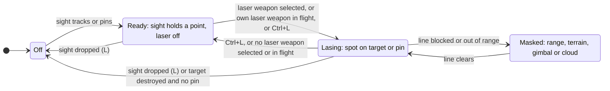
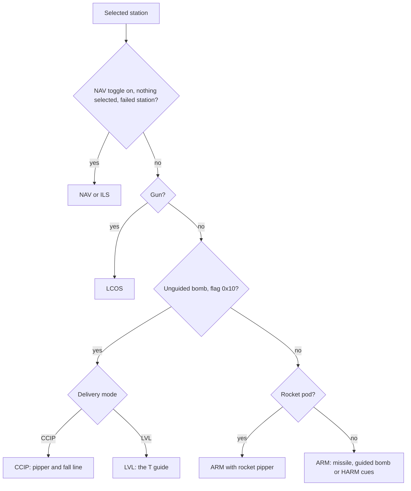
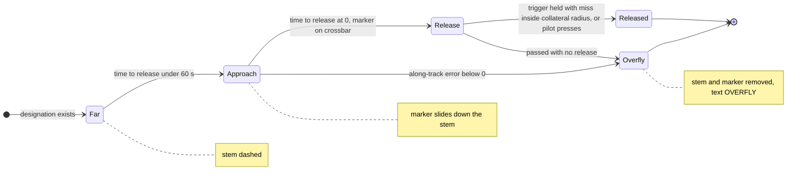
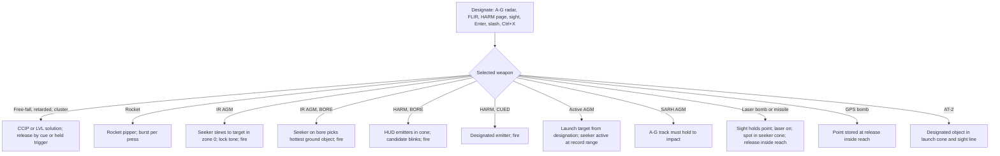

# Air-to-ground radar, designation and weapons

> **T.O.R.E: Tasteful Opinionated Reverse Engineered.**
> The thing being reverse engineered is the *experience*, not the executable. We
> trace what a player does and what the game does back, down to the numbers they
> would notice. How the original code achieved it is history: useful evidence,
> never a blueprint. If a sentence below reads like an instruction to reproduce
> the original's internals, it is out of date.
> <!-- tore-header v2 -->

Status: **specification written before implementation** (2026-10-10, the A2G
round). Nothing in this file is built yet. Each section says what the player
will see and do, with the numbers, and labels where every number comes from.
The slices that build it are listed in [Source notes](#source-notes). Two
research slices are still running and will fold their facts in at the spots
marked **R1 fold** and **R2 fold** (see [Fold-in spots](#fold-in-spots-for-the-research-slices)).

## What the player gets

Today a player can carry Mavericks, HARMs, Mk 82s and rockets, but cannot use
them on the ground: nothing on the ground can be designated, bombs fly
straight along the nose and never fall, rocket pods fire one rocket per pod,
and the HUD draws nothing for a bomb or rocket. This round makes every
air-to-ground store the 36 imported aircraft can carry work: 40 real weapon
records in twelve weapon classes, plus the Pave Spike and Pave Knife pods.

- **Ground targeting.** Ctrl+R puts the radar in the retail air-to-ground mode
  (objects slower than 90 kt, drawn as dots). The FLIR (I) sees hot ground
  targets. T, Shift+T, a scope click, Enter and ' designate them, and the
  target window shows them as it shows aircraft.
- **Two bomb sights** for unguided bombs, as John asked: a dive pipper (the
  retail CCIP, a continuously computed impact point with a dotted fall line and
  a range arc) and a level-flight "T" release guide with automatic release
  while the trigger is held. Rockets get a pipper too.
- **Laser designation.** An aircraft with a laser designator lases its
  designated target or a pinned ground point, automatically when a laser weapon
  is selected (retail) or by hand with a laze key (John). The target display
  becomes a targeting pod page with a flashing LASE cue, the laser range and
  the weapon's time to impact. The HUD marks the laser point with a box and a
  laser range readout. When the spot is a wingman's or another player's, both
  displays say so (BUDDY).
- **Guided bombs.** Laser bombs home on the spot and fall blindly without it.
  The JDAMs are GPS bombs that fly to the point designated at release. Both get
  a release range indicator on the HUD range scale.
- **HARM like boresight.** With a HARM selected the HUD shows every radar
  emitter the missile can see. The one nearest the bore blinks as the
  candidate and the trigger fires at it without designation, exactly as an
  air-to-air missile in BORE. The retail HARM scope page (M) designates too.
- **Missiles.** Mavericks lock a designated ground target, or the hottest one
  near the bore. Harpoon and Exocet go after ships. AS-7 and AS-15 ride the
  radar track. The laser missiles ride the spot.
- **Bomb motion that matches the game**, read from the original's own bomb
  routine; multi-bomb packs released at their retail spacing; pods holding
  their real rocket count; cluster bombs with their retail wide burst.

Out of scope this round: AI wings attacking ground targets (John, 2026-10-10:
the player's systems come first; the AI wings stay air-to-air), ground map or
moving target radar pictures, remote ground targeting from an E-8C (Shift+G,
no such aircraft is imported), the bombers' HAB camera, drawing stores on
pylons, ripple or salvo settings, and weapons FA has no records for (napalm,
fuel-air, runway cratering, dispensers, cruise missiles).

## How to read the labels

Every number or rule below carries one of these labels, as
[AGENTS.md](../../AGENTS.md) defines them.

| Label | Meaning |
| --- | --- |
| **retail data** | A decoded JT, PT, SEE or HUD record, or a static read of FA.EXE 1.02F. Shown with its address or record where it matters |
| **retail manual** | The 1999 EA manual text, with its printed page |
| **spec-derived** | An existing TORE spec in this directory |
| **fitted** | Chosen by an agent because the original's value is not known; the rule and constants are recorded |
| **opinionated (John, date)** | A design John asked for |
| **opinionated (agent)** | A design choice an agent made; never attributed to John |
| **unknown** | Insufficient evidence; see [Unknowns](#unknowns) |
| **R1 fold** and **R2 fold** | A spot waiting for a research slice. The text beside it is the fitted fallback that ships if the research cannot close the fact |

Manual and data disagree in places. John accepted (decision 17) that the
records' seekers and ranges win and the manual is quoted next to them.

## Ground contacts and channels

A ground contact is a surface row (a unit, a building with a combat row, a
ship, a parked aircraft) or an aircraft slower than 90 kt. Five channels can
show one.

| Channel | What it sees | Label |
| --- | --- | --- |
| A-G radar | Objects slower than 90 kt with a radar return, inside the radar's range and azimuth, with terrain line of sight. Parked aircraft return no radar | retail manual pp. 96, 99, 109 (90 kt split), p. 208 (parked aircraft); detection reuses the radar observation with the object's radar signature, fitted |
| FLIR (I) | Hot ground objects by infrared signature inside the IR sensor's range, terrain line of sight, 10 percent of range in cloud and fog | retail manual pp. 25, 100, 111; the contrast model is spec-derived ([missiles](missiles.md#minimum-engagement-and-target-role)) |
| Targeting sight | The object under the sight's line (see [the sight](#the-targeting-sight)) | opinionated (John, 2026-10-10), AC-130 rules |
| HARM page | Ground emitters the HARM seeker receives | retail manual p. 112 |
| Visual | Ground objects in view; only a filter on the channels above (Enter, ') | retail manual p. 112, John's air rule ([radar](radar.md#target-selection-keys)) |

Fitted limits: at most 64 ground contacts per channel, nearest first (the
city-scale scenery would flood the list otherwise). Buildings count only when
they have a combat row (the scene's targets), never city-fill blocks.

## The air-to-ground radar

**Ctrl+R** (and Shift+R, both retail keys) toggles the A-G mode on the
aircraft's own radar. Any aircraft with a signature-3 radar has it (retail
data: the page reads the aircraft's own radar record). The scope label is
**A-G** (the binary's string; the manual's "G-R" is noted as a conflict). R
returns to air mode. Turning A-G on clears the current air target, the IR
channel and the HARM page, and shows the message "Air-Ground Radar on" (retail
data). The range ladder is unchanged: 5, 10, 25, 50, 100 and 150 nmi, reset 10
(spec-derived, [radar](radar.md#scope-range-and-targeting-modes)). A ground
specific range is unknown.

Air mode ignores anything slower than 90 kt and ground mode ignores anything
faster (retail manual pp. 96, 99, 109). A hovering Mi-24 at 60 kt therefore
shows on A-G and not on air radar, and a 300 kt fighter shows on air radar and
not on A-G.

**Symbols** (fitted on the manual's "single-pixel dots", p. 97):

| Contact | Symbol |
| --- | --- |
| Ground vehicle, building, parked aircraft | 2 by 2 pixel dot |
| Ship | 3 by 3 pixel dot |
| SAM or AAA unit the pilot has identified (seen, or received as an emitter) | 5 by 5 pixel X (the manual's remote-targeting X, p. 113) |
| Selected contact | the existing captain's bars ([radar](radar.md#selected-contact-bars-and-movement-line)) |
| Moving vehicle | the TWS direction line, as for an air contact |

**Selection.** T and Shift+T cycle ground contacts nearest first, the air rule
([radar](radar.md#target-selection-keys)); a scope click picks one. Friendly
units are skipped by T (the air rule) but can be clicked, so a friendly target
window still works. A designated ground contact drops when every channel loses
it, except that the targeting sight's track keeps it (as the AC-130 pod track
does). Cycle order beyond "nearest first" is unknown in the original. Label:
opinionated (agent) over the spec-derived air rule.

**Support.** An A-G track on the designated object supports SARH missiles (AS-7,
AS-15) and gives active radar missiles their launch target. The gun's LCOS
solves against a designated ground object as it does for an aircraft, so
strafing a designated tank shows the pipper on it. Tab fires the gun whatever is
selected (retail key).

> **R2 fold, A-G page.** Waiting for the A-G handler (0x414faf), the scope
> update (0x43fb1e) and the selector (0x440d00): the 90 kt filter, what mode 4
> draws, ground-specific range, cycle order and the symbols. Fallback: the
> fitted values above. Destination: [radar formats](../formats/radar.md).

### FLIR ground contacts

The IR channel (I) adds ground contacts by infrared signature beside its air
contacts, labelled "IR" (retail manual p. 100). T cycles them when the IR
channel is the scope channel. Today T selects nothing on IR; the ground list
changes that for ground contacts only, and air IR contacts stay Enter-only as
John's air rule says. This is how aircraft without an air-to-ground radar (the
A-10, the AH-64) designate for a Maverick. Sensor ranges are retail data (AAS-38
15 nmi, AV8IR 15, SU27I 9 or 10). Weather: radar 100 percent except cloud 75,
IR 10 percent in cloud and fog, laser 50 percent in cloud and fog (retail
manual p. 111).

### The HARM scope page

**M** cycles the scope channels Radar, IR and, when an anti-radiation missile is
aboard, HARM (retail: M is the HARM seeker; TORE's cycle keeps both meanings).
"HARM" appears in the upper left. Without a HARM aboard the message is "No HARM
seeker found" (retail data, handler 0x4154c7). Selecting HARM turns the radar
and IR channels off (retail manual p. 122).

- The page shows every ground emitter the selected HARM type's seeker receives
  (passive reception, the record's zone 0 range) as the RWR ground square at
  its bearing and true range (range fitted: the seeker is passive; the retail
  page draws them on the range ladder). Painting emitters are bright, tracking
  emitters flash (retail manual p. 95, [RWR](rwr.md)).
- T, Shift+T and a scope click designate an emitter. The designation drops when
  the emitter goes off and stays off past the seeker's memory (opinionated,
  agent).
- After launch the HARM is fire and forget. If the emitter turns off, the
  missile flies to its last known position and detonates (retail manual
  p. 120). Turning the radar off is the threat's only defence.

> **R2 fold, HARM page.** Waiting for the HARM handler (0x4154c7) and the
> selector (0x440d00): what the page draws and what the target switch does.
> Destination: [radar formats](../formats/radar.md).

### Visual and sight designation

- **Enter** cycles visible ground objects left to right (retail) that are also
  current ground contacts on some channel (John's air rule kept for the ground).
  **'** picks the one nearest the centre. Aircraft keep today's Enter rule.
- **`/`** (retail "IR/laser target", next visible object) cycles the targeting
  sight through visible ground objects on aircraft with a sight. Backslash
  stays "nearest the centre" (retail and the AC-130).
- **Ctrl+X** (retail cheat "nearest ground target") designates the nearest
  hostile ground object, only with the Easy targeting cheat on.
- The AC-130 sight's track really designates its ground object (today it
  clears the selection), so the HUD, the scope and the weapons agree.

## The targeting sight

### Who has a sight

An aircraft has a sight when it carries a sensor record with signature 1
(laser) or 2 (FLIR). Records are retail data. The gimbal limits for pods and
internal FLIRs are fitted from the SEE fields (the record fields give 60 degree
search and 45 degree track for built-ins and 360 for pods).

| Sensor | Aircraft | Laser | Gimbal |
| --- | --- | --- | --- |
| PAVESPK Pave Spike (fixed row) | F-16C, A-10 | yes, 10 nmi | pod: the hemisphere below the aircraft, as the AC-130 dome (fitted) |
| PAVESPK, PAVEKNF as loaded pods | any aircraft with a pod station (flag 0x400) | yes, 10 nmi | pod hemisphere |
| SU24L, KA50L (built in) | Su-25, V-22 | yes, 10 nmi | 60 degree search, 45 degree track cone about the nose (record fields) |
| AAS38 pod, AV8IR, MIG29I, SU27I, AC130I (FLIR) | Rafale (pod), X-31, F-22, F-22N, AV-8B, AH-64, MiG-29, Su-27, Su-35, AC-130 | no | FLIR pods: hemisphere; internal FLIR: 60 degree cone (fitted) |

Other aircraft have no sight. They designate by radar, FLIR channel or visually
and cannot laze, but they can still drop laser bombs on a buddy's spot (see
[buddy lasing](#buddy-lasing)). Pave Knife is on no imported aircraft by
default; Pave Spike and Pave Knife load on any pod station from the
Air-to-Surface group, as the manual instructs (retail manual p. 120, decision 7).

### The sight

The AC-130 sight is generalised for every aircraft with a sight and the
AC-130 behaves as it does today ([AC-130 linked guns](ac130-linked-guns.md#the-gunsight)).
It has three modes: free slew, a pinned ground point, and a tracked object, with
the same keys (Backslash, Shift+Backslash, L or ;, Alt+arrows, Shift+' and
Shift+;), the same ground march and the same masking rule. A fighter's default
look is straight ahead, 10 degrees down (fitted). The tracked object becomes the
designation. Label: opinionated (John, 2026-10-10: the target display shows
lasing), reusing the AC-130 design.

### The laser

A laser spot exists while the laser is on and the sight holds a tracked object
or a pin. It sits on the tracked object, moving with it, or on the pin.

- **On.** Automatically while a laser weapon (signature 1 with flag 0x400) is
  selected and armed and the sight holds a point (retail manual, "automatically
  activated"), and also while one of the aircraft's own laser
  weapons is in flight. **Ctrl+L** turns it on or off by hand at any time
  (opinionated, John, 2026-10-10: the laze button). A manual off overrides the
  automatic rule until Ctrl+L again or a new laser weapon release.
- **Limits.** Range from the sensor record (10 nmi, retail data), halved in fog
  or when the line passes through the cloud layer (retail 50 percent, manual
  p. 111; the line rule is fitted); terrain line of sight (the AC-130's 25 ft
  rule, spec-derived); the sensor's gimbal. Outside them the laser is MASKED and
  the spot goes away until the line clears.
- **Laser weapons and a lost spot.** The weapon falls or flies blindly
  (ballistic or straight), as the manual says "will fall blindly"
  (retail manual pp. 120, 123, 125). It reacquires if a valid spot enters its
  seeker cone again (fitted).

> **R2 fold, laser and designator.** Waiting for `PROJLock` and
> `HARDBestSeeker` for signature 1: whether the 0x400 designator gate checks the
> own aircraft only or any, what happens on a target switch, and laser weather.
> Decisions 5 and 6 get their retail answers if the code gives them. Fallback:
> the rules above. Destination: [missile formats](../formats/missiles.md).

### Buddy lasing

**Opinionated (John, 2026-10-10, decision 6 and his note):** buddy lasing is in,
and the target display and the HUD must show when the spot is someone else's.
The rule (agent decision) is:

- Every spot belongs to an actor (the aircraft that lases), not to "the player",
  and to that actor's side.
- A laser weapon homes on its own aircraft's spot first, otherwise on the
  nearest same-side spot inside its seeker cone. A spot of the opposing side is
  never used.
- A spot is shown to the player, as a buddy spot, when a laser weapon is
  selected and a same-side spot (not the player's own) lies inside that weapon's
  seeker range (zone 0 maximum, 8.23 nmi for the GBU-10, retail data; the
  display rule is fitted).

What the player sees, own spot against buddy spot:

| Display | Own spot | Buddy spot |
| --- | --- | --- |
| Targeting page laser row | **LASE** (flashing, 2 Hz) | **BUDDY** (flashing, 2 Hz), with the lasing pilot's callsign on the name row |
| HUD box marker | rectangular box with a small **L** | the same box with a small **B** |
| HUD weapon text | `LSR 4.3` (nm, flashing while lasing) | `BUD 4.3` (nm from the player's aircraft to the spot, flashing) |
| Range | laser range from the player's aircraft to the spot | the same, to the buddy's spot |
| Both exist | the row reads LASE and a second small BUDDY row sits beneath it | |

An aircraft with no sight of its own (a MiG-23 with an F-16C overhead) still
gets the page: with a laser weapon selected and a buddy spot valid, the target
display shows the targeting page in its buddy form, looking from the aircraft at
the spot, with the BUDDY row, the range and the weapon's time to impact. Without
a buddy spot it is the plain target window. This extension to the page rule is
opinionated (agent), following John's note. The page's exact buddy layout is an
[unknown](#unknowns) until P1 renders it.

## The targeting page

On an aircraft with a sight the target display (camera slot 4, Shift+4) shows
the targeting page, instead of the plain [target window](target-window.md),
whenever the sight is pinned, slewed off its default, lasing, or an
air-to-ground weapon is selected. Otherwise it is the target window as today.
The AC-130 keeps its gunsight page. Label: opinionated (John, 2026-10-10;
agent for the layout).

- **Picture.** The camera looks along the sight from the aircraft (the pod or
  the nose; the eye point is fitted per type as the AC-130's dome is), with the
  AC-130 zoom ladder, 24 Hz, grayscale, and, when the city-fill branch's
  full-detail rule lands, full building detail.
- **Symbology** (ink with a white halo, in the AC-130 page's style):

| Element | Content |
| --- | --- |
| Crosshair | Camera centre |
| Track box, pin square | As the AC-130 page |
| Name row | Target name, PIN, SLEW (the lasing pilot's callsign for a buddy spot) |
| Laser row | **LASE** blinking at 2 Hz while lasing; **BUDDY** while the spot is someone else's; **LSR RDY** when ready; **MASK** when masked; nothing without a laser |
| Range | Laser range to the spot (nm with one decimal, feet under 1 nm) while lasing; else sight range |
| Time to impact | **TTI m:ss** for the aircraft's oldest laser or GPS weapon in flight, counting down; **IMPACT** for one second at the hit |
| Objective row, clock, damage bar | As the target window |
| Gimbal limit | The AC-130 eye icon |

Retail shows the weapon's own view in the IR/Laser window after launch (Shift+2,
retail manual p. 88). The weapon camera in the flight views already does that,
so the page keeps the pod view (opinionated, agent; John asked for the page to
show the lasing).

## The HUD in air-to-ground modes

### Status word and mode choice

The HUD status word follows retail (static read: printer 0x409030, mode byte set
at 0x406e2a to 0x406f6c, dispatch 0x4075b0) with John's level mode added.

For a bomb-flag store retail picks CCIP when a HUD module byte (+0x239) is set,
else HAB (a bomber camera, byte +0x23a), else ARM. Ctrl+M switches CCIP and LVL
for bombs (and BORE and CUED for missiles, the existing action). CCIP is the
default. LVL is chosen automatically when a bomb is selected while a ground
designation exists and the flight path is within 10 degrees of level (fitted),
and Ctrl+M overrides it.

Retail gives the MiG-21, MiG-17F, Mi-24 and Yak-141 no bomb sight (their bombs
show ARM). **Every aircraft that can carry bombs gets both modes** (opinionated, John accepted decision 1,
2026-10-10): a jet with no sight cannot bomb usefully. Retail CCIP aircraft
(retail data, partly matched by file name): F/A-18D, Rafale, F-14, A-4E, MiG-29,
Su-25, MiG-23, Su-27, Su-35, F-22, F-22N, AV-8B, the F-4s, A-7, F-15, F-16C,
F-104 and A-10. The F-14's PT names `f14cc.HUD`, which is CCIP, and several PTs
carry an empty HUD name and were matched by file name. None of the imported
aircraft uses HAB.

All air-to-ground cues come from one deterministic solution computed on the host
for the seat's own aircraft every tick, so single player and online show the
same picture.

### CCIP, the dive pipper

- **Impact point.** Where the selected bomb would hit the ground (or the sea) if
  released now, flown through the same motion the game uses after release.
  The pipper and the real bomb cannot disagree. Spec-derived from the
  retail routine (0x409760 predicts with 0x4c3eb0).
- **Pipper.** The LCOS pipper's style: ring radius 9 reference pixels, centre
  dot (spec-derived, [gunsight](gunsight-targeting.md)). Its arc follows the
  binary's glyph rule: a full arc inside 0.4 of the record's zone-1 maximum
  range, unwinding to nothing at the maximum; beyond the maximum the pipper is
  not drawn (retail data, glyph 0x2f inside 0.4, 0x2e down to 0x20 between 0.4
  and 1.0, blank beyond). The manual says the arc is a full circle at 10,000 ft
  or more and half at 5,000 ft with about 2 nmi practical limit (retail manual
  pp. 85, 125). **The code wins** (decision 3, accepted): the arc scales with
  each bomb's own maximum (MK-82 20,000 ft; guided and cluster 30,000 ft).
- **Fall line.** Dotted, from the HUD reference point (the boresight cross) to
  the pipper (retail data, pattern 0x55555555 from 0x521060).
- **Off the HUD.** Retail draws nothing. TORE draws the fall line to the HUD's
  lower edge and a small caret there, so a level pass still shows where the
  bombs would go (fitted).
- **Text.** CCIP status, count and short name, slant range to the impact point
  (`R 1.8`), and IN RNG inside the zone-1 maximum (fitted layout; the
  "IN RNG" string is retail data).
- **Release.** The pilot releases when the pipper is on the target. With the
  trigger held, the station follows its record's pack spacing (see [packs](#release-modes-and-packs)).

> **R1 fold, bomb sight.** Waiting for the CCIP draw (0x409760): the HUD
> reference point ([0x521060]), the units of the 0.4 threshold, the glyph
> shapes (rendered to a sheet from the HUD font) and the dotted line size.
> Fallback: the rule above with the survey's reading of the units. Destination:
> [weapons formats](../formats/weapons.md).

### The level release "T" (LVL)

**Opinionated (John, 2026-10-10).** Retail has no level cue; John asked for a
level-flight "T" release guide. The design is an agent decision. It needs a
designated ground object or a pinned point from any channel, the sight or Enter.

- **Solution.** The impact point if released now (as CCIP) is compared with the
  target. D is the along-track error (target beyond the impact point is
  positive), C the cross-track error. Time to release is D divided by ground
  speed, assuming the current flight path is held (fitted).
- **The T.** The stem is the **azimuth steering line**, a vertical line on the
  HUD at the bearing that puts the impact point through the target (the
  cross-track correction). Fly the flight path marker onto it. The **crossbar**
  is a short horizontal bar fixed across the flight path marker. The **release
  marker** is a small circle that rides down the stem: at the top of the HUD
  while time to release is 15 s or more, linear to the crossbar at 0 s. Together
  they read as a T that closes.
- **Text.** `LVL` status, `REL 0:07` time to release, `R 3.4` slant range to the
  target; after release `IMP 0:12` time to impact for the last bomb.
- **Release.** When the marker meets the crossbar. If the trigger is held
  (pickle and hold), the release happens automatically at 0 s when the
  cross-track miss is inside the record's collateral radius (decision 2,
  accepted). Otherwise the pilot presses at the cue.
- **Overflown** (D below zero): the stem and marker go and the text reads
  OVERFLY. More than 60 s out, the stem is dashed.
- The same T serves guided bombs in level flight, with the release range
  indicator (below) instead of the time-to-release cue when the bomb can reach
  the target already.

### Guided bomb release range indicator

For laser and GPS bombs the right-hand weapon range scale (x=390, today's
missile scale, [missiles](missiles.md#weapon-hud-delivery)) shows the bomb's
reach from the current altitude and speed: the minimum and maximum ground range
at which the bomb can still reach the target with its own turn and glide (a
fly-out of the guided motion, as the missiles' maximum range is computed), the
target caret, and IN RNG when the target lies between them. Above the scale,
`R 6.2` target range. In LVL the T's release marker reaches the crossbar when
the target enters the maximum reach, so a level pass with a JDAM is "fly the
stem, release at the bar". This is John's "range indicator for when to drop"
(opinionated, John, 2026-10-10, decision 4); the reach computation is an
opinionated (agent) design. Retail gives only "when you're in range and have a
good hit probability" (retail manual p. 125) and no release range cue.

### Rockets and guns

- **Rockets** (ARM status, retail): a rocket pipper at the predicted ground
  impact of the next rocket, flown through the rocket's motor, speed command and
  gravity (opinionated, agent, decision 12; without it rockets are unaimable).
  The range arc follows the record's zone-1 maximum, as CCIP.
- **Guns.** The LCOS solves against a designated ground object (see
  [support](#the-air-to-ground-radar)).

### Missiles and the HARM boresight cue

- **IR AGMs** (Maverick AGM-65A and G, SLAM). Retail cues: the seeker diamond
  floats to the designated target's rectangular TD box; a ringing lock tone; the
  range scale; IN RNG; hit percent (retail manual pp. 83, 84; a Maverick solid
  box at 10 nmi, fire above 70 percent). Retail requires a designation and that
  stays the default. **Maverick boresight** (opinionated, John accepted
  decision 10): with BORE selected the seeker looks along the bore and the
  diamond blinks on the hottest ground object in the seeker cone, exactly as
  air-to-air BORE ([missiles](missiles.md#weapon-hud-delivery)).
- **HARM boresight cue** (opinionated, John, 2026-10-10: "act kind of like
  boresite on a2a weapons where it shows a radiation source you can shoot at").
  While an anti-radiation missile is armed, the HUD draws every ground emitter
  the missile's seeker receives inside its zone 0 cone as the RWR ground square
  at its direction (at most 8, nearest the bore first; painting ones bright).
  The candidate (painting first, then nearest the bore, inside the launch cone
  and range) gets the blinking diamond, the range scale and BORE, and the
  trigger launches at it without designation. A designation from the HARM page
  or the A-G radar turns it CUED (solid box). An emitter that goes off dims.
  After launch the missile keeps its memory and flies to the last known position
  (retail manual p. 120). The geometry rules are fitted.
- **Active and SARH AGMs.** The A-G designation's box, range scale, readiness
  (`NO TRACK` when the A-G track is lost for a SARH missile).
- **Laser AGMs.** The laser box and laser range (below), range scale.

### Laser on the HUD

- The laser point is marked with the retail IR/laser **rectangular TD box**
  (12 by 8 reference pixels, fitted) beside the radar square, with a small **L**
  when lasing (**B** for a buddy spot). The aim box rules apply off the HUD (an
  edge arrow, [aim box](ac130-linked-guns.md#the-aim-box-on-every-view)).
- Weapon text adds `LSR 4.3` (laser range, nm) blinking at 2 Hz while lasing,
  `LSR RDY`, or `MASK`; `BUD 4.3` for a buddy spot; and `TTI 0:12` while an own
  laser or GPS weapon flies. All opinionated (John, 2026-10-10: "the hud with a
  range indicator"); text layout fitted.

### Warnings

Opinionated (agent, decision 15). Advisory, in the readiness slot, except where
the station could not release at all:

| Warning | When |
| --- | --- |
| LOW | The predicted fall time is shorter than the record's fuze arm time: the bomb will not explode |
| FRAG | At the predicted impact time the aircraft (flying its current path) is inside the record's collateral radius of the impact point; splash can hurt the shooter (retail manual p. 126, no number given) |
| BAY | A bay aircraft with the bay closed, as today (retail BAY; release refused "Can't deploy, Open weapon bay door") |
| NO TARGET | A guided weapon that needs a designation has none |
| NO TRACK | A SARH missile's A-G track is lost |
| NO LASER, MASK | A laser weapon with no valid spot (it may still be released and falls ballistic; MASK when the line is blocked) |
| OUT OF REACH | A guided bomb's reach does not cover the target |
| OVERFLY | LVL, passed the target |
| NO EMITTER | A HARM with no emitter to fire at |

Only a GPS bomb with no designated point and an AT-2 with no target block
release. Laser bombs can be released without a spot (they fall ballistic and can
still pick one up), as retail allows. The text strings are fitted.

## Weapon classes

Forty real records in twelve classes. "Today" is the status on the branch before
this round.

| # | Class | Records | Carriers | How it works | Today |
| --- | --- | --- | --- | --- | --- |
| 1 | Free-fall bombs | MK82, MK84, FAB250, FAB500, FAB1000, MK82P3 (3-pack) | 18 to 26 | Retail bomb motion; CCIP and LVL; fuze, splash and craters exist | MK82 partly; rest missing |
| 2 | Retarded bombs | MK82HD, MK82P (6-pack), MK82AIR (7-pack) | 17 to 26 | As 1, with the record's launch retard 66 and pack spacing | missing |
| 3 | Cluster bombs | CBU87, CBU89, MK20, RBK250, RBK500 | 26 each | As 1, with the slowdown to 278 ft/s; retail wide splash; presentation-only bomblet flashes | missing |
| 4 | Laser-guided bombs | GBU10, GBU10A, PAVEWAY, PAVEWA3, GBU28 | 24 (GBU28: 5) | Ballistic until a valid spot is in the seeker cone (zone 0, 90 degrees); then steer within the record's turn limits while gliding to final speed; spot lost: ballistic | missing |
| 5 | GPS bombs (JDAM) | GBU29, GBU29P, GBU30 | 25 to 26 | Fly to the ground point designated at release (fixed coordinates; a moving target is missed), all weather, no designator after release | missing |
| 6 | Rocket pods | LAU61, B8, B13, LAU10 | 24 to 26 | A pod holds its real rockets (19, 19, 5, 4); each press, or held repeat, fires the record burst (2, LAU-10 1); rocket pipper | LAU61, B8, B13 partly |
| 7 | Optical rocket | AT2 | 27 (Mi-24 default) | Command guidance to the designated ground object while it stays inside the launcher's zone-1 cone with line of sight; else ballistic | partly |
| 8 | IR AGMs | AGM65G, AGM65A, AGM84E | 24 to 25 | Existing surface infrared profile; designated lock, or BORE | AGM65G partly |
| 9 | Anti-radiation | AGM88, AGM45 | 26 | Existing emitter profile; HUD boresight cue and HARM page; memory to the last position | AGM88 partly; AGM45 hidden |
| 10 | Active radar AGMs | AGM84A, AM39, AS16 | 20, 20, 13 | Existing active profiles; launch target from the A-G designation; surface seekers see surface rows without the air notch | profiled, hidden |
| 11 | SARH AGMs | AS7, AS15 | 21 | Supported by the launcher's A-G track until impact; track lost: unguided | AS7 partly; AS15 missing |
| 12 | Laser AGMs | AS14, AS30, AT12 | 24 to 25 | Class 4's seeker with a motor and the cruise profile | missing |

Also: the F-4J's SUU-16 gun pod and the AC-130's 105 mm already work. Novelty
Boulder and Moose are Cheat catalog only ([decisions pending](#decisions-pending)).
Pave Spike and Pave Knife are loadable pods (decision 7). Carrier counts and
status are survey results (static reading of the PT stations with the real
loading rules); they are re-checked at acceptance.

Guidance names. The data's seeker signatures are 0 none, 1 laser, 2 IR, 3 radar
(0x200 means supported by the launcher), 4 passive radar. Flag 0x400 means the
weapon needs a designator; flag 0x1 guided. The Load Ordnance seeker labels in
FA.EXE are "passive rdr, active rdr, IR, laser, optical, unguided, SARH". The
manual's "Optical" weapons (AT-2, GBU-29B, GBU-30) are exactly the guided
signature-0 records, a plausible but unproven mapping ([unknowns](#unknowns)).

### The seekers and the lock flow

### Rockets

A pod holds `projsInPod` rockets, the real count: LAU-61 19, B-8M1 19, B-13L 5,
LAU-10 4 (retail data). Each press, or each repeat while the trigger is held
(rockets carry the held-repeat flag 0x800), fires the record's burst (2 rockets,
LAU-10 1) with the record's burst spacing, and the pod empties in order. An empty
pod stays on the station. Launch envelope 1.48 to 2.47 nmi; motor 10 s; the
manual gives a 1 nmi line of sight (retail manual, weapon notes). Opinionated
(John accepted decision 12): the real counts and burst, with the rocket pipper.
Which JT field counts pod rockets (`projsInPod` against `actualRoundsPerGame`) is
an R1 fold.

### Cluster bombs

CBU-87, CBU-97 (record CBU89), Mk 20 Rockeye II, RBK-250 and RBK-500 are the
five cluster records (flags 0x82a052; 0x800000 is set on exactly these five,
meaning unknown). The data has **no submunition count or dispersion field**.
They slow to a final speed of 278 ft/s (deceleration 14 with the speed
command), explode as type 18 with a fuze radius of 100 ft and no crater, and
their splash is wide: 2,200, 2,500, 1,600, 1,500 and 2,500 ft at 100 percent
damage for CBU-87, CBU-97, Mk 20, RBK-250 and RBK-500 (retail data; compare
[explosions](explosions.md)). The remake keeps the retail wide splash and
adds a **presentation-only scatter of small flashes** over the radius, so a
cluster bomb looks like one (opinionated, agent, decision 13): the flashes do
no damage and the damage is the same as the original's.

### Release modes and packs

Data packs only (opinionated, John accepted decision 14, matching retail, which
has no ripple, salvo, interval or quantity control): one press releases one
record burst, that is a single bomb or the 3, 6 or 7 of a pack at its spacing
(gameRoundsInBurst 3, 6, 7 on MK82P3, MK82P, MK82AIR; gameBurstT 4; retail data,
unit R1 fold). Holding the trigger repeats releases at the record's reload time
for held-repeat records (rockets) and in LVL auto-release.

### Bomb motion

Retail bomb motion is the routine at 0x4c4050 (`PROJBombPos`), not yet read.
Until R1 folds it, the fitted fallback below ships. Today a released bomb flies
straight along the nose and never falls (the 0x4 gravity flag is absent from
every bomb record).

| Fact | R1 fold; fitted fallback |
| --- | --- |
| Release velocity | The aircraft's velocity vector times `launchRetard` / 100 plus a 10 ft/s downward ejection. `launchRetard`: 100 slick, 66 retarded (MK82HD Snakeye, MK82AIR, MK82P), 90 cluster and guided (retail data) |
| Gravity | 32.2 ft/s squared, no terminal cap for bombs |
| Drag | None for slick bombs (retail records carry no drag fields); retarded bombs lose horizontal speed by the cluster record's deceleration rule only if R1 shows one |
| Orientation | The drawn bomb points along its velocity (pitch-over) |
| Packs | `gameRoundsInBurst` bombs per press, one every `gameBurstT` service units, from alternating sides of the station mount |
| Pods | As [Rockets](#rockets); empty pods stay on the station |

> **R1 fold, bomb motion.** Waiting for the bomb routine (0x4c4050), the impact
> predictor (0x4c3eb0), `PROJSpeed` for bomb records (nose or velocity, retard),
> the 0x40 speed command on bombs and cluster records, the `gameBurstT` units,
> which field counts pod rockets, and the 0x800000 bit. Destination:
> [weapons formats](../formats/weapons.md).

The sight and the motion are one calculation: a test requires the real bomb to
land on the predicted point to within a foot.

## Keys

Retail keys are marked; the rest are TORE additions. All were free before this
round. The generated [controls list](../CONTROLS.md) and the
[keyboard spec](keyboard.md) change in the same slice that adds the action.

| Action | Keyboard | Gamepad | Label |
| --- | --- | --- | --- |
| A-G radar on or off | Ctrl+R, Shift+R | none | retail manual p. 99 |
| Scope channel (adds HARM) | M | as today | retail M plus TORE cycle |
| Next or previous ground target | T, Shift+T | as today | retail |
| Visual target, nearest the centre | Enter, ' | as today | retail manual p. 112 |
| Sight: next visible object | `/` | none | retail |
| Sight: designate, pin, drop, slew, zoom | Backslash, Shift+Backslash, L or ;, Alt+arrows, Shift+' and Shift+; (now every aircraft with a sight) | AC-130 bindings | retail keys, AC-130 design |
| Laze on or off | Ctrl+L | none | opinionated (John, 2026-10-10) |
| Delivery mode: CCIP and LVL for bombs, BORE and CUED for missiles | Ctrl+M (the existing seeker-mode action gains a key) | none | opinionated (agent) |
| Fire the gun whatever is selected | Tab | none | retail |
| Nearest ground target (Easy targeting cheat) | Ctrl+X | none | retail cheat |
| Jettison air-to-ground stores | Shift+K | as today | retail, exists |
| Bay doors | O | as today | retail, exists |
| Remote ground targeting (Shift+G), wingman engage IR/laser target (Alt+F) | not provided | none | out of scope this round |

## Inventory

### Aircraft

The 36 imported aircraft (37 selectable with the F/A-XX). **27 carry
air-to-ground stores**: F/A-18D, Rafale C, F-14D, A-4E, X-31, MiG-29, Su-27,
MiG-21, Su-25, MiG-23, Su-35, F-22, F-22N (and the F/A-XX), AV-8B, Yak-141,
AH-64, Mi-24, MiG-17F, F-4B, F-4J, F-4E, F-4G, A-7, F-15, F-16C, F-104, A-10.
**Nine carry none**: C-130, AC-130 (its 105 mm is a gun aimed by the gunsight),
E-3, Il-76, E-2, V-22 (a chin gun, and a KA50L laser but no laser weapon),
CH-47, B747, A310.

Loading follows the existing loading rules (station masks, weight class). The
eight records loadable today (AGM65G, AGM88, AS7, AT2, B8, B13, LAU61, MK82) fit
every one of the 27 except: the Mi-24 takes AT-2 only; the AH-64 takes no AS-7,
B-8 or B-13; the MiG-17F takes no AGM-65G or AS-7; AS-7 needs a semi-active
station, so not the A-10, A-4E, A-7, AH-64, MiG-17F or Mi-24. GBU-28 (4,500 lb)
fits only the Rafale, F-4B, F-4J, A-7 and F-15. AS-16 fits 13 aircraft. Pod
stations (flag 0x400) exist on every imported jet except the MiG-17F and the
AH-64. All retail data (PT stations and weights).

### Default air-to-ground loads

Retail data (PT defaults, hardpoint in brackets).

| Aircraft | Default stores |
| --- | --- |
| F/A-18D | AGM-65G x4 [6], x4 [7] |
| Rafale C | AGM-65G x4 [5] |
| X-31 | AGM-65G x2 [7] |
| F-22, F-22N | AGM-65G x2 [6] |
| AV-8B | AGM-65G x4 [5], x2 [6] |
| F-4E | AGM-65G x4 [6] |
| F-4G | AGM-88 x4 [6] |
| F-16C | AGM-65G x4 [6] |
| A-10 | AGM-65G x4, x4, x2, x2 [5 to 8] |
| A-7 | MK-82 x2 [5], AGM-65G x4 [6] |
| A-4E | MK-82 x4 [4], LAU-61 x2 [6] |
| F-4B | MK-82 x4 [4], x4 [5] |
| Su-25 | B-13 x2 [6], AS-7 x4 [7] |
| MiG-23 | B-8 x2 [6], AS-7 x2 [7], x2 [8] |
| AH-64 | LAU-61 x2 [5] |
| Mi-24 | AT-2 x4 [2] (fixed) |
| F-4J | SUU-16 gun pod only |
| none by default | F-14, MiG-29, Su-27, MiG-21, Su-35, F-15, F-104, MiG-17F |

### Weapon records

All values are retail data (the JT records, [weapons table](../formats/fa-weapons.csv)). Launch range is the
zone 1 minimum and maximum in nautical miles; seeker is the zone 0 range. Pack
counts are from the release fields and "pod" is rockets per pod. Weights are in
pounds.

| Record | Name | Class | Weight | Launch nmi | Seeker nmi | Notes |
| --- | --- | --- | ---: | --- | ---: | --- |
| MK82 | Mk 82 Slick | 1 | 500 | 0.01 to 3.29 | 3.29 | Fuze radius 300, arm 4 |
| MK84 | Mk 84 Slick | 1 | 2000 | 0.01 to 3.29 | 3.29 | |
| FAB250 | FAB-250 M62 | 1 | 550 | 0.01 to 1.65 | 3.29 | |
| FAB500 | FAB-500 M62 | 1 | 1093 | 0.01 to 1.65 | 3.29 | |
| FAB1000 | FAB-1000 M62 | 1 | 2272 | 0.01 to 1.65 | 3.29 | |
| MK82P3 | Mk 82 3-Pack | 1 | 1500 | 0.01 to 3.29 | 3.29 | 3 bombs per press |
| MK82HD | Mk 82 Snakeye | 2 | 500 | 0.01 to 3.29 | 3.29 | Launch retard 66 |
| MK82P | Mk 82HD 6-Pack | 2 | 3000 | 0.01 to 3.29 | 3.29 | 6 per press |
| MK82AIR | Mk 82 AIR 7-Pack | 2 | 3500 | 0.01 to 3.29 | 3.29 | 7 per press |
| CBU87 | CBU-87/B Cluster | 3 | 500 | 0.01 to 4.94 | 8.23 | Splash 2,200 ft |
| CBU89 | CBU-97/B Cluster | 3 | 700 | 0.01 to 4.94 | 8.23 | Splash 2,500 ft |
| MK20 | Mk 20 Rockeye II | 3 | 400 | 0.01 to 4.94 | 8.23 | Splash 1,600 ft |
| RBK250 | RBK-250 Cluster | 3 | 500 | 0.01 to 4.94 | 8.23 | Splash 1,500 ft |
| RBK500 | RBK-500 Cluster | 3 | 700 | 0.01 to 4.94 | 8.23 | Splash 2,500 ft |
| GBU10 | GBU-10E Paveway II | 4 | 2000 | 0 to 4.94 | 8.23 | Laser, needs designator |
| GBU10A | GBU-10 Paveway I | 4 | 2000 | 0 to 4.11 | 7.41 | Laser |
| PAVEWAY | GBU-10E Paveway | 4 | 2000 | 0.01 to 4.94 | 8.23 | Laser |
| PAVEWA3 | GBU-27 Paveway III | 4 | 2000 | 0.01 to 4.94 | 8.23 | Laser |
| GBU28 | GBU-28/B | 4 | 4500 | 0.01 to 4.94 | 8.23 | Laser; splash 100 ft at 35 percent |
| GBU29 | GBU-29 JDAM | 5 | 2000 | 0.01 to 4.94 | 8.23 | Signature 0, guided flag; splash 300 ft |
| GBU29P | GBU-29/P JDAM | 5 | 2000 | 0.01 to 4.94 | 8.23 | Splash 100 ft at 35 percent |
| GBU30 | GBU-30 JDAM | 5 | 1000 | 0.01 to 4.94 | 8.23 | Splash 1,000 ft |
| LAU61 | LAU-61 Rocket Pod | 6 | 200 | 0.01 to 1.97 | 3.29 | Pod 19, burst 2 |
| B8 | B-8M1 Rocket Pod | 6 | 798 | 0.01 to 1.48 | 2.14 | Pod 19, burst 2 |
| B13 | B-13L Rocket Pod | 6 | 1111 | 0.01 to 2.47 | 3.29 | Pod 5, burst 2 |
| LAU10 | LAU-10 Rocket Pod | 6 | 200 | 0.01 to 1.97 | 3.29 | Pod 4, burst 1 |
| AT2 | AT-2 Swatter | 7 | 65 | 0.08 to 2.96 | 3.29 | Manual "Optical", 0 to 2.9 |
| AGM65G | AGM-65G Maverick | 8 | 675 | 0.08 to 9.87 | 9.87 | IR; data minimum 500 ft against the manual's 0.8 nmi |
| AGM65A | AGM-65A Maverick | 8 | 675 | 0 to 8.23 | 8.23 | IR |
| AGM84E | AGM-84E SLAM | 8 | 1380 | 0.08 to 49.37 | 49.37 | Data signature 2 (IR); manual says active radar, 2 to 49 |
| AGM88 | AGM-88 HARM | 9 | 795 | 0.08 to 32.92 | 32.92 | Manual 0 to 12.3 |
| AGM45 | AGM-45B Shrike | 9 | 795 | 0 to 9.87 | 9.87 | Manual 0 to 11 |
| AGM84A | AGM-84A Harpoon | 10 | 1165 | 0.08 to 59.25 | 59.25 | Manual active radar, 2 to 59 |
| AM39 | AM-39 Exocet | 10 | 1476 | 0.08 to 59.25 | 59.25 | Manual 2 to 92.6 |
| AS16 | AS-16 Kickback | 10 | 2640 | 0.08 to 6.58 | 8.23 | Manual 2 to 6.5 |
| AS7 | AS-7 Kerry | 11 | 631 | 0.08 to 4.94 | 8.23 | SARH; manual 2 to 4.9 |
| AS15 | AS 15 | 11 | 220 | 0.08 to 9.87 | 9.87 | Data radar (3 with 0x200); manual says laser, 0 to 6.5 |
| AS14 | AS-14 Kedge | 12 | 1495 | 0.08 to 6.58 | 8.23 | Laser; manual 0 to 6.5 |
| AS30 | AS 30L | 12 | 1146 | 0.08 to 9.87 | 9.87 | Laser; manual "active radar, laser", 2 to 6.5 |
| AT12 | AT-12 Swinger | 12 | 132 | 0.16 to 4.28 | 4.28 | Laser; manual 0 to 4.2 |
| ~BLDR | Boulder | novelty | 300 | 0.01 to 3.29 | 3.29 | Loads on our aircraft; Cheat only by default |
| ~MOOSE | Moose | novelty | 300 | 0.01 to 3.29 | 3.29 | As Boulder |

Guided-bomb envelope (retail data): seeker cone zone 0, 90 degree half-angle,
to 50,000 ft; launch zone 1, 45 degree half-angle, 0 to 30,000 ft; launch
retard 90; altitude limits unbounded. Splash: slick bombs 500 to 1,200 ft; 1,000 ft at 100 percent for the
GBU-10, GBU-27 and GBU-30; 300 ft for the GBU-29; 100 ft at 35 percent for the
GBU-28 and GBU-29/P.

~MOTHB and ~VOMIT exist in the data but nothing loads them. Absent from the
data and so not provided: GBU-15, AGM-130, Walleye, JSOW, GBU-31 and 32, Sea
Eagle, Penguin, Kormoran, ALARM, AGM-86, Tomahawk, AGM-142, AS-4, AS-6, AS-11,
AS-12, AS-17, Hellfire, napalm, fuel-air, Durandal, JP233, BLU-107, dispensers
and recon pods. SS-N-9 is ship-launched. AEMP-1 is air-to-air.

### Catalog rule

Each weapon is added to the Load Ordnance catalog only when its class works
(the roadmap's rule). After the round the supported list gains 32 air-to-ground
names plus the two pods. The ordnance card's seeker label learns "optical" for
signature 0 guided records (retail label list).

## Numbers

Every figure introduced by this spec, with its source. Figures read from the
records (ranges, weights, counts) are in the inventory above.

| Figure | Value | Label |
| --- | --- | --- |
| Air versus ground speed split | 90 kt | retail manual pp. 96, 99, 109 |
| Range ladder | 5, 10, 25, 50, 100, 150 nmi; reset 10 | spec-derived |
| Ground contacts per channel | 64, nearest first | fitted |
| A-G dot size, ship dot, SAM and AAA X | 2 by 2, 3 by 3, 5 by 5 pixels | fitted |
| Weather | radar 100 percent, 75 in cloud; IR 10 percent in cloud and fog; laser 50 percent in cloud and fog | retail manual p. 111 |
| Laser range | 10 nmi | retail data (SEE) |
| Laser line through cloud or fog | halves the range | retail manual (50 percent), line rule fitted |
| Sensor gimbal | 60 degree search, 45 degree track (built-in); hemisphere (pod) | retail data (SEE); hemisphere and 60 degree FLIR fitted |
| Fighter default sight look | straight ahead, 10 degrees down | fitted |
| Terrain masking for the laser | the AC-130's 25 ft rule | spec-derived |
| LASE flash rate | 2 Hz, 50 percent duty | opinionated (agent), the existing blink rate ([missiles](missiles.md#weapon-hud-delivery)) |
| Buddy spot display range | the weapon's seeker range (8.23 nmi for GBU-10) | fitted |
| Automatic LVL choice | flight path within 10 degrees of level | fitted |
| CCIP ring radius | 9 reference pixels | spec-derived |
| CCIP arc full / zero | full inside 0.4 of the zone-1 maximum; none at the maximum; no pipper beyond | retail data (0x409760); units R1 fold |
| CCIP arc, manual | full at 10,000 ft or more, half at 5,000 ft | retail manual pp. 85, 125; not used |
| Fall line | dotted, 0x55555555 pattern | retail data |
| Off-HUD caret | at the HUD lower edge | fitted |
| LVL marker timing | top of the HUD at 15 s or more, linear to 0 s | opinionated (John, 2026-10-10); numbers agent |
| LVL stem dashed | more than 60 s out | opinionated (agent) |
| LVL auto-release | at 0 s with the cross-track miss inside the record's collateral radius, trigger held | opinionated (John, 2026-10-10); gate agent |
| Release range scale | x=390, the missile scale | spec-derived |
| HUD laser box | 12 by 8 reference pixels | fitted |
| Cluster final speed | 278 ft/s, deceleration 14 | retail data |
| Cluster splash | 2,200, 2,500, 1,600, 1,500, 2,500 ft at 100 percent | retail data |
| Fuze radius | 300 ft slick, 100 ft cluster and guided | retail data |
| Release velocity, gravity, ejection | see [Bomb motion](#bomb-motion) | R1 fold; fitted fallback |
| Rockets per pod and burst | 19, 19, 5, 4; burst 2 (LAU-10 1) | retail data |
| Pack sizes | 3, 6, 7 bombs | retail data |
| AI release tolerance (for the future AI round) | impact within max(1,000 ft, range/8) | spec-derived ([AI](ai.md)) |
| Release altitude advice | 3,000 ft lightly defended, 5,000 ft or more defended; about 1 nmi of range per 1,000 ft of drop altitude | retail manual (advice, not enforced) |
| Stairstep bombing | drop at 65 to 70 percent hit probability | retail manual (advice) |

## Edge cases

- A SAM or AAA site turns its radar off: its HARM square dims; a HARM already
  flying goes to the last known position.
- Terrain blocks the laser: MASK on the page and the HUD; a laser weapon falls
  ballistic until the line clears.
- The designated object is destroyed: the designation clears. A sight pin keeps
  the spot.
- Weapon bay closed (F-22 and bay aircraft): BAY, as today.
- Radar off with an AS-7 or AGM-88 selected: the missile reads READY and flies
  unguided (existing rule, [missiles](missiles.md#radar-off-unguided-release)).
- A bomb released below its arm time: LOW before the release, and the bomb does
  not explode.
- A moving target with a GPS bomb: the bomb hits the stored point and misses.
- Online, the host runs every solution and sends the results; clients draw
  them. Buddy lasing works across players by side.

## Unknowns

AGENTS.md rule: a missing fact is recorded as unknown with the next step, never
filled in with something plausible. Rows that a research slice may close say so.

| Unknown | Fallback shipped | Next step |
| --- | --- | --- |
| Radar: ground detection range, per-aircraft ground behaviour, the A-G page's drawing beyond single-pixel dots, the ground cycle order, the 90 kt filter's code | Section "air-to-ground radar" values (fitted) | R2: handlers 0x414faf, 0x43fb1e, 0x440d00 |
| HARM page look; modes beyond designated target (boresight, self-protect, pre-briefed) | Fitted page; the boresight cue is opinionated | R2: handler 0x4154c7 |
| Laser: the designator gate (own aircraft only or any), reacquisition after a target switch, spot behaviour, laser weather | Buddy rule and reacquisition (fitted) | R2: `PROJLock`, `HARDBestSeeker` |
| What a guided signature-0 record (JDAM, AT-2) does in the retail projectile code | GPS point and command guidance (opinionated, agent) | R2 |
| Bomb motion: release direction (nose or velocity), drag, pitch-over | Fitted fallback table | R1: 0x4c4050, 0x4c3eb0 |
| `gameBurstT` units for packs and pods; which field counts pod rockets | `gameBurstT` service units, `projsInPod` | R1 |
| CCIP pipper glyph shapes, the threshold units (record range against the manual's feet), the dotted line size, the HUD reference point | The 0.4 and 1.0 rule over zone-1 range | R1 (renders glyphs 0x20 to 0x2f) |
| Meaning of flags 0x2, 0x8, 0x8000 and 0x800000 on air-to-ground records | Ignored | R1, R2 where touched |
| The "optical" label mapping | Signature 0 guided = optical | R2 |
| AS-15 is signature 3 + 0x200 (manual: laser); AGM-84E is signature 2 (manual: active radar) | The data wins (decision 17) | Test against FA behaviour not possible (no retail comparison) |
| Manual and data range conflicts (Maverick minimum 0.8 nmi against 500 ft; HARM 12.3 against 32.92; Shrike 11 against 9.87; bombs 1 nmi per 1,000 ft against 3.29 to 4.94 nmi) | The data wins | none |
| Minimum release altitude and safe-escape numbers | LOW and FRAG warnings from the record's arm time and radius | none (manual gives no number) |
| Cluster submunition count and dispersion | Wide splash plus presentation flashes | none (no field in the data) |
| Retail laser-on cue and laser range readout | The opinionated cues in this spec | none: John's design |
| Buddy-lasing rule in retail; wingman Alt+F "attack on contact" | The rule above (opinionated, agent) | none this round |
| The buddy form of the targeting page: exact layout and camera for an aircraft with no sight | The rows above | P1 renders and reviews it |
| IR/Laser window contents beyond "camera view of your target" | The weapon camera and the pod page | none |

## Decisions pending

John answered all 21 plan decisions on 2026-10-10 by accepting the
recommendations, with the notes below. This table lists what is still open and
what depends on research.

| Item | State | Default if John does not choose |
| --- | --- | --- |
| Novelty bombs (decision 16): Boulder (~BLDR) and Moose (~MOOSE) load on our aircraft; ~MOTHB and ~VOMIT are in the data but nothing loads them | John's pick is pending | Cheat catalog only, hidden from the Load Ordnance list |
| Decision 3, the CCIP arc rule | Accepted: the code's rule over the manual's feet. Confirm when R1 folds the units | The 0.4 and 1.0 rule over the zone-1 range |
| Decisions 4 and 6, JDAM as GPS bombs and buddy lasing | Accepted; R2 may give the retail answers, which replace the opinionated rules where they exist | The rules in this spec |
| Decision 7, Pave pods as stores | Accepted; confirm the pod station rule against R2 | Pods on any 0x400 station |
| Buddy-spot display range and the buddy page for aircraft with no sight | Agent follow-ups to John's 2026-10-10 note | As written above |

Recorded decisions (all accepted, 2026-10-10): 1 both sights on every bomb
carrier; 2 the level T with auto-release; 3 the code's CCIP arc rule; 4 JDAMs
are GPS bombs with a reach scale; 5 automatic laser plus Ctrl+L; 6 buddy
lasing, shown on the target display and the HUD (John's note); 7 Pave pods as
stores; 8 the targeting page on every aircraft with a sight; 9 HARM boresight
cue plus the retail page; 10 Maverick boresight; 11 retail A-G mode only; 12
real rocket counts and a pipper; 13 retail cluster splash plus flashes; 14 no
ripple settings; 15 LOW and FRAG warnings; 17 data over manual; 18 no AI strike
this round; 19 replay events without a format change; 20 stores on pylons stay
undrawn; 21 Tab and Ctrl+X.

## Fold-in spots for the research slices

Two research slices run in parallel with this spec. They write facts into the
format documents; this spec then replaces its fallbacks.

| Spot | Waiting for | Research slice | Destination | Search for |
| --- | --- | --- | --- | --- |
| A-G page | The A-G handler, scope update and selector | R2 | [radar formats](../formats/radar.md) "A-G page" | `R2 fold, A-G page` |
| HARM page | The HARM handler and selector | R2 | [radar formats](../formats/radar.md) "HARM page" | `R2 fold, HARM page` |
| Laser and designator | `PROJLock`, `HARDBestSeeker`, signature-0 guided records, laser weather | R2 | [missile formats](../formats/missiles.md) "Laser and designator", "Optical" | `R2 fold, laser` |
| Bomb sight | The CCIP draw, reference point, glyph rule and units | R1 | [weapons formats](../formats/weapons.md) "Bomb sight" | `R1 fold, bomb sight` |
| Bomb motion | The bomb routine, predictor, retard, 0x40 command, pack and pod fields, 0x800000 | R1 | [weapons formats](../formats/weapons.md) "Bomb motion" | `R1 fold` |

## Source notes

- Build identity: FA.EXE 1.02F (`e31560c2...`), static reads only, nothing
  executed. Addresses cited above: HUD status printer 0x409030, mode byte
  0x406e2a to 0x406f6c, dispatch 0x4075b0, CCIP draw 0x409760, predictor
  0x4c3eb0, bomb routine 0x4c4050, A-G handler 0x414faf, scope update 0x43fb1e,
  selector 0x440d00, HARM handler 0x4154c7. Known routines are in the
  [weapons formats](../formats/weapons.md#fa-entry-points-for-the-next-pass).
- Manual: the 1999 EA manual, pp. cited above ([manual weapons](../baselines/manual-weapons.md)).
- Records: JT decoded with the field order in the aircraft schema; the decode
  agrees with [the weapons table](../formats/fa-weapons.csv) on all 135
  signatures and weights.
- John's request and his answers (2026-10-10) are in the A2G planning notes
  outside the repository; the design behind every opinionated row is summarised
  here, not restated elsewhere.
- Related specs: [radar](radar.md), [missiles](missiles.md),
  [HUD layout](hud-layout.md), [target window](target-window.md),
  [AC-130 linked guns](ac130-linked-guns.md), [surface defenses](surface-defenses.md),
  [explosions](explosions.md), [RWR](rwr.md), [keyboard](keyboard.md).
- Slices that build this: K1 keys; B1 bomb and rocket motion; G1 ground
  designation and A-G radar; T1 sight, laser and pods; W2 AGMs and HARM; H1
  bomb HUD; W1 guided bombs and laser missiles; P1 targeting page; X1 packs,
  cluster and catalog; NA multiplayer; RA replay; A1 acceptance. Evidence will
  land in one baseline per the documentation rules.
