# Surface objectives and air defenses

> **T.O.R.E: Tasteful Opinionated Reverse Engineered.**
> The thing being reverse engineered is the *experience*, not the executable. We
> trace what a player does and what the game does back, down to the numbers they
> would notice. How the original code achieved it is history: useful evidence,
> never a blueprint. If a sentence below reads like an instruction to reproduce
> the original's internals, it is out of date.
> <!-- tore-header v2 -->

New worlds use [energy flight](missile-energy.md) for supported SAMs and ship
missiles. Physical reach comes from the shared bounded prediction service;
sensor, ownership, minimum-range, altitude, mount and skill gates remain.
The original game guidance classifications are retained independently from
public physical variant proxies. AAA and surface decision schedules are unchanged.

Specification, 2026-10-10, for the surface-AI round (John's request of the same
day, with his answers). It was written ahead of the code so each
implementation slice had numbers to test against, and it now describes what
shipped: every section below is built, with the choices each slice made in
its "as built" tables ([engagement](#implementation-so-far),
[objectives](#implementation-slice-o1-2026-10-10), [resupply](#how-it-runs)).
The per-theater acceptance (slice A1) is in
[the surface defenses baseline](../baselines/surface-defenses.md). Retail data comes from the survey of `FA_2.LIB` and `FA.EXE`
described under [Provenance](#provenance-and-how-to-read-this).

For a player: the Quick Mission Creator's line "Friendly ground target is [30]
defended by AAA [31] and SAMs [32]" becomes live in all 16 theaters. Picking a
target loads the retail template mission for it, rolls which of its SAM and AAA
slots are manned (none, light, moderate, heavy: 0, 25, 60 and 100 percent),
picks each unit's type from the enemy nationality's retail equipment list,
nudges units so no two flights look the same, and places it all in the world.
Targets that are not tied to a fixed theater feature (an airfield, a bridge, a
town) move as a whole group to a new valid site each flight, and the Blue and
Red starts follow the target. SAM launchers, AAA guns, flak batteries, armed
ships and armed vehicles search, lock and fire using their own retail records:
launch zones, altitude floors, burst sizes, reload times and reaction delays.
SA-2, SA-3, SA-6 and HAWK fight as batteries around a search radar: the radar is
what the RWR sees and what a HARM kills, and a dead radar blinds the battery.
Supply trucks in the defended groups refill SAM rails and AAA magazines within
0.1 mile. AAA fires real shells with a tuned rate of fire, magazine and reload
per gun type; flak shells burst in the air with a flash of light and no tracer.
Radars show on the RWR, sound lock tones, can be killed by HARMs and can be
decoyed by chaff, flares and jammers. Parked aircraft in the templates are
simulated aircraft on the ground (engines off, aircraft damage, they burn when
killed), not scenery. The 321 air-defense units already standing in 12 theater
layouts wake up too, on both sides. Destroying the target is a mission
objective; the debrief counts SAM and AAA fire. Everything runs on the host in
multiplayer; in PvP the Redfor players defend the target. Since 2026-10-11
surface units of opposing sides in range shoot at each other too (John): tanks,
armoured cars, troops and the Sarancha's anti-ship missile, by what their
weapon records may aim at, and land gun AAA by John's ruling ([surface against
surface](#surface-against-surface)), and a Quick Mission with a ground target
stands a few Blue and Red ground units in contact so the battle is seen ([the
front line](#the-front-line)). Since 2026-10-12 a Quick Mission with no ground
target but an AAA or SAM strength above none scatters the enemy's SAM sites
and guns over Red's side of the front ([area defenses](#area-defenses)).

- [Provenance and how to read this](#provenance-and-how-to-read-this)
- [Data model](#data-model): unit records, templates and rolls, ownership, ids,
  jitter, relocation, starts, the [front line](#the-front-line), the
  [area defenses](#area-defenses), the units of
  the movement words, mission settings.
- [Surface AI](#surface-ai): engagement, SAM missiles, AAA and flak, ships,
  movement, experience, RWR emitters, countermeasures, and [surface against
  surface](#surface-against-surface).
- [SAM batteries](#sam-batteries), [Resupply](#resupply) and
  [AAA tuning](#aaa-tuning).
- [Parked aircraft](#parked-aircraft) and [Destroyed looks and
  drawing](#destroyed-looks-and-drawing).
- [Objectives, scoring and debrief](#objectives-scoring-and-debrief) and
  [Multiplayer](#multiplayer).
- [Per-theater notes](#per-theater-notes), [Unknowns](#unknowns),
  [Decisions pending](#decisions-pending) and the
  [provenance summary](#provenance-summary).

Templates, rolls, equipment lists and the 16 theater target menus are recorded
as format facts in [the Quick Mission tables](../formats/quick-mission.md#ground-target-templates-and-defenses).
The NT unit record layout is in
[objects and shapes](../formats/objects-and-shapes.md#nt-surface-unit-layout).
Related specs: [AI](ai.md) (the B42 weapon service this reuses), [missiles](missiles.md),
[RWR](rwr.md), [debrief](debrief.md), [Quick Mission menu](quick-mission-menu.md).

### Grounded objective assemblies

A ground objective's complete shape stands on the terrain with its dish,
mast, antenna frame, base and other decoded components kept together.
Faces, line endpoints and sprite bounds all count. Drawing and hit boxes
use the same stance through `tore_world::grounding`.

**Broad static foundations (fitted, agent decision, 2026-10-21).** A level
static object at authored height zero gets flat support when its shape is
flat, or its footprint spans at least 200 ft on either local axis. A closed
horizontal bottom face is not required. This includes concrete lots, reactor
pads, factory floors, open-bottomed buildings, revetments, bunkers, compound
sites and broad rocks without naming individual types. Fixed NT units whose
recorded maximum speed is zero, including the SA-2 site, use the same rule.
Mobile units, ships,
bridges, roads, runways and tilted or explicitly raised placements retain their own rules.

The foundation uses the world-axis rectangle enclosing the complete shape,
with 2 ft of clearance at each edge. Intersecting rectangles merge into one
rectangle. Its height is the imported terrain height at the merged centre.
A foundation or skirt meeting a level airfield instead inherits that
airfield's existing support height, so runway and building contact agree.
The whole footprint is flat, including terrain ridges through its interior.
A 512 ft skirt joins it continuously to the original terrain. The skirt is
piecewise planar, triangulated at footprint, skirt and source-cell edges.
The conservative rectangle can level bare ground beside a rotated or
irregular base. These dimensions and the rectangle choice are agent choices,
not measurements of the original game.

Terrain contact, units, buildings, parked aircraft, impacts and ground
clearance use the same foundation triangles as drawing. Bottom-face artwork, including compound site bases,
covers a 1 ft recessed visual substrate, following the airport technique,
to prevent coplanar raster ties. Recesses follow the actual face triangles,
leaving gaps and ground outside them intact; shadow decals are excluded.
The visible pad and its simulation support
stay at the foundation height. This recess alone is not the slope fix.

Other small shapes retain the existing fitted slope lift: translate the
complete shape vertically to meet the terrain, unless its reach exceeds
400 ft or the resulting downhill gap exceeds 30 ft. Nonqualifying placements
retain origin support when the slope lift refuses them. Runways, bridges,
roads and ships retain
pavement, map-height and waterline support. Driving units tilt and settle
against the finished terrain. Buildings on a foundation therefore stand on
the same plane as its pad.

The original game's slope treatment remains unknown. The next research step
is to recover how its placed-object contact point selects terrain support.
See [the shared grounding rule](../formats/objects-and-shapes.md#grounding-every-object-stands-on-the-bottom-of-its-shape)
for implementation and audit coverage.

## Provenance and how to read this

Every number carries a basis, in a table column or in the sentence.

| Label | Meaning |
| --- | --- |
| retail | Read from the player's own `FA_2.LIB` records, the template missions or `FA.EXE` tables. No retail bytes are committed; these are recorded facts and runtime reads. |
| spec-derived | Taken from an existing TORE spec, such as the B42 weapon-service timing in [AI](ai.md). |
| fitted | Chosen by an agent because retail has no value, or because the host needs one. Each is recorded with its rule and is acceptable as shipped behaviour. |
| defined | A design rule, AGENTS.md's *opinionated*. Either John's binding decision of 2026-10-10 ("defined (John)") or an agent's design choice ("defined (agent)"). |
| unknown | Insufficient evidence. Listed in [Unknowns](#unknowns) with the next research step. |
| default, pending John | An open decision. The text states the recommended default that will be built unless John changes it; the list is in [Decisions pending](#decisions-pending). |

Build identity of the retail data (the same build as the other format docs):

| Input | SHA-256 |
| --- | --- |
| `FA.EXE` | `e31560c2a6d6adb4aa1493f0308f6ae5640f67a4e886dbdf5887489e6e99244c` |
| `FA_2.LIB` (every NT, OT, JT, SEE, `.M` and `.MM`) | `fb8b30216e739292489d4872cc440debec334e14f8b9a3d0e340092445246198` |
| Loose `quick.M` (a retail-generated Quick Mission) | `665011a76eab98e10a13f957046af183520027a9e0383b8a91057cd9b49c1d46` |

Distances are feet unless a unit is written. "nm" is a nautical mile, 6,076
ft. Times in seconds. Retail times stored in "quarter seconds" are converted.

Authorization: John's request is the explicit permission that
[the roadmap](../ROADMAP.md) and AGENTS.md require for surface AI and
autonomous surface firing. AI strike (aircraft attacking ground targets on
purpose) and the wider ground weapon systems are the **next** round, a combined
ground-weapons pass; AI wings stay air-to-air here (defined, John).

## Data model

### Surface unit records

Retail has 84 active objects (`*.NT`) and 170 static objects (`*.OT`). An NT is
the OBJECT block, the NPC block and a list of hardpoints (a PT minus its PLANE
block); the byte layout is in [the NT layout](../formats/objects-and-shapes.md#nt-surface-unit-layout).
Every armed NT names its weapons on hardpoints with load counts and turret arcs,
and every weapon is an ordinary `.JT` record of the same layout as the air
weapons TORE already models.

| Count | Class (word at OBJECT +0x0d) | Binding | Notes |
| ---: | --- | --- | --- |
| 27 | Ship (0x2000) | `_GVProc` | |
| 5 | Ship, carriers | `_CARRIERProc` | Static targets with their own guns this round |
| 17 | SAM (0x1000) | `_GVProc` | The SCUD launcher is a SAM and carries four SA-9 |
| 9 | Tank (0x0400) | `_GVProc` | |
| 11 | Vehicle (0x0200) | `_GVProc` | Trucks, radars, SAM trucks |
| 8 | AAA (0x0800) | `_GVProc` | Includes the invisible barrage zone `A_M1939` |
| 1 | Other (TROOPS) | `_GVProc` | Small arms |
| 3 | Other (SOLDIER, RUNNER, PLTDWN) | `_OBJProc` | Men, no weapons |
| 1 | Structure (GCI radar) | `_OBJProc` | The only radar with a sensor hardpoint |
| 2 | Other (CATGUY, EJECT) | own procs | Not placed in surface scenes |

Source: retail data. Common values: ground units have 5 (MANPADS, men) to 200
(main battle tanks) hit points, the SA-2 site 650; ships 10 (riverboat) to
4,000 (Iowa, Kitty Hawk, Eisenhower). Explosion type is 21 for ground units, 35
for ships, 15 for men; `damage[0..4]` is 255 on every NT (meaning unknown).

A placed NT with any weapon or sensor mount is an **active unit**. An unarmed NT
(trucks, cargo ships, oilers, men without weapons) is a **passive unit**:
targetable, movable, never fires.

**SAM launchers** (retail; times are the NPC fields in seconds, search / first
engagement preparation / later preparation):

| NT | Name | HP | Weapon x load | Search / unready / ready s | Notes |
| --- | --- | ---: | --- | --- | --- |
| SA2A | SA-2A Guideline | 650 | SA2A x1 on each of 6 rails | 10 / 36 / 15 | One object draws a six-rail site; fixed |
| SA3 | SA-3 Goa | 100 | SA3 x2 | 10 / 36 / 15 | |
| SA6 | SA-6 Gainful | 100 | SA6 x3 | 10 / 36 / 15 | |
| SA15 | SA-15 Gauntlet | 100 | SA15 x8 | 5 / 5 / 5 | Fastest reaction in the data |
| SA9 | SA-9 Gaskin | 100 | SA9 x4 | 5 / 15 / 10 | |
| SA13 | SA-13 Gopher | 100 | SA13 x4 | 5 / 15 / 10 | |
| 2S6 | 2S6 Tunguska | 100 | 2S6 gun (unlimited) and SA19 x4 | 5 / 15 / 5 | Gun and missile |
| CHAP | M48 Chaparral | 100 | SA13 x4 | 5 / 15 / 10 | |
| HAWK | MIM-23 HAWK | 100 | SA19 x4 | 5 / 15 / 10 | Uses the SA-19 record, not MIM23 |
| ROLAND | Roland SAM | 100 | SA19 x4 | 5 / 15 / 10 | |
| ASA5 | Crotale SAM | 100 | R440 x2 | 5 / 15 / 10 | |
| FIM92, MIS, SA7, SA14, SA16 | Stinger, Mistral, SA-7, SA-14, SA-16 teams | 5 | one record x2 | 5 / 15 / 10 | Infantry teams; SA-16 shares the SA-14 shape |
| SCUD | SCUD launcher | 100 | SA9 x4 | 48 / 44 / 44 | Class SAM in retail |

**Ships** carry guns, missiles or nothing. The armed ones (retail):

| NT | Name | HP | Weapons |
| --- | --- | ---: | --- |
| NIMZ, KITT | Eisenhower, Kitty Hawk | 4,000 | Phalanx x2, Sea Sparrow x2 |
| CLEM | Clemenceau | 2,500 | Phalanx x2, Sea Sparrow x2 |
| WASP | Wasp | 2,500 | Phalanx x2 |
| KIEV | Kiev | 2,000 | SA-N-3, SA-N-9, AAA30 x2 |
| IOWA | Iowa | 4,000 | Phalanx x2, Sea Sparrow x2 |
| KIROV | Kirov | 2,000 | AAA30 x2, SA-N-11 x2 |
| SOVR | Sovremennyy | 700 | AAA30 x2, SA-N-7 x2 |
| KRIVAK | Krivak | 500 | AAA30BAD x2, SA-N-4 |
| TYPE69, KNOX, JIANC, JIANE | Frigates | 800 to 1,500 | AAA30BAD x2, SA-N-4 |
| TICON | Ticonderoga | 1,000 | Phalanx x2, ASROC x2 |
| BUTLER | John C. Butler (Red Crown picket) | 500 | AAA30 x2 and the REDCR.SEE radar |
| CYCL | Cyclone patrol craft | 250 | AAA30BAD x2, SA-N-4 |
| SARAN | Sarancha hydrofoil | 180 | SA-N-4, AAA30, SS-N-9 |
| PMORN | Pomornik hovercraft | 150 | AAA30BAD x2 |

Unarmed ships: submarines (OSCAR, surfaced), cargo ships, oilers, LCAC and
SL100 hovercraft, Sea Shadow, barges and small craft, the oil rig. Every ship
has a damaged `_A` shape; no ground vehicle or SAM has one.

Ground vehicles: M1 (M256 120 mm), T-72, T-80 and T-90 (2A46 125 mm), BMP-2
and BTR-80 (30 mm and 14.5 mm), M113 and M2 (machine gun and 25 mm), soft
vehicles and support vehicles without weapons, TROOPS (small arms 0 to 4,000 ft
range, below 2,000 ft). The full gun records are under
[Gun records](#gun-records-retail).

### Templates and defended slots

Retail builds a ground target from one of 129 **template missions**
(`~Q<theater><target>.M`; 124 are reachable from the menus, five are
unreferenced), plain object lists at fixed theater coordinates. "Defended" is
not a separate data set: most templates carry exactly 10 `<sam>` and 10 `<aaa>`
placeholder objects (79 of the 95 templates that have SAMs have exactly 10).
The template list and per-theater target menus are in
[the Quick Mission tables](../formats/quick-mission.md#ground-target-templates-and-defenses).

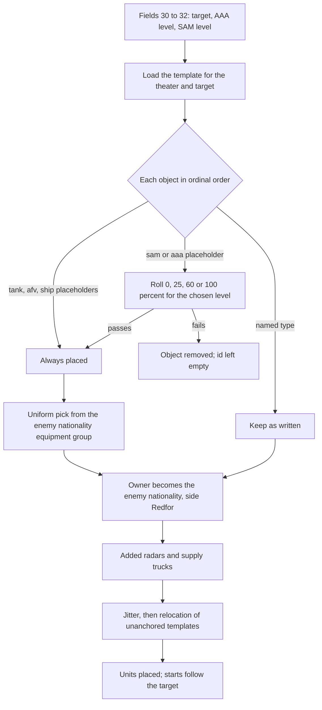

**The rolls** (retail data, `FA.EXE` tables at 0x4f3148 for SAM and 0x4f31b8 for
AAA):

| Setting (field 31 AAA, field 32 SAM) | Retail label | Chance a slot is manned |
| --- | --- | ---: |
| 0 | not | 0 percent |
| 1 | lightly | 25 percent |
| 2 | moderately | 60 percent |
| 3 | heavily | 100 percent |

The retail sentence reads "defended by AAA [not/lightly/moderately/heavily]"
and the same four words for SAMs. A failed roll removes the object (retail
writes `type <nothing>`). The choice of unit for a surviving placeholder is a uniform pick from the list
for the **enemy nationality's equipment group** (retail data; five groups,
numbered 0 to 4). The lists per placeholder and the nationality to group table
are recorded in
[the Quick Mission tables](../formats/quick-mission.md#placeholder-unit-lists-and-equipment-groups).
In short: group 0 is the Western list (Stinger, Roland, Chaparral SAMs; M163 and
M113 AAA; M1 and M2 tanks), group 1 the French list (Mistral and Crotale; M113
and ZSU-23; T-80 and T-90), group 2 the Russian and Chinese list (SA-6, SA-7,
SA-9, SA-13, SA-14, SA-15 and 2S6; ZSU-23 and ZSU-57; T-72, T-80, T-90), group 3
the Arab list (M113, Chaparral, SA-6, SA-9, SA-14, Crotale; ZSU-23, ZSU-57,
ZIF-31) and group 4 a mixed list (M113, Chaparral, Crotale, SA-7, SA-13; ZSU-23,
ZIF-31, M113).

The M113 is an armored personnel carrier with a machine gun. It is a legal
`<sam>` pick in groups 3 and 4 and a legal `<aaa>` pick in groups 0, 1, 3 and 4.
Retail's list is preserved: a "SAM site" can be an M113. The `<vehicle>`,
`<small>` and `<hovercraft>` placeholders appear in no shipped template.

With each theater's default enemy: Egypt and the Falklands use group 3, France
group 1, Greece group 4 and the other 12 theaters group 2. Changing the enemy
nationality changes the defenses and ships, never the template. The enemy
nationality is therefore part of the resolution input.

Further rules, all retail data unless noted:

1. **Night rule.** Condition Night with an F-117 or B-2 in any friendly wing
   turns every `<aaa>` into a ZSU-23 with skill 0. No F-117 or B-2 is flyable
   yet, so the rule is dormant; it keys on those aircraft names and wakes when
   they are imported.
2. `<tank>`, `<afv>`, `<vehicle>`, `<small>`, `<hovercraft>`, `<destroyer>`,
   `<cruiser>`, `<carrier>` and `<cargo>` are always placed.
3. A placeholder carrying the destroy-target flag (0x80) that fails its roll is
   not a target. `~QUCITY` flags eleven `<AAA>` and twelve `<SAM>` slots as
   targets; with defenses at none it has 16 tank targets only.
4. Selecting ground target none clears both defense fields (retail). Here
   they stay, as the strengths of the enemy's
   [area defenses](#area-defenses) (agent decision, 2026-10-12, B23).
5. A target is any template object flagged 0x80 that exists after resolution.

### Ownership and sides

- Template `nationality` and `nationality2` are rewritten to the enemy
  nationality with the side bit 0x80 (Redfor). **`nationality3` passes through
  unchanged** (retail): `~QIRRETR` keeps 40 American objects and `~QSPFRU` 21
  Pakistani objects on the friendly side.
- Theater layouts spell the owner three ways: `nationality2` (BAL, EGY, FRA,
  KURILE, TVIET, VLA), the legacy `nationality` (UKR) and `nationality3` (CUB,
  LFA, GRE, IRA, SPA, APA, PGU, NSK, WTA). TORE reads `nationality3` so the nine
  layouts that use it get owners; they need them now that their defenses go
  active. `nationality3` indexes the creator list directly (CUB 161 is the enemy
  Cuban, 33 with the side bit; WTA 39 is friendly Taiwanese).
- Bit 0x80 set is Redfor (the enemy side), clear is Blue. Surface units take
  that side. Objects with no nationality field stay neutral scenery.
- TVIET's `nationality2 142` decodes to Islamic Egyptian without the remap the
  legacy field gets; only the side bit matters and it is right. BUTLER in the
  TVIET layout is nationality 0, so the Red Crown picket is friendly.
- **Base-layout air defenses go active** (defined, John): the 321 SAM and AAA
  units in the 12 theater layouts that have them (all but Egypt, France, Ukraine
  and Vladivostok), on both sides, regardless of the "defended" setting. Retail
  evidence points the same way (the units carry weapons and the active `_GVProc`
  binding) but whether retail Quick Missions activate them is not traced.
- **An airfield's guns belong to its own side** (retail layouts, measured
  2026-10-10). In all 12 layouts every SAM and AAA unit near a runway has the
  runway's own side, and no runway stands inside the launch reach of the
  other side's base defenses. A ground start at a field of the player's side
  is therefore quiet. Before slice AL1 the airport list and `--ground-start`
  offered every airport, enemy-owned ones included (airports were imported as
  neutral), so a Blue wing that started at an enemy field, such as Polotsk
  (Baltics), Taetan or Wonsan (South Korea) or Longtian (Taiwan), met that
  field's ZSU-23s (0.3 to 0.6 nm from the runway) and SAMs as soon as it was
  airborne. Since AL1 (John, 2026-10-10) every airport takes its runway's
  side and the player starts only at its own side's or a neutral field
  ([airport allegiance](airports.md#allegiance)), so a ground start is always
  under friendly guns.
- **In PvP the Redfor players defend the target** (defined, John). Template
  units are Redfor: they engage Blue aircraft (and Blue ground units in reach,
  [surface against surface](#surface-against-surface)). Base-layout units take their
  layout side, so a Redfor player raiding a friendly airfield meets its SAMs.
- **Redfor may start on the ground at its own airfield** (John, 2026-10-11:
  "add redfor ground starts, match the quick mission creator styles"). The
  creator's **Enemy start** (Airborne or Ground) and **Enemy airport** mirror
  Blue's Start and Airport ([start placement](#start-placement)); they park
  Enemy Wing 1, the flight Redfor humans take online, whether a human or the
  AI flies it, and the other enemy wings start in the air as before. The
  field is a Redfor or neutral one, never Blue's, so its guns and SAMs are
  Red's own: they hold their fire at the Redfor wing, and with friendly fire
  off no Red round touches it. A unit engages only an airborne aircraft of
  the other side, so nothing shoots a parked aircraft of either side.

### Identifiers

Every placed object has a fixed id so destruction, rejoin and replays agree on
every machine.

| Range | Owner | Rule |
| --- | --- | --- |
| `0x4000_0000` plus ordinal | Theater layout objects, base-layout air defenses included | Unchanged from today |
| `0x5000_0000` plus ordinal | Template objects, parked aircraft included | The template ordinal, taken before the roll, so a removed `<sam>` leaves a gap and every machine numbers the rest the same |
| `0x5800_0000` plus n | Added supply trucks | n in the order of the unit each serves (ascending unit id) |
| `0x5C00_0000` plus n | Added battery radars | n in battery order (ascending lowest launcher id); an adopted radar keeps its own id |
| `0x5E00_0000` plus n | The [front line](#the-front-line)'s units | n in placement order: Blue's line, then Red's |
| `0x5F00_0000` plus n | The [area defenses](#area-defenses) of a mission with no ground target | n in placement order: SAM sites, then gun sites, two units each |
| `0x0200_0000` upward | Surface projectiles (SAMs, shells) | Own counter; AI aircraft shots start at `0x0100_0000` and would need 16.7 million shots to reach it |
| `0xE000_0000`, `0xF000_0000` | Client cosmetic rounds | Unchanged |

All defined (agent): ids are an implementation contract.

### Jitter

John's decision: template positions vary, they are not fixed (defined, John).
The rules below are defined (agent) with fitted numbers.

**Seed.** The creator rolls a 32-bit `surface_seed` when the player presses Fly,
and the multiplayer lobby when the flight starts. A restart reuses it, so a
restarted mission has the same defenses and positions (retail restarts re-fly
the same written `quick.M`). A dedicated server's mission file may name a seed;
without one the host draws it and the mission text sent to clients carries it.
Each object's results come from its own stream (seed, template, ordinal,
purpose), so they do not depend on the order objects are processed or on how
many others survive.

| Objects | Position jitter | Heading jitter | Why |
| --- | --- | --- | --- |
| Structures (bunkers, factories, bridges, roads, tents, crates, flags, hooches) and airstrip pieces | none | none | They anchor the site to roads, rivers, coasts and runways |
| Parked aircraft | none | none | They sit on aprons and in shelters |
| SAM and AAA, named or placeholder | disc of 1,500 ft | plus or minus 45 degrees | Defense rings change from flight to flight |
| Barrage zone `A_M1939` | disc of 2,000 ft | none | Invisible; changes where the barrage stands |
| Tanks, AFVs, vehicles, troops without a route | disc of 600 ft | plus or minus 30 degrees | Small, so a column parked on a road stays near it |
| Units with a route (`~QUCOL`) | none | none | Routes follow roads |
| Ships | one common shift for the fleet (disc of 6,000 ft in an anchored template) plus a formation rotation of plus or minus 20 degrees about its centroid; then each ship a disc of 300 ft | formation rotation plus 10 degrees | Fleets move, formations keep their shape |

**Validity** uses integer data only, so every platform decides the same:

- Land units need a land cell and ships a water cell, checked at the unit's
  centre and at the four corners of its footprint. A cell is water when its
  integer class byte is 1 (open water) or when its colour byte is 255 (the
  water cutout) and no ground texture placement covers it. Those colour-255
  cells with a land class are shore cells at sea level (every one in all
  sixteen theaters has elevation 0) drawn as the sea: the Falklands' forward
  SAM site (`LFSAM`) used to put a Crotale on one (agent decision, 2026-10-11,
  CL-M). Under a texture the class byte alone decides, because the picture
  draws its own beach.
- A unit the layout moved, and every supply truck and battery radar it adds,
  must pass this rule. A unit left at its retail spot is the data's: the grid
  is coarse (8,192 ft cells), so a few retail ships stand on shore cells and
  a few retail structures on water cells, and nothing moves them. The
  `surface-class-sweep` battery scenario (`--surface-dump --classes`) checks
  every offered template with 20 seeds and every base layout and fails on any
  moved unit on the wrong class.
- Land units refuse a cell whose four corner elevations span more than one
  elevation unit (256 ft).
- Footprint clearance from every fixed template object and theater layout
  object, plus 300 ft from every runway's box.
- Up to 8 candidates per object from the same stream; if none passes, the
  original retail position is used (the relocated one in a relocated
  template). An NT structure (the GCI radar site) stays put like a building.
- Footprints are boxes from each type's shape vertex bounds at the placed
  scale (the one scale seam, so they follow any rescale); a placed unit is
  tested as the circle around its box, so its heading does not matter. Positions round to whole feet and headings
  to the retail angle unit; heights then come from the terrain as for any
  placement.

**Network guard.** Every machine resolves the same spec text against the same
retail data (the lobby already requires an identical `FA_2.LIB`). The host adds
a 64-bit digest of the resolved scene (group transform, every unit's id, type,
position, heading and owner, battery membership, supply trucks, parked aircraft
and both sides' start points) to the seat and rejoin messages. A client whose
digest differs reports it, logs both lists and refuses the seat, so a divergence
is loud, not silent.

### Relocation

Jitter varies a site; relocation varies where the site is (defined, John:
"objective locations can and should vary"). Both use the same seed and
integer-only rules.

**Anchored templates stay at their retail spot** and only jitter. A template is
anchored when any rule below holds, computed from its contents at load (a rule,
not a hand list); the result on the real data is pinned by an ignored import
test.

| Rule | Templates on the retail data |
| --- | --- |
| Its centroid is within 1 nm of a theater runway, or it contains its own strip piece | 16 airfield templates `~QAPFAIR`, `~QBAIR`, `~QCFAIR`, `~QELAIR`, `~QESAIR`, `~QFLAIR`, `~QFSAIR`, `~QIRFAIR`, `~QKPLNGR`, `~QLFFAIR`, `~QNSFAIR`, `~QPGFAIR`, `~QSPFAIR`, `~QVLAIR`, `~QVSAIR`, `~QWTFAIR`; plus five that bring their own strip piece: `~QBFAIR`, `~QGRSAIR`, `~QFFACT`, `~QTBUNK`, `~QUSTRIP` |
| It contains a bridge or road piece | `~QBBRD`, `~QTBRDG`, `~QTTRUCK`, `~QUBRI` |
| A target lies within 2,000 ft of a theater layout object (built into a town, harbor or base) | `~QAPHELO`, `~QTBARG`, `~QPGSRUN`, `~QTSTRG`, `~QUCITY` |
| It has routes | `~QUCOL` |

That is 31 anchored templates by the plan's survey. Measured by the rule on the
retail data (slice L1) it is 34: runways are theater layout objects too, so
`~QPGSRUN` (a target 1,000 ft from a dirt strip) anchors by the town rule; a
dirt strip (`DTSTRP`, a `_STRIPProc` runway) counts as a runway, so `~QCCMHQ`
(its centroid 0.6 nm from one) anchors; and every routed template anchors
(`~QTCARGO`, `~QUFACT` besides `~QUCOL`). The other 74 offered non-empty
templates relocate; the 16 "nothing" templates have no objects. The
`surface-relocate-sweep` battery scenario pins the list. The per-theater split is
in [Per-theater notes](#per-theater-notes).

**Group transform.** A relocatable template moves as a rigid group: a rotation
about its targets' centroid by a whole number of degrees (0 to 359) and a
translation, computed with an integer cosine and sine table (whole degrees,
scaled by 2^30 so a step is under a thousandth of a foot over 40 nm) and
64-bit integer arithmetic, rounded half away from zero to whole feet.
Per-object jitter is applied in the template's own frame before the transform,
so spacing rules hold after the move.

**Candidate sites** (fitted; the first of up to 32 candidates that passes wins,
the retail spot is the fallback). Radius ranges are default, pending John.

| Rule | Value |
| --- | --- |
| Distance from the retail spot | 3 to 30 nm, radius drawn as the square root of a uniform value so area is uniform (default, pending John) |
| Map edge | every object at least two cells (16,384 ft) inside |
| Terrain class | land units and structures on land; ships on water (water as defined under Validity, shore cells drawn as the sea included), with the 8 neighbouring cells also water when the retail spot had that (open sea stays open sea; a harbor keeps a coast) |
| Slope | land objects only on cells whose four corner elevations span at most one unit (256 ft) |
| Clearance | 2,000 ft from every theater layout object; 3 nm from every theater runway |
| Side | the front axis runs from the centroid of the theater's Blue-side layout placements to the centroid of its Red-side ones; the candidate's depth along it must be within 15 nm of the retail spot's depth and on the same side of the midpoint (default, pending John) |
| Completeness | every target and structure must pass; a defense, vehicle or truck that fails gets 8 local tries within 2,000 ft; if any still fails the candidate is rejected, so the retail rolls and counts never change because of relocation |

### Start placement

With a ground target the airborne scene is placed from the target instead of the
theater centre (defined, John, 2026-10-10: request item 7). All of it comes
from the seed and is inside the digest.

- **Red (defenders, AI or human).** The Redfor flight starts within 5 nm of the
  targets' centroid, defending it: a seeded spot in that disc that is on the
  map (one grid cell inside its edge); the centroid itself if none of 8 tries
  is. The enemy group is placed there, turned to face Blue.
- **Blue (attackers).** Blue starts the mission's enemy distance (the
  creator's separation: 50, 75, 100, 150 nm and the rest of the list) from
  Red's start, on the bearing toward the Blue side of the front axis, plus or
  minus 30 degrees (seeded; default, pending John), heading at the target, at
  the chosen altitude. If the point does not fit the map the bearing is
  searched one degree at a time, as the enemy-placement rule does
  ([Keeping the enemy on the map](quick-mission-menu.md#keeping-the-enemy-on-the-map));
  if no bearing fits at the full distance, the farthest that does, a mile at
  a time. Friendly wings 2 and 3 keep their offsets from the player.
- **Ground starts.** An explicit runway choice is kept. With none picked, the
  default runway becomes the Blue-side airfield nearest the target that is at
  least 15 nm from it (default, pending John). An airfield's side is its
  owner's; an unowned one takes its side of the front. The airfield must hold
  the wing (no short strip or vertical pad); with none, the earlier rule
  stands (the first friendly airport's runway that holds the wing).
- **Enemy ground starts** (slice CL-R, John 2026-10-11). The same rule for
  Red: an explicit Redfor or neutral runway is kept (a Blue field, a short
  strip or a vertical pad is refused); with none picked, Enemy Wing 1 parks at
  the Red-side airfield nearest the target at least 15 nm from it, else the
  first Red-side runway that holds the wing. **The ground start overrides the
  distance** (John, 2026-10-11: "for the redfor ground starts have that
  override the distance"): Enemy Wing 1 starts at its field wherever that is,
  not within 5 nm of the target and not at the enemy distance from Blue.
  Everything else keeps its rule: Enemy Wings 2 and 3 start in the air within
  5 nm of the target (or at the enemy distance from Blue with no target), and
  Blue is still placed the enemy distance from that Red point, heading at the
  target, so the enemy distance setting measures Blue's run to the defended
  target, not to Red's airfield. Enemy Wing 1 must have aircraft, and it never
  shares the player's runway.
- The target point is the targets' placed centroid. A theater with no front
  (no owned placements on one side) starts Blue toward the middle of the map
  (fitted).
- No ground target: unchanged (the [area defenses](#area-defenses) add no
  start).

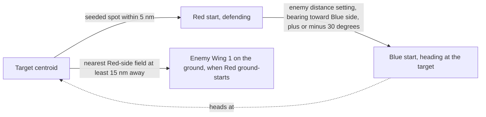

### The front line

John, 2026-10-11 (on surface units fighting): "Quick Mission places opposing
ground forces in contact so surface battles are visible." Slice CL-FL. Retail
never does (see [surface against surface](#surface-against-surface)), so this
is **opinionated, John**; every number below is fitted (agent).

A Quick Mission with a ground target adds a **front line**: two short lines of
ground units, Blue's and Red's, that face each other a few miles from the
targets. They are the theater's own equipment, drawn from the same equipment
lists as the template's `<tank>`, `<afv>` and `<aaa>` slots
([equipment lists](../formats/quick-mission.md#ground-target-templates-and-defenses)):

| Side | Units | Equipment group |
| --- | --- | --- |
| Red | an armoured car or APC (`<afv>`), two tanks (`<tank>`), and a gun (`<aaa>`) when the AAA level is not none | the enemy nationality's, as the template's |
| Blue | the same four | group 0, the Western list (M1 and M2 tanks, M113 and HUMVEE, M163 and M113 guns); the creator has no friendly nationality (agent) |

- **Where.** The centre is a seeded point 5 to 10 nm from the targets' placed
  centroid, on the bearing toward Blue's side of the theater's front (turned by
  up to 90 degrees); when no site in that band passes, 10 to 20 nm. Up to 24
  candidates per band, the first that passes wins. A candidate must keep 4 nm
  from every template unit and parked aircraft and from every leg of a routed
  unit's path, start to last waypoint (so no front unit's gun or missile
  reaches the targets, wherever a column or truck drives, and the front can
  neither destroy nor protect the objective), and from both airborne starts
  and every runway a ground start of either side may use (so nobody starts or
  takes off in the fighting), and
  every unit must stand on land where a ground unit may (level, off the sea,
  clear of layout objects and runways: the same rule as the template's units)
  and see every unit of the other line over the terrain (the weapons' own line
  of sight rule, sampled every 250 ft at 10 ft above the ground). With no
  site, no front is added and the layout notes say so. Measured with
  `--surface-battle --front-survey --seeds 2` (108 offered targets, heavy
  defenses): 191 of 216 builds stand a front, 8 units each, 4.8 to 19.5 nm from
  the targets, with 13 to 32 pairs in sight and reach and the nearest opposing
  pair 2,146 to 2,601 ft apart (the farthest pair in reach 4,056 ft, inside a
  tank gun's 5,000); the 25 without are naval targets (fleets, cargo ships, the
  Taiwan sea scenarios) with no land within 20 nm of them. The route and
  runway rules (review fix, 2026-10-12) changed none of these builds: the
  same survey after them stands the same 191 fronts in the same places.
- **How.** The line's axis runs from the centre toward the targets, turned by
  up to 45 degrees. Blue's line stands 1,200 ft back from the centre on the
  Blue end of the axis, Red's 1,200 ft on the other: the lines are 2,400 ft
  apart, inside a tank gun's reach and an AAA gun's. Each line's four units
  stand 500 ft apart across the axis (flank vehicle, two tanks, gun), the
  vehicle 200 ft and the gun 700 ft behind the line (so the tanks take the
  first fire and the guns live to fire), each moved by a seeded
  amount inside a 150 ft disc and facing the other line within 15 degrees.
- **What they are.** Ordinary units with the default skill (1, average), no
  route (they hold their ground), no `react` mask and no destroy flag: they
  are not objectives and no AI wing is ordered at them (AI wings fly
  air-to-air only here). Destroying a Blue one yourself is friendly fire like
  any friendly ground unit that is not a target; the other units' kills of them
  are not (the kill is the unit's). They fight by the [surface against
  surface](#surface-against-surface) rules (tanks and armoured cars at the
  other line, the guns at aircraft first and at the ground when none is in
  reach) and shoot at aircraft in reach like any other unit, so a Blue pilot
  passing over Red's line is shot at.
- **Determinism.** Every choice comes from the template's own seeded stream
  and integer arithmetic, so the front is the same on every machine and in
  every replay of the same seed. It is in the surface digest, and the replay
  header marks it (a tenth ground target value), so a recording made before it
  existed rebuilds without one. Online no wire byte changes; a build with a
  front and one without disagree on the surface digest and refuse each other.
- **Off.** `Variation::OFF` (the preview tools' retail spot) and the probes'
  `--no-front` leave it out. A mission with no ground target has none: it has
  no surface to add it to (agent).
- **The mission map** lists starts and an approximate objective area, not
  units, so it shows no front line (the front would otherwise give the
  objective's neighbourhood away).

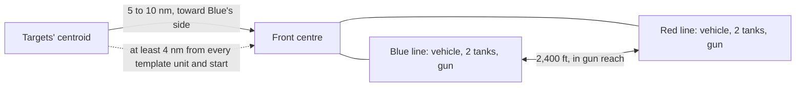

### Area defenses

John, 2026-10-12 (B23): "Allow enemy AAA and SAMs with no objective set;
scatter them across the Redfor area of operations", with his answers to the
round's questions 11 to 16: Red's side of the front, 10 to 60 nm deep, extra
cover near Red airfields; counts from the creator's AAA and SAM strengths; the
usual unit sets (SAM sites with their radars, plus guns) of the enemy nation;
standing still, no tanks; hidden from the map; Quick Mission only. Retail has
no such thing (with no ground target its Quick Mission has no surface units
beyond the theater layout's), so this is **opinionated, John**; every number
below is fitted (agent).

- **When.** A Quick Mission with no ground target whose AAA or SAM strength
  is above none (the creator's fields 31 and 32, which stay live without a
  target; [the creator](quick-mission-menu.md#ground-target-and-defenses)).
  The mission text writes `defenses aaa LEVEL sam LEVEL` with no
  `ground-target` line. With a ground target the strengths man the target's
  slots as before and no area defenses stand (never both). Free flight has no
  creator and so never has them.
- **How many.** Rolled like the target templates' defense slots (John,
  2026-10-13, nr-b23b; the first build of 2026-10-12 had fixed counts of 2, 4
  and 6 SAM sites and 4, 8 and 12 gun sites). A mission has **ten SAM site
  slots and ten gun site slots** (agent decision, 2026-10-13: the ten
  `<sam>` and ten `<aaa>` slots of 79 of the 95 templates). Each slot is
  manned with the template chance for its strength, the
  [roll](#templates-and-defended-slots) of the creator's field 31 (guns) or
  32 (SAMs):

  | Strength | Chance a slot is manned | Sites of a kind (ten slots) | Mean |
  | --- | ---: | ---: | ---: |
  | none | 0 percent | 0 | 0 |
  | light | 25 percent | 0 to 10 | 2.5 |
  | moderate | 60 percent | 0 to 10 | 6 |
  | heavy | 100 percent | exactly 10 | 10 |

  Each slot draws once from its own stream (the surface seed, the layout and
  the slot's number, the Roll purpose), exactly as a template's slot does,
  against 100: manned when the draw is under the percent. SAM slots and gun
  slots roll apart. The draw does not depend on the other slots or on how
  the sites later fall, so a site keeps its type and place whatever its
  neighbours rolled, and a slot manned at light is manned at moderate and
  heavy for the same seed. A manned slot is a **site of two units of one
  type**, so heavy is 20 launchers and 20 guns, light about 5 and 5, with
  the SAM sites' radars and trucks on top. A light mission can roll no site
  of a kind (one seed in about 18 for ten slots at 25 percent), as a lightly
  defended template can; the rule is the same. Every machine and every
  replay rolls the same slots, since the seed is the mission's (below).
  `site_counts` (the sweep's expected count) is the rolls alone; a site that
  finds no place is left out, as below.
- **Which.** Each site's type is a uniform pick from the enemy nationality's
  equipment group for `<sam>` or `<aaa>`, the lists the target's slots draw
  from ([templates](#templates-and-defended-slots)); with the night rule's
  condition a gun site is ZSU-23s at novice, as the template's are. The
  battery rules ([SAM batteries](#sam-batteries)) then group each SA-2, SA-3,
  SA-6 or HAWK site into a battery with its radar vehicle, added beside it;
  area batteries never take a base-layout radar or launcher, nor the other
  way round. Skill average (1). No route, no front line, no destroy flag:
  they are not objectives, and destroying one scores as any enemy ground unit
  does.
- **Supply trucks** (John, 2026-10-13: "supply trucks for area SAMs: yes").
  The [template rule](#resupply) applies to the SAM sites: every SAM unit
  gets a MISTRK 200 to 400 ft from it (the slot truck) and every area SAM
  battery one more (SA-2, SA-3, SA-6, HAWK sites), served to the battery's
  first launcher, all added after the sites are placed with the template's
  placement rule and the resupply reach of 528 ft, from their own stream of
  the surface seed (Supply purpose). They are ordinary supply trucks in
  `Surface::trucks` (ids from `0x5800_0000`), so the whole
  [resupply](#resupply) applies unchanged: a live truck of the same side
  within 528 ft rearms all of a launcher's empty rails after the system's
  time (300, 420 or 600 s), a destroyed truck stops it at once, and a site
  whose truck is dead stays empty. Guns get none (John asked for the SAM
  sites only; agent decision, 2026-10-13: a gun site still uses its two spare
  magazines). A truck is a targetable passive vehicle that is never a
  target of the mission. The first build had none.
- **Where.** The front axis runs from the centroid of the theater layout's
  Blue placements to that of its Red ones ([relocation](#relocation)); its
  midpoint splits the sides. Every theater's layout has both, so every
  theater has a front.
  - A **band site** stands at a seeded depth of 10 to 60 nm past the
    midpoint toward Red, at a seeded lateral offset anywhere across the map.
  - **Airfield cover.** The first SAM site and every third after it, and the
    same for gun sites, guard a Red airfield instead: a seeded point 2 to 5 nm
    from a runway's origin. Red airfields are the runways of Red's side (an
    unowned one by its side of the front) lying 0 to 100 nm past the
    midpoint; they are taken in turn from a seeded first one. A theater with
    none puts every site in the band.
  - **Fallback.** A site that finds no place by its airfield tries the band;
    one that finds none in the band tries 10 to 120 nm deep (island theaters,
    whose band is mostly sea). A site that still finds none is left out and
    the layout notes say so.
  - Up to 96 candidate centres per pass, the first that holds both units
    wins. A centre must be on the map two cells inside its edge, on Red's
    side, and 3 nm from every site already placed. Each unit stands 150 to
    600 ft from the centre, 150 ft clear of the other beyond their
    footprints, where a ground unit may (land, level, as the template rule
    under [Jitter](#jitter)), its centre 2,000 ft clear of every theater layout object
    (towns, buildings, airfield objects) and 1 nm clear of every runway (past
    the aprons and taxiways the redrawn airports add). The city fill also
    hides any filler building a unit stands on.
  - Measured with `--surface-dump --area-sweep --seeds 2` (16 theaters,
    light to heavy, 96 builds): every unit keeps every rule, and every theater
    but the Kurils stands every site. The Kurils (a chain of small islands)
    stand what the islands hold and leave the rest out: with the rolled counts
    8 of 8, 22 of 24 and 30 of 40 units (seed 1) and 8 of 10, 16 of 22 and
    26 of 40 (seed 2) at light, moderate and heavy, about two thirds of a
    heavy mission. John, 2026-10-13: fine, no looser rule for the small
    islands.
- **Facing and sight.** Each unit faces away from its site's centre. They
  fight by the ordinary [Surface AI](#surface-ai) rules: a site engages an
  aircraft of the other side in its reach, so a Blue pilot flying over Red's
  side is shot at.
- **Hidden.** No map lists them, the creator's map nor the in-flight map's
  mission markup (John: hidden from the map). Like any unit, a site the
  aircraft's sensors detect shows as a contact.
- **Determinism.** Each site draws from its own stream, keyed by the mission's
  surface seed, the layout and the site's number, in integer arithmetic, so
  every machine and every replay of the same seed places the same sites. The
  settings (strengths, seed, enemy nationality, night rule) are in the
  surface digest only when set, so every other mission's digest is unchanged;
  the replay header keeps them as `world.area_defense`
  ([Replays](#replays)). Online no wire byte changes: the mission text carries
  the strengths and the host draws the seed, as for a ground target
  ([Multiplayer](#multiplayer)); a build with the area defenses and one
  without disagree on the digest and refuse each other. So do a build with
  the rolled counts and one with the first build's fixed counts: the surface
  digest of a rolled mission carries a "rolled" mark, the first build's
  digest does not.
- **Older recordings.** The rolled counts are marked in the replay header by
  `world.area_rolled=1`. A recording from the first build (2026-10-12) has
  the five-field `world.area_defense` and no mark, so it rebuilds its fixed
  counts of sites (2, 4 and 6 SAM sites, 4, 8 and 12 gun sites) with no trucks
  and replays as it was made; the header keeps its shape and a build from
  before the mark keeps the key as an unknown extra
  ([Replays](#replays)). The online path has no old mode: every machine of a
  game rolls.

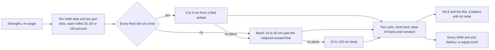

### The units of the movement and range words

**Waypoint speed `w_speed` is feet per second** (retail data, strong inference;
accepted by John, "sure"). Evidence, from the 388 non-template missions and the
templates:

| Observed `w_speed` | In ft/s read as knots | Read as |
| ---: | --- | --- |
| 843 | 499.5 knots | 500 knots |
| 506 | 299.8 knots | 300 knots |
| 759 | 449.7 knots | 450 knots |
| 675 | 399.9 knots | 400 knots |
| 421 | 249.4 knots | 250 knots |

Aircraft `w_speed` values cluster at exactly these five numbers, which are 500,
300, 450, 400 and 250 knots in feet per second (1 knot is 1.6878 ft/s, values
truncated). Read as knots they would be supersonic at sea level, and none of
them is a round number. Surface routes then run at 50 ft/s (29.6 knots, 34
mph), 33 (19.5 knots), 16 (9.5 knots), 100 ft/s for hydrofoils (59 knots) and 10
ft/s for men. The same unit is assumed for the object's `_maxSpeed` (ships 50,
hydrofoils and frigates 100, tanks 50, men 10). As a plausibility check only,
not as evidence: 50 ft/s is a destroyer's cruising speed, 100 ft/s a
hydrofoil's, and 50 ft/s a tank's road speed. A counter-reading exists: the
Ticonderoga routes at 33 also look plausible as 33 knots. The aircraft values
decide it because the mission format is shared. The next research step is the
retail waypoint consumer (`GVDoCurrentWaypoint` 0x473de0), listed under
[Unknowns](#unknowns).

Other words:

- **Turn rate** `_turnRate` is in the angle unit of 182 per degree (16,384 is 90
  degrees): ships 910 is 5 degrees, tanks 2,730 is 15 degrees, applied per
  second (fitted).
- `_acc` and `_dacc`: unknown; fitted 5 ft/s squared for ground vehicles, 1 ft/s
  squared for ships.
- `maxVisDist` and `zoneDist`: the values 78, 195 and 391 match 20,000, 50,000
  and 100,000 ft at 256 ft per unit (inference). Used this round only for the
  barrage zone's activation radius (195, about 50,000 ft, fitted).
- Hardpoint slew limits: 16,384 is 90 degrees (inference).

### Mission settings carried

The mission specification (and its text form, which is part of the mission
hash and travels to every multiplayer client) gains fields, each written only
when set so existing specifications, hashes and golden fingerprints are
unchanged. All defined (agent).

| Field | Text line | Notes |
| --- | --- | --- |
| Ground target | `ground-target QUCOL` | The template stem, not a menu index, so a server file reads clearly |
| AAA and SAM levels | `defenses aaa heavy sam moderate` | `none / light / moderate / heavy`; written when either is above none. With no target they are the [area defenses](#area-defenses)' strengths |
| Surface seed | `surface-seed 1234567` | See [Jitter](#jitter) |
| Enemy nationality | `enemy-nationality 10` | Field 20; default per theater; drives the equipment group |

The creator's fields 30 to 32 fill them. The multiplayer lobby's read-only
creator shows them.

## Surface AI

Surface units reuse the AI weapon service that already drives AI aircraft (the
[B42 phases and quarter-second clock](ai.md#b42-weapon-preparation-search-cadence-and-firing)):
retail's `_GVProc` shares `_NPCWeaponsProc` with aircraft, so ground units
search, lock and fire through the same procedure. The wider surface events and
the ranking terms for surface actors are untraced (see [Unknowns](#unknowns)).

### Engagement

One controller runs per weapon mount group (all mounts carrying the same record
on a unit share one; a 2S6 has a gun controller and a missile controller). A
SAM battery has one controller on its radar ([SAM batteries](#sam-batteries)).

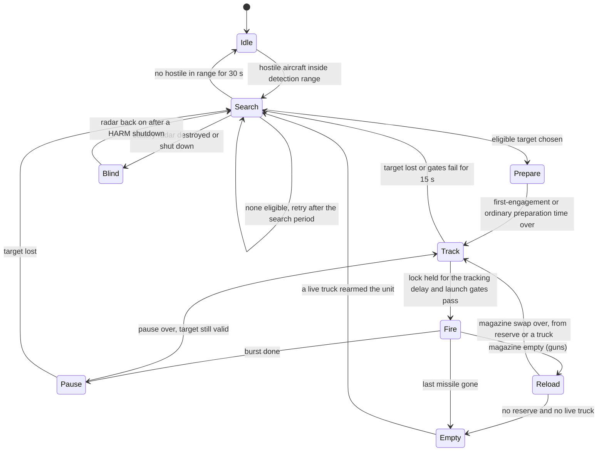

| Step | Rule | Basis |
| --- | --- | --- |
| Detection range | The weapon's seeker `zone0` range and altitude band (SA-2 150,000 ft with an altitude floor of 3,000 ft; SA-6 80,000 ft, floor 500 ft); a sensor's range for GCI and BUTLER (303,800 ft, 50 nm). A battery detects from its radar's position with the battery missile's `zone0`; a GCI element also gives its 50 nm sensor for search, never for launch | retail; battery use defined (John) |
| Search period | Quarter seconds in the NPC block: 5 s for small SAMs, ZSU-23 and vehicles, 10 s for big SAMs, guns and ships, 48 s for the SCUD | retail, B42 |
| Eligibility | Hostile side, airborne, class matches the object's `react` attack mask (templates use `$c000`: fighters and bombers), inside detection range and band, terrain line of sight clear, inside `searchDist` when non-zero (unit unknown: 25 is read as 25 x 256 ft). Ground units and ships of the other side too, for a weapon whose record may aim at them ([surface against surface](#surface-against-surface)) | retail; the `searchDist` reading fitted |
| Choice | Nearest eligible; keep the current target while valid; KS-12 and KS-19 re-evaluate every 10 s (`retargetT` 40), choosing as a team ([flak teams](#flak-teams)) | fitted (the retail ranking terms for surface actors are untraced); flak teams opinionated (John, 2026-10-14) |
| Preparation | `unreadyAttackT` for a unit's first engagement (SA-2, SA-3 and SA-6 36 s; SA-15 5 s), `attackT` afterwards (5 to 20 s) | retail times; which engagement counts as first is fitted (B42 says the producer of the unready flag is unknown) |
| Lock to fire | `trackT`: guns 1 s, missiles 5 s, Sea Sparrow and SS-N-9 3 s | retail, B42 |
| Launch gates | `zone1` range, altitude floor and ceiling, heading and pitch half-angles; mount arcs `slewLimitH/P` relative to the hull; terrain line of sight from the mount | retail |
| Salvo | `gameRoundsInBurst` missiles `gameBurstT` apart: SA-15, SA-19 and SA-N-9 fire 2 rounds 2 s apart; others 1 | retail |
| Missile spacing | `reloadT` between salvos: SA-2 and SA-3 20 s, SA-6 15 s | retail; quarter-second unit assumed |
| Missile stock | Hardpoint load (SA-2 six rails of 1, SA-6 three, SA-15 eight); refilled only by a supply truck, see [Resupply](#resupply) | retail; resupply defined (John) |
| Gun cadence | See [AAA tuning](#aaa-tuning): rate, burst, magazine, reserve and the 60 or 120 s magazine swap | defined (John), values fitted |
| Lost target | Back to Search; supported missiles in flight keep their memory rule | spec-derived ([missiles](missiles.md)) |

**Range and altitude gates a player can use.** Radar SAMs have an altitude
floor: SA-2 launches only above 5,000 ft (seeker floor 3,000 ft), SA-3 above
5,000 ft (seeker 2,000 ft), SA-6 above 2,000 ft (seeker 500 ft). Flak will not
fire below 4,000 ft. A site that cannot see you over a ridge does not fire.

### SAM missiles

Retail data, launch and seeker numbers per record. Times in the motor columns
are quarter seconds; reload is the raw `reloadT` in quarter seconds.

| Record | Seeker | Launch range ft | Launch altitude ft | Seeker range ft (altitude floor) | Salvo: rounds / gap / reload | Damage | Used by |
| --- | --- | --- | --- | --- | --- | ---: | --- |
| SA2A | 3 radar, support 0x200 | 7,500 to 95,000 | 5,000 to 50,000 | 150,000 (3,000) | 1 / 0 / 80 | 300 | SA2A |
| SA3 | 3, 0x200 | 7,500 to 54,000 | 5,000 to 36,000 | 100,000 (2,000) | 1 / 0 / 80 | 200 | SA3 |
| SA6 | 3, 0x200 | 9,000 to 75,000 | 2,000 to 30,000 | 80,000 (500) | 1 / 0 / 60 | 75 | SA6 |
| SA15 | 3, 0x200 | 1,000 to 36,000 | 100 to 18,000 | 80,000 | 2 / 8 / 40 | 100 | SA15 |
| SA19 | 3, flag 0x100, no 0x200 | 500 to 24,000 | to 9,500 | 60,000 | 2 / 8 / 20 | 50 | 2S6, HAWK, ROLAND |
| R440 | 3, 0x200 | 7,500 to 54,000 | 5,000 to 36,000 | 100,000 (2,000) | 1 / 0 / 80 | 200 | ASA5 |
| MIS | 3, 0x200 | 7,500 to 48,000 | 5,000 to 36,000 | 64,000 (2,000) | 1 / 0 / 80 | 200 | MIS |
| FIM92 | 2 infrared | 7,500 to 54,000 | 5,000 to 36,000 | 100,000 (2,000) | 1 / 0 / 80 | 100 | FIM92 |
| SA7 | 2 | 500 to 9,000 | to 6,000 | 15,000 | 1 / 0 / 40 | 25 | SA7 |
| SA9 | 2 | 2,500 to 18,000 | to 15,000 | 20,000 | 1 / 0 / 60 | 35 | SA9, SCUD |
| SA13 | 2 | 1,500 to 15,000 | 100 to 10,000 | 25,000 | 1 / 0 / 60 | 25 | SA13, CHAP |
| SA14 | 2 | 500 to 15,000 | to 15,000 | 20,000 | 1 / 0 / 40 | 25 | SA14 |
| SA16 | 2 | 500 to 8,000 | to 5,000 | 15,000 | 1 / 0 / 40 | 25 | SA16 |
| SAN3 | 3, 0x200 | 5,000 to 100,000 | 1,000 to 75,000 | 100,000 | 1 / 0 / 60 | 200 | KIEV |
| SAN4 | 3, 0x200 | 4,000 to 35,000 | 500 to 15,000 | 100,000 | 1 / 0 / 60 | 200 | 7 ships |
| SAN7 | 3, 0x200 | 1,500 to 60,000 | 500 to 45,000 | 100,000 (to 50,000) | 1 / 0 / 40 | 80 | SOVR |
| SAN9 | 3, 0x200 | 1,000 to 36,000 | 100 to 18,000 | 80,000 | 2 / 8 / 40 | 100 | KIEV |
| SAN11 | 3, no 0x200 | 1,500 to 24,000 | 100 to 24,000 | 100,000 (to 50,000) | 1 / 0 / 32 | 80 | KIROV |
| SEA_SPAR | 3, 0x200 | 3,000 to 120,000 | unlimited | 120,000 | 1 / 0 / 32 | 170 | 4 carriers, IOWA |
| ASROC | 3, 0x200 | 500 to 75,000 | 1,000 to 30,000 | 100,000 (500) | 1 / 0 / 40 | 150 | TICON |
| SSN9 | 3, flags 0x22365 | 3,000 to 120,000 | unlimited | 250,000 | 1 / 0 / 32 | 170 | SARAN (anti-ship) |

Retail quirks preserved: the Stinger and Mistral records copy the SA-3 envelope
(launch 1.23 to 8.89 nm, 5,000 to 36,000 ft); HAWK and Roland use the SA-19
record; the SCUD launcher is class SAM with four SA-9; Knox carries SA-N-4. All
surface missiles start from rest (`initialSpeed` 0, final speed 1,026 ft/s),
`trackT` 20 (Sea Sparrow and SS-N-9 12), proximity fuze 100 ft and collateral
damage 750 ft at 35 percent (SA-2 1,200 ft).

TORE rules (defined and fitted):

- Each SAM record gets a guidance profile: radar records with the support flag
  0x200 are **supported radar**, the infrared records are **infrared**, as the
  [missile inventory](missiles.md#first-pass-inventory-matrix) proposes. Their
  target role is aircraft.
- **Support.** A self-contained launcher (SA-15, Roland, 2S6, Crotale, ship
  systems) supports its own missiles while its controller holds lock and its
  radar is on. For a battery launcher the missile belongs to the launcher (kill
  credit and the debrief's SAM tally follow its owner) but the support, the
  radar position and the track come from the battery radar, which must be alive,
  on and in line of sight of the target. Losing any of those ends support; the
  missile falls back to its memory rule.
- **Launch** is from the mount position (the NT's `pos`, scaled with the unit
  to real size, `surface::mount_position_ft`) at speed 0, boosting from the record's
  ignition time with the same motor model as air launches. Launch pitch is the
  line to the lead point clamped between 10 degrees and the mount's pitch limit
  (SA-2 15 degrees). Fitted.
- **SA-19 and SA-N-11** are treated as supported radar, because HAWK, Roland and
  the 2S6 carry SA-19 and would otherwise be unarmed; ASROC stays held
  (Ticonderoga keeps its Phalanx). Default, pending John. The Tunguska and
  Kashtan carry their own radars; only the battery systems need component
  radars (answered for John's question).
- **SS-N-9** fires at ships of the other side (since 2026-10-11): it is the
  only missile record a surface unit carries with the surface target flag
  0x20000 and not the air one, supported radar by its support flag 0x200
  (retail data), aimed at ships only (agent decision: an anti-ship missile).
  See [surface against surface](#surface-against-surface).
- **Collateral damage** follows the rule every weapon follows, in
  [splash damage](missiles.md#splash-damage): a share of the record's damage
  falling from the collateral percent at the burst to nothing at the radius,
  measured to each aircraft's surface, whole in the air and halved on the
  ground. The aircraft a missile strikes takes its direct hit only; friendly
  fire off spares the shooter's side. A burst is a missile striking an
  aircraft or the ground, or a flak shell bursting. A surface unit's splash
  reaches aircraft and the other side's ground objects and ships, never its
  own side's or neutral scenery (see the next point), so a SAM falling back
  near its own battery never wrecks it. John decided on 2026-10-10 that
  splash applies to every weapon, aircraft missiles, rockets and bombs
  included.
- **What a surface round can hit** (changed 2026-10-11, when surface units
  began to fight each other). Aircraft, the terrain, and the ground objects
  and ships of the other side. A round or missile passes through its own
  side's ground objects and ships, neutral scenery (an object with no side)
  and its own launcher, whatever the friendly fire setting, so a gun crew
  never shoots up its own site or the runway beside it, and a launcher is
  never hit by its own missile leaving the rail. Defined (agent): friendly
  fire is on by default, and AAA firing low past its own units and airfield
  would otherwise wreck them in every mission.

### AAA and flak

All gun rounds are physical projectiles (defined, John), flown by the existing
gun-round model with the tuned muzzle velocity and hit-tested like aircraft
rounds. Flak is physical too; it has no tracer.

How a surface gun round differs from an aircraft's (defined, agent):

- It does its record's damage, split over the physical rounds of a game round
  as the [AAA tuning](#aaa-tuning) table says. The aircraft guns' one-third
  rule and their critical hits (a round through the cockpit kills the pilot)
  do not apply: the table already matches retail damage per second, and a
  critical kill on top would make AAA deadlier than retail.
- A jammer does not defeat individual gun rounds; it works on missile seekers.
  A gun's skill-based aim error is its accuracy rule.
- A controller may end a gun's rounds a little past the target's range instead
  of letting them fly their whole life (a Shilka at 3,400 rounds a minute
  otherwise keeps about 280 rounds in the air), so the sky stays within the
  projectile limit.
- Surface fire never fills the last 1,000 of the 5,000 projectile slots, which
  stay free for the aircraft's own weapons (fitted).

#### Gun records (retail)

Burst = rounds in the time shown, then the pause. Muzzle speeds in ft/s. Fire
zone range and altitude in feet. Damage and fuze as in the record.

| Record | Aim | Fire zone range | Fire zone altitude | Burst, then pause | Startup shots | Muzzle | Life (s) | Fuze ft | Damage | Used by |
| --- | --- | --- | --- | --- | ---: | ---: | ---: | ---: | ---: | --- |
| ZSU23 | radar | 50 to 7,500 | to 7,500 | 4 in 0.25 s, 1.0 s | 0 | 3,666 | 5 | 100 | 20 | ZSU23 |
| 2S6 | radar | 50 to 15,000 | to 9,000 | 4 in 0.25 s, 1.0 s | 0 | 3,666 | 5 | 100 | 20 | 2S6 |
| PHALANX | radar | 50 to 20,000 | to 15,000 | 6 in 0.25 s, 1.0 s | 0 | 3,666 | 10 | 50 | 40 | carriers, IOWA, TICON, M163 (zones replaced, see [AAA tuning](#aaa-tuning)) |
| AAA30 | radar | 50 to 15,000 | to 7,500 | 4 in 0.25 s, 1.0 s | 0 | 3,666 | 5 | 50 | 30 | KIROV, SOVR, KIEV, BUTLER, SARAN |
| AAA30BAD | visual | 50 to 10,000 | 100 to 7,500 | 4 in 0.25 s, 1.0 s | 0 | 3,666 | 5 | 50 | 30 | frigates, patrol craft |
| ZSU57 | visual | 50 to 12,000 | 1,000 to 12,000 | 4 in 0.5 s, 3.0 s | 0 | 3,666 | 5 | 100 | 20 | ZSU57, ZIF31 |
| M1939 | visual | 0 to 10,000 | to 6,000 | 4 in 0.5 s, 3.0 s | 0 | 3,960 | 5 | 100 | 30 | M1939 |
| A_M1939 | visual | 0 to 10,000 | to 6,000 | 4 in 0.5 s, 3.0 s | 0 | 3,960 | 5 | 100 | 30 | barrage zone, random fire 33 percent |
| KS12 | radar flak | 0 to 40,000 | **4,000 to 15,000** | 1 in 0.5 s, 4.0 s | 8 | 3,520 | 10 | **250** | 50 | KS12; collateral 750 ft at 35 percent (400 ft in the game, the fuze unused, [flak](#flak)) |
| KS19 | radar flak | 0 to 50,000 | **4,000 to 25,000** | 1 in 0.5 s, 4.0 s | 8 | 4,400 | 15 | **250** | 80 | KS19; collateral 750 ft at 35 percent (400 ft in the game, the fuze unused, [flak](#flak)) |
| M1, T72 | visual | 50 to 5,000 | to 3,000 | 1, 4.0 s | 0 | 5,866 | 5 | 100 | 200 x5 | main battle tanks |
| BMP2, BTR80 | visual | 50 to 3,000 | to 3,000 | 2 in 0.5 s, 3.0 s | 0 | 3,666 | 5 | 100 | 5 | IFVs |
| M113, M2 | visual | 50 to 3,000 | to 3,000 | 2 in 0.5 s, 3.0 s | 0 | 3,666 | 5 | 100 | 10 | APCs |
| SMLARMS | visual | 0 to 4,000 | to 2,000 | 4 in 0.25 s, 1.0 s | 0 | 3,666 | 5 | 50 | 10 | TROOPS |

The radar guns carry projectile flag 0x4000, which the [AI lead
calculation](ai.md#b44-steering-execution-and-pursuit-lead) ties to the lead; the
visual guns do not. That matches the manual: "modern AAA uses radar to calculate
lead ... older AAA ... must eyeball you" (pp. 157 to 158). The KS-12 and KS-19
are the flak: a large fuze radius, collateral damage, 8 startup shots and an
altitude floor of 4,000 ft, which is the manual's "minimum range is 4000 ft".
The KS-19's 25,000 ft ceiling and the SA-2's 50,000 ft ceiling are the manual's
maximum AAA and SA-2 ranges (p. 193). Life is converted from the record's
quarter seconds.

#### Aim

| Gun kind | Aim | Lead | Basis |
| --- | --- | --- | --- |
| Radar guns (flag 0x4000: ZSU-23, 2S6, Phalanx, AAA30) | Observed target, refreshed every tick while tracking | Time of flight and drop from the existing gunsight solution, plus aim error by skill | retail (the flag); error fitted |
| Flak (KS-12, KS-19, radar directed) | Observed target, refreshed every tick while tracking | The same lead point, then a burst point drawn inside an egg 300 m wide and 100 m tall around it, with no aim error by skill ([flak](#flak)) | retail (the flag); egg opinionated, John, 2026-10-13 |
| Visual guns (ZSU-57, M1939, AAA30BAD, IFV and APC guns, tank guns at a ground target) | Observation refreshed every 0.5 s | Lead from that stale velocity, larger aim error by skill | manual pp. 157 to 158; numbers fitted |
| Tank guns (M1, and the T-72 record of the T-72, T-80 and T-90) at an aircraft | The same stale observation, and only an aircraft within 20 degrees above the hull | The visual guns' lead, the visual guns' error plus 0.4 degrees, plus 0.2 s of the sight line's turn rate; a 3 s lay before the first round ([tanks against aircraft](#tanks-against-aircraft)) | fitted, agent; the 20 degrees John's, 2026-10-24 |
| Small arms (a squad's SMLARMS) at an aircraft | The same stale observation as a visual gun, carried on at 30 percent of the target's velocity | Lead 30 percent of the gunsight solution and four times the visual guns' aim error by skill ([small arms](#small-arms)) | fitted, agent, 2026-10-12 |

Aim error by skill is a random angular offset per burst plus the existing
per-round dispersion: radar guns 0.6, 0.4, 0.3 and 0.2 degrees; visual guns 1.5,
1.0, 0.7 and 0.5 degrees for novice, average, veteran and ace. Fitted. A jammer
on the target widens a radar-directed gun's aim error two times; visual guns
are unaffected (defined, John, 2026-10-10: "fine for now"). A tank gun at an
aircraft aims wider still ([tanks against aircraft](#tanks-against-aircraft)).

#### Small arms

A squad (the TROOPS unit, record SMLARMS) fires 5 rounds in half a second, then
pauses a second (rounds 10 damage each, muzzle 3,000 ft/s, to 4,000 ft range
and 2,000 ft altitude). Squads stand in the airfield templates and most other
ground targets (3 to 7 in `~QAPFAIR`, `~QBAIR`, `~QBFAIR`, `~QCFAIR`,
`~QLFFAIR`, `~QNSFAIR`, `~QPGFAIR` and `~QSPFAIR`, 8 in `~QIRFAIR` and 19 in
`~QGRSAIR`, counted with the surface dump); the theater layouts' base
defenses hold only one squad, in Egypt. A squad is drawn and can be killed
([below](#squads-are-seen-and-killed)). Before 2026-10-12 it shot at jets with
no tracer and no flash and with the same aim error as a 57 mm gun, so a low
pass over a field was met by hits from nothing visible: the "airport shoots
with very high accuracy and nothing to see" report (B17, John, 2026-10-12).

**Round one (B17).** Tracers every third round, a muzzle spark, and four times
the visual guns' aim error (6.0, 4.0, 2.8 and 2.0 degrees for novice, average,
veteran and ace; fitted, agent). That still let one squad hit a 400 kt jet 300
ft over it with 5, 7, 11 and 13 of its 35 to 40 rounds by experience (the
F/A-18 has 232 hit points; a field of squads took about 30 percent of it at
average experience and 70 percent at ace). John, 2026-10-12: infantry fire at
aircraft "must be nerfed considerably"; small bullets, not radar guided,
"should rarely hit an aircraft passing through".

**Round two (BD2): what a squad does against an aircraft now.** Riflemen shoot
by eye with no sight and no lead computer. A squad has the same stale
observation of its target as a visual gun (refreshed every half second), but
aims at where the jet was seen carried on at only **30 percent** of its
velocity, not all of it, so the bullets arrive behind a fast jet (the miss is
70 percent of its speed times the bullet's flight time: about 100 ft at 1,000
ft range for a 400 kt jet), and a slow target is hit much more than a fast
one. On top of that the aim error stays four times the visual guns'. The
tuning goal (opinionated, John 2026-10-12; the numbers are the lead's fit, so
fitted, agent): one squad hits a 400 kt jet at 300 ft with about 0.5 to 2
percent of its rounds; a whole field of squads, even at ace, rarely costs more
than 10 to 15 percent of a jet's hit points in a low pass; almost nothing
above about 1,000 ft above the ground or at high speed. A squad shooting at a
ground unit or ship keeps a quarter of the visual guns' error and leads in
full ([surface against surface](#surface-against-surface)). The record's
damage, rate, range and the table's burst are unchanged (a reduced reach
against aircraft was considered and not needed: the lead and error already
make long shots miss).

Measured on 2026-10-12 with the surface trace (`--surface-trace APA QAPFAIR
--over TROOPS --solo`, one squad armed, an F/A-18 flying north at 400 kt, 300
ft above the squad unless stated, 3 nm out, surface random streams 31 to 42 (fewer
for the rows with fewer rounds),
experience as stated; a pass is 35 to 40 rounds per squad):

| Pass | Rounds fired | Rounds hit | Jet hit points lost (average of the passes) |
| --- | ---: | ---: | ---: |
| One squad, straight over it, novice | 420 | 4 (0.95 percent) | 1.4 percent |
| Average | 480 | 6 (1.25 percent) | 2.1 percent |
| Veteran | 480 | 6 (1.25 percent) | 2.1 percent |
| Ace | 480 | 5 (1.04 percent) | 1.7 percent |
| Average, 1,500 ft to the side | 480 | 0 | 0 |
| Ace, 1,500 ft to the side | 480 | 0 | 0 |
| Average, 1,000 ft above the squad | 480 | 0 | 0 |
| Ace, 1,000 ft above the squad | 480 | 0 | 0 |
| Average, 600 ft above, 400 kt | 320 | 2 (0.6 percent) | 1.0 percent |
| Ace, 600 ft above, 400 kt | 320 | 0 | 0 |
| Average, 300 ft, 600 kt | 240 | 0 | 0 |
| Ace, 300 ft, 600 kt | 348 | 0 | 0 |
| Average, 300 ft, 200 kt (slow) | 640 | 28 (4.4 percent) | 14 percent |
| Average, 300 ft, 100 kt (helicopter speed) | 240 | 6 (2.5 percent) | 3 percent |
| Average, 1,000 ft above, 200 kt | 640 | 4 (0.6 percent) | 2 percent |
| The squads of the field within 2.5 nm (`--near 15000`), average | 864 | 11 (1.3 percent) | 7.6 percent |
| The same field, ace | 720 | 6 (0.8 percent) | 4.2 percent |
| The same field, ace, 1,000 ft to the side | 720 | 2 (0.3 percent) | 1.4 percent |
| The same field, ace, 600 ft above | 720 | 4 (0.6 percent) | 2.8 percent |

The battery scenario `surface-small-arms-airfield` holds these (a single
squad hits at most 3 of its 40 rounds; the four squads together at most 3
percent of their rounds; a field costs a jet at most 25 percent; the
1,000 ft, 600 kt and 1,500 ft passes hit at most twice). For scale, the same
pass against one ZSU-23 or M163 (radar guns, 0.6 to 0.2 degrees) destroys the
jet at any experience above novice in one or two bursts; their tuning is
John's 2026-10-10 AAA table and stays (John, 2026-10-12: "keep the ZSU-23
table"). Small arms carry tracers (every third round, as the other light
guns) and a muzzle spark ([flak bursts, gunfire, launches and
light](#flak-bursts-gunfire-launches-and-light)), so a field's fire reads on
screen. Every machine online shows the same: a client rebuilds each round of a
surface burst from the host's burst event with the same tracer rule and the
same lead (`fire::observation`) the host's simulation uses, so no wire field
changed.

##### Squads are seen and killed

(BD2, John, 2026-10-12: "render them so they can be killed".)

| Question | Answer |
| --- | --- |
| Drawn? | Yes: each TROOPS unit draws its shape, a group of flat textured soldier cards (the SOLDIER art) in fixed directions, so a card seen edge-on is a thin line; never absent. The shape is centred on the unit's origin, so the squad stands on its bottom, 3.3 ft up, like every ground object (slice GROUND, 2026-10-13; until then the soldiers stood waist deep; [grounding](../formats/objects-and-shapes.md#grounding-every-object-stands-on-the-bottom-of-its-shape)). |
| Visible at a pilot's range? | A man is 4 ft tall, a few pixels at 1,000 ft. Beyond 1,000 ft a man (the SOLDIER sprite and the TROOPS cards alike) is drawn larger by the distance over 1,000 ft, up to three times from 3,000 ft out, growing up from his feet, which stay on the ground (opinionated: the boost agent, 2026-10-12; the 3x cap John, 2026-10-13, was 6x; presentation only, the hit box is unchanged). The squad's cards are drawn every frame for it, not in the standing scenery (agent decision, slice GROUND, 2026-10-13: until then the boost reached only sprites, so squads were never enlarged). Deck crew are not scaled. |
| Hit box | The shape's contact volume: 30 ft wide, 6.6 ft tall, 12 ft deep, standing on the ground with the soldiers; 75 hit points. |
| Killed by | Guns (the A-4E's Mk 12 kills a squad in a strafing pass; 155 rounds fired), bombs (an Mk 82 within its splash kills it), rockets and splash (an LAU-61 rocket 26 ft away took 2 hit points, so a pod's salvo is what kills), AAA and tank shells of the other side. Splash needs no hit: the collateral radius of the weapon applies to the squad as to any ground unit. |
| After death | The unit's hit points are 0: it stops firing at once (no burst after the kill tick), its record's explosion plays, and the squad's bodies lie where it stood: TROOPS.SH carries a damaged model (its `shape::DAMAGED_WORD` branch, 8 flat faces of fallen men, 0.3 ft high), which is drawn as its destroyed look, without fire ([Destroyed looks](#destroyed-looks); John, 2026-10-13: bodies only where retail has them). |
| Counted | As a kill of a ground unit like every other (any destroyed combat target is recorded as a `Kill` for its shooter, and a flagged destroy target counts toward the objective). Online, retail scores no ground kills, so no score. |
| Synced online | Like every surface unit: ids `0x5000_0000` and up, the host's destroyed events, the same hit points and destroyed look on every client; no new wire field. |

The battery scenario `surface-squad-killable` kills one squad of `~QAPFAIR`
with the A-4E's gun, with an F/A-18's Mk 82, and in the trace by `--kill-at`,
and checks the kill of that id and that a killed squad fires no more.

##### Airfield defences fire at all times

(BD2, John, 2026-10-12: "airfields fire at enemies at all times".) An armed
surface unit's controller reads only the unit's side, its react mask and the
aircraft in the air: the mission's objective, whether the field is a destroy
target (flag 0x80) and whether the player flies against it play no part. A
squad, an airfield's AAA gun and the theater layout's base defenses all
engage every hostile aircraft in their reach, and never their own side, a
unit with no side, or an aircraft that is still on the ground. The unit tests
`an_airfields_squad_and_gun_fire_at_enemies_target_or_not_and_never_at_their_own_side`
and `guns_fire_only_at_the_other_sides_airborne_aircraft` hold it for a squad
and a ZSU-23 with and without the target flag.

#### Tanks against aircraft

John, 2026-10-24: "Tanks accuracy on aircraft need a nerf and max elevation of
fire set to like 20 degrees up. Whatever the current accuracy is we need to
make realistic changes to cut it by 66%. Tanks should be a surprise if they
kill you, not be godlike snipers." Before this, a tank fired its 125 mm or
120 mm gun at an aircraft as any visual AAA gun does, at any elevation its
fire zone allowed, and one hit kills a helicopter or a fighter (200 damage),
so an average T-72 killed a 450 kt jet passing 200 ft over it in two passes
of three and a helicopter hovering 0.5 km out almost every time.

The rules, for the M1's M256 and the 2A46 the T-72, T-80 and T-90 fire, only
at an aircraft (a tank's fire at ground units and ships is unchanged):

| Rule | What the player sees | Why | Basis |
| --- | --- | --- | --- |
| Elevation ceiling | A tank never takes, tracks, turns to or fires at an aircraft more than 20 degrees above its hull's horizontal plane (the hull's own frame, so a tank on a slope measures from its deck). It stays awake and takes the aircraft once it is lower in the sky; a round whose lead would leave above 20 degrees is not fired and stays in the magazine | The M1's gun elevates to +20 degrees, the T-72's to about +14 | opinionated (John, 2026-10-24) |
| Lay before the first round | The first round at an aircraft leaves 3 s after the aircraft has been inside the gun's reach and ceiling, on top of the record's 1 s lock; if the aircraft leaves them, the lay starts again when it is back. Later rounds follow the gun's own cycle | The gunner must lay, lase and track for the fire control to settle a lead, and can only do it once the target is in the sight inside the gun's reach | fitted (agent) |
| Fire control error | The visual guns' error by skill plus 0.4 degrees, the same at every experience: 1.9, 1.4, 1.1 and 0.9 degrees at a hovering helicopter for novice, average, veteran and ace | A tank's ballistic computer has no air target mode, its laser ranges poorly on a small target against the sky, and its round must strike (no proximity fuze); a better crew tracks better but cannot range better | fitted (agent) |
| Tracking lag | The error grows by 0.2 s of the sight line's turn rate: nothing for a hovering helicopter or a head-on aircraft, 0.6 degrees for a 100 kt helicopter crossing 3,000 ft away, 9 degrees for a 450 kt jet crossing 1,000 ft away | Turret and gun drives and the stabiliser are built to hold a slow ground target; a gunner tracking a crossing aircraft lags it, and the lead taken from that tracking carries the lag | fitted (agent) |
| Rate of fire | Unchanged: the M1 one round every 9.75 s, the T-72 every 7.25 s ([AAA tuning](#aaa-tuning)) | Already a real loader's and autoloader's pace; a faster rate was not the problem | fitted (unchanged) |
| Machine guns | None: every tank NT carries its main gun only (survey 2.3 to 2.5), so there is no roof or coaxial machine gun to tune | retail data | retail |

The armoured cars and APCs keep the visual guns' rules (John's scope, 2026-10-24,
"tanks only"; they are listed for a later decision): the BMP-2's 2A42 30 mm
(300 rounds a minute, 20-round bursts, a 3 s pause, 3,150 ft/s, 1.5 to 0.5
degrees by skill), the BTR-80's KPVT 14.5 mm (600, 10-round bursts), the
M113's M2HB .50 cal (500, 21-round bursts) and the Bradley's (M2) M242 25 mm
(200, 20-round bursts), all to 3,000 ft and 3,000 ft up with no elevation
ceiling beyond their records' zones.

Measured on 2026-10-24 with the surface trace (one T-72 of `~QIRRETR` armed,
an AH-64 or F-16C on a scripted line, 40 to 60 passes a row; the method and
every row are in the [baseline](../baselines/tank-air-accuracy.md)). Kill a
pass is the share of passes in which the tank killed the aircraft (one hit
kills either):

| Pass (average experience unless stated) | Before | After |
| --- | ---: | ---: |
| Helicopter hovering 300 ft up, 0.5 km out (60 s) | 98% | 80% |
| Helicopter hovering 300 ft up, 1 km out | 33% | 18% |
| Helicopter hovering 1,500 ft up, 1 km out (24 degrees up) | 48% | 0% (not engaged) |
| Helicopter at 80 kt, 500 ft, 0.5 km to the side | 92% | 32% |
| Helicopter at 120 kt, 1,000 ft, straight over | 95% | 0% |
| Jet at 450 kt, 200 ft, straight over | 68% | 3% |
| Jet at 500 kt, 300 ft, 0.5 km to the side | 18% | 0% |
| Jet at 400 kt, 2,500 ft, straight over | 15% | 0% (always above 20 degrees in reach) |
| Mean of the 13 passes in reach, average | 45% | 14% (a 70 percent cut) |
| The same, ace | 76% | 25% (67 percent) |
| The same, novice | 28% | 8% (70 percent) |

The ceiling alone takes a little over a third of the cut (average: 45 to 28
percent); the lay, the ranging error and the lag the rest. The battery
scenario `surface-tank-aa` holds the rules: no round at a helicopter 24
degrees up, the first round at a low hovering one 4 s after the lock, every
round at a jet 200 ft over the tank at 20 degrees or less and none at a jet
2,500 ft over it. A network client remakes a tank's round from the host's
burst as before (one round a burst, so its direction is the host's); a round
the ceiling holds back is never sent, and no wire field changed.

#### Flak

KS-12 and KS-19 (retail fuze 250 ft, splash 750 ft at 35 percent). Reworked on
2026-10-13 at John's request: "flak accuracy needs to be tuned a bit, right
now it's super strong, it needs to be within a sphere around the target of
about 300m wide and roughly 100m in altitude (not really a sphere but an egg
around the target)", and "flak rate of fire needs to be cut to 1/3".

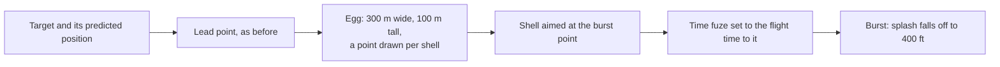

- Fire zone floor 4,000 ft and ceilings 15,000 and 25,000 ft (retail).
- **Where a shell bursts (opinionated, John, 2026-10-13; the distribution is
  an agent decision, fitted).** Each shell is aimed at its own burst point: a
  point drawn at random inside an egg centred on the gun's lead point (the
  target's predicted position). The egg is an ellipsoid 300 m (984 ft) wide in
  the horizontal plane and 100 m (328 ft) tall, so 492 ft out sideways and
  164 ft up and down at the most. Points are drawn uniformly through the
  egg's volume, so bursts are as likely near its edge as anywhere (the middle
  is not favoured): the average burst is about 0.75 of the way to the edge.
  The draws come from the surface's seeded stream (three per shell), so a
  flight, its replay and a networked host all see the same bursts, whoever
  the target is, the player or an AI wing. Skill no longer widens the flak's
  scatter and range does not either (the egg is the same at any range); a
  jammer on the target still widens a radar gun's scatter two times, the egg
  included (defined, John, 2026-10-10, kept).
- **Time fuze.** Each shell's fuze is set at launch to the flight time to its
  burst point and it bursts there. Fitted (the time fuze is not in the
  data).
- **No proximity fuze (agent decision, 2026-10-13).** A flak shell no longer
  bursts early when it passes within the record's 250 ft fuze radius of an
  aircraft: with the egg, that rule would have made most bursts happen near
  the target whatever the egg said. A shell still bursts on striking an
  aircraft or the ground, so one drawn through the target's own volume hits it.
  The record's 250 ft is unused for flak.
- **Splash falls off to 400 ft, not 750 (fitted, agent decision,
  2026-10-13).** The record's splash (35 percent of the damage, falling in a
  straight line to nothing at its edge) reached 750 ft, wider than the whole
  egg, so every burst hurt the target, however far from it, and a single gun
  did 70 percent of a jet's hit points in one pass. The splash edge is now 400
  ft (122 m, a little more than the real fragment reach of an 85 to 100 mm
  shell, about 100 m): the percent and the straight-line fall are unchanged.
  Measured, 70 to 75 percent of bursts reach the aircraft at all and a
  burst does on average a quarter of the damage one at the target's centre
  would (4.2 hit points of a possible 17.5 for the KS-12).
- **Rate of fire (opinionated, John, 2026-10-13): one third of before.** The
  guns' pause between shells is 12.5 s (was 4.0 s, the retail record's); a
  shell every 12.75 s is 4.7 a minute (was 14.1). The retail record's own
  cycle is 4.5 s, 13.3 a minute; the real 85 mm 52-K and 100 mm KS-19 fire 15
  to 20 rounds a minute at the most. The eight-shell opening barrage (retail
  startup shots), fired once in a gun's life, is slowed by the same third
  (opinionated, John, 2026-10-14: "The 8-shell opening barrage should be
  slowed as well"; the 0.75 s is an agent decision): its shells leave 0.75 s
  apart, eight in 6 s, where they left a quarter second apart (eight in
  2 s).
- A burst deals splash damage and plays an air flak explosion: the KS-12's
  is the record's own type 27 (the original's air flak row: size 130, 2 s,
  air explosion sounds; retail), the KS-19's is type 28 (size 170, 1 s;
  both records name 27, so the larger calibre's sheet is fitted). Each shows its sheet
  (FLAKA, FLAKB) with a dark puff that lingers about 4 s and a point light
  ([flak bursts, gunfire, launches and light](#flak-bursts-gunfire-launches-and-light)).
  Both are **heard as type 27**, the retail row, whichever sheet is drawn
  (2026-10-13, [sound](sound.md#flak-bursts)). It has no tracer, and a shell
  is not drawn in flight.
- A shell passes friendly aircraft and aircraft on the ground (collateral
  damage spares the gun's own side when friendly fire is off).
- Startup shots 8: the first engagement opens with an eight-shell barrage
  (retail), 0.75 s a shell (above).
- **A burst knocks an aircraft half as hard (opinionated, John, 2026-10-14:
  "flak pushes aircraft a lot, maybe cut push forces by 50%, damage can stay
  the same").** A flak burst's splash jolts an aircraft with half the roll,
  pitch and yaw kick and half the push of another blast of its strength
  ([missile hit jolt](cheats.md#missile-hit-jolt)), halved after the
  strength's floor, so every flak jolt is now a quarter of a 100-point
  warhead's (it was a half). The damage is unchanged.
- The guns fight as teams: see [flak teams](#flak-teams).
- A shell reaching its life without bursting bursts there.

What this does, measured with `--surface-trace ... --solo` (one gun, the
player's F/A-18 on a straight line over it at 450 kt, four seeds;
[measurements](../baselines/flak-egg.md)): a lone KS-12 took 168 of the
jet's 232 hit points in a pass and now takes about 40; a lone KS-19 211 and
now about 70; a helicopter that a lone gun destroyed now keeps most of its hit
points. The whole North Vietnam emplacement killed the jet in 66 to 73 s and
now leaves it with 31 to 68 hit points after a 150 s pass. Of the bursts
measured 97 percent lie inside the egg and the rest within 5 percent of its
edge.

#### Flak teams

John, 2026-10-14: "Flak looks a lot better, however they just attack the first
plane that comes in range until it dies ... in flight it is usually the flight
lead. It would be nicer if flak would try to attack the group ... let's give
flak a 'group logic' kind of how supply trucks work, but give them double the
detection range, and have the flak attach and detect and work as a team within
1 mile of each other, and have it attack the entire detected group once 25% of
the detected group is in range of the entire group." Amended the same day: a
group just outside range with only one of ten in reach would draw no fire, so
the team also opens fire when the group "judges heading ... within a 90%
cone of the known blob". Every rule below is opinionated (John's request);
the readings and numbers marked *agent* are agent decisions.

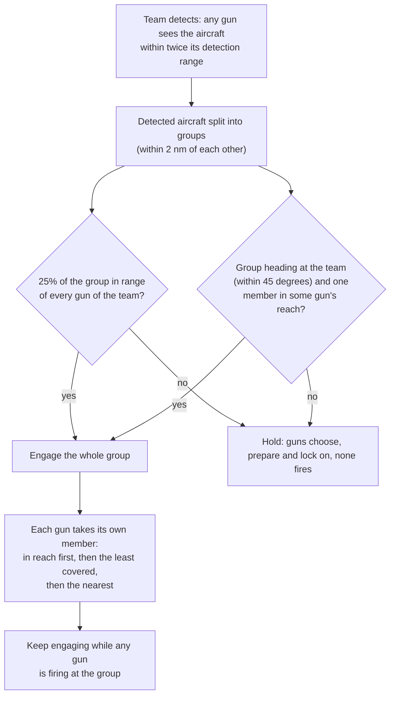

- **Who is in a team.** The KS-12 and KS-19 guns, the only heavy flak (the
  other guns fire as before). Guns of one side join one team when a gun of
  the team stands within 1 nautical mile (6,076 ft) of them, so a chain of
  guns each a mile from the next is one team (*agent*: chained; the nautical
  mile is the lead's reading of John's "1 mile"). Teams form from where the
  mission places the guns and do not change; a destroyed gun drops out and
  the rest stay a team. A gun with no other within a mile is a team of one
  and follows the same rules, so a lone gun still fires at a single aircraft
  or a flight heading at it. Ships' guns and other AAA are not in teams.
  Measured on the retail data: North Vietnam's base layout stands its 24 KS
  guns 1.5 to 3 nm apart, so each is a team of one; its Quick Mission
  templates hold teams of 2 (barges, cargo ships), 4 (storage units) and 11
  (the comm center); no other theater has heavy flak.
- **Shared detection, doubled.** The team sees every hostile aircraft any of
  its live guns sees within twice the gun's detection range (the records'
  100,000 ft, so 200,000 ft, about 33 nm), with terrain line of sight from
  that gun; the record's altitude band is kept and `searchDist` is doubled too
  where a unit has one. Every gun of the team knows every aircraft the team
  sees.
- **The group** (*agent*). The aircraft the team sees are split into groups:
  an aircraft within 2 nm of another of the group belongs to it. A flight in
  formation is one group; two flights on different tracks are usually two.
- **When the team opens fire on a group.** Either at least 25 percent of the
  group's aircraft are in range of the team, meaning inside its widest fire
  zone: inside the fire zone (range and altitude band) of at least one live
  gun of the team (John, 2026-10-14: "the team's longest reach"; the union
  of the guns' zones is the reading, since in a mixed team the KS-19s'
  zone, 44,250 ft and up to 25,000 ft, holds the KS-12s' 26,200 ft and
  15,000 ft one, so it is the longest-reach gun's zone measured from where
  each gun stands), and at least two of its aircraft are (the whole group
  when it is a single aircraft; John, 2026-10-14: "let's add a minimum of 2
  aircraft"); or the group heads at the team (no minimum): its members' mean track
  over the ground lies within 45 degrees either side of the bearing from the
  group's middle to the team's middle (John's "90% cone", read as a cone 90
  degrees wide) and at least one member is inside some gun's fire zone. A
  group slower than 30 kt over the ground (a hovering helicopter group) has
  no track and opens fire by the 25 percent rule only (*agent*). On a
  straight line the heading cone usually opens fire first; a line passing
  more than about 30,000 ft off the team is skirting it.
- **Holding.** Until then the team holds its fire at the group. Its guns
  still choose targets, prepare and lock on (a radar gun paints its target on
  the RWR, as before), so they fire the moment the team engages. A group
  skirting the edge, not heading in, with fewer than 25 percent or fewer than
  two of its aircraft in range of the team, is never fired at, not even the one aircraft a gun could reach:
  a point or line defence does not give its position away (John, 2026-10-14:
  keep holding).
- **Once engaged.** The team engages the whole group, and keeps engaging it
  while any gun of the team is firing at a member (a burst begun, the pause
  after it or a magazine swap), even if the group turns away.
- **Spreading the fire** (*agent*). The team gives each gun a member of the
  groups it engages (while it holds, of every group it sees): the guns that
  reach farthest first, as they open fire first, each the next member by id
  in turn, round again when every member has a gun. With fewer guns than
  members the turn moves on one member every 10 s, so a lone gun walks over a
  flight. A gun chooses its own member when it is within its reach or 1 nm
  past it, else any member it can reach, else its own, else any within 1 nm
  of its reach; the nearest, then the lowest id, first among equals. It
  chooses again when its target dies or leaves and at flak's 10 s retarget
  period, so the fire stays spread over the group rather than on the lead.
- **The opening barrage is spread** (John, 2026-10-14). A gun's eight opening
  shells go round the members of the engaged groups it can reach (inside its
  fire zone, with a clear line), one shell each in turn, its own target
  first, then ascending id; members coming into reach during the barrage join
  the round. With a single target all eight go to it.
- Determinism: everything is a function of this tick's positions and the
  controllers' checkpointed state, read in ascending unit id, so the player,
  the AI, a networked host and a replay all see the same teams and the same
  fire. Nothing is added to the checkpoint or the wire.

What this does, measured with `--flak-pass` (a flight on a scripted line over
the storage template's four-gun team and a lone gun;
[measurements](../baselines/flak-teams.md)): a four-ship's lead, which drew 39
of the team's 52 shells and died in a third of the passes, now draws about 16,
like each wingman, and no seat died in any pass; the flight as a whole loses
about a fifth more hit points (the shells no longer fall on a lead already
nearly destroyed). A lone gun's opening barrage, spread, now reaches every
member (a lone KS-19 over a four-ship: 5, 3, 4 and 2 shells). A two- or
four-ship grazing the team's edge with one member inside a KS-19's reach is
held (the minimum of two); passing 35,000 ft to the side, where a second member
comes into reach a few seconds later, it is engaged then. Eight aircraft
grazing the edge with one in reach draw nothing, with two in reach they are
engaged. A lone gun fires the moment the flight comes into
reach (before the teams, its lock lapsed every 15 s while it waited, delaying
its first shell by about 12 s). Every flak jolt is a quarter of a 100-point
warhead's.

#### Barrage zone

The `A_M1939` object (North Vietnam only) is an invisible barrage: 1 hit point,
no shape, `randomFirePercent` 33 (retail). The rule is untraced, so (fitted,
settled by John): it is active while a hostile aircraft is within about 50,000
ft (the activation radius, from `zoneDist` 195); then each burst slot fires with
33 percent chance at a random point inside the fire zone (0 to 10,000 ft range,
up to 6,000 ft) biased toward the nearest hostile's track, using the record's
offset-fire fields where non-zero. It is a legal bomb target (an AAA kill if
destroyed) but is never drawn or designated.

### Ship weapons

Ships use the same controllers per mount, with arcs `slewLimitH` (60 to 150
degrees each side) and `slewLimitP` relative to the hull heading, and mount
positions from the hardpoints (retail). Carriers (Eisenhower, Kitty Hawk,
Clemenceau, Wasp, Kiev) fight with their Phalanx and Sea Sparrow, or SA-N-3,
SA-N-9 and AAA30 for the Kiev, and are otherwise static targets. Ships are
never resupplied; their SAM rails are finite as in retail and their guns have an
unlimited reserve. The one template with sailing ships is `~QTCARGO`, see
[Movement](#movement).

### Movement

Five Quick Mission templates carry routes (retail: every other object has `speed
0` and no waypoints). The reader exposes the route of each; the closing waypoint
(flag 2) sits at 0 0 0, so a route's path is the unit's start plus its legs.

| Template | Who moves | Route |
| --- | --- | --- |
| `~QUCOL` | Nine tanks | Three legs at 50 ft/s, 58,600 to 62,600 ft each (9.6 to 10.3 nm), the tanks 400 ft apart in a column on one road (in game, each in its own lane) |
| `~QTCARGO` | Three CARGO2 target ships | One leg at 16 ft/s (9.5 knots) to a common point, 87,100 to 101,800 ft (in game, they end side by side) |
| `~QUFACT`, `~QUBUNK` | One truck each | Legs at 50 ft/s, 6,100 ft and 72,200 ft |
| `~QFACT` (not offered) | One truck | A copy of `~QUFACT`'s |

A routed template is never relocated or jittered (its units follow roads and sea
lanes), so the routes are in the same frame as the units. A tank column takes
about 20 minutes to drive its route; the cargo ships take 90 to 100 minutes.

The follower (fitted: the retail waypoint consumer is untraced):

- **Steering.** Turn toward the next leg's point at the record's `_turnRate`
  (182 units per degree per second: 15 degrees a second for tanks, 5 for
  ships, 45 for trucks). A unit turns in place if it must.
- **Speed.** Accelerate and brake at 5 ft/s squared on land and 1 ft/s squared
  at sea (the record's `_acc` units are unknown) toward the leg's `w_speed`,
  never above the record's `_maxSpeed`. A turn sharper than 45 degrees slows
  the unit to a quarter of the leg speed until it points along the leg again.
- **Legs.** A leg counts as reached inside two turning-circle radii of its point
  (at least 25 ft), so a point the unit cannot turn onto never makes it circle;
  the corner is rounded, not cut square. The last point is approached at the
  braking speed and reached exactly (within 4 ft the unit stands on it).
- **Terrain.** A land unit stands on the terrain height every tick and tilts to
  the local slope (pitch and bank from the height field 30 ft either side). A
  ship keeps the water level it started at and stays level: its route is
  authored on water, and the terrain grid's 8,192 ft cells are too coarse to say
  where a harbour or a river ends (the Vietnam cargo route crosses cells
  classed as land).
- **Stops.** A unit stands on the end of its route for good. A destroyed unit
  stops at once, where it died, and stays.
- **Lanes** (fitted, lead ruling after M1, 2026-10-10). Units whose legs run
  through exactly the same points (the nine `~QUCOL` tanks, the three
  `~QTCARGO` ships) drive side by side instead of on one line: in ascending id
  order each takes a lane, centred on the authored path, 1.5 of the group's
  widest hull beam apart (the hit box at its drawn size: 17 ft for the T-72,
  T-80 and T-90 column). Every one of the group's points moves right of the
  direction of travel by the unit's lane, across the leg that arrives at it
  and mitred at a corner (at most twice the lane) so the lanes stay parallel
  through it. Starts do not move, so the column keeps its order and its
  spacing along the road, and the units finish side by side. Offsets are
  whole feet from integer route data, so every machine computes the same
  routes. A unit alone on its route keeps it.
- **No collision.** Units neither avoid each other nor block aircraft beyond
  their lanes. Planes fly through a routed unit (agent decision: the scene's
  contact box at its start would otherwise stay solid where it no longer
  stands).
- **Fire.** Guns fire while moving (fitted; retail behaviour unknown). The unit
  fires from where it is: its combat target (aim point, velocity, orientation),
  its hit box and its mounts follow the pose every tick. A land unit halts while
  it fights a ground unit or ship in reach and drives on afterwards; one it only
  sees does not stop it ([surface against surface](#surface-against-surface)).

The state of a moving unit is a position, heading, speed, leg and halt reason in
whole units (1/65536 ft, 2^32 binary angles), so a checkpoint resumes the march
exactly and the path is a function of the mission and the tick alone.

### Experience

Template objects carry `skill` 0 to 3 (retail: 3,752 objects at 1, 136 at 2, 143
at 3, 3 at 0). Base-layout units default to 1 (fitted, as the generator writes
`themGroundSkill 1`). The record's `chances[0..3]` and hit modifiers stay unused
because the retail hit-chance routine is untraced. The existing
[AI spec](ai.md#b30-surface-behavior) warns against applying aircraft
experience tables without a demonstrated consumer; this table is a separate,
fitted surface table (defined by John's acceptance, values fitted):

| Effect | Novice (0) | Average (1) | Veteran (2) | Ace (3) |
| --- | ---: | ---: | ---: | ---: |
| Search and preparation delays | x1.5 | x1.0 | x0.85 | x0.7 |
| Gun aim error | see [Aim](#aim) | | | |
| Missile launch range used | 80 percent of max | 90 | 100 | 100 |
| HARM shutdown chance | 0 percent | 25 | 60 | 90 |

The night and stealth rule sets ZSU-23 skill 0 (retail).

### RWR emitters and radar state

**Who emits** (defined, John accepted the rule):

- A battery's radar element, never its launchers.
- Any other unit with a radar weapon (seeker signature 3, or a gun with flag
  0x4000) or a sensor (GCI, BUTLER), while its radar is on. Retail plus fitted.
- Named radar objects with no weapon: LTRACK, SFLUSH, SRDR1, SRDR2 (vehicles)
  and KING (Tall King OT) are always-on emitters while alive, when they are not
  part of a battery. Defined (agent): they are radars by name and the RWR and
  HARM need them; the data gives them no sensor. PRDR1 and PRDR2 ("Passive
  Radar") and MICRO and MICROM (microwave relays) never emit. A radar adopted
  into a battery follows the battery's on and off rule below instead.
- Infrared SAMs (SA-7, SA-9, SA-13, SA-14, SA-16, FIM-92, Chaparral), visual
  guns, tanks and men never emit.

**Radar on and off** (fitted). On while a hostile aircraft is inside the unit's
detection range, off 30 s after the last one leaves. **HARM**: when an
emitter-homing missile (AGM-88, AGM-45) is launched at an emitter and is within
10 nm, the emitter rolls its skill's shutdown chance once; on success the radar
goes off for 30 s (supported missiles it guides lose support; a battery goes
Blind for that time). Manual p. 120: "A threat's only defense ... is to turn off
the radar." A HARM that has already locked the radar keeps homing on it after
the shutdown, on angles only (retail data; slice W2,
[air-to-ground](air-to-ground.md#missiles-and-the-harm-boresight-cue)), so the
shutdown blinds the battery but does not save its radar from that missile.

**What the player sees and hears:**

- The [RWR](rwr.md) shows surface emitters as the Ground square. TORE's passive
  reception drops anything not airborne today; this round accepts surface
  targets (the readout already codes the Ground symbol, so no wire change).
- Painting (bright) while the unit is in Track or Fire on this aircraft; firing
  (flash) while one of its supported missiles is in flight at this aircraft
  (the existing 2-degree rule).
- Lock tones, ranks 3 and 4: the surface controller feeds the same per-actor
  lock list the AI aircraft feed (target is the player, phase Track or Fire,
  weapon signature 2 or 3). The RWR spec's "Ground units: no lock warning" row
  becomes spec-derived, since retail shares the weapons procedure
  ([RWR formats](../formats/rwr.md#lock-producer-stage)). Ranks 1 and 2 already
  work for any incoming projectile.
- HARM targets: a surface target with its radar on is a compatible emitter for
  the existing AGM-88 profile.

### Implementation so far

Slice W3 (2026-10-10) built the engagement controller, the batteries and the
radars to the rules above. Where the rules leave a choice, it chose as follows
(defined, agent, unless marked):

| Rule | As built | Basis |
| --- | --- | --- |
| Controllers | One per gun mount (a ship's fore and aft guns turn and fire on their own, each with its magazine) and one per missile record on a unit (its rails share it); a battery has one on its radar | defined (John, 2026-10-10): the arcs of a ship's mounts differ |
| First search | At once when a hostile enters detection range; the search period is the retry when none is eligible | fitted |
| First engagement | The unready preparation time is the controller's first Prepare; every later one takes the ordinary time | fitted (unknown producer) |
| Lost target, failing gates | A target no longer eligible returns to Search at once; launch gates that fail hold the lock up to 15 s, then Search (which may choose the same target again) | B42 window, fitted recovery |
| Lock between salvos | The lock holds through the pause between bursts and salvos: the RWR lock tone and the painting state continue | defined (John, 2026-10-10) |
| Gun bursts | A burst's rounds leave evenly over its burst time; the first engagement's opening barrage (`startupShots`) spaces its rounds by the burst's round spacing, at least a quarter second apart; the flak's are 0.75 s apart (KS-12 and KS-19: 8 shells in 6 s; John, 2026-10-14) | fitted; flak opinionated |
| Where rounds leave from | A **missile** leaves its rail: the unit's pose this tick (a moving unit fires from where it is, with its velocity) plus the hardpoint offset at real size (a third of the record's) turned by the unit's attitude, at least 5 ft above the terrain. A **land gun** leaves the end of its drawn barrel ([muzzles](#muzzles)), and a **ship's gun** its hardpoint, which sits at the gun. Radars and sights look from 10 ft above the unit's reference point | fitted |
| RWR reception of a ground radar | The terrain test ends at least 10 ft above the ground under the radar (its antenna), so a unit whose contact volume sits low on a slope still shows its square | fitted |
| Mount arcs | A half-arc of 0 is unrestricted on that axis (every land vehicle reads 0 for heading); otherwise the bearing (guns: and elevation) must lie inside the half-arc of the mount's rest direction, relative to the hull. A missile's launch pitch is the line to the target clamped between 10 degrees and the rail's arc. A tank gun takes, and fires at, no aircraft more than 20 degrees above its hull's horizontal plane ([tanks against aircraft](#tanks-against-aircraft)) | inference, fitted; the tank ceiling opinionated (John, 2026-10-24) |
| Altitude bands | Zone altitudes are the target's height above the unit, as the AI's envelopes take them | spec-derived (B45) |
| Gun reach and range | A gun's launch range is its fire zone capped by its shells' reach; a round ends 15 percent (at least 500 ft) past the target; a flak shell's time fuze is its time of flight to its own burst point in the egg around the lead point ([flak](#flak)) | fitted |
| Lead | A radar gun observes its target every tick; a visual gun every 0.5 s and leads from that stale track; both through the shared gunsight time-of-flight solution | spec-derived, fitted refresh |
| Detection | Range, the weapon's `zone0` altitude band, the react class mask (0 attacks any class), `searchDist` read as 256 ft units, and a terrain line of sight sampled every 500 ft | retail plus fitted |
| Radar guns | A gun is radar-directed when its record carries flag 0x4000 and a radar seeker; the barrage zone's record carries the flag without the seeker and is not | inference |
| Battery blind | A battery is Blind while its radar is destroyed or shut down by a HARM; a radar that is merely off (no hostile near) leaves it Idle | defined (agent) |
| Battery launcher | Each salvo leaves from the nearest launcher with a loaded rail, line of sight and the target in its launch zone; the missile is the launcher's, its support the radar's | defined (John) |
| Optical backup | Detection and support from the first live launcher, inside half the launch range and 10 nm, preparation doubled, no emitter and no lock tone | defined (John, 2026-10-10, the agent's recommendation) |
| Barrage zone | A target volume 60 ft square and 20 ft tall on the ground (bombs can kill it); it wakes when a hostile is within 195 x 256 ft and fires each burst with its 33 percent chance at the nearest hostile's lead point clamped into its fire zone, scattered by the record's offset-fire angles (20 degrees) | fitted |
| Resupply hook | A unit's stock (rails, magazine, spare magazines) and a "truck in reach" flag that the [resupply](#resupply) step sets each tick before the controllers read it; with the flag set an empty gun swaps a magazine from the truck, and an Empty unit returns to Search once a rail or magazine is loaded | defined (John's rule, built in slice SR1) |

`--surface-trace` flies a scripted pass past one unit and prints the
controller's phases, shots and bursts, radar and HARM events and the RWR
(see [development](../DEVELOPMENT.md#surface-unit-inspection)).

### Countermeasures

No new countermeasure code is needed beyond wiring:

| Defense | Mechanism | Basis |
| --- | --- | --- |
| Chaff against radar SAMs, flares against infrared SAMs | Decoy rolls by seeker class and the record's chaff and flare chance, unchanged | spec-derived ([countermeasures](countermeasures.md)) |
| Jammers | The seeker's deception chance against the aircraft's jammer, unchanged | spec-derived |
| Terrain masking | Launch needs line of sight; support ends when it breaks | retail (terrain blocking is shared with aircraft) |
| Flying low | Seeker altitude floors (SA-2 3,000 ft, SA-3 2,000 ft, SA-6 500 ft) and launch zone floors gate detection and launch | retail |
| Notching, out-turning | Existing seeker and missile turn-rate fields | spec-derived |
| HARM | See above | defined |
| AI aircraft | Already react to any projectile aimed at them and release decoys | spec-derived |

Manual guidance matches: radar SAMs have trouble at low altitude, fly above
15,000 ft against AAA, ground radars cannot see through hills, and air defenses
need time to turn and engage (pp. 157 to 158, 192 to 193).

### Surface against surface

John, 2026-10-11: "If units are in range of opposing sides they should shoot
at each other." Slice CL-SV built it on the engagement controller above; the
controller does not care whether its target is an aircraft or a ground unit,
so search, preparation, lock, bursts, salvos, magazines and resupply are
unchanged. Only what a unit may aim at, which it prefers, what its rounds
strike and how a column behaves are new.

**What a weapon may aim at** comes from its record (retail). Every JT record
carries a target flag: 0x10000 lets it be aimed at aircraft (the fighter and
bomber classes, `0xC000`), 0x20000 at every other class (ships, SAM and AAA
sites, tanks, vehicles, structures, men). Retail's store choice matches a
target's class against these flags ([AI formats](../formats/ai.md), B45; the
`PROJLock` row of [radar](../formats/radar.md)). Over the 135 JT records the
split is clean: every air-to-air missile, SAM, AAA and flak record carries
only the air flag, every bomb, rocket and air-to-ground missile only the
surface flag, and the aircraft guns and the ground units' own guns both.

| Surface weapon | Target flags | Aims at |
| --- | --- | --- |
| Tank guns: M1 (M256), T-72 record for the T-72, T-80, T-90 | air and surface (`0x300c0`) | aircraft and ground units, ships |
| Armoured car and APC guns: BMP-2, BTR-80, M113, M2 | air and surface | aircraft and ground units, ships |
| Small arms (TROOPS) | air and surface | aircraft and ground units, ships |
| SS-N-9 (Sarancha) | surface only (`0x22365`) | ships only (agent decision: an anti-ship missile) |
| ZSU-23, ZSU-57, 2S6 gun, AAA30, AAA30BAD on land | air only (`0x140c0`, `0x100c0`, `0x5140c0`) | aircraft first, then, by John's ruling, ground units and ships in reach |
| Phalanx and every other ship gun | air only | aircraft only |
| M1939 barrage zone, KS-12 and KS-19 flak | air only (`0x2940c0` for the flak) | aircraft only |
| Every SAM, ship SAM, Sea Sparrow and ASROC | air only (`0x12041` to `0x12345`) | aircraft only; ASROC stays held |

**Gun AAA fires at the ground.** The records of the land anti-aircraft guns
carry only the air flag, so a first reading kept them at aircraft. John,
2026-10-11: "If it can shoot at ground targets let it." So a land AAA gun
(a gun record with the air flag and not the surface flag, on a unit that is
not a ship, that is not flak and is not the barrage zone) may also aim at
ground units and ships of the other side in reach, **after any aircraft**:
the existing preference already puts an air-defence unit's aircraft first, and
a gun that has an aircraft in reach never turns to the ground. Its detection
and fire zones, mount arcs, line of sight, bursts, magazines, resupply and
aim error (a quarter of the air error at the ground, fitted) are the same as
for the tanks; the damage is the record's for the target's class. SAMs do not
(their missiles are anti-aircraft), nor do ships' guns and flak (a time-fuzed
shell bursts in the air and the barrage zone fires at nothing it can see).
Opinionated, John 2026-10-11 (the records alone would have forbidden it). The
M1975 is a tank-class unit with no weapon, so no artillery fights. A record
with neither flag would keep the anti-aircraft use every surface weapon had
(none does).

**What it may aim at is a unit**, of the other side, that stands and that the
scene holds: a ground vehicle, a SAM or AAA site, a truck, a radar, a ship.
Never a building or other structure, a parked aircraft, a unit with no side,
or the invisible barrage zone (defined, agent: a crew fights vehicles, sites
and ships). The target point is the unit's combat row, the upper half of its
box, and a moving unit is aimed at where it is.

**The `react` masks.** Retail mission objects carry three class masks; the
manual's Pro Mission Creator calls them ATTACK, DEFEND and EVADE ("Defend if
under attack from this class of enemy", p. 207), and a class in none is
IGNORE. The shipped templates give tanks and armoured cars `$c000 $3fff $0`
(attack fighters and bombers, defend against every other class) and SAM,
AAA, ships and trucks `$c000 $0 $0` (ignore surface classes); troops carry
`$0 $0 $0`. John's rule decides instead: units in range shoot, whatever their
masks say (opinionated, John). The masks keep their air meaning (an aircraft
is eligible only if `react` names its class).

| Rule | As built | Basis |
| --- | --- | --- |
| Detection and range | The weapon's `zone0` (range and relative altitude band) to see it and `zone1` to fire, a gun's capped by its shells' reach, a missile's by experience; `searchDist`; terrain line of sight from 10 ft above the unit to the target's aim point, sampled every 500 ft | retail records, the existing rules |
| Gates | As for an aircraft: launch zone, mount arcs relative to the hull, line of sight | retail, unchanged |
| Preference | An air-defence unit (class SAM or AAA) takes aircraft first (a land AAA gun turns to the ground only when no aircraft is in reach), every other unit (tanks, vehicles, men, ships) ground units and ships first. A controller sees only the eligible contacts of the preferred kind while there is one, so a tank fighting an aircraft turns to a ground unit that comes into view, and to the aircraft again once no ground unit is left | defined (agent) |
| Choice | Nearest eligible of the preferred kind, ties by lower id; kept while it stays eligible; flak retargets as before | fitted, deterministic: no random choice |
| Aim | A gun's aim error at a ground unit or ship is a quarter of its air error (visual 0.375, 0.25, 0.175, 0.125 degrees by skill; radar a quarter of 0.6 to 0.2), drawn from the surface's seeded random stream once per burst, plus the 0.25 degree round dispersion. A T-72 at 3,000 ft hits another about once in five rounds | fitted (the retail hit-chance rule is untraced; with the air error a tank needs about fifteen minutes to hit another) |
| Damage | The record's damage for the target's class (`damage[0..4]`: the T-72 and M1 guns 200 against everything, so one 125 mm round kills a 200 point tank) | retail |
| Locks and painting | Fed for aircraft only: a ground unit has no RWR, and a ship's lock tone would be meaningless | defined (agent) |
| The SS-N-9's support | The Sarancha's radar comes on while a ship of the other side is inside the SS-N-9's 250,000 ft detection range (its air search keeps the SA-N-4's 100,000 ft), and it supports its missiles from its own radar like any self-contained launcher | defined (agent) |
| Columns | A land unit on a route halts while one of its weapons fights a ground unit or ship: the target is inside the weapon's launch gates (its fire zone, arc and line of sight), or a burst has started (to the pause between bursts and a magazine swap). A target seen only inside the detection zone does not halt it, so a column closes to firing range first (review fix 2026-10-12: halting on sight froze a column for good on an enemy out of reach). It brakes at its usual 5 ft/s squared where it is and drives on, from rest, when none does. Fighting aircraft does not stop it, and ships fight under way. Nothing about the halt is kept: it follows from the controllers' state, which the checkpoint already holds | fitted (agent): a column stops to fight; the retail waypoint consumer is untraced |
| Supply | Unchanged: trucks rearm and refill whatever a unit fired at | defined (John) |
| Stock | Unchanged; a ship's missile mounts hold the record's `maxItems` 32,767 (unlimited), so a Sarancha fires an SS-N-9 every 8 s (`reloadT` 32) while a ship is in reach | retail |

**What strikes what.** See [what a surface round can
hit](#sam-missiles): aircraft, the terrain and the other side's ground objects
and ships, never its own side's or neutral scenery, whatever the friendly fire
setting (defined, agent). Its splash follows the same sides. Damage, wrecks,
fires and craters are those of any hit. The kill is credited to the unit
(its id is the round's owner), so the wreck's replay event names it and an
objective counts the target destroyed whoever destroyed it. No pilot's
debrief row and no multiplayer score counts it: retail multiplayer scores no
ground kills, and a surface unit is no player.

**Where it happens.** Retail never stands opposing units in reach of each
other in a Quick Mission. The `--surface-battle --survey` run built every
theater's base layout and every offered ground target at heavy defenses with
seeds 1 to 20 (2,480 missions) and found no pair of opposing units within a
weapon's reach: the nearest, in Iraq's "troops withdrawing from Kuwait"
(`~QIRRETR`, whose 40 American objects stay friendly), stand 22,000 to 27,000
ft apart, beyond a tank gun's 5,000 ft. So on retail's own layout the ground
war never wakes. John asked for it to be seen (2026-10-11), so a Quick Mission
with a ground target now adds [a front line](#the-front-line) of Blue and Red
units in contact, which fights. The `surface-battle-*` [battery
scenarios](../testing/lane-ai.md) check it, and the older test missions that
hand template units to Blue (`--surface-battle ... --blue --no-front`): four of
the Ukraine column's tanks against the other five and the template's SAM and AAA
sites (both sides halt, fight and kill; the tanks fire, and so do the AAA guns
at a Blue tank in reach), and the Baltic fleet's Kiev and a Krivak against its
Saranchas (the SS-N-9s sink both).

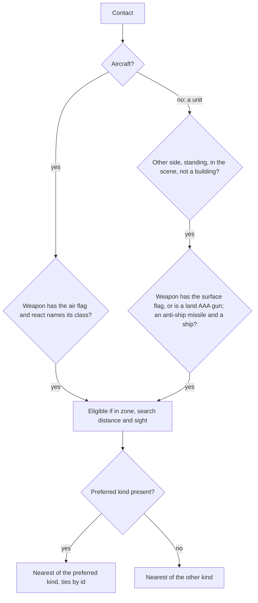

## SAM batteries

Retail treats every launcher as self-contained: there is no radar-to-launcher
link in the data. By John's decision the SAMs that need a separate radar in
real life fight as batteries: one search radar element and its launchers
(defined, John).

| System | Launcher | Real-world radar | Battery here | Most launchers per battery | Radar element |
| --- | --- | --- | --- | ---: | --- |
| SA-2 Guideline | SA2A (one object draws a six-rail site) | Fan Song with Spoon Rest | yes | 1 site | GCI.NT, the Tall King radar and the only radar object with a sensor (50 nm). Retail's North Vietnam layout already stands 9 GCI radars among its 13 SA-2 sites |
| SA-3 Goa | SA3 | Low Blow with Flat Face | yes | 4 | GCI.NT |
| SA-6 Gainful | SA6 | 1S91 Straight Flush | yes | 4 | SFLUSH.NT ("Straight Flush Radar", 50 hp, SA6SFR shape) |
| MIM-23 HAWK | HAWK | PAR acquisition and HPIR illuminator | yes | 6 | No LIB object. A defined element "HAWK Radar": a TORE record with the Straight Flush record's numbers (50 hp, vehicle class 0x0200, signatures) and a LIB radar shape: SRDR2 ("Stealth Radar 2"), John's pick from the render sheet of the LIB's radar shapes (defined, John, 2026-10-10) |
| Crotale | ASA5 | acquisition unit, each firing unit has its own tracking radar | no, self-contained | | |
| Roland, SA-15, 2S6 | | on the vehicle | no | | |
| SA-9, SA-13, Chaparral, MANPADS, SCUD | | infrared or optical | no | | |
| Ship SAMs | | the ship | no | | |

The "most launchers" caps (1, 4, 4, 6) and the clustering distances below are
default, pending John.

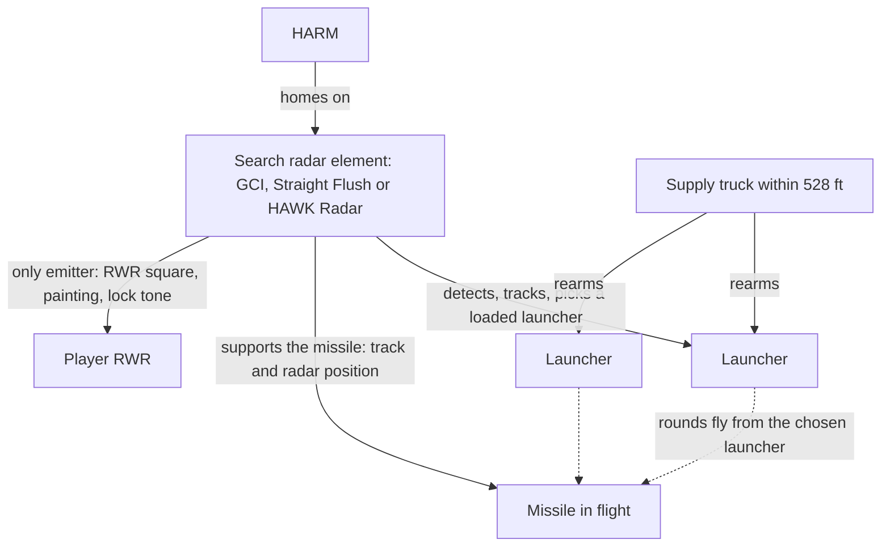

**Forming batteries** (deterministic, same on every machine):

1. After the rolls, launchers of one battery system on one side are clustered by
   single linkage within 1 nm (6,076 ft), in the template's own frame for
   template units and in the world for base-layout units. Templates and base
   layouts never share a battery.
2. A cluster larger than the system's cap is split into as few batteries as
   the cap allows. Seeds: the lowest-id launcher, then each time the launcher
   farthest from every seed (lower id on a tie); the other launchers, in
   ascending id order, join the nearest seed's battery still under the cap
   (defined, agent: a reading of the plan's rule that keeps batteries
   together on the ground).
3. **Adoption.** An existing radar of the system's element type (GCI for SA-2
   and SA-3, SFLUSH for SA-6) on the same side within 3.5 nm of the battery's
   centroid, not already adopted, becomes its radar (nearest first, lower id on a
   tie), keeping its id, flags and place. A template battery adopts only a
   template radar and a base-layout battery only a layout radar. North
   Vietnam's base GCIs and template radars such as `~QCLST`'s two GCI targets
   are adopted this way when they stand within reach (see the per-theater
   notes for North Vietnam).
4. **New element.** Otherwise a radar is added: 600 to 1,000 ft from the
   launcher centroid (1,000 to 1,500 ft from an SA2A site's centre, outside the
   six-rail ring), with the jitter validity rules and clear of its launchers,
   moving with its template's group transform; if no candidate stands, the
   first drawn. Added radars are never targets. Base layouts draw their
   radars from seed 0, so a base layout looks the same in every flight. A
   battery whose radar element the import cannot place (its record or shape
   missing) is not formed and its launchers stay self-contained, so a mission
   always builds.
5. Each template battery also gets one MISTRK supply truck ([Resupply](#resupply)).

Base layouts gain batteries too: Cuba (5 SA-2, 2 SA-6), North Vietnam (13 SA-2
with 9 GCI to adopt), Baltics (4 HAWK), Panama (2 HAWK, 3 SA-6) and the SA-6
sites in Iraq, Pakistan, the Persian Gulf, South Korea and Taiwan.

**Fighting as a battery.** One controller on the radar: it detects from the
radar's position with the battery missile's `zone0`, uses the battery's best
skill, and for each salvo picks the launcher that has a loaded rail, line of
sight to the target and the target inside its launch zone, nearest first. The
missile flies from that launcher; support comes from the radar.

**Emitter identity.** The radar element is the only emitter: its RWR square, its
painting and firing states, its lock tone. Launchers never emit, so a launch
shows as the radar's firing state plus the incoming missile. HARMs home on the
radar; a launcher cannot be a HARM target. The radar's shutdown roll blinds the
battery while it is off.

**Radar killed.** The battery goes Blind: no new launches, and missiles in
flight lose support and fall to their memory rule. Degraded mode (defined,
John, 2026-10-10, accepting the agent's recommendation): SA-2 and SA-3 keep their real optical
backup (the Fan Song's optical sight, the SA-3's TV tracker). In Clear, Cloudy,
Dawn or Sunset conditions (not Night or Foggy) a blind SA-2 or SA-3 battery may
still launch at a target inside half its launch range and within 10 nm, with
preparation times doubled, guided from the launcher with no emitter: no RWR
square and no lock tone, only the incoming-missile warning. SA-6 and HAWK have no
backup and stay blind. The alternative is fully blind for all four.

**Networking and debrief.** Membership is derived on every machine from the same
inputs and is in the digest; no wire field. Launchers keep class 0x1000 (SAM
row). Radar elements keep their LIB class: GCI is a Structure (0x0100), Straight
Flush and the HAWK element are Vehicles (0x0200); missiles are owned by launchers
so the enemy SAM tally is unchanged (default, pending John; the alternative
counts battery radars in the SAM row).

## Resupply

John's decision: supply trucks in the defended groups resupply every unit,
SAM rails and AAA magazines, within 0.1 mile (defined, John).

- **Who counts as a supply truck.** MISTRK ("SAM-Carrying Truck") and TRUCK.
  TANKER (fuel), radar vehicles and Mules do not. Existing template and
  base-layout trucks count too (the North Vietnam layout has 14 SAM trucks; 8
  templates name MISTRK).
- **Added trucks.** Each manned `<sam>` slot gets one MISTRK and each manned
  `<aaa>` slot one TRUCK, and each template battery gets one MISTRK in addition,
  added after the slot's roll from their own random stream so the retail rolls
  and picks are untouched. One per slot because retail slots are spread out
  (median nearest-slot distance 3,280 ft, and only 13 percent of slots have
  another slot within 0.2 mile, measured over 1,770 slots), so a truck at 528 ft
  serves essentially one slot. A battery's own truck serves its first launcher
  that has no slot truck (a named launcher), else its first launcher. Placed
  200 to 400 ft from the unit it serves (after that unit's jitter), with the
  same validity rules and clear of it; the first drawn spot when none stands;
  ownership is the slot's. Ids `0x5800_0000` up, in the order of the units
  served (a slot's truck before its battery's).
  Trucks are passive units, targetable, Vehicle class (0x0200), and move with the
  defended group's relocation. Never targets. Number and placement: fitted,
  agreed by John (2026-10-10).
- **Area defenses** (a Quick Mission with no ground target) get trucks for
  their SAM units and SAM batteries by the same rule, none for guns
  ([area defenses](#area-defenses), John, 2026-10-13).
- **Base layouts get no added trucks** (including no truck for their batteries);
  their units are resupplied only by trucks already standing in them (agreed by
  John, 2026-10-10).
- **Reach.** A live supply truck of the same side within 528 ft (horizontal) of
  a unit resupplies it. One truck serves every unit in range at once. Trucks
  carry unlimited stock (fitted; agreed by John, 2026-10-10).
- **SAM rails** (John, 2026-10-10: SAMs take about 5 to 10 minutes to rearm from
  trucks). While a launcher has an empty rail and a truck is in range, a rearm
  timer runs; when it completes, **all** the launcher's empty rails are refilled
  together. The timer is fitted within John's range:

  | Launchers | Rearm timer | Basis |
  | --- | ---: | --- |
  | SA-2, SA-3, HAWK (large missiles, transloader) | 600 s | fitted |
  | Other vehicle launchers: SA-6, Roland, SA-15, SA-9, SA-13, Crotale, Chaparral, 2S6 missiles, SCUD | 420 s | fitted |
  | MANPADS teams: FIM-92, Mistral, SA-7, SA-14, SA-16 | 300 s | fitted |

  The timer restarts if the truck dies or leaves range. It is not the record's
  `reloadT`, which is the salvo spacing (SA-2 20 s) and already paces firing.
- **Gun magazines** ([AAA tuning](#aaa-tuning)). A gun swaps magazines in 60 s
  (towed guns, small vehicles and troops) or 120 s (self-propelled AAA and ship
  guns), from its own reserve (fitted: two magazines for land guns, unlimited for
  ships). A truck in range refills the reserve one magazine per swap period; with
  an empty reserve and a truck in range, the swap draws from the truck at the same
  time. Without either the gun falls silent (Empty) until a truck arrives in
  range. The 60 and 120 s figures are John's (2026-10-10).
- Tanks, APCs and troops are resupplied the same way (defined, John: all units).
- A destroyed truck stops at once; a rearm in progress is cancelled.
- Ships are never resupplied (no trucks at sea).
- State (rails, magazines, reserves, rearm timers) is part of the mission
  checkpoint.

### How it runs

Slice SR1 (2026-10-10) built the rules above. The details a player or a tester
can see, and where the rules left a choice (defined, agent, unless marked):

| Rule | As built | Basis |
| --- | --- | --- |
| Who is a truck | Every supply truck listed in the surface: the added ones and the MISTRK and TRUCK units already standing in a layout or template. A truck counts only while it stands (hit points above 0) | defined (John) |
| Whose truck | The same side as the unit. A truck of the other side, or a neutral one, does nothing | defined (John) |
| Reach | Straight-line distance on the map between the truck's and the unit's positions this tick, 528 ft or less. Height does not count. A truck on a route (`~QUFACT`, `~QUBUNK`) is measured where it is now, not where it was placed | defined (John), agent for the horizontal reading |
| Who is resupplied | Every armed unit that is not a ship: launchers, guns, tanks, APCs, troops. Radars, trucks and structures carry nothing to refill | defined (John) |
| The flag | Each tick, before the controllers run, a unit in reach of a live truck is marked so; the mark clears the same tick the last truck dies or drives out of reach | defined (agent) |
| Rail timer | Starts the first tick a unit has an empty rail and a truck in reach; completes 600, 420 or 300 s later (the table above) and refills every empty rail in one step. Rails that were loaded are untouched. The timer is cleared when no truck is in reach or no rail is empty, so a new rearm always takes the full time | defined (John), times fitted |
| Magazine timer | Per gun mount: runs while a truck is in reach and the mount has fewer than two spare magazines; each completion adds one spare, so a gun at none is full again after two swap periods. Cleared like the rail timer | defined (John) |
| The loaded magazine | A truck never tops up the magazine in the gun, only the spares; an empty gun swaps a spare in (or draws from the truck when there is none) | defined (John) |
| Truck swap and refill together | An empty gun with no spares and a truck in reach starts a swap at once; the swap draws from the truck. The reserve refill that completes on the same tick as the swap is added after it, so the gun ends with a full magazine and one spare after one swap period | defined (agent) |
| Empty and Search | A unit that ran dry (Empty) goes back to Search the tick after its rails or magazine are loaded | defined (agent) |

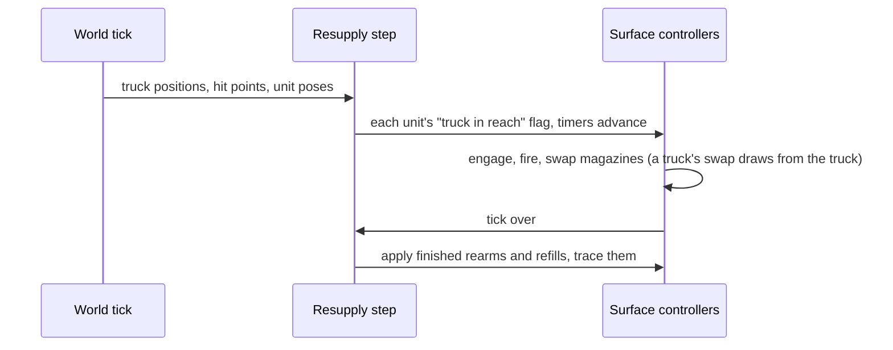

The tests are in `supply_tests.rs` (rail times per system, reach, a destroyed
truck, one truck for several units, spare magazines, ships, a truck on a route,
a checkpoint mid-rearm) and the `surface-resupply` battery scenario runs the
Ukraine factory's seed 2 group (an SA-6 battery rearming after 420 s and
firing, the trucks destroyed and nothing rearming, a ZSU-23 that gains a spare
magazine every 120 s, swaps in 120 s and goes silent without a truck). The
trace flags `--drain`, `--drain-reserve` and `--kill-truck-at S` set those up
(see [development](../DEVELOPMENT.md#surface-unit-inspection)).

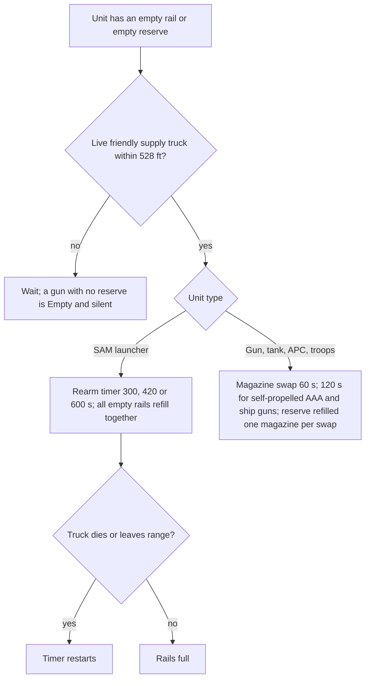

## AAA tuning

AAA gets a fitted rate of fire, magazine size, reload time and reserve per gun
type, starting from the retail record where it has a value and fitting
real-world figures where it does not, each marked, in one tuning table
(defined, John). The table lives in the simulation crate as a constant and
overrides the record's burst fields when a unit's mount weapons load: aircraft
records never pass through it. Retail stock is unlimited (`maxItems` 32767); here
a gun holds its magazine plus a reserve (two magazines on land, unlimited on
ships), refilled by trucks ([Resupply](#resupply)). Magazine swap times are
John's: 60 s for towed guns, small vehicles and troops, 120 s for self-propelled
AAA and ship guns. Damage per drawn round is scaled on high-rate guns so damage
per second of sustained fire matches the retail record; flak, 57 mm, 37 mm and
tank guns keep the retail damage per round (defined, John). M163 fires the
Phalanx record but is an M168 Vulcan, so it has its own row; the Butler keeps the
retail 30 mm row, with no Bofors row (defined, John).

**The M163's reach (opinionated, John, 2026-10-13).** Retail mounts the ship
Phalanx record on the M163, so the retail M163 sees a target out to 50,000 ft
(8.2 nm) and fires out to 20,000 ft (3.3 nm), up to 15,000 ft above itself,
read in feet as written
([the zones of every armed unit](../formats/surface-units.md#weapon-zones-of-the-armed-units)).
The long sight is the normal shape of retail's gun data (every radar gun
acquires at 2 to 8 times the range it fires at), but the M163's fire range is
2.7 times the ZSU-23's and its painting began 8 nm out. John chose to give it
the real Vulcan's reach: the M163 row of the table below replaces the record's
zones, **detection 18,000 ft (about 3 nm) and fire 7,500 ft (about 1.2 nm,
the figure of the unused retail `M163.JT`, a ZSU23 copy) up to 7,500 ft
above**. Minimum range, the other bounds, damage, rate, life and the round are
unchanged, and the ships' Phalanx keeps the retail record. A radar gun paints
a target on the RWR while it holds it in Track, so the M163 now paints inside
3 nm (after its 25 s first-engagement delay) rather than 8 nm. The override
is in the table in code, so every machine agrees. Alternatives considered:
mounting `M163.JT` itself (rejected: it would keep its 60,000 ft sight, and
change the round and damage); changing PHALANX.JT (rejected: ships keep
theirs).

The table below is generated from the table in code by a documentation test, as
the controls tables are; do not edit it by hand. The columns are: gun type,
record and units, TORE rate in rounds per minute, burst rounds, pause, opening
shots, magazine, magazine reload, reload class, reserve, muzzle velocity and
tracer, each marked retail or fitted. Tags: `R` retail record value, `F` fitted,
`O` opinionated (John, 2026-10-10). Regenerate with
`TORE_UPDATE_SURFACE_GUNS_DOC=1 cargo test -p tore-sim surface_guns_doc`.

<!-- surface-guns-table:start -->
| Gun | Record (units) | Retail burst / pause s / opening / muzzle ft/s | Rate rpm | Burst rounds (s) | Pause s | Opening | Magazine | Magazine reload s | Reload class | Reserve magazines | Muzzle ft/s | Tracer | Damage per round | Damage per second vs retail |
| --- | --- | --- | ---: | ---: | ---: | ---: | ---: | ---: | --- | ---: | ---: | --- | --- | ---: |
| ZSU-23-4 Shilka, 4 x 23 mm 2A7 | ZSU23 | 4 in 0.25 s / 1.0 s / 0 / 3,666 | 3,400 F | 99 F (1.75 s) | 1.0 R | 0 R | 2,000 F | 120 O | self-propelled AAA | 2 F | 3,180 F | every 3rd | 1/11 of retail F | 1.02 |
| 2S6 Tunguska, 2 x 30 mm 2A38M | 2S6 | 4 in 0.25 s / 1.0 s / 0 / 3,666 | 5,000 F | 105 F (1.25 s) | 1.0 R | 0 R | 1,904 F | 120 O | self-propelled AAA | 2 F | 3,150 F | every 3rd | 1/15 of retail F | 0.97 |
| M163 VADS, 20 mm M168 Vulcan | PHALANX (M163) | 6 in 0.25 s / 1.0 s / 0 / 3,666 | 3,000 F | 50 F (1.0 s) | 1.0 R | 0 R | 1,100 F | 120 O | self-propelled AAA | 2 F | 3,380 F | every 3rd | 1/5 of retail F | 1.04 |
| ZSU-57-2, twin 57 mm S-68 | ZSU57 (ZSU57, ZIF31) | 4 in 0.5 s / 3.0 s / 0 / 3,666 | 240 F | 5 F (1.25 s) | 3.0 R | 0 R | 300 F | 120 O | self-propelled AAA | 2 F | 3,280 F | every 3rd | retail R | 1.03 |
| Phalanx CIWS, 20 mm M61A1 | PHALANX (NIMZ, KITT, CLEM, WASP, IOWA, TICON) | 6 in 0.25 s / 1.0 s / 0 / 3,666 | 4,500 F | 150 F (2.0 s) | 1.0 R | 0 R | 1,550 F | 120 O | ship | unlimited F | 3,600 F | every 3rd | 1/10 of retail F | 1.04 |
| AK-630 class, 30 mm six-barrel | AAA30 (KIROV, SOVR, KIEV, SARAN, BUTLER) | 4 in 0.25 s / 1.0 s / 0 / 3,666 | 4,000 F | 150 F (2.25 s) | 1.0 R | 0 R | 2,000 F | 120 O | ship | unlimited F | 2,950 F | every 3rd | 1/15 of retail F | 0.96 |
| AK-230 class, twin 30 mm | AAA30BAD (TYPE69, KNOX, JIANC, JIANE, KRIVAK, CYCL, PMORN) | 4 in 0.25 s / 1.0 s / 0 / 3,666 | 2,000 F | 42 F (1.25 s) | 1.0 R | 0 R | 1,000 F | 120 O | ship | unlimited F | 3,440 F | every 3rd | 1/6 of retail F | 0.97 |
| 61-K 37 mm M1939 | M1939 | 4 in 0.5 s / 3.0 s / 0 / 3,960 | 160 F | 6 F (2.25 s) | 3.0 R | 0 R | 200 F | 60 O | towed | 2 F | 2,890 F | every 3rd | retail R | 1.00 |
| 61-K 37 mm M1939, barrage zone | A_M1939 | 4 in 0.5 s / 3.0 s / 0 / 3,960 | 160 F | 6 F (2.25 s) | 3.0 R | 0 R | 200 F | 60 O | towed | 2 F | 2,890 F | every 3rd | retail R | 1.00 |
| 52-K 85 mm (KS-12) flak | KS12 | 1 in 0.5 s / 4.0 s / 8 / 3,520 | 5 F | 1 R (single shot) | 12.5 O | 8 R, 0.75 s apart O | 60 F | 60 O | towed | 2 F | 2,620 F | none | retail R | 0.35 |
| KS-19 100 mm flak | KS19 | 1 in 0.5 s / 4.0 s / 8 / 4,400 | 5 F | 1 R (single shot) | 12.5 O | 8 R, 0.75 s apart O | 60 F | 60 O | towed | 2 F | 2,950 F | none | retail R | 0.35 |
| M256 120 mm tank gun | M1 | 1 in 0.25 s / 4.0 s / 0 / 5,866 | 6 F | 1 R (single shot) | 9.75 F | 0 R | 34 F | 60 O | vehicle | 2 F | 5,866 R | none | retail R | 0.43 |
| 2A46 125 mm tank gun | T72 (T72, T80, T90) | 1 in 0.25 s / 4.0 s / 0 / 5,866 | 8 F | 1 R (single shot) | 7.25 F | 0 R | 22 F | 60 O | vehicle | 2 F | 5,866 R | none | retail R | 0.57 |
| 2A42 30 mm | BMP2 | 2 in 0.5 s / 3.0 s / 0 / 3,666 | 300 F | 20 F (4.0 s) | 3.0 R | 0 R | 500 F | 60 O | vehicle | 2 F | 3,150 F | every 3rd | 1/5 of retail F | 1.00 |
| KPVT 14.5 mm | BTR80 | 2 in 0.5 s / 3.0 s / 0 / 3,666 | 600 F | 10 F (1.0 s) | 3.0 R | 0 R | 500 F | 60 O | vehicle | 2 F | 3,280 F | every 3rd | 1/5 of retail F | 0.88 |
| M2HB .50 cal | M113 | 2 in 0.5 s / 3.0 s / 0 / 3,666 | 500 F | 21 F (2.5 s) | 3.0 R | 0 R | 2,000 F | 60 O | vehicle | 2 F | 2,910 F | every 3rd | 1/7 of retail F | 0.95 |
| M242 25 mm | M2 | 2 in 0.5 s / 3.0 s / 0 / 3,666 | 200 F | 20 F (6.0 s) | 3.0 R | 0 R | 300 F | 60 O | vehicle | 2 F | 3,600 F | every 3rd | 1/4 of retail F | 0.97 |
| Squad small arms | SMLARMS (TROOPS) | 4 in 0.25 s / 1.0 s / 0 / 3,666 | 600 F | 5 F (0.5 s) | 1.0 R | 0 R | 1,000 F | 60 O | troops | 2 F | 3,000 F | every 3rd | retail R | 1.04 |
<!-- surface-guns-table:end -->

## Parked aircraft

Twenty-six templates hold aircraft and twenty-five place them (4 to 9 each,
161 aircraft of 39 types), and three of them make aircraft the targets: `~QLFFAIR` (5 Super
Etendards), `~QKPLNGR` (4 Yak-141) and `~QWTFAIR` (5 J-7 and 4 Q-5). They are
**simulated aircraft on the ground** (defined, John: real aircraft entities,
not static scenery), engines off, and they never take off. The templates'
`startTime` is not used for them.

- **For weapons a parked aircraft is a surface target.** It takes the surface
  role, so Mavericks, bombs and other surface weapons take it and air-to-air
  missiles do not. It is on the ground, so radar cannot see it. No surface
  unit aims at it; a surface unit's round or splash strikes it only when it
  belongs to the other side and stands in the way, as for any ground object
  ([surface against surface](#surface-against-surface)).
- **For damage it is an aircraft.** Gun rounds meet the aircraft volume (the
  six damage-section boxes inside a 28 ft sphere); bombs and missiles meet the
  28 ft sphere without their fuze radius (fitted: a Mk 82's 100 ft fuze would
  otherwise burst it at the release point). Hits are recorded by damage
  section; hit points come from its PT's OBJECT block. Nobody is aboard and
  nothing runs, so there are no critical (pilot) gun kills, no system faults
  and no jammer (agent decision).
- **Destroyed**, it explodes as every FA aircraft does (type 30, with its
  usual variety) and stays where it stood as a **burnt hulk** (John,
  2026-10-13: "a destroyed parked aircraft leaves a burnt hulk"): no crash
  site, no crater and no flying piece. It may burn (agent decision, "may
  still burn"): a fire with its smoke column for 15 minutes on a small
  scorch under it (crater size 2, 32 ft of half width; none on a carrier's
  deck), the same however it died, a hit or splash. The kill carries its PT
  class word (0x8000 fighter, 0x4000 bomber), so it lands in the Fighter or
  Bomber debrief row; it is a ground kill, not an aircraft of the roster.
- **The hulk** (fitted, agent decision, 2026-10-13). The picture swaps the
  standing aircraft for its own shape broken down: every face split into
  small triangles, every point sunk toward the aircraft's lowest point so it
  keeps 30 to 60 percent of its height (a fixed function of where the point
  is, so shared corners stay joined), a tenth of the skin torn away and 85
  percent of the rest charred, in dark greys that differ face by face; the
  remaining skin keeps its camouflage texture. It is built when the scenery
  is, from the same shape as the standing aircraft, so every machine and
  every replay of the mission draws the same hulk; nothing reaches the
  simulation or the wire. The `_B` and `_D` piece shapes are no longer
  drawn, and the sim throws no fragment (a crashed or shot-down aircraft in
  flight still sheds its piece).
- **Not roster planes.** No plane id, no AI actor, no lineage. Retail writes
  template aircraft as `$4017` (not targets) unless flagged 0x80, and roster
  planes would join "every enemy aircraft is a target".
- **Every type reads its own record.** The OBJECT block of the PT (names,
  shape, class, hit points, signatures, debris positions) through one reader
  for all 39 types, with no identity whitelist and no aliasing: `MIG21F` is
  not `MIG21`, `RAFALEF` is not `RAFALE` (AGENTS.md). Eleven of the types are
  ones the game flies (C130, F4E, MI24, MIG17F, MIG21, MIG23, MIG29, RAFALE,
  SU25, SU35, YAK141); the other 28 are parked only.
- **Drawn gear down at the aircraft size.** The shape is drawn with its gear
  state word set, found from the shape's own geometry
  ([gear words](../formats/objects-and-shapes.md#parked-aircraft-gear)), at the
  aircraft convention (one third of the scenery scale), so a parked aircraft
  matches the same type in flight. It stands on its wheels: the lowest point
  of the gear-down shape meets the ground (fitted; the shape's recorded ground
  offset agrees within two units for every type). Placed at the template
  position, heading from the template, jittered not at all.
- **Deck aircraft** (lead ruling after S2, 2026-10-10). A fleet template's
  aircraft stands on a carrier when its spot, measured in the hull's own
  units from the template positions, lies inside the hull's flight deck: the
  largest area of level faces above the waterline. It keeps that spot in hull
  units and stands at the deck's height, both scaled with the hull's placed
  scale, so the deck and its aircraft scale together (agent decision: the
  template positions were authored around the hull at its scenery scale).
  All eight `~QFFLT` aircraft (3 Rafale M, 5 Super Etendards) stand on the
  Clemenceau's deck, 89 ft up at real size (the lead kept this rule,
  2026-10-10). The four `~QBFLT`
  Yak-141s stay out: the Kiev's only level faces lie below its waterline, so it
  has no deck the rule finds. An aircraft on no deck is listed with the
  template's left-out objects.
- **Weapons reach aircraft on an airfield** (lead ruling, 2026-10-10). A
  runway object's shape box spans its whole airfield (the Falklands field's
  is 7,900 by 8,100 ft and 92 ft tall) and used to take every round before
  the 112 parked aircraft in 16 templates standing inside it. For weapons a
  runway object (`_STRIPProc`) now has pavement-only contact: a slab over its
  footprint from 2 ft below the runway plane to 1 ft above it. Rounds and
  bombs reach aircraft and units standing on or beside the field and meet the
  pavement at the plane. The landable surface (grass between runways stays
  landable, John), aircraft collision and every other use of the shape box are
  unchanged. A composite runway shape's built-in structures (the towers and
  hangars drawn inside RNWY1 and the AIRPORT shapes) no longer stop weapons:
  they are part of the runway object, not objects of their own. At real size
  (SC1) no parked aircraft stands inside another object's contact volume.
- **Known gap: the Kiev fleet's aircraft.** KIEV.SH has no level deck above
  its waterline (its only level faces lie 22 units below it), so the four
  `~QBFLT` Yak-141s stand nowhere (accepted by the lead, 2026-10-10). Parking
  them needs the Kiev's deck surface found another way.
- **Network.** Built from the spec on every client like other static units;
  destruction travels as the ground-destroyed event plus the usual effect and
  mark events; a surface record is sent while damaged so damage smoke shows.

## Destroyed looks and drawing

### Size

Surface units, like buildings, are drawn at real size: a third of the retail
shape scale (John, 2026-10-10, realistic scale; the factor is fitted). A Krivak
is 405 ft long, a ZSU-23-4 21 ft. Their contact and hit boxes follow, so they
are a third the size retail's were in every axis. Mount positions and the
shape's F2 ground offset, which the records give in retail feet, take the same
factor. Runways, bridges and roads keep the retail scale. The rule and its
evidence: [placed object scale](../formats/objects-and-shapes.md#placed-object-scale-2026-10-10).

Every land unit stands on the lowest point of its shape, standing or moving,
intact or wrecked, and its contact and hit box stand with it (fitted: a
vehicle's shape origin is at its turret or rails, and for every land unit the
lowest point equals the F2 ground offset within a unit; a T-80 drawn on its
origin hid its hull in the ground). Since slice BG (B13, 2026-10-12)
buildings do too, bunkers included, and since slice GROUND (2026-10-13) men,
the GCI radar and every other structure: one rule for every ground object
([grounding](../formats/objects-and-shapes.md#grounding-every-object-stands-on-the-bottom-of-its-shape)).
Ships keep their waterline (Krivak F2 -100 against its geometry's -26).

### Shapes the reader learned

No stand-ins (defined, John): the shape reader learned the shapes it could not
draw at the start of the round, so every unit draws with its own retail shape.
SA3 and SCD use the loaded-count envelope, KRIV and SOVR the hardpoint-angle
envelope, SOLDIER, RUNNER and CATGUY are sprites, and the carriers NIMZ, KITT,
CLEM and WASP with their `_A` hulls and islands take the full model past the
low-memory branch. Details: [surface unit
shapes](../formats/objects-and-shapes.md#surface-unit-shapes-envelopes-and-sprites-2026-10-10)
and [carriers](../formats/objects-and-shapes.md#carriers-islands-and-deck-crew-2026-10-10).
Only the A_M1939 barrage zones have no shape; they are a target volume.

### Destroyed looks

John accepted the recommended looks (12.4).

| Object | Look | Basis |
| --- | --- | --- |
| Ships | Swap to the `_A` shape (every ship has one), keep it in place, burning with fire and smoke for 15 minutes | retail shapes |
| Carriers | The `_A` hull, the island's own damage branch (`shape::DAMAGED_WORD`), the deck tractors as they were and the deck crew gone, burning | retail shapes, fitted parts rule |
| Ground vehicles, SAM launchers, AAA guns (and a layout's vehicles with no unit record, such as parked fuel trucks) | Replace with the DEST.SH wreck ("Destroyed Vehicle", DEST.OT, hp 0) at the unit's pose, standing on its own lowest point like the unit it replaces; about half of them burn with fire and smoke for 15 minutes, the others only smoke ([wreck fires](#wreck-fires)) | retail wreck object; the swap rule is untraced (fitted); the half that burn: John, 2026-10-12 |
| Buildings with a damaged variant (`~BNK5`, `~BNK6`, `~BNK8`, and in layouts `~COLTWR`) | Swap to the damaged OT's shape; burns | retail look; fire John, 2026-10-12 |
| Buildings whose shape holds a damage branch (57 types: hangars, towers, fuel tanks, factories, stores, bunkers, masts, bridge spans; [the survey](../formats/objects-and-shapes.md#destroyed-looks-of-buildings-and-bridges-2026-10-12)) | The shape's own damaged copy (`shape::DAMAGED_WORD`), on its own lowest point; burns, except a bridge, whose span breaks or drops | retail shapes (B16, 2026-10-12); the condition the original draws it on is unknown, here destruction |
| Other buildings (city and town blocks, houses, apartments, industry without a branch, sites, tents, crates) | A ruin generated from the intact shape: split, sunk to 6 to 30 percent of its height, its fallen roof partly charred; burns | fitted, agent decision (B16, 2026-10-12) |
| Runways, roads, lots, crops, bridge ends, rocks | Stay as they stood; a runway keeps the craters of every weapon that hit it | runway B15; the rest agent decision (B16) |
| Parked aircraft | A burnt hulk: its own shape sunk, torn and charred ([parked aircraft](#parked-aircraft)), after the type 30 explosion; a scorch (none on a deck), fire and smoke for 15 minutes; no crater, no crash site and no flying piece | John, 2026-10-13 (hulk); the hulk's numbers and the fire: agent decision |
| Men whose shape holds a damaged model (TROOPS) | The shape's own damaged copy, the men lying on the ground, on its own lowest point; no fire | retail shape (John, 2026-10-13) |
| Other men (SOLDIER, RUNNER, EJECT: no damaged model in retail), barrage zones | Removed | retail has no body art for them |

The explosion uses the unit's own type (21 ground, 35 ship, 15 men) and crater
size on land, rather than one fitted value for all ground objects.

- **The fire.** However a burning wreck died (a hit, splash, the host's
  destroyed event), it gets one fire with its smoke column, the crash site's
  look, at the foot of its hit box: for the whole mission for a building or
  fixed object, 15 minutes for a vehicle, ship or parked aircraft. See [wreck
  fires](#wreck-fires).
- **Nothing vanishes** (B16, John 2026-10-12): every destroyed building and
  fixed object stays drawn in its destroyed look, in live flight, online
  and in replays. Only men and the invisible barrage zones go, and a parked
  aircraft becomes a burnt hulk (John, 2026-10-13).
- **What destruction does in play is unchanged**: the same explosion, the
  same splash, objectives, scoring and debrief; a destroyed object's
  contact is as before.
- **A moving unit** destroyed stops where it died and its wreck lies there.
- **A replay** shows the wreck of every object it recorded as destroyed.

### Wreck fires

B16 (John, 2026-10-12): destroyed objects stay on fire.

- **Who burns.** Every destroyed building and fixed object, and ships, as
  before. Ground vehicles, SAM launchers and guns burn about half the time:
  the pick is a fixed function of the object's id and the mission's surface
  digest (`tore_world::surface::wreck::vehicle_burns`), never a random
  stream, so every machine in an online game and every replay of the same
  mission agrees. Pavement (runways, airstrips, roads, lots, crop fields),
  bridges, rocks, flags, the crater object and men do not burn (agent
  decision). A vehicle that does not burn smokes for 15 minutes, as a wreck
  with no fire always has.
- **How hard.** Fuel, ammunition and industry (FUEL, OILW, SUPPLY, STORE,
  CRATE, CONT, FACT, FCTY, IND, PRDR, REACT, NUC, SILO types) burn hard: a
  fire 1.1 times the larger side of the object's plan, 60 to 160 ft wide.
  Other buildings burn smaller: 0.6 times the smaller side, 24 to 90 ft. A
  vehicle's or ship's fire keeps the width its hit points give, 24 to 140 ft;
  a crash site's is 100 ft. Opinionated, agent fit (B16).
- **The scorch.** A burning building leaves a crater mark round its foot
  reaching a tenth past the larger half of its plan (16 ft of half width a
  size unit, sizes 2 to 16; the type's own crater word when larger): the
  burnt ground the ruin stands on. On water, none.
- **How long** (John, 2026-10-13: "building fires burn the whole
  mission"). A destroyed building's or fixed object's fire burns for the
  rest of the mission, at full strength (no fade). A vehicle's, ship's or
  parked aircraft's fire keeps the crash site's 15 minutes, fading over the
  last minute (agent decision: a fuel fire burns out; the same code path
  lights both, so the whole-mission class is one flag on the object's
  `GroundLook`, `lasting`). The ruin and the scorch stay for the mission
  either way.
- **The cap** (agent decision). The crash sites' cap of 64 fires, the oldest
  going out, now counts only fires of limited life (crash sites, vehicles,
  ships, aircraft hulks). A whole-mission fire is outside it: it is never
  put out and never counted, so a bombed airfield keeps every fire and the
  crash sites keep their 64. At most as many whole-mission fires burn as the
  mission has destroyable buildings and fixed objects. Craters and pock
  marks have no cap (since 2026-10-12).
- **The smoke budget** (agent decision). Every fire's column puffs ten times
  a second for about 44 seconds, 438 puffs, out of the simulation's 8,192.
  Up to 16 burning columns smoke at that full rate, as before; with more,
  each column lets a puff go less often (a whole number of 12 tick steps,
  staggered from column to column), so 100 fires smoke 6,300 puffs between
  them and 500 smoke 7,000, with every column standing and thinner, instead
  of the oldest puffs of all of them being thrown away
  (`combat/smoke.rs`, `FULL_COLUMNS`). Up to 16 fires change nothing.
- **At night** (nr-fx3, John 2026-10-13). Every fire glows as a point of
  light that stays visible to the limit of the night scene, brighter and
  larger the wider the fire (a 24 ft city building fire 0.36 flares, a
  90 ft building 2.6, a 160 ft fuel or ammunition fire 6.2), and the
  nearest 8 within 3 nm light the ground around them as a flare does, the
  bigger farther ([night glow](explosions.md#night-glow)). Of a burning
  city, the nearest 2,048 buildings past the 1,024 fire sprites glow too, so
  a city on fire shows from afar.
- **Simulation data.** The fire and scorch are ordinary combat marks, so
  they are deterministic, travel online as the crash sites' do and are
  recorded and replayed with no format change; a ground object's look
  (`GroundLook`) gained the pavement flag (B16) and the whole-mission flag
  (nr-fx2), carried in checkpoints. No protocol change. A networked client
  keeps every fire it is told of for the rest of the game (it was never
  told when one ends), so it shows a crash site's fire past 15 minutes; a
  recording of a networked game likewise records every fire for good and
  its viewer applies no cap to them. A wire message that says which fires
  last would need a protocol bump and is left to the lead. Fire widths and
  the ruins are presentation only.

#### City fill buildings

John, 2026-10-13: "city fill buildings burn too, no cap". A background city
building a ground burst knocked flat ([the city
fill](../formats/objects-and-shapes.md), `CityFill::flatten`) burns for the
rest of the mission, however many fall.

- **The set that burns is the fill's flattened set**, which the host already
  tells every player and the world checkpoint carries, so every machine of a
  networked game and every restart shows the same fires with no new message.
  There are no simulation marks for them (the fill is scenery, never a
  combat target) and nothing new reaches the wire. Since nr-fx3 (John,
  2026-10-13) a recording keeps the flattened set in its city section, each
  building by where it stands, so a replay shows the flattened blocks
  burning, seeking and playing backwards included; a recording from before
  it shows its city whole and unburnt ([replays](../REPLAYS.md#versions-and-damage)).
  A replay ages each column from the tick its building fell on (nr-fx4), so
  a seek shows the column as tall as playing through would have; live
  flight ages it from the moment the fire was first seen.
- **How it looks.** A fire on each knocked-down building's base, a building
  fire's width (0.6 of the smaller plan side, 24 to 90 ft; the fill's piece
  sizes), its flames looping once a second, each out of step with its
  neighbours, and a smoke column of the wrecks' own shape.
- **Cheap with thousands burning** (agent decisions): only the nearest 1,024
  fires within 2,000 of their widths become fire sprites in the explosions'
  instanced pass, and only the nearest 32 within 8 nmi get a smoke column,
  computed from the fire's age, not simulated, at half the density of a
  wreck column (a puff every 0.8 s; 38 puffs a column). That is at most
  about 1,200 puffs a frame, a budget of its own beside the simulation's. A
  fire farther off than 8 nmi shows its flame only. The burning set is
  rebuilt only when the fill's version changes; a frame scans it once and
  selects the nearest (`city_fires.rs`). `--city-fires` measures it: 563
  burning cost 0.04 ms of CPU a frame, and all 49,311 buildings of Ukraine's
  Town 1 0.7 ms, about a millisecond (500) to two (49,000) on the whole frame
  ([measurements](../baselines/surface-defenses.md#city-fill-fires-nr-fx2-2026-10-13)).
- **Presentation only.** Fires and smoke here are not sounds: the fire loop
  is the simulation's marks' (a city fire is silent).

### Craters on pavement

A weapon that hits a runway or airstrip leaves its own crater there, as it
would on open ground (B16, John 2026-10-12): bombing a runway pocks it
whether or not it is destroyed, and a destroyed runway keeps its pavement and
every crater (B15). Other objects leave a crater only when destroyed (their
scorch). Craters last the mission (no cap since 2026-10-12).

### Drawing

- **Moving units** (the column, the cargo ships, the trucks that drive) are
  drawn every frame at their blended pose with the static scenery's art and
  passes, built relative to the render origin; the scenery's copy at the
  start is not drawn. Land units tilt with the terrain, ships stay level.
  Stationary units draw as scenery with ids.
- **Launcher rails** (CHAP, SA-2, SA-3, SCUD) show the rounds each hardpoint
  still carries: a rail empties as its missile leaves and fills again when a
  truck rearms it. A launcher on a vehicle turns with its body toward its
  target ([Aiming](#aiming)); no launcher elevates (no shape has a pitch
  part).
- **Men** (SOLDIER) are viewer-facing sprites, 4 ft tall, upright on the
  screen; they vanish with their unit. The airfield squad (TROOPS) is flat
  soldier cards that leave their bodies when killed. Both grow up to three
  times larger at range, from their feet.
- **Carriers** carry their island and deck parts from the FA.EXE carrier table
  (the catapult officer, the three deck tractors and the island; Wasp: one
  tractor and the island). Each part stands on the flight deck by its F2 ground
  offset (retail feet, at the hull's factor), its table offset at the hull's
  placed scale, turned with the hull (lead ruling after S2: the island stands
  about 70 ft taller than real). The catapult officer (CATGUY) is a sprite:
  the front sheet while the viewer is ahead of him, the back sheet behind,
  cycling his 11 signal frames four times a second (fitted: the native frame
  choice is untraced). A carrier with aircraft on its deck keeps its template
  spot (no jitter), so its deck aircraft stay on it.
- **Parked aircraft** stand gear down as scenery; a destroyed one is drawn as
  its burnt hulk ([parked aircraft](#parked-aircraft)), and a parked aircraft
  at half its hit points or less smokes as a damaged aircraft in the air does
  (dark puffs every 12 ticks) until it is destroyed.
- Battery radars and trucks are ordinary NT shapes (SA6SFR, KING, MISTRK,
  TRUCK); the HAWK element draws SRDR2 (John, 2026-10-10).

`--surface-scene` renders a ground target in game offscreen after a chosen
time, with units destroyed and rails emptied on request (and, since CL-AIM,
an intruding aircraft to aim at, units handed to Blue, or the old unturned
look with `--no-aim`), and `--surface-preview OUT destroyed` draws each
class beside its destroyed look (see
[development](../DEVELOPMENT.md#surface-unit-inspection)).

### Aiming

Surface units visibly point their weapons at what they engage (John,
2026-10-12: "AAA and SAM units rotate, tank turrets rotate or the whole body
rotates, barrels point at enemies"). Slice CL-AIM. It is presentation only:
the fight still aims every round itself, at once, inside the mount's arc
(see [Unknowns](#unknowns), "Slew rates"), so nothing a unit hits or misses
changes.

What can turn comes from the retail shapes
([turrets and rotating antennas](../formats/objects-and-shapes.md#turrets-and-rotating-antennas-2026-10-12)):

| Shape kind | Units | What turns | Basis |
| --- | --- | --- | --- |
| Turrets (`@HardpointAngle@4`) | Krivak (KRIV, KRIVAK), Sovremennyy (SOVR): the two AAA30BAD or AAA30 gun mounts | Each gun turret traverses on the hull, inside its mount's arc (`slewLimitH`, 150 degrees either side of its rest), at 45 degrees a second, and returns to its rest when nothing is held; the hull keeps its heading | Which parts turn and their rest: retail. The rate and the return to rest: fitted |
| Rotating antennas (`_currentTicks`) | Krivak and Sovremennyy (one turn in 4 s), Butler's Red Crown radar REDCR (8 s), Roland RLD (2 s) | Spins all the time, clockwise seen from above, every unit in step with the mission clock | Retail (`_currentTicks << 6`, `<< 5`, `<< 7`, at 256 ticks a second) |
| No part | Every other armed land unit: ZSU-23, ZSU-57, ZIF-31, M163, M1939, KS-12, KS-19, 2S6, Crotale, Chaparral, HAWK, Roland, SA-3, SA-6, SA-9, SA-13, SA-15, SCUD, the four tanks, BMP-2, BTR-80, M113, M2, the infantry SAM teams and TROOPS | The whole unit turns about its up axis, standing on the ground as before, at its type's turn rate (`_turnRate`: tanks and the ZSU-57 15 degrees a second, ZSU-23 30, 2S6 and the IFVs 45, SA-3 and SA-6 5); it keeps the heading it last aimed at, and lines up with its route again while it drives | Turn rate: retail word, read as degrees a second as for movement (fitted). Whole-body turning: John's rule |
| No part, fixed | The SA-2 site (turn rate 0, six fixed rails); the barrage zone (no shape) | Nothing | Retail data |
| No part, ship | Every other ship (Kirov, Kiev, frigates, carriers and the rest) | Nothing: the hull keeps its heading | John's rule |

No retail shape has a part that pitches: no barrel or rail elevates (the
envelopes write only the heading word of a part's transform). A tank's gun
points at its target because its body does.

When a unit aims, from what it knows:

- A weapon aims from the moment its controller chooses a target (Prepare)
  while it holds it (Track, Fire, Pause), so a slow mount turns during its
  preparation and is on target when its first round leaves (defined, agent).
  A battery's launchers aim while the battery's controller does.
- A unit whose picture turns as a whole aims with its first weapon that
  holds a target (a 2S6's gun before its missiles). A turret aims with the
  weapon that fires from its hardpoint.
- Nothing aims at a destroyed unit or a crashed aircraft, and a destroyed
  unit stops turning (it shows its wreck).
- A part turns at its rate by mission time, so it moves the same whatever
  the frame rate (its goal is taken once a frame, so two viewers at very
  different frame rates may differ by a fraction of a degree while a target
  crosses fast). A jump of more than a second (a replay seek, a restart)
  puts every part straight on its goal.

Who sees what (the aim is worked out on each machine from what it already
has; no wire field or recording changed):

| Viewer | What the aim follows |
| --- | --- |
| Single player | The controllers' phases and targets, the battery controllers included |
| Replay | The recorded `surface.phase` events (the same phases and targets) and, for battery launchers (whose battery controller is not recorded), each salvo's target for 5 s after it |
| Online client, the hosting player included | Each gun burst's target for 5 s after it began. The host sends no controller phase or missile target of a surface unit, so a launcher does not turn on a client, and a gun turns only once it fires. Matching single player needs the host to send each controller's target as it changes (the replay's `surface.phase`: unit id, weapon index, target id or none); not built (protocol 25 is the city fill's) |

Drawing: a unit that has turned, or has a spinning antenna, is drawn every
frame like a moving unit (its static copy hidden) and so casts a shadow as
moving units do; one at rest stays in the static scenery. A shape's line
art is not drawn on the every-frame path (as for moving units).

### Muzzles

John's report (2026-10-13): "the flash comes from the center of the gun
instead of the end of the barrel, this is on the KS12 and 18 [KS-19] I
noticed". Every land gun's NT puts its hardpoint at `[0, 30, 0]`, 10 ft (at
real size) above the unit's middle, and a gun's shell and flash started
there, inside the hull, whatever the shape looked like. The shape knows where
its barrel ends, so from 2026-10-13 a **land gun's shell and flash start at
the end of its drawn barrel** (`tore_world::surface::muzzle`, fitted, agent
decision: the tips are read by eye from each shape's faces and kept in one
table).

Every land gun was wrong, by how far the barrel's end is from the unit's
middle (forward, and up from the ground; the old point was 0 ft forward and
10 ft up for all of them):

| Gun (shape) | Used by | Forward (ft) | Up (ft) |
| --- | --- | ---: | ---: |
| KS-12 (AA85) | 85 mm flak | 22.7 | 28.0 |
| KS-19 (AA105) | 100 mm flak | 27.7 | 32.3 |
| M1939 (AA35) | 37 mm | 15.0 | 17.3 |
| ZSU-57-2 (ZSU57) | 57 mm | 15.7 | 22.3 |
| ZSU-23-4 (ZSU23) | 23 mm | 10.0 | 12.0 |
| 2S6 (ZSU30) | 30 mm | 11.0 | 13.3 |
| M163 (M3V) | 20 mm Vulcan | 6.7 | 18.0 |
| M1 | 120 mm | 18.0 | 5.3 |
| T-72, T-80, T-90 | 125 mm | 18.0, 19.3, 17.7 | 7.2, 6.2, 6.2 |
| BMP-2 | 30 mm | 6.7 | 6.0 |
| BTR-80 (BTR70) | 14.5 mm | 5.0 | 8.7 |
| M113 | .50 cal | 6.0 | 7.2 |
| M2 | 25 mm | 6.0 | 8.5 |

Not changed: a squad's rifles (TROOPS, soldiers have no barrel to draw), ship
guns and CIWS (their hardpoints are the gun mounts on the deck), the barrage
zone (no shape) and every missile (the rail).

A gun turns about its up axis toward its target (the drawn body turns; the
barrel is fixed in the shape and does not elevate), so the tip is out along the
bearing to the target. The shell leaves the drawn tip in the direction the gun
aims. A networked client puts a remade burst's rounds at the tip along the
burst's azimuth, the host's rule.

### Flak bursts, gunfire, launches and light

John's request (2026-10-10): AAA and flak fire real shells, flak has no
tracers, and flak explosions flash light. Everything below is presentation
only (opinionated, agent, 2026-10-10: the numbers are fitted by eye from the
preview sheets), rebuilt from the picture every frame, so single player, a
networked client and a replay show the same. Lights ride the AC-130's point
light path (a warm light with the flare's law: inverse square, 1,500 ft reach,
four times as bright at night, blending in at dusk; strengths are in the flare
light's units, one flare is 4,000).

| What | Look | Basis |
| --- | --- | --- |
| Flak burst, 85 mm (KS-12) | Explosion type 27: the `FLAKA` sheet, 2 s, size 130 | retail row |
| Flak burst, 100 mm (KS-19) | Explosion type 28: the larger `FLAKB` sheet, 1 s, size 170; heard as type 27 (the retail air flak recordings, [flak sound](sound.md#flak-bursts)) | the sheet fitted (both records name 27); the sound retail since 2026-10-13 |
| Flak light | One point light at the burst: 10,000 (85 mm) or 14,000 (100 mm) at the peak, held 2 ticks, gone by 14 ticks | fitted |
| Flak puff | Three dark puffs growing from 0.3 to 0.8 of the explosion's width, fading in over 0.2 s and out by 4 s, drifting up 3 ft/s | fitted |
| Flak shell in flight | Not drawn; no tracer | John |
| AAA tracers | The shared [night visibility rule](damage-smoke.md#night-tracer-visibility), [weapon-record colour family](damage-smoke.md#tracer-colour-families), and existing flag: every third round for guns whose tuning row has a tracer (Shilka, Tunguska, Vulcan, ship guns, 37 mm, 57 mm, IFV and APC guns, small arms), none for flak and tank guns | spec-derived ([AAA tuning](#aaa-tuning)); small arms added as opinionated, John, 2026-10-12 |
| Muzzle flash and firing light | The gun-flash sprite at the muzzle (the end of the drawn barrel for a land gun, [muzzles](#muzzles)), along the barrel, in three classes: light cannon (ZSU-23, 2S6, Vulcan and Phalanx, 30 mm ship guns, BMP-2, BTR-80, M113, M2: a flicker that never goes dark at any cadence, 8 ft, light 160), 37 mm and 57 mm (a distinct pop, 14 ft, light 340, one puff) and 85 mm to 125 mm guns (flak and tank guns: a big flash, 28 ft, light 700, three puffs). One flash per gun, its newest round. The barrage zone flashes nothing. A squad's small arms flash a spark (3 ft, light 50, 3 ticks, no smoke; opinionated, John, 2026-10-12, size by the agent) | fitted |
| SAM launch | When the motor lights (speed 30 ft/s; the SA-6 sits about 2 s on its rail first): a flash 40 ft long along its heading for 0.15 s, a point light of 2,800 fading over 40 ticks, and a white cloud of six puffs growing from 10 to 60 ft over 8 s. The missile's own smoke trail is the simulation's | fitted |
| Wreck smoke | A destroyed unit whose wreck burns (ships, vehicles, launchers and guns) has the simulation's crash-site fire and its smoke column, 15 minutes, one column per wreck. The fire sprite is fitted to the unit: 30 ft wide for a 100 point vehicle, growing with the square root of its hit points, from 24 ft to 140 ft (a crash site's is 100 ft). A destroyed unit that does not burn (a building or bunker) sends up a smaller dark column of its own for 15 minutes, the last minute fading it out: a puff every 0.4 s rising 16 ft/s in a fixed 7 ft/s breeze, growing from 6 ft by 3 ft/s, living 30 s, sized by its hit points ((hp / 100) to the one quarter, from 0.6 to 2.4); the 24 newest draw. A wreck that lights its fire later gives up its own column | fitted |

A column or a puff starts from the picture alone: a destroyed unit first seen
dead (a restart in progress, a seek) starts its column ten seconds old. The
fire's width comes from the unit's hit points in the picture, so a replay
(which records fires without a size) draws the crash site's 100 ft until the
replay slice carries it.

**The flight map** shows surface units known by sight (identified, not just
painted by radar) with the symbol of their kind and the tile of their side:
a gun, launcher, tank, truck, radar or ship symbol from `MCICONS.PIC`, on its
blue tile for the viewer's own side and its red tile for the other, so a
Redfor pilot sees the colours the other way round. A unit with no side stays
on the grey tile that claims nothing, and a contact only the radar found stays
the yellow "unknown surface" placeholder: unknown contacts never show
allegiance ([flight map](flight-map.md)). The RWR draws the square of a radar
whose controller is tracking or firing at the player bright and steady
([RWR](rwr.md)).

## Objectives, scoring and debrief

Retail (see [debrief](debrief.md#outcome-and-objectives) and the
[format](../formats/debrief.md)): targets are objects flagged 0x80, destroyed
when not alive; friendly objectives are flagged 0x20, protected when alive. The
Quick Mission writer flags enemy aircraft `$97` in single player and `$17`
otherwise. Template objects keep their own 0x80 flags.

### Targets

- A template object with flag 0x80 that exists after resolution is a ground
  target. In single player the destroy list is the existing air requirement
  (the assigned group, or every enemy aircraft) plus the ground targets: **one
  combined Destroy objective line**, as retail counts them together ("Destroyed 0
  of 3 targets"; defined, John). Parked aircraft flagged 0x80 are ground targets
  like any other; unflagged parked aircraft are not (retail `$4017`). Added
  radar elements and supply trucks are never targets.
- **Friendly fire.** Retail counts a kill of a same-side object not flagged as a
  target as friendly fire. Destroying a friendly ground unit that is not a target
  (a base-layout SAM, radar or supply truck included) therefore **fails the
  mission** (defined, John).
- **PvP.** Redfor players get a **protect** objective over the targets and Blue
  players get destroy; a Redfor flight's success also needs the targets alive at
  the end (defined, John). Co-op games with no Redfor humans behave as single
  player. Multiplayer objectives follow the [respawn lineage
  rules](debrief.md#objectives-in-a-game-with-respawns) unchanged; surface ids,
  parked aircraft included, have no lineage.
- The in-flight "Obj: Destroy" or "Obj: Survive" line in the target window
  applies to designated surface targets.

### Implementation (slice O1, 2026-10-10)

| Rule | As built | Basis |
| --- | --- | --- |
| Targets | The ground target's objects flagged 0x80 that have a combat row (a unit whose shape cannot be drawn is no target) and the parked aircraft flagged 0x80: a friendly plane's Destroy list, joined to its air requirement; a Redfor plane's Protect list. Moving routed targets count where they die; the wreck stays | defined (John) |
| Destroyed | A surface object is destroyed when its combat row has no hit points, whoever did it (a shell, a bomb, splash, a crash). One the result cannot find is undecided, neither destroyed nor lost; before this an unknown id counted as destroyed at once. An unlisted aircraft still counts as gone | defined (agent); the unknown-id fix is the bug |
| Friendly fire | Any surface object of the plane's side that is not named in its Destroy or Protect list: base-layout units, a template's friendly (`nationality3`) units, battery radars and supply trucks. Scenery with no side is never friendly | defined (John) |
| PvP | `Requirements::with_ground`: Blue gets Destroy, Redfor gets Protect. A Redfor plane's own non-target units are friends: shooting one is friendly fire | defined (John) |
| Debrief rows | A hostile surface unit's gun round at the pilot is AAA, anything else SAM (a battery missile belongs to its launcher); the unit's class word picks its kill row; splash kills credit the shooter | retail rule |
| Names | The pilot who was shot down by a surface unit gets a **Shot down by** row (the unit's short name) and a flight message; the networked debrief carries it since protocol 22 | opinionated (agent, 2026-10-10), kept by the lead after John saw it in the plan |
| Radio | A surface unit makes no hit or kill call; a Blue site's side is its own, not the AI's friend list | defined (agent) |
| Target window | "Obj: Destroy" (Redfor: "Obj: Survive") for a ground target, destroyed or not | defined (John) |

`--surface-objective THEATER STEM` flies a scripted pass at a ground target's
defenses, drops bombs on its targets and prints the objectives and the
debrief's tallies (see
[development](../DEVELOPMENT.md#surface-unit-inspection)).

### Debrief

- **Kills.** Surface classes land in the existing rows by class word (Ship, SAM,
  AAA, Tank, Vehicle, Structure, Other).
- **Enemy fire** (retail rule). A gun round from an aircraft is Gun, otherwise
  AAA; anything else from an aircraft is AAM, otherwise SAM. So hostile surface
  units feed the SAM and AAA tallies: a SCUD's SA-9 counts as SAM and a tank's
  shell as AAA, as in retail.
- **Batteries.** Launchers count in the SAM row, radar elements in Structure
  (GCI) or Vehicle (Straight Flush, HAWK element), supply trucks in Vehicle,
  parked aircraft in Fighter or Bomber by PT class.
- **Multiplayer.** No scoring change: retail multiplayer scores no ground kills.
  Ground kills show in debriefs, not scores.

## Multiplayer

Built in protocol 22 (slice N1, 2026-10-10); the wire layout is in
[the protocol document](../formats/net-protocol.md#the-surface-world-protocol-22)
and the player's view in [the multiplayer guide](../MULTIPLAYER.md#ground-targets-online).

- **Authority.** The host (or dedicated server) runs all surface AI, movement,
  firing, resupply and damage. Every client builds the same surface world from
  the mission text and the seed the host draws, and checks the digest
  ([Jitter](#jitter)) at seating and at a resume: placement, relocation,
  batteries, trucks, parked aircraft, both sides' starts and the
  [area defenses](#area-defenses) all come from the seed, so none of it
  crosses the wire. A game whose surface differs is refused
  in plain words. Standing, untouched units never send state.
- **Entity kind.** A fifth network entity kind, "surface" (defined, John), for
  units that drive or sail: position, ground-relative velocity, heading, pitch,
  bank and whether it is a wreck (the host's pose; clients do not step units).
  Limit 128 per snapshot.
- **Unit states.** A Surface unit event carries a unit's hit points, radar on
  or off, launcher rails and spare magazines when they change, and at a seat or
  resume for every unit not as built; a gun's loaded rounds are not sent.
- **Fire.** SAMs travel as ordinary launch and projectile entities with the unit
  as owner. An AAA burst is one Surface burst event (unit, hardpoint, target,
  first round's direction, rounds and ticks); the client remakes the rounds from
  the unit's mount, turning later rounds with the target it draws, and a burst
  cut short ends with a Surface burst end event. Flak shells are never remade;
  the burst is an Effect carrying its explosion type (27 for the KS-12, 28 for
  the KS-19). Wreck fires and craters are the host's marks.
- **Late join and rejoin.** The destroyed list covers base and template units;
  moving units arrive in the next snapshot; the RWR's ground squares, locks and
  painting arrive in the seat's readout; the digest rides in the seat and resume
  messages. The surface state (hit points, damage sections, controller phases
  and clocks, battery Blind state, magazines, reserves, rails, rearm timers,
  radar state and timers, route progress) is part of the mission checkpoint, so
  host migration carries it.
- **Sides.** Friendly fire off spares same-side aircraft from surface rounds too.
- **Surface against surface** (2026-10-11). The host runs it like the rest:
  the wrecks, hit points and stock travel as today's Surface unit events and
  the destroyed list, a missile as a projectile entity, a gun burst at a
  ground unit as today's Surface burst event (its target is the unit's id).
  A client remakes those rounds along the first round's direction without
  turning them, as it cannot lead a target it does not draw as an aircraft;
  they are cosmetic. No wire field changed, and the controllers' targets
  (aircraft or unit ids) and the halts' cause are already in the mission
  checkpoint.
  In PvP Redfor humans start by the target (airborne) and defend it, or, with
  the mission's enemy ground start (`enemy-start ground`, slice CL-R), on the
  ground at the Redfor field Enemy Wing 1 parks on: the host builds that
  parking from the mission text and its seed like every other start, so every
  game agrees. A player who takes a parked plane starts as a single-player
  ground start does, on NAV with the departure field selected, and that
  field is the home base its result calls check.
- **Debrief.** The networked debrief carries "Shot down by".

## Replays

An opinionated addition (the recording is John's request of 2026-09-26; what it
keeps of the surface is an agent decision, slice RP1, 2026-10-10). A ground
target mission's recording is a format 3 file
([the format](../REPLAYS.md#versions-and-damage)); a replay shows the same
surface the flight had.

| What | How it is kept |
| --- | --- |
| The surface itself | The ground target (template stem, defense levels, seed, enemy nationality, night rule, jitter and relocation switches, enemy distance) is in the header, so the viewer resolves the same template, defenses, trucks, radars, parked aircraft and starts again. With no target, the [area defenses](#area-defenses)' settings (`world.area_defense`: strengths, seed, enemy nationality, night rule) rebuild the same sites. The airfield scene number is reserved there (0 is the retail airfields) |
| Units that drive or sail | A pose each tick (position and attitude to the recording's precision of 1/32 ft, the wrecked flag), keyed by the unit's fixed id. Standing units are the rebuilt scenery |
| Wrecks | The unit's hit points (as for any ground object), so the wreck look, the crater, the fire mark and the smoke column come back; the registry's hit points size the fire. The smoke starts on the tick the unit died, however the playhead got there |
| Launchers and guns | A launcher's rails, every rail of the unit when one changes, and a gun's spare magazines when they change; a unit not listed holds its full load. Gun rounds and missiles are the usual projectiles owned by the unit's id |
| Fire at ground units and ships | `surface.burst` and `surface.phase` with the unit fired at as the object and `surface` true (since 2026-10-11); that unit joins the registry, so the log names it, and its `surface.wreck` names the unit that destroyed it |
| Radars | `surface.radar` events when a radar comes on, goes off or is shut down |
| Parked aircraft | Their hit points like any ground object, and the piece a destroyed one throws |
| Flak | Its own effect code with the explosion type (the KS-12's 27, the KS-19's 28), so the replay lights and puffs each burst |
| Names | A registry of each unit's name, label, side, hit points and position; losses to a unit say `it was shot down by an SA-6` |

## Per-theater notes

Columns: default enemy (field 20) and equipment group; targets in menu order
after "nothing", with `<sam>` / `<aaa>` slot counts where they are not 10 / 10;
special cases; base-layout SAM and AAA, enemy / friendly, all active. The full
target and template lists are in
[the Quick Mission tables](../formats/quick-mission.md#ground-target-templates-and-defenses).

| Theater | Enemy, group | Targets | Special cases | Base air defenses |
| --- | --- | --- | --- | --- |
| Baltics (BAL) | Russian, 2 | fleet (Kiev target; 2 Sovremennyy, 4 Krivak, Kirov, 8 Sarancha; 0 / 0); airstrip; bridge; border checkpoint; armored column (parked); forward airfield; supply base; super-hardened C&C bunker | Fleet needs the Krivak and Sovremennyy shapes; the fleet's 4 Yak-141 stay out (the Kiev has no deck the rule finds); airstrip and forward airfield hold 13 parked aircraft | 10 / 20 (HAWK, M163, ZSU-23, Roland, 2S6 and others) |
| Cuba (CUB) | Cuban, 2 | airstrip; SCUD launchers (6 SCUD targets); submarines (4 Oscar); radar installations (2 GCI among targets: emitters); cargo ships (4 cargo, 2 destroyer; 0 / 0); command HQ | SCUD shape and soldiers; GCI targets emit | 19 / 4, including 5 SA-2 |
| Egypt (EGY) | Islamic Egyptian, 3 | small fleet (3 cargo, 2 destroyer, 2 cruiser: Jianghu, Knox; 0 / 0); small airstrip; large airstrip; command HQ; radar installation; armored column (5 M1, parked); canal defense | Group 3 lists | none |
| Falklands (LFA) | Argentinean, 3 | cargo ships (10 / 10 at sea); patrol boats (4 Cyclone); forward SAM sites (6 Crotale targets that shoot back); Super Etendards on an airstrip (5 parked SPE targets); supply depot; command HQ (BNK9) | The cargo template's 10 SAM and 10 AAA slots stand on the shore where retail put them, so a rigid move rarely keeps them on land: it relocates in 2 of 20 seeds and stays at its retail spot otherwise (acceptance: all 20 slots manned at heavy, seed 1 at the retail spot) | 5 / 2 |
| France (FRA) | French, 1 | fleet (Clemenceau target; 5 destroyer: Type 69; 0 / 0); small airfield; large airfield; supply convoy; radar installation; command HQ; aircraft factory (7 parked Rafales) | Clemenceau shape; group 1: MIS and Crotale SAMs, M113 and ZSU-23 AAA; the 5 SPE and 3 Rafale M stand on the Clemenceau's deck | none |
| Greece (GRE) | Turkish, 4 | small airfield; patrol boats (0 / 0); radar stations (4 Stealth Radar 1 targets: emitters); cargo ships (0 / 0); invasion force (7 tank targets, 15 tank and 20 AFV placeholders) | Group 4 lists | 10 / 14 |
| Iraq (IRA) | Iraqi, 2 | radar stations (Tall King targets: emitters); airfield; power station; command bunkers; armored staging area; SCUD launchers (4 SCUD); chemical weapons plant; troops withdrawing from Kuwait (8 tank targets) | `~QIRRETR` keeps 40 American `nationality3` objects on the friendly side | 13 / 10 |
| Kuril Islands (KURILE) | Russian, 2 | small fleet (carrier pick Kiev); large fleet; hydrofoils (6 Pomornik or Sarancha); submarines in a harbor (6 / 5); planes at an airstrip (4 parked Yak-141, 10 / 8); missile silo; tank platoon (8 T-80) | The "nothing" quickpos (12501, 10000, 37432) is near the map corner: start placement and relocation clamp into the map | 2 / 0 (2 ZSU-57) |
| North Vietnam (TVIET) | North Vietnamese, 2 | barge flotilla (4 / 5); cargo ships (5 / 0, plus 5 KS-12 and 4 KS-19); bridge (6 / 4); bunker complex (7 / 8); comm center (6 / 9, GCI target); storage units (6 / 6); truck convoy (6 / 4); AAA emplacement (5 / 0; KS-12, KS-19, M1939 are the targets); SAM sites (0 / 4; 4 SA-2 targets; 6 barrage zones) | Flak everywhere; barrage zones; the heaviest base layout | 98 / 0: 44 M1939, 17 barrage zones, 15 KS-12, 13 SA-2, 9 KS-19, plus 9 GCI (emit), 14 SAM trucks, 10 cargo ships (enemy) and BUTLER (friendly Red Crown picket with 2 AAA30) |
| Pakistan (SPA) | Indian, 2 | airstrip; SAM sites (9 SA-3 targets); armored staging area (12 tank targets); forward radar units (5 Long Track targets: emitters); supply column; command HQ (4 GCI) | SA-3 shape; `~QSPFRU` keeps 21 Pakistani `nationality3` objects friendly | 8 / 14 |
| Panama (APA) | Panamanian, 2 | airport; warship blockade (2 destroyer targets plus 3); patrol craft (5 Sarancha); helicopter base (parked Mi-24, Mi-17); SAM sites (4 SA-2 targets); command HQ | | 12 / 9 |
| Persian Gulf (PGU) | Iranian, 2 | patrol boats (4 Sarancha); airport; SAM sites (9 SA-3, soldiers, GCI); small airfield; radar stations (Tall King); warships (2 destroyer targets, 9 Sarancha, 5 cargo) | SA-3 shape and soldiers | 13 / 9 |
| South Korea (NSK) | North Korean, 2 | airport; troops massing (8 tank targets); forward observation area (Long Track: emitters); border checkpoint; armored column (parked); supply cache | | 14 / 16 |
| Taiwan (WTA) | Chinese, 2 | aircraft on an airstrip (5 J-7, 4 Q-5 parked targets); patrol boats (6 Sarancha, 0 / 0); hydrofoils (5 LCAC targets, 0 / 0); pair of warships (0 / 0); cargo ships (0 / 0); offloaded vehicles | Mostly naval, undefended except by the ships' own guns | 5 / 14 |
| Ukraine (UKR) | Russian, 2 | small fleet (carrier pick Kiev); large fleet; tanks hiding in a city (16 tank targets plus 11 `<AAA>` and 12 `<SAM>` targets, 12 / 11); factory (4 / 3); airstrip; armored column (moving; 3 of 9 tanks are targets); nuclear reactor (15 / 11); bridge (3 / 7) | The only moving template; defenses as targets in `~QUCITY` | none |
| Vladivostok (VLA) | Chinese, 2 | small fleet; small airfield; large airfield; command HQ; armored column (parked); radar installation (Straight Flush: emitters); supply column | | none |

Unreferenced templates (`~QFACT`, `~QUBUNK`, `~QURADAR`, `~QMANOTH`, `~QOSNOTH`)
are not offered; retail menus do not reach them.

Relocation, batteries and parked aircraft by theater (the anchored and
relocatable lists follow the rule in [Relocation](#relocation), measured on the
extracted data; battery systems are those the default enemy's equipment group or
the template's named units can produce: groups 2 and 3 `<sam>` lists include
SA-6; groups 0, 1 and 4 produce no battery system; HAWK appears only in base
layouts). Stems drop the `~Q` prefix.

| Theater | Anchored (jitter only) | Relocated as a group | Battery systems in templates | Base-layout batteries | Parked aircraft templates |
| --- | --- | --- | --- | --- | --- |
| BAL | `BAIR`, `BBRD`, `BFAIR` | `BACOL`, `BFLT`, `BSHAR`, `BSPPY`, `BXING` | SA-6 | HAWK (4 launchers, 2 batteries) | `BAIR`, `BFAIR` |
| CUB | `CFAIR`, `CCMHQ` | `CCARG`, `CLST`, `CSCUD`, `CSUB` | SA-6 | SA-2 (5), SA-6 (2) | `CFAIR`, `CCMHQ` |
| EGY | `ELAIR`, `ESAIR` | `EARMOR`, `ECDEF`, `ECMHQ`, `ERDRI`, `ESFLT` | SA-6 (group 3) | none | `ELAIR`, `ESAIR` |
| LFA | `LFFAIR` | `LFCARG`, `LFCMHQ`, `LFPATR`, `LFSAM`, `LFSTOR` | SA-6 (group 3) | none (Crotale is self-contained) | `LFFAIR` (targets) |
| FRA | `FLAIR`, `FSAIR`, `FFACT` | `FCMHQ`, `FFLT`, `FRDRI`, `FSUP` | none (group 1) | none | `FLAIR`, `FSAIR`, `FFACT`, `FFLT` (on the deck) |
| GRE | `GRSAIR` | `GRCARG`, `GRPATR`, `GRRDR`, `GRSTOR` | none (group 4) | none | `GRSAIR` |
| IRA | `IRFAIR` | `IRARM`, `IRCCC`, `IRCWP`, `IRPOW`, `IRRDR`, `IRRETR`, `IRSCUD` | SA-6 | SA-6 (4) | `IRFAIR` |
| KURILE | `KPLNGR` | `KARMOR`, `KLFLT`, `KSCFT`, `KSFLT`, `KSILO`, `KSUB` | SA-6 | none | `KPLNGR` (targets) |
| TVIET | `TBARG`, `TBRDG`, `TBUNK`, `TCARGO`, `TSTRG`, `TTRUCK` | `TAAA`, `TCOMM`, `TSAM` | SA-2 (`TSAM`), SA-6 | SA-2 (13 batteries; 6 of the 9 GCI adopted at 3.5 nm, 7 radars added; the 3 GCI 8 to 13 nm off stay standalone, always on) | none |
| SPA | `SPFAIR` | `SPASA`, `SPCMHQ`, `SPFRU`, `SPSAM`, `SPSUP` | SA-3 (`SPSAM`, 9 launchers), SA-6 | SA-6 (2) | `SPFAIR` |
| APA | `APFAIR`, `APHELO` | `APBLK`, `APCMHQ`, `APPATR`, `APSAM` | SA-2 (`APSAM`), SA-6 | HAWK (2), SA-6 (3) | `APFAIR`, `APHELO` |
| PGU | `PGFAIR`, `PGSRUN` | `PGPATR`, `PGRDR`, `PGSAM`, `PGWSHP` | SA-3 (`PGSAM`, 9 launchers, GCI to adopt), SA-6 | SA-6 (3) | `PGFAIR`, `PGSRUN`, `PGSAM` |
| NSK | `NSFAIR` | `NSARM`, `NSBORD`, `NSCOL`, `NSFOA`, `NSSUP` | SA-6 | SA-6 (4) | `NSFAIR` |
| WTA | `WTFAIR` | `WTCARG`, `WTHYDO`, `WTLAND`, `WTPATR`, `WTWARS` | SA-6 | SA-6 (2) | `WTFAIR` (targets) |
| UKR | `UBRI`, `UCITY`, `UCOL`, `UFACT`, `USTRIP` | `ULFLT`, `UNUKE`, `USFLT` | SA-6 | none | `USTRIP` |
| VLA | `VLAIR`, `VSAIR` | `VARMOR`, `VCMHQ`, `VRDRI`, `VSFLT`, `VSUP` | SA-6 | none | `VLAIR`, `VSAIR` |

Base-layout battery counts are launchers by type; how many batteries they make
depends on the 1 nm clustering (measured: Cuba 5 SA-2 and 2 SA-6 batteries,
the Baltics 2 HAWK, Panama 3 SA-6 and 1 HAWK, Iraq 4, Pakistan 2, the Persian
Gulf 3, South Korea 4 and Taiwan 2 SA-6). In the North Vietnam layout one GCI
stands 1.9 nm from an SA-2 site, five more 2.2 to 3.2 nm off and three 8.0,
12.5 and 13.4 nm off. At the 3.5 nm adoption distance (John, 2026-10-10; the
lead raised it from 2 nm because retail pairs these GCIs with SA-2 sites) six
are adopted and seven batteries get an added radar; the
three far GCIs stay standalone radars, always on.

Some relocatable templates never find a site in 20 seeds and stay at their
retail spot: the mixed land and sea ones (`CSUB`, `LFPATR`, `APPATR`,
`PGPATR`, `PGWSHP`; a rigid move does not keep a coastline), the Kuril
Islands' (`KSCFT`, `KSUB`, `KSILO`, `KARMOR`; small islands), and the SAM
networks spread over 15 nm or more of uneven ground (`TAAA`, `TSAM`, `APSAM`,
`APBLK`, `GRSTOR`). Over all 74 relocatable templates 78 percent of seeded
placements relocate. The single-player regression cases fly Ukraine
and France and the golden tests use Ukraine; neither layout has base air
defenses, so activating them should leave those unchanged.

## Unknowns

What the retail data does not settle, recorded with the next research step
(AGENTS.md: never fill a missing fact with something plausible without saying
so). Each row has a fitted stand-in above.

| Unknown | What is known | Stand-in | Next research step |
| --- | --- | --- | --- |
| Units of `_maxSpeed`, `_turnRate`, `_acc`, `_dacc` | `w_speed` is feet per second with strong evidence ([units](#the-units-of-the-movement-and-range-words)); the object words are assumed to share it | feet per second; turn rate 182 per degree; acceleration fitted | Trace the waypoint consumer `GVDoCurrentWaypoint` (0x473de0) and the `_acc` readers |
| `maxVisDist`, `zoneDist`, `searchDist` units | 78, 195 and 391 match 20,000, 50,000 and 100,000 ft at 256 ft per unit; `searchDist` is 0, 1 or 25 | 256 ft per unit; 25 read as 6,400 ft | Trace the consumers of `NPC +zoneDist` and the mission `searchDist` |
| Why `M163.NT` mounts `PHALANX.JT` | The archive also holds `M163.JT`, a ZSU23 copy that no NT uses; the NT names PHALANX | PHALANX, as the NT says, with the M163's zones replaced ([AAA tuning](#aaa-tuning)) | Look for any mission or script that selects `M163.JT`, or for a retail value that overrides the mount at run time |
| Which engagement uses `unreadyAttackT` | B42 says the producer of the unready flag is unknown | first engagement of a unit | Trace the unready flag's producer |
| Hit chance and experience | The record's `chances[0..3]`, `taaHitChange`, `gHitChange`, `speedHitChange`, `bigPlaneChange` exist; `_PROJHitChance` (0x4c3380) is untraced; manual: skill sets "how accurately a tank or AAA site aims" | Physical shells with a fitted aim error by skill | Trace `_PROJHitChance` and the surface skill consumer |
| Surface target ranking and `retargetT` | B41 says surface actors have extra ranking terms and "special zone behavior" | Nearest eligible; flak re-evaluates every 10 s | Trace the B41 surface terms |
| `reloadT` unit | Quarter seconds assumed (B42 "reload" field) | quarter seconds | Confirm in the weapon-service consumer |
| Radar on and off | No field turns a SAM radar on or off; manual p. 120 says shutting it off is the only defense against HARM | On while a hostile is in range; HARM shutdown roll by skill | Trace `_PROJRadarIsOn` and helper 0x4c31f0 |
| RWR emitter identities | Radar vehicles, KING and PRDR have no weapon or sensor in the data | Named-radar rule above | Trace the RWR emitter filter |
| Base-layout defenses in retail Quick Missions | The units carry weapons and the active binding; nothing marks them inert | Active on both sides (John) | Trace whether the mission loader gates them |
| Destroyed-look swap for ground units | Ships have `_A`; DEST.OT exists; no replacement rule found | Swap to DEST.SH | Trace the death handler of `_GVProc` |
| Template `startTime` | 159 objects carry it (values 60 to 5,400, seconds assumed): 98 aircraft, 40 NTs, 21 tank or AFV placeholders | Ignored; template aircraft never scramble | Trace the mission loader's late-spawn path |
| `quickpos` consumption | Templates with only `quickpos` ("nothing") set an accumulator; every `pos` adds to it | Not used; starts come from the target | Trace the accumulator's consumer |
| Barrage zone rule | `A_M1939` has `zoneDist` 195, random fire 33 percent, no shape | Rule above | Trace `zoneDist` |
| Salvo doctrine | Burst counts only; manual history says SA-2s fire in pairs | Use the burst fields as given | None planned |
| Slew rates | Only slew limits are in the data | Instant within arcs for the fight; the picture turns at a turret's fitted 45 degrees a second or the type's turn rate ([Aiming](#aiming)) | None planned |
| Formation geometry for surface groups | Routes carry `w_wng 1 0 2048 0` (the aircraft wing format) | Each unit follows its own route | Trace the wing format's surface use |
| Route flag bit 0x04 | Routed objects have it set (inference) | Not used | Trace the mission flag reader |
| `damage[0..4]` = 255 on every NT | Mapping unresolved | Hit points only | Trace the damage-class table |
| SA-19, SA-N-11 and ASROC roles | No support flag, or an unclear role | SA-19 and SA-N-11 supported radar, ASROC held | Trace the seeker role |
| Whether retail surface units fight each other | The `react` DEFEND mask on tanks and armoured cars (`$3fff`) says they answer fire from surface classes; no shipped template stands opposing units in reach | John's rule: units in range shoot; target flags decide the weapons | Trace `Reaction` (0x464040) for the DEFEND word and the surface actors' ranking terms |
| Flak time fuze | Not in the data; the 250 ft proximity radius is | Time fuze at the flight time to the burst point; the proximity radius is unused for flak since 2026-10-13 ([flak](#flak)) | None planned |
| Hardpoint `flags`, NPC `flags` | NT flags seen: 0x4000000 (SA2A), 0x2000000 (M1939, KS-12, KS-19), 0x801 (Mule), carrier values 0xc8331, 0x108331, 0x1c8131 | Not used | Trace the flag consumers |

## Decisions pending

Open decisions, built with the default shown unless John changes it. All
carry the label "default, pending John" where they appear above. The settled
ones follow in their own table.

| Decision | Default | Why |
| --- | --- | --- |
| Relocation and start numbers | John found the target variance fine (2026-10-10); the numbers stay fitted: unanchored templates move 3 to 30 nm from their retail spot, keep within 15 nm of their retail depth along the front and may rotate freely; Blue starts plus or minus 30 degrees off the line from Red toward its own side (the distances are John's: Red within 5 nm of the target, Blue the enemy distance setting from Red) | Far enough that a template is not where you remember it, near enough to stay on the side of the map retail's designers put it |
| SA-19 and SA-N-11 as supported radar; ASROC held | As in [SAM missiles](#sam-missiles) | HAWK, Roland and the 2S6 carry SA-19 and would otherwise be unarmed |
| Ground-start runway with a target | With no runway picked, the nearest friendly airfield at least 15 nm from the target, for Blue and for Enemy Wing 1's ground start (slice CL-R) | A ground start across the map from a relocated target would mean a long flight |
| Battery size and clustering | Up to 1 SA-2 site, 4 SA-3, 4 SA-6 and 6 HAWK launchers, clustered within 1 nm; existing radars adopted within 3.5 nm (confirmed by John, 2026-10-10; the lead's change from 2 nm, 2026-10-10, so North Vietnam's GCIs pair with their SA-2 sites); Crotale self-contained; base layouts get added radars where none can be adopted | Matches real battery sizes and retail's spacing |
| Radar kills in the debrief | Keep the radars' retail class: GCI is a Structure, Straight Flush and the HAWK radar Vehicles | That is how retail's kill table sorts those objects |
| Building and unit hit boxes | Real size, a third of retail's in every axis, with the drawn size | Matches John's realistic scale; retail's targets were three times larger and easier to hit |

Settled during the round:

| Decision | Settled | Why |
| --- | --- | --- |
| HAWK radar element's shape | Settled: SRDR2 (John, 2026-10-10), from the sheet of the LIB's radar shapes (SRDR1, SRDR2, LTRACK, SFLUSH, KING) | The LIB has no HAWK radar; this reuses retail art |
| Optical backup for SA-2 and SA-3 | Settled, yes (John, 2026-10-10): a blind battery may launch in daylight inside half range with no RWR warning before launch; SA-6 and HAWK stay blind | Both real systems had optical tracking; keeps a killed radar from making the site harmless at short range |
| Supply truck numbers and stock | Agreed by John (2026-10-10): one truck per manned SAM or AAA slot plus one per template battery, unlimited stock, no added trucks in base layouts, two spare magazines per land gun. (The SAM rearm times of 300, 420 and 600 s are John's range, fitted within it.) | Retail slots stand about 3,300 ft apart, so a 528 ft radius covers one slot per truck |
| Runway pavement width | Deferred by John (2026-10-10): keep the retail width, about twice a real runway's (368 ft pavement band on RUNWAY.SH); runways are not shrunk with buildings | The STRIP anchors are uniform feet, so a narrower runway would need an uneven stretch |
| Jammers against radar-directed AAA | Factor 2 on the aim error, "fine for now" (John, 2026-10-10) | Visual guns are unaffected |
| Lock tone between salvos, one controller per ship gun mount | Yes (John, 2026-10-10) | See [implementation so far](#implementation-so-far) |
| Surface units fighting each other | Built (John, 2026-10-11: "If units are in range of opposing sides they should shoot at each other"): by the weapon records' target flags; the agent's choices (preference, sides struck, the SS-N-9 at ships only, the column's halt, the surface aim error) are listed in [surface against surface](#surface-against-surface) | |
| M163 ranges | Settled, option (b) (John, 2026-10-13): fires to 7,500 ft and sees 18,000 ft (about 3 nm), no longer painting from 8 nm; the retail record (sees 50,000 ft, fires to 20,000 ft) is replaced in the AAA tuning row, opinionated | The real M168 Vulcan reaches about 1.2 nm; retail mounted the ship record |
| Redfor ground start | Built (John, 2026-10-11: "add redfor ground starts, match the quick mission creator styles"; "have that override the distance"): Enemy Wing 1 may start at a Redfor field in single player and online, chosen as Blue's start is | See [start placement](#start-placement) |

## Provenance summary

| Component | Label |
| --- | --- |
| Unit records, weapon records, template contents, rolls, equipment lists, night rule, `nationality3` pass-through, flak floors and fuze radius, burst, salvo, reload, startup shots, search and preparation times, tracking delay, target flags | retail |
| B42 phases, missile guidance classes, decoy rules, RWR states | spec-derived |
| Having a gun rate, magazine and reload (values fitted); splash damage for every weapon; the 60 and 120 s gun swaps; the 300 to 600 s SAM rearm range; base-layout defenses active; Redfor defends in PvP; jitter; relocation and starts; batteries; supply trucks; simulated parked aircraft; one combined objective; friendly-fire failure; a fifth network entity kind | defined (John, 2026-10-10) |
| Surface units of opposing sides in range shoot at each other, whatever their `react` masks | opinionated (John, 2026-10-11) |
| Area defenses with no ground target: Red's side, 10 to 60 nm deep, airfield cover, counts from the strengths, the enemy group's units with radars, standing, hidden, Quick Mission only | opinionated (John, 2026-10-12, B23) |
| Area defense site counts: ten slots a kind rolled at the template percentages (John, 2026-10-13; the ten is agent), supply trucks for the SAM units and batteries (John, 2026-10-13), one site in three by a Red airfield, the Kurils as they fall (John, 2026-10-13) | opinionated (John, 2026-10-13); slot count fitted (agent) |
| Area defense two units a site, airfield sites 2 to 5 nm out (fields 0 to 100 nm deep), 10 to 120 nm fallback, 3 nm spacing, 150 to 600 ft unit ring, 2,000 ft object and 1 nm runway clearance, strengths kept when the target goes, no trucks for guns | fitted or defined (agent, 2026-10-12 and 2026-10-13) |
| Weapon target flags (0x10000 air, 0x20000 surface) deciding what a surface weapon aims at; surface damage by class | retail |
| Preference by unit class, nearest-first choice, units only (no buildings or parked aircraft), the SS-N-9 at ships only and its surface radar search, sides a surface round strikes, the quarter surface aim error, the column's halt | fitted or defined (agent, 2026-10-11) |
| Relocation site rules and counts, battery caps and radar placement, truck counts and placement, the per-system SAM rearm timers within John's range, gun reserve, jitter numbers, emitter rule, radar on and off, HARM shutdown, experience effects, target choice, time fuze, the flak egg's distribution, the flak splash edge of 400 ft, barrel tips, surface splash reaching aircraft and the other side's ground objects only, barrage rule, movement rates, launch pitch, flak and gun-light looks | fitted or defined (agent) |
| Unready flag producer, hit-chance rule, surface ranking terms, `zoneDist` and `maxVisDist` units, movement word units other than `w_speed`, whether retail Quick Missions activate base defenses | unknown, see [Unknowns](#unknowns) |
