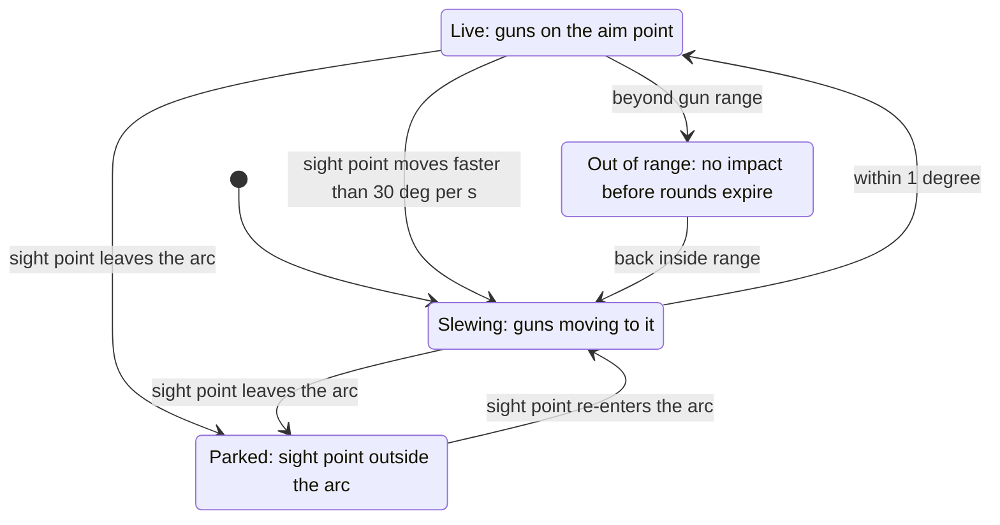
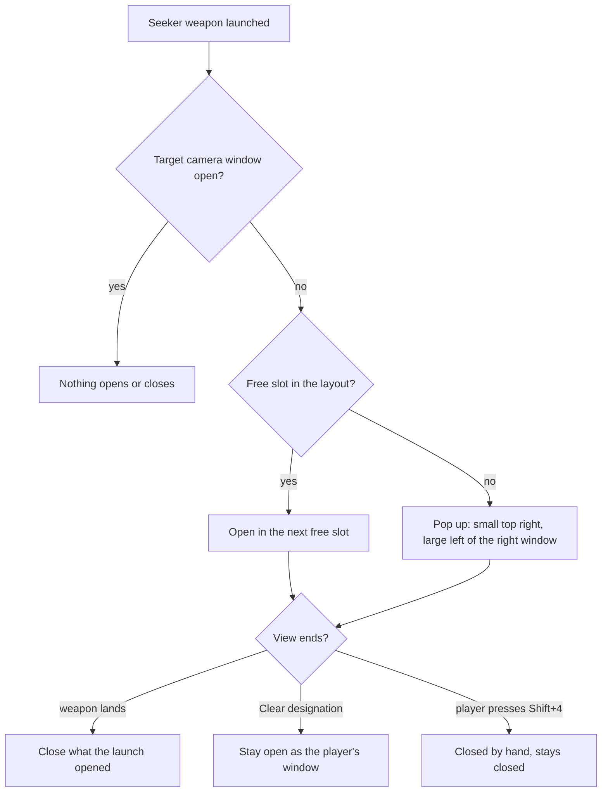
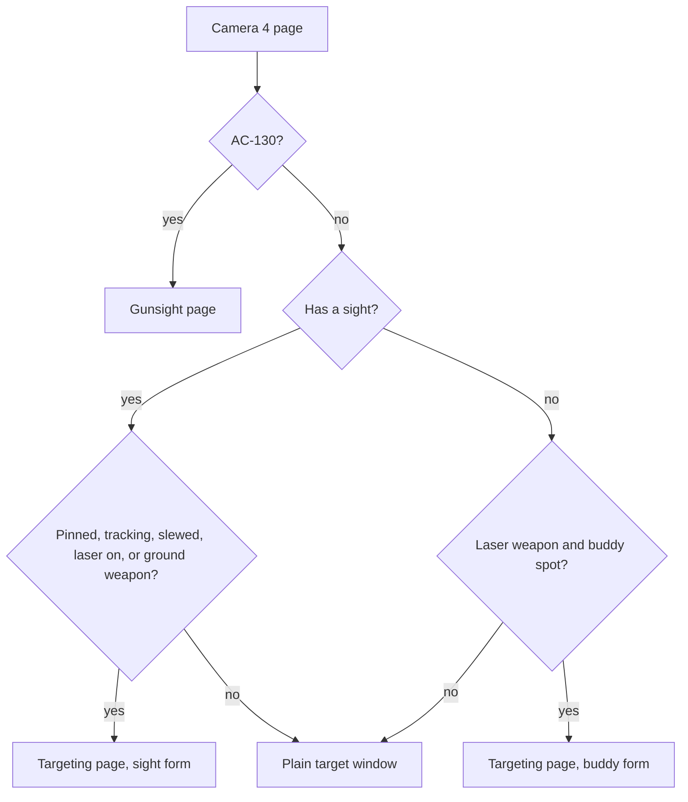
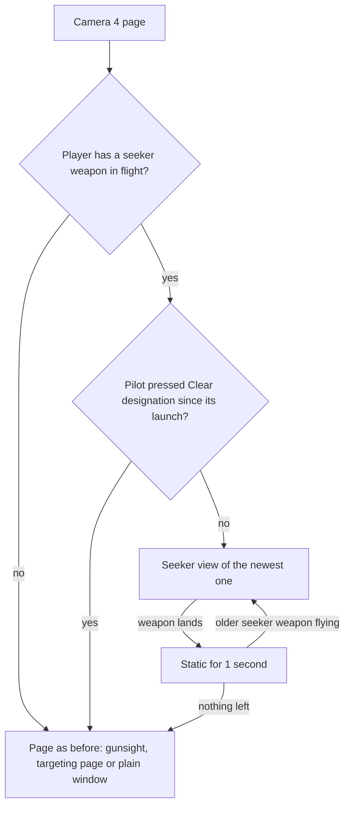

# Target camera window

> **T.O.R.E: Tasteful Opinionated Reverse Engineered.**
> The thing being reverse engineered is the *experience*, not the executable. We
> trace what a player does and what the game does back, down to the numbers they
> would notice. How the original code achieved it is history: useful evidence,
> never a blueprint. If a sentence below reads like an instruction to reproduce
> the original's internals, it is out of date.
> <!-- tore-header v2 -->

Implementation mode, 2026-09-21. View 4 presents the selected target using the
original instrument pieces and font, with a grayscale scene behind dark text.

## Evidence and behavior

The local 1999 EA/Jane's Fighters Anthology manual, printed page 101 (PDF page
105), specifies type/callsign, activity, clock bearing with Hi/Lo, damage,
tactical goal and pilot skill. PDF SHA-256:
`1a082378a8e8cd163ed6b398efcc1df80b67c2f104f6b90ac0733c88d58e26c3`.
The page was rendered and inspected from `.local/missile-update/manual.pdf`.
John's two supplied screenshots corroborate layout, the mission-objective label,
and NM/KTS fields. Their executable build identity is unknown. They do not
establish timing or hidden behavior. John requested a three-second alternation
on 2026-09-21, an opinionated timing choice.

- Type appears at the top; the camera shows the selected object's live geometry.
- John requested on 2026-09-21 that the target fill the view along the player's
  sight line, with the camera between player and target and no farther than
  one nautical mile from the target. The camera moves along the complete
  player-to-target line, including elevation, and faces the target. Automatic
  magnification fits the target regardless of range or aspect.
- John requested on 2026-09-21 a background about 10% darker. After grayscale
  conversion, scenery (sky, terrain and clouds) uses 90% of its former brightness.
  Aircraft and static objects retain their brightness, as do text and the frame.
- John requested on 2026-09-21 a 24-frame-per-second target-camera refresh.
  Requests follow a wall-clock 24 Hz phase, independent of the simulation clock
  and other camera panels. A slow host skips missed frames rather than queuing
  bursts. GPU readbacks remain asynchronous, so delivered rate depends on the host.
- A black damage bar means undamaged; fully white means destroyed.
- Bearing uses 12 at the nose, 3 right, 6 aft, 9 left, relative to player heading.
- John requested on 2026-09-21 that HI/LO use elevation relative to the level
  horizontal plane through the player, independent of aircraft pitch and bank.
  HI means strictly above +10 degrees; LO means strictly below -10 degrees.
  Exactly +/-10 degrees and all angles between them show neither. This requested
  threshold is opinionated; the manual does not give the original number.
- Bottom right alternates slant distance in NM and ground speed in KTS every
  360 simulation ticks at 120 Hz, starting with distance. Pausing freezes it.
- The objective row shows only `Obj: Survive` or `Obj: Destroy`, relative to the
  player's assignment. Survive identifies an escorted friendly or a friendly
  marked must-survive in mission requirements. Destroy identifies an enemy
  explicitly required by the player's destroy assignment. Other contacts have
  no objective label. Allegiance alone does not establish a requirement.
  The objects of the mission's ground target are objectives too: Destroy for a
  friendly plane, Survive for an enemy-side (Redfor) one, whether or not the
  object still stands ([surface objectives](surface-defenses.md#objectives-scoring-and-debrief)).
  In a multiplayer game "friendly" is the viewer's own side, and an aircraft a
  respawn or a revival added carries the objective of the aircraft it
  continues ([debrief, objectives in a game with
  respawns](debrief.md#objectives-in-a-game-with-respawns); agent decision of
  the lobby pass's follow-up F1).
- Activity, tactical goal and skill keep their existing independent meanings.
- Goal A means attack, E evade, N neutral, T takeoff, C crash, L land.
  Underline A/E only when directed at the player. Skill has 0..3 dots.
  T covers waiting on the runway, taxiing and the takeoff itself. L covers
  holding at marshal, the landing and the landed aircraft. Keeping L after the
  aircraft stops is an agent decision (2026-09-23): rollout and parking end the
  same landing sequence, and the manual lists no separate code for it.

## Fitted presentation and unresolved evidence

Agent choices: round clock bearing to the nearest hour and speed to whole
knots; range has one decimal.
Damage is one minus current/initial hit points, clamped to 0..1, filling upward.
The camera uses the player's position and interpolated target position to
establish the viewing line. It sits one nautical mile (6,076 feet using the
existing simulation convention) behind the target along that line. Agent choice:
when player-to-target range is at or below one nautical mile, it stays at the
player position rather than moving behind the player. Coincident positions
remain finite and use that same position. Displayed range, bearing and Hi/Lo
still measure from the player, never from this presentation camera.
Agent-chosen framing keeps image roll level and fits aircraft mesh vertices into
90% of image width and 52% of image height, reserving the top/bottom text rows.
The single objective row is at y=110 in the 162 by 160 window and uses the
original instrument font.
One dimension fills that area without cropping the other. Framing converts render-origin-relative mesh vertices back to world coordinates
before projection. Zoom follows projected
geometry each camera refresh, so range, target size, and aspect cannot leave a
small target surrounded by empty space. Ground objects use their oriented bounds.
This framing rule expresses John's requested behavior; the exact margins and
bounds fit are fitted implementation choices. Empty/degenerate geometry keeps
unit zoom; points inside the one-foot near plane cannot supply a usable fit.
To address surface flicker during magnification, the target camera's near clip
is half the nearest fitted subject depth, with a one-foot minimum. This fitted
choice retains every fitted subject vertex. The shared
[reversed-depth mapping](../ARCHITECTURE.md#flight-presentation-and-measurement)
also preserves distant surface separation with the default one-foot near plane.
Foreground scenery closer than that plane can be clipped in this camera only.
Ordinary views keep their existing one-foot near clip. True coplanar geometry
and source-model defects are not repaired by this precision change.
Text is shortened to its pixel budget so it cannot overlap the goal/damage strip.

Existing aircraft activity and skill are read only. Pursuing/attacking maps to
A; defending/evading/breaking maps to E; destroyed maps to C. Other current
activities map to N. SEARCHING, ACQUIRING and REJOINING are explicit neutral
goal mappings from the [AI awareness service](ai-awareness.md); searching and
rejoining never imply an active weapon target. An attack goal's player underline
uses the existing selected target identity. The evaded threat's identity is not exposed, so E is not
underlined. Ground objects and fixtures have unknown activity/skill/goal.
There is no invented firing prediction: activity describes current state, not
whether a launch will occur. Return-to-base is not labeled L before landing.

Unknown: original Hi/Lo threshold, exact camera pose, speed definition, bar
fill direction, complete activity wording, campaign objective loading, and
player-specific evade provenance. Next research should inspect mission objective
records and activity display contracts. No AI decisions or flight adapters change.

## AC-130 gunsight

Opinionated, requested by John on 2026-10-09 (the gunsight project; retail has
no AC-130 gunsight and no sensor camera, so none of this claims retail
parity). On the AC-130 the TARGET CAM page is the gunsight. Every other
aircraft keeps the page above unchanged. The sight itself (modes, slew, pin,
the guns' train, the pipper's ballistics) is specified in
[AC-130 linked guns](ac130-linked-guns.md#the-gunsight); this section covers what
the page and its camera show. In short: the picture always looks somewhere
(a target, a pinned point or a free line of sight the pilot slews); a circled
ring and dot, the pipper, shows where the linked guns' rounds will land and,
in the bold arc of its ring, how far away that is; a gun list and a small arcs
box show which guns are linked and where each is trained. The
box and diamond that mark the same point on every other view are specified in
[the aim box](ac130-linked-guns.md#the-aim-box-on-every-view).

### The camera

- **Eye point.** The camera looks from sensor dome D, the round turret on the
  left of the belly just forward of the wing root, not from the aircraft's
  centre. Its own gimbal is the hemisphere below the aircraft: its elevation
  stops at the horizon (the sim clamps the sight's look; the page reads the
  limit from the look too).
- **Direction and zoom.** The camera looks along the sight's body-relative
  look angles (heading, elevation), so it follows the aircraft's bank and
  turn, roll 0. Free and pinned sights use the client's zoom, six steps whose
  vertical fields are 30, 15, 7.5, 3.75, 1.875 and 0.94 degrees (fitted,
  agent choice; `Camera.zoom` 2.15 up to 69). A tracked object keeps the
  automatic framing of the section above (camera on the eye-to-target line, at
  most one nautical mile behind the object, fitted to the object), whatever
  the zoom step.
- **Between ticks.** The look the sim reports is carried smoothly between its
  120 Hz ticks (interpolated by the frame's tick fraction, the short way round
  the heading), so a slew and the return to the default view travel at the
  sim's rate and never snap. The return travels at the sight's return speed
  (22.5 degrees a second); the page names it RETURN.
- The 3D picture still refreshes at 24 Hz; the symbology below is drawn every
  frame from the presented look, over the last picture.

### The page (138 x 114 screen pixels)

All gunsight marks are ink `[20,20,20]` with a one pixel white halo.

| Element | Where | Notes |
| --- | --- | --- |
| Crosshair | Four 3 pixel ticks, 3 to 5 pixels out from (69,57) | Camera centre. Hidden while the pipper's dot is within 4 pixels of it, so the dot is not crowded |
| Pipper | The fighter HUD's LCOS pipper: a 1 pixel ring of radius 9, a 2 pixel bold range arc hugging its outside, and a centre dot (a 3 x 3 plus) | The candidate gun's predicted impact; the first linked gun when none is a candidate |
| Other linked guns | Small hollow diamond (radius 3) at each impact | Shows whether the group converges. No ring and no arc, so the candidate's pipper stays the one reading |
| Pinned mark | 7 x 7 square on the pin | Free slew draws none |
| Tracked mark | 11 x 11 square on the target | |
| Gun list | 25, 40, 105 at x=3, rows y=3, 14, 25 | See below |
| Name row | y=3, centred in x 22 to 122 | Target name; PINNED; SLEW; RETURN |
| Activity row | y=16 | Target activity; ZOOM n when free or pinned; notices NO GROUND POINT and L TO DROP for two seconds |
| Link rows | From y=28 | Unchanged rows, narrowed |
| Status row | y=72, centred, with a white halo | The pipper gun's readiness label |
| Objective row | y=82 | Moved up from y=90 |
| Arcs box | x 45 to 90, y 92 to 111 | Between the clock and the range |
| Clock, range | y=103 | Range is to the sight point; a tracked target keeps its NM and KTS alternation |
| Damage bar | x 133 to 137 | Tracked target only |

**Pipper states.** The sim evaluates each linked gun's pipper every tick from
where the sight point sits relative to that gun's arc and range:

**Range arc.** The bold arc follows the fighter HUD's LCOS range arc
([gun pipper](gunsight-targeting.md)): it starts at twelve o'clock and runs
clockwise, absent at the gun's maximum range, half the circle at half range and
the whole circle inside 100 feet (the same `range_arc_fraction` fit). The range
is the straight line from the muzzle to the pipper's impact point, and full scale
is each gun's own maximum from its record: 13,000 feet for the 25, 40 and 105
(the firing zone's range, not the longer projectile life). So the arc starts to
show inside 13,000 feet and is about three quarters of the circle at 3,000 feet.
Only the candidate's pipper (or the lead linked gun's) carries the ring and arc;
the other linked guns' impacts are the small diamonds, because three rings
would overlap and hide each other. Rounds that spend in the air before reaching
anything draw no arc.

The page draws the states: live and solid when the guns are on the aim point.
When the status is CANNOT BEAR the thin ring is dashed (30 degrees on, 30 off),
with its dot and its whole arc: the guns stop at the arc edge, so the pipper sits
where the clamped guns put their rounds. For MAX RANGE, or rounds that spend
before reaching anything, the ring is dashed with no arc and no dot. With no
impact at all (no solution, EMPTY) there is no ring, only the crosshair. A
pipper that falls off the page, or behind the camera, is parked on the page edge
in its direction with its ring clear of the edge.

**Gun list.** The labels follow the data (25, 40, 105). Linked: a box. Linked
and READY: the box has a heavy right edge. Linked and slewing: a dashed box.
Candidate (Ctrl+7): inverse (white on ink). CANNOT BEAR, MAX RANGE or MIN
RANGE: a diagonal strike. Empty, or not fitted: a grey label struck flat.

**Status row.** READY, SLEWING, CANNOT BEAR, MAX RANGE, MIN RANGE, TERRAIN
MASK, NO LINE OF FIRE, EMPTY (the labels of `Readiness`). Only NO LINE OF FIRE
and the empty and failed states block the trigger
(`Readiness::gun_may_fire`); the rest are advisory. When the camera reaches
the bottom hemisphere's top limit the row reads GIMBAL LIMIT after an eye icon
(John, 2026-10-09: hand-drawn, not an emoji). The page draws a hand-drawn
9 x 5 pixel eyeball bitmap (an almond outline with a round pupil), John's pick
over the text `<o>` in the page's font. The one-line `EYE_ICON` switch in
`instruments/gunsight.rs` keeps the text option, and
`--target-cam-preview gimbal-text` and `gimbal-bitmap` render each.

**Arcs box.** The box spans the widest arc (C_25): heading -150 (aft) at the
left edge to -30 (forward) at the right, elevation +60 at the top to -60 at the
bottom. Forward is on the right and aft on the left (John, 2026-10-09; the
box used to run the other way). Inside it: a dotted line at the camera's own horizon limit (solid, with
a filled sight mark, when the camera is against it); grey corner brackets for
the candidate gun's own arc; ticks at abeam; each linked gun's actual train as
a 2 x 2 dot, the candidate's as a ring; the camera's direction as a hollow 5 x 5
square. When the camera looks outside the candidate gun's arc the outline goes
dashed, and when it looks outside the box an arrowhead sits just outside the
nearest edge, pointing the way (forward is right, aft left).

### Seeker window

Opinionated, requested by John on 2026-10-12 ("launching a seeker weapon opens
the target cam: with all six windows in small mode active, pop it up at the top
right; with large windows active, pop it up to the left of the right window").
The rest, marked agent decision, fills in what he did not say.

The instrument windows come in two layouts (Escape, Pref, Large windows?):
**large** is four windows of 162 by 160 pixels in the corners; **small** is
six of 96 by 95 along the bottom ([placement](../FLIGHT-CONTROLS.md#instruments),
[bezel spec](instrument-bezel.md#window-placement)). John's "small mode" and
"large windows" are those two. The target camera is the window Shift+4 toggles.

A launch of a seeker weapon of the list above, when the target camera window is
not open, opens it:

| Layout | Windows open | Where it goes |
| --- | --- | --- |
| Small | all six | The top right corner, 8 pixels in from both edges, 96 by 95 (John) |
| Large | all four | At the top, to the left of the top-right window, an 8 pixel gap between them, 162 by 160 (John) |
| Either | fewer than the layout holds | The next free slot, as Shift+4 would put it (agent decision) |

The pop-up is a fifth (or seventh) window: none of the player's windows is
closed to make room, and it scales and anchors to the screen edges as the others
do. With the Weapon diagnostics panel shown (Escape, Pref) it sits 104 pixels
lower, as the large layout's top-right window does, so the two never overlap.
It is the same window as Shift+4: the same page, the same hit testing and the
same 24 Hz refresh.

What happens next is the agent's decision, so the player's own choices win:

- **When the view ends** (the newest seeker weapon lands and its second of
  [static](#seeker-view) is over, so the page has nothing left to follow), the
  window the launch opened closes and the other windows are as they were. A
  window that was already open stays open.
- **Clear designation** (the way back to the pod view) keeps the window open as
  the player's own, now showing the pod view; Shift+4 closes it.
- **Shift+4** while the view runs closes the window and it stays closed until
  the next launch. Other Shift+digit keys keep working: with the pop-up out,
  opening a window replaces the oldest regular window and the pop-up stays;
  closing a regular window lets the camera slide into the freed slot.
- **Changing layout** (Escape, Pref, Large windows?) during the view opens the
  window again in the new layout by the same table. A pop-up the player kept
  does not move to the other layout.
- **Several launches.** Each new launch opens the window if it is closed (a
  window the player closed after the first launch opens again for the second).
  The window closes when the last one lands.
- **Preferences.** The saved window choice leaves out the window a launch
  opened and any pop-up.
- **Replays and online.** Only the player's own windows are touched: the
  trigger is the player's own weapons in the picture, on a single-player host
  and on a client alike; nothing is on the wire, and other players' windows are
  unaffected. The replay viewer has no instrument windows, so it has none to
  open.

### Preview

`--panel-snapshot OUT.ppm --target-cam-preview MODE` draws the page from a
synthetic readout on a synthetic scene with the CPU raster, no GPU and no
retail scene (the imported instrument font is needed: `--aircraft ac130` and
`TORE_DATA_DIR`). Modes: free, pinned, tracked, outside, range, close (rounds
2,000 feet out: nearly the whole range arc), mask, nolos, empty, returning,
gimbal (gimbal-text and gimbal-bitmap force an eye icon), zoom1 to zoom6, and
bloomN (the tracked page N ticks after a 105 mm shot, N 0 to 40: the sensor
picture whited out by the [bloom](ac130-linked-guns.md#muzzle-flash), the
overlay untouched).

### Sensor console

Opinionated, requested by John on 2026-10-13: "a mode that lets the player go
into a black/white optical vision screen ... flight information, target info if
relevant, azimuth, range, etc. ... a gimbal animation to represent visible
gimbal limits on the thermals, and switch between white hot and black hot ...
nice static occasionally and a bit of chromatic aberration and pixelation to
make it look like a CRT display", after the AC-130 mission of Call of Duty 4,
"semi realistic". Later the same evening he made it the console the player
works the guns from while the aircraft flies its orbit by itself: entering the
console engages the orbit autopilot, leaving it hands the aircraft back.
**Ctrl+9** (gamepad Select + Guide) opens and closes it: the screen shows
exactly while the console's autopilot flies, searching or orbiting ([the sensor console and the
orbit](ac130-linked-guns.md#the-sensor-console-and-the-orbit) covers the key and
the autopilot; this section covers the picture). Online, a client's screen
follows its own prediction of the plane, which carries the host's orbit mode,
so it opens and closes with the host's orbit.
The TARGET CAM page above is unchanged. Everything else here (layout, wording,
heat levels, the CRT numbers) is an agent decision (nr-fltv, 2026-10-13),
fitted on offscreen renders. Retail has nothing like it. The picture is
presentation only, so it works the same in single player and on an online
client flying its own AC-130; its radar and target keys act through the
seat's existing commands (below), so they work online and in replays.

After trying it John asked (2026-10-14, opinionated) for: no periodic
static; a box on the target selected in flight, hidden while the reticle is
over it; an air-to-ground radar on the gimbal graphic with a 5, 10 and 25 nm
range selector, whose targets T cycles, linked to the flight target view,
each selection snapping the sensor to the target and zooming in to fill;
then white hot, black hot, "regular visual" and night vision ("that is not
thermal") on one key. Slice nr-conb built those; the numbers and the
layout are agent decisions unless marked.

**The picture.** The whole screen is the sensor's view from dome D along the
sight's look at the sight's zoom step (the same eye, look and zoom ladder as
the page's camera). A tracked object is followed by the sight's own look
rather than the page's framing camera, so the picture never jumps closer than
the sensor really is (agent decision). The cockpit, HUD and instrument windows
are hidden; messages, the map and the menus still draw over it. The gunsight
works unchanged: Alt+arrows slew, Backslash designates, Shift+Backslash pins,
L drops, Shift+' and Shift+; zoom, Ctrl+7 and Ctrl+8 pick and link guns, and
the trigger fires. Since the stick does not fly in the console, the arrows,
the stick and mouse look also slew, the view zoom keys (= and -) and the
mouse wheel zoom, P pins and releases, and Shift with the arrows and the
throttle keys command the autopilot (opinionated, John 2026-10-14; the keys
are [the console's keys](ac130-linked-guns.md#the-consoles-keys)).

**Picture modes.** **Ctrl+Backslash** steps the picture through white hot,
black hot, TV and night vision, then back to white hot (the key does nothing
outside the console), and **Shift+F5**, **Shift+F6**, **Shift+F7** and
**Shift+F8** go straight to white hot, black hot, TV and night vision (John
asked on 2026-10-16 for shortcuts to each picture in every sensor view; the
keys are an agent decision: Shift with the function keys is free in flight,
next to the view keys; the gamepad keeps its D-pad left step). The label at the top right says WHOT, BHOT, TV or NVG,
and the sensor word at the top left says IR for the two thermal modes, TV
and NVG (the same word as the label, so the two never disagree). The symbology is the same in all four. The real AC-130U
carries a FLIR and an all-light-level television (from memory of public
descriptions, not checked against a source this round); the labels stay
plain.

| Mode | Picture |
| --- | --- |
| WHOT, BHOT | The thermal world below |
| TV | The world as the game draws it, in its own colours, through the same CRT (John asked for "regular visual"; colour rather than a grey TV picture is the agent's reading). No lens flare or spotting aid, which are the eye's, not a camera's. Dark at night, as a plain camera is |
| NVG | An image intensifier: the visible scene in grey, amplified, on a green phosphor (0.42, 1.0, 0.5). Heat does not show: a cold vehicle in the dark is as dark as the ground round it; a fire, a flare, a muzzle flash, an explosion or a vehicle's headlight beam (the art's night-lit beam polygon) is bright because of its light, and what the gain lifts past full scale blooms over its surroundings (eight taps 9 and 18 px out, strength 1.6), so a blast washes out the narrow fields. The gain follows how dark it is (the sun from 2 degrees above to 6 below the horizon, the rule the night glows use): 6 by day, which washes the picture out as an intensifier would, up to 200 at night, shown through a logarithmic response (log(1 + v) / log(1 + gain)) so the dark ground comes up while a light many times brighter keeps its own falloff instead of clipping into a flat plate. Grain grows with the gain, up to 5 percent on top of the CRT's own 4.5. The symbology keeps its own pale grey |

**Thermal.** The world draws as a thermal camera sees it, in grey: in white hot
the hotter the whiter, in black hot the reverse. Levels (agent decision,
display grey 0 to 1, white hot):

| What | Level | Notes |
| --- | --- | --- |
| Clear sky | 0.06, rising to 0.32 at the horizon | Coldest |
| Open ground | About 0.33 at night, 0.28 by day, plus the art's contrast | The art's brightness against the weather's daylight palette (so a night weather's darker art keeps its contrast), 0.8 times the difference at night and 1.3 by day; soft patches a few hundred feet across (2 percent at night, 3.5 by day); the sunny side a little warmer by day; kept between 0.08 and 0.62 |
| Water | 0.30 at night, 0.17 by day | Warmer than land at night, cooler by day |
| Buildings, the airfield | About 0.33 | Like the ground, with less contrast |
| Aircraft, vehicles, men, weapons, debris | About 0.68 | Everything drawn as a moving object runs warm |
| Engines, afterburner flames | 0.86 to 1.0 | |
| Fires, explosions | 0.8 to 1.0 | Their art's brightness, as heat |
| Muzzle flashes, tracers, flares, fire glow | Their own brightness | Flares half as bright again |
| A crater | Up to 0.18 over the ground when new | Cooling over three minutes, so one pass's hits still show on the next |
| Smoke, dust | 35 percent of their usual cover | A thermal camera sees through most of it; fire-lit smoke is a little warmer |
| Clouds | 0.27 | Opaque |

Distance flattens everything toward the air's own level (0.30 at night, 0.36
by day; about a third of the way at 10 nm), whatever the weather. The sun and
moon are not drawn and there is no lens flare or spotting aid. The display
then stretches the levels as a camera's automatic gain would (times 1.5, less
0.2), and black hot shows the inverse at 85 percent of full scale, so a cool
scene is light grey rather than a white page.

**Symbology.** Pale grey block letters (the console's own 5 by 7 font) with a
two pixel dark outline, so they read in
white hot and black hot. The labels follow real sensor conventions where they
are known (WHOT and BHOT, wide, medium and narrow fields of view, AGL); the
rest is the game's own data.

| Where | Shows |
| --- | --- |
| Top left | The sight's mode (MAN free slew, RTN returning, PNT pinned, TRK tracked), the field of view by name (WFOV, MFOV and NFOV for zoom steps 1 to 3, then NFOV E2, E4 and E8: the narrow field's electronic zoom) and the sensor, IR, TV or NVG; the field in degrees (with the field's name, the zoom legend); searching (nothing pinned): SEARCH P PINS, then the commanded heading, altitude and speed (HDG 275 ALT 9500 191KT; slice nr-cona, `flight::State::console_status`); holding a point, the orbit: ORBIT JOIN while the aircraft is still joining the circle, ORBIT GUNS on it with every gun and the camera bearing on the point, ORBIT NO BEAR on it when one cannot; then the planned radius and height above the point (`flight::State::orbit_status`) |
| Top right | True heading, height above the ground, true airspeed, the picture mode (WHOT, BHOT, TV, NVG) |
| Left, middle | The sensor's azimuth (from the nose, clockwise), its elevation, and the true bearing of its line of sight (LOS) |
| Right, middle | With a tracked target: its name, range, true bearing and clock bearing with HI or LO |
| Bottom left | The guns: a mark for each linked gun, the name and the rounds left; the candidate in a filled box; a gun the aircraft does not carry struck through |
| Bottom centre | The lead gun's state (RDY, SLEW, NO ARC, MAX RNG, MIN RNG, MASKED, BLOCKED, EMPTY) or GIMBAL LIMIT, flashing; under it the slant range from the sensor to the aim point in feet and nautical miles |
| Centre | An open crosshair: four arms with a clear centre, ticks along them and a bar across each end |
| Over the picture | The pipper (ring, range arc and centre dot, dashed when the gun cannot bear or is out of range, parked at the screen edge when off it), the other linked guns' impacts as diamonds, a square on a tracked target and corner marks on a pinned point, and the target box (below) |
| Bottom right | The gimbal and the radar (below), with the radar's state and range under it (A-G 10NM, or A-G OFF) |

The top left block's orbit lines are where nr-cona's console flight status
(SEARCH, ORBIT JOIN, ORBIT and the commanded heading, altitude and speed)
goes; a marked hook in `sensor_console.rs` holds the place until that slice
merges.

**Target box.** The designated target (whatever designated it: the
gunsight's track, T or Enter in flight, a scope click, the console's T) has
a square box 8 percent of the picture's height across on it, besides the
reticle. It hides while the reticle is over the target, which is while the
target lies within 4 percent of the picture's height of the centre on both
axes (the reticle's centre inside the box); a tracked target, which the
sight centres, therefore shows only the track square. Off the picture a
small arrow at the edge points to it.

**Gimbal and radar.** A plan view about the aircraft, the nose up, the rim at
the radar's range (agent decision: one scale for the radar's contacts and
the sensor, so a contact under the sensor's mark is what the sensor sees).
The centre is straight down; a line from the camera at or above the horizon
meets the ground beyond any range, so the camera's limit (the aircraft's
horizontal plane) is on the rim too. A dashed ring is 45 degrees down (the
height away over the ground), a small cross the aircraft. The lead gun's
sector, small open diamonds for the linked guns' trains, and an arm from the
centre to corner marks round the sensor's aim move as they slew, each placed
where its line meets the ground. The radar's contacts are drawn over them as
the A-G page draws them: a dot for a unit, a structure or a ship, an X for
a SAM or AAA unit, a filled square for an aircraft, the designated one
between two bars. Over the last 10 degrees before the camera's limit the rim
beside the sensor thickens; at the limit it flashes and LIMIT shows under
the graphic, with GIMBAL LIMIT on the status line.

**The console's radar.** It is the aircraft's own A-G radar page
([air-to-ground radar](air-to-ground.md#the-air-to-ground-radar)): the same
host-built list, by the same detection rules and limits, so a client sees
what the host's page lists. Opening the console turns the A-G radar on once,
as Ctrl+R would, when it is off and the radar works ("Air-Ground Radar on");
pressing Ctrl+R in the console turns it off again (A-G OFF, no contacts).
On the AC-130 the page's scan is centred on the sensor's line of sight
rather than the nose (agent decision, 2026-10-14: the gunship's radar works
toward the orbit's centre; scanning about the nose would never see what the
guns are on), in flight as in the console. **Ctrl+0** steps the range 5, 10
and 25 nm (the A-G radar's first three range settings, 25 its maximum here,
John 2026-10-14). It is the flight radar's own range setting, so the scope
and the console agree; a flight range above 25 nm shows as 25 in the console
until Ctrl+0 is pressed. Contacts beyond the range are not drawn.

**T in the console.** T steps to the next contact, Shift+T to the previous
one, among the radar's contacts the sensor can see: on the A-G list, within
the console's range over the ground, not friendly, at or below the
aircraft's horizontal plane from the sensor dome (inside the gimbal), and
with a clear terrain line from the dome (the sight's own line rule). They
are taken nearest the dome first; T after the last wraps to the first, and
with no current one T takes the nearest. The selection is a designation by
the seat's existing command (as a scope click), so the gunsight tracks it,
the camera snaps onto it and the TARGET CAM page, the HUD and the weapons
show the same target, and a target designated in flight is the console's
current one: the two are linked both ways. The sight then zooms to the
target: one step wider (John, 2026-10-14, for context) than the narrowest
zoom step whose field still holds the target's largest side within 60
percent of the picture's height at its slant range from the dome (the
object's own box; 60 ft for an aircraft), the widest step when none does.
A tank at 2 nm takes NFOV E4. In SEARCH (the console's straight and level search with nothing
pinned, slice nr-cona) the selection is a track, so the autopilot leaves
the search and joins the orbit about the target; the scan centres on the
sensor's line, which in SEARCH is the default look abeam left, so T finds
what lies there. With
A-G off, T turns it on; with nothing in view it says "Sensor: no radar
target in view". Outside the console T keeps its flight meaning.

**CRT.** The picture and the symbology are shown on a small monochrome monitor
(`crt.rs`, a module the seeker view may share: a GPU pass, and the same
look for a small page drawn on the CPU): the picture in 2 pixel blocks with a
slight soft focus, red and blue pulled 1.1 pixels apart toward the edges
(only 40 percent of the fringes' colour is kept, so they are a hint; every
colour reads the same 2 pixel block, so block edges never split into colour),
scanlines of 12 percent every 3 rows with a faint band rolling down, a
vignette and fine noise of 4.5 percent. There is no periodic static (John,
2026-10-14: "an occasional console flicker, let's remove that"); the module's
bursts (snow, sideways tearing, bright and dark lines) remain for a caller
that asks for one, as the seeker view's second of static on impact does. In
the TV picture the fringes fade toward the picture's own colours rather than
grey. The symbology goes through the same monitor, without the blocks and
without the night vision's tint. Sizes are for 1080 rows and scale with the
screen.

**Previews.** `--a2g-run UKR QUCOL --pilot ai --aircraft ac130 --load C_25.JT
--console-scene DIR --console-at S,...` (with `--condition night` for the dark)
draws the console offscreen from an AI gunship's own sensor at those seconds:
white hot, black hot, TV and night vision on its target, the free wide
field, the narrow field, and near and at the gimbal limit. The AI flies without the
player's gunsight, so these frames build the symbology from the same geometry
(arcs and reach); they are a picture check, not a gunsight check. The player's
own path is `--a2g-run UKR QUCOL --aircraft ac130 --load C_25.JT --attack
orbit ... --console-scene DIR --console-at S,...`: the seat opens the console
with its command and the frames (`seat-tS-whot`, `-bhot`, `-tv`, `-nvg`, the
radar at `-radar-5nm`, `-radar-10nm` and `-radar-25nm`, and `-box-visible` and `-box-edge`
with the sensor turned off the target) are the game's own gunsight page,
target, orbit status and A-G list. There `--console-range N` sets the seat's
radar range setting, `--console-cycle S,...` presses the console's T at
those seconds through the game's own rule and checks the designation, the
track and the zoom (battery `flight-ac130-orbit-console-radar`), and
`--console-fire FROM,TO` links the 105 mm and holds the trigger. With `--orbit-sight free` and `--console-cycle` the run opens the console searching and checks that T leaves the search for the orbit (battery `flight-ac130-orbit-console-search-t`).

### Sensor View in a replay

Opinionated, requested by John on 2026-10-16: "the Sensor View, which is
available if the aircraft has a targeting pod installed ... the same console
view from the AC-130 from the aspect of the aircraft ... if from the AC-130
make it identical; when not from the AC-130 show aircraft-specific info and if
they are lasing, TTI on release of ordnance, buddy lasing etc." The replay
viewer's Shift+V ([the viewer's Sensor View](../REPLAYS.md#sensor-view)) shows
this console from the selected aircraft's targeting sight: the same world
picture, picture modes, CRT and drawing as above. Layout, wording and the
rules below are agent decisions (nr-replayviews, 2026-10-16).

- **Who.** The aircraft with a sight ([who has a sight](air-to-ground.md#who-has-a-sight)):
  the AC-130, an aircraft with its own laser or FLIR record, and one the
  recording shows lasing (a loaded Pave Spike).
- **AC-130.** This console, unchanged. With an `aircraft.sight` sample
  (nr-replayhud, John 2026-10-16) the angles, zoom, rounds, selected gun,
  readiness, designated target and A-G radar state are the ones recorded,
  and, in format 4, the pippers use the live displayed impacts. The lead
  gun's sector and linked guns' marks use the recorded trains. The target
  block includes name, slant range, true bearing and clock bearing. A-G radar
  contacts retain their symbols and selection. Older sight records use the
  train-based pipper fallback. Without a sight sample the rounds, readiness
  and pipper show empty, the radar reads `A-G OFF`, and the status line says
  where the line of sight came from (`LOS FROM ORBIT POINT`).
- **Recording cadence.** Opinionated, requested by John on 2026-10-21:
  human cockpit HUD and sensor displays are sampled every 5 simulation ticks,
  exactly 24 Hz at 120 Hz, including idle, slow slews and gunfire. Free fighter
  sights are recorded too. Overlay values hold until the next sample. Camera
  azimuth interpolates by the shortest turn and elevation linearly, without
  blending across mode, tracked-object or zoom changes, gaps, or resets over
  0.5 radians (agent decisions). The HUD tape retains its 24 fps presentation.
  Ground designations and displayed positions reach every aircraft's HUD.
  Older recordings retain their sparse fallback. Network captures sample
  received readouts at most once per five-tick interval; packet loss or a
  lower host delivery rate cannot supply missing observations. Encoding is
  specified in [replay display records](../formats/replay-display.md).
- **Other aircraft.** The same reticle, angles, heading block, gimbal
  graphic (the sensor's arm on the plan, without guns or radar) and status
  and range lines, with the aircraft's own lines:

| Place | Shows |
| --- | --- |
| Top left | What the sight follows. With an `aircraft.sight` sample: `TRK` when it tracks, `PNT` when it holds a point, `FWD` when it is free or returning, and the recorded zoom. Without one: `LSR` the laser spot, `TRK` a designated or targeted object, `PNT` a pinned point, the orbit or the rounds' bursts, `WPN` a guided weapon's aim, `IMP` a landing, `FWD` nothing recorded, at the default `FOV 7.5*`. The sensor (IR, TV, NVG) is the viewer's picture choice. The aircraft's label and type (the sensor itself is not named: John, 2026-10-16, which device it is does not matter) |
| Top centre | With a recorded sight, the gun or mode word. Without one, where the line of sight came from: `LOS FROM LASER SPOT`, `LOS FROM DESIGNATION`, `LOS FROM WEAPON AIM`, `LOS FROM RECORDED TARGET`, `LOS FROM ORBIT POINT`, `LOS FROM ROUND IMPACTS`, `LOS FROM BOMB IMPACT` or `NO LOS RECORDED` |
| Bottom left | The laser: `LASE` in a box, blinking twice a second while lasing, else `LSR RDY`, `MASK` or `OFF`; `LSR 14513FT 2.4NM` (no code); `BUDDY FRIENDLY 1-2 2.8NM` when its weapon rides another aircraft's spot; `WPN GBU-12 ...` (the weapon it last released); `TTI 0:17`, with `X2` when several fly and `IMPACT` for a second (exact: the recording knows when each lands) |
| Bottom centre | The status (`GIMBAL LIMIT` flashing, `LASE`, `MASK GIMBAL`, else the mode word), the slant range, and a landing's words for twenty seconds (`IMPACT 35 FT FROM AIM, 35 FT FROM TARGET`) |
| On the picture | The laser spot (a cross in a diamond; another aircraft's in a dashed ring), the designated target's box (hidden under the reticle as above), the weapon's aim (a small diamond) and a landing (an X) |

- **Picture.** White hot at first; 1 to 4, Shift+F5 to Shift+F8 and
  Backslash change it in the viewer.
- **Camera.** At the sensor's eye (the AC-130's dome; a pod 4 ft under the
  aircraft; a built-in sensor at its centre), along the recorded look when
  the sight holds one and along the derived line otherwise, held inside the
  sight's gimbal, at the recorded zoom step or the default (7.5 degrees);
  the viewer's + and - zoom it.

## Targeting page

Opinionated, requested by John on 2026-10-10 (the target display shows when it
is lasing, and shows when the spot is someone else's; decision 8 puts a
targeting pod page on every aircraft with a FLIR or a laser, using the AC-130
sight keys). The layout, the show rule and the buddy form are agent choices.
Retail shows the weapon's own view in the IR/Laser window after launch; this
page does that for the weapons that have a seeker picture
([seeker view](#seeker-view), John 2026-10-12, which reverses the earlier
choice to keep the pod view). The sight, the laser and the buddy rule are specified in
[air-to-ground](air-to-ground.md#the-targeting-sight); this section covers
what the page and its camera show. The AC-130 keeps its
[gunsight page](#ac-130-gunsight), whose look this page does not change.

### When it shows

The target display (camera slot 4, Shift+4) is the targeting page instead of the
plain window when any of these holds, and the plain window otherwise:

- **Sight aircraft** (F-16C, A-10, Su-25, V-22 with a laser; Rafale, X-31,
  F-22, AV-8B, AH-64, MiG-29, Su-27, Su-35 with a FLIR; any aircraft carrying
  a Pave Spike pod): the sight is pinned or tracking an object,
  or slewed off its default look, or the laser is on (lasing or masked), or a
  ground weapon is selected (a bomb, a rocket pod, a laser weapon or a ground
  missile).
- **An aircraft with no sight**, in the buddy form: a laser weapon is selected
  and a buddy's laser spot is shown for it (the readout carries the laser then).
  With no buddy spot it is the plain window.

### The camera

Seeker view aside (below), the camera is the sight's:

- **Eye and direction.** The camera looks along the sight's body-relative
  look angles (heading, elevation) from the sensor's eye: four feet under the
  aircraft's centre for a pod, the aircraft's centre for a built-in sensor
  (fitted). It follows the aircraft's bank and turn, roll 0. The default
  look is straight ahead and 10 degrees down (fitted).
- **Zoom.** The AC-130's six steps (vertical fields of 30, 15, 7.5, 3.75,
  1.875 and 0.94 degrees), on the same zoom keys. A tracked object keeps the
  automatic framing of the target window (on the eye-to-target line, at most
  one nautical mile behind the object), whatever the step.
- **Between ticks.** The look is carried smoothly between the 120 Hz ticks, as
  the gunsight's is; the picture refreshes at 24 Hz.
- **Buddy form.** The camera looks from the aircraft at the buddy's spot, on
  the target window's camera line (at most a nautical mile behind the spot). It
  picks the zoom step that frames a spot area about 500 feet tall (fitted).
  There are no slew, pin or zoom keys here: the aircraft has no sight to move.
- **Gimbal.** A pod looks anywhere in the hemisphere below the aircraft, a
  built-in sensor in its cone ([gimbal](air-to-ground.md#the-targeting-sight)).
  Against the edge the status row reads GIMBAL LIMIT after the AC-130's eye icon.
- Camera slot 4 keeps its semantics for the city-fill rule: the picture is the
  slot 4 camera and draws the full-detail scene as the plain window does.

### The page (138 x 114 screen pixels)

Marks are ink `[20,20,20]` with a one pixel white halo (the status rows, the
laser rows and the crosshair), or plain ink (name and activity rows), as on the
gunsight page. Fonts and positions:

| Element | Where | Content |
| --- | --- | --- |
| Name row | y=3, centred | The target's name (tracking), PIN (pinned), SLEW, RETURN; the lasing pilot's callsign when the laser row is BUDDY (and in the buddy form, `LASER SPOT` before it is known) |
| Activity row | y=16 | The target's activity (tracking); ZOOM n (free or pinned); NO GROUND POINT or L TO DROP for two seconds; empty in the buddy form |
| Laser row | y=28, centred, halo | **LASE** (own spot, blinking twice a second), **BUDDY** (someone else's spot, blinking), **LSR RDY** (the sight holds a point, laser off), **MASK** (wanted, blocked); nothing without a laser |
| Second row | y=39, centred, halo | **BUDDY**, blinking, under LASE or LSR RDY or MASK when a buddy's spot is also shown |
| Crosshair | The camera centre | Four 3 pixel ticks, 3 to 5 pixels out |
| Track square | 11 x 11 on the object | Tracking |
| Pin square | 7 x 7 on the point | Pinned, and the buddy spot |
| Status row | y=72, centred, halo | GIMBAL LIMIT after the eye icon; OUT OF RANGE or TERRAIN MASK when the laser is masked for those reasons |
| Objective row | y=82 | As the target window (tracking) |
| Time to impact | y=92, centred, halo | **TTI m:ss** for the aircraft's oldest laser or GPS weapon in flight, **IMPACT** for a second at the hit. Filled by slice W1 from the readout's guided weapons in flight (the oldest one whose time can be worked out, its seconds rounded up) and the tick the last one ended |
| Clock bearing, range | y=103 | Clock bearing and Hi/Lo from the aircraft to the sight's point; the range reads laser range while the row is LASE, LSR RDY or MASK (the sensor to the point), the range to the buddy's spot for BUDDY, the target window's alternating range and speed when tracking with the laser off, else the range to the sight's point |
| Goal, skill dots, damage bar | Top right | As the target window (tracking only) |

The range reads in nautical miles with one decimal, or whole feet under one
nautical mile (`4.3 NM`, `5200 FT`). The two blinking rows are lit for a
quarter second and dark for a quarter second (the combat tick mod 60 below 30
at 120 Hz); the others do not blink.

**Laser row states.** LASE means the spot is on the point and the laser works
(the laser state machine in [air-to-ground](air-to-ground.md#the-laser)). MASK
names its reason on the status row: out of range (including the halving in
cloud and fog), outside the gimbal, or terrain across the line. BUDDY shows when
the spot the aircraft's laser weapons would home on is a buddy's, either
because the aircraft has no designator, or has one that is off.

### Seeker view

Opinionated, requested by John on 2026-10-12 ("every weapon with a seeker view
switches the target cam to the last missile or bomb fired or dropped, until
impact"). It reverses the earlier line that kept the pod view after a launch.
The list of weapons, the camera, the page and the way back are the agent's
choices, labelled below.

- **Which weapons.** The air-to-ground weapons with a seeker picture: the
  infrared AGMs (AGM-65G, AGM-65A and the AGM-84E SLAM, class 8), the laser
  bombs (GBU-10, GBU-10A, Pave Way, Pave Way III and GBU-28, class 4; John
  2026-10-13: "nosecone (GBU's, Mavericks, AT-12's etc) views"), the laser
  missiles (AS-14, AS-30 and AT-12, class 12) and the AT-2 (retail's
  "optical" label; John 2026-10-12 added it, so its view is the missile's nose
  view like the others, and it stays steered from the launcher's sight). The
  data has no "has a picture" flag, so the list is `missiles::SEEKER_VIEW`
  (agent decision). Weapons without a picture keep today's behaviour: the
  anti-radiation missiles (HARM, Shrike), the active and supported radar
  missiles, the JDAMs (they fly to a point and carry no camera; John
  2026-10-12: "JDAM no", not changed on 2026-10-13), rockets and free-fall
  bombs. There is no TV or IR guided bomb (GBU-15, Walleye) in the data; the
  list grows by one line if one is added. A laser bomb or laser missile marks
  the laser spot it homes on with the target square (the spot of the plane's
  designator or a buddy's, whichever the plane's laser weapons use), looking
  at it while it is inside the 45 degree cone.
- **When.** From the tick the player's weapon appears until it lands (it
  leaves the picture), whatever the page showed before (the targeting page, the
  plain window or nothing but a grey screen), on any aircraft except the
  AC-130, whose gunsight keeps the page. A newer seeker weapon takes the page
  from an older one; when the newest lands the older one, if still flying, is
  next. A bomb or HARM released after a Maverick does not take the page. A
  launch also opens the window if it is not open
  ([seeker window](#seeker-window)).
- **Camera.** From four feet ahead of the weapon (its own body hidden),
  looking at its target while the target is inside the 45 degree cone of the
  AGM records' zone 1, otherwise along its nose; level, 15 degrees tall (step 2
  of the sight's zoom ladder, fitted). Nothing is smoothed: the picture is the
  weapon's position at the 24 Hz refresh.
- **Page.** The weapon's record name at the top left (`AGM65G`), SEEKER at the
  top right, the crosshair, a 11 pixel square on the target when it is in the
  picture, and `RNG` with the distance on the bottom row (weapon to target,
  else to the aircraft; nautical miles with one decimal, whole feet under a
  nautical mile). No laser rows, no pod marks. The text sits in the corners so
  the crosshair's bars run clear of it (agent decision; it was centred at the
  top before the crosshair changed).
- **Crosshair.** Opinionated, John 2026-10-13 (his drawing): four straight
  bars, up, down, left and right, with the centre open and nothing drawn in
  it. On the 138 by 114 pixel picture each bar starts 10 pixels from the centre
  and runs to 7 pixels short of the picture's edge (so about 52 pixels across,
  40 up and down), 3 pixels of ink with the usual 1 pixel white halo (agent
  decision; the drawing has them thick). The gap is wider than the 11 pixel
  target square, so a target on the centre sits in the gap. The pod pages
  keep their short ticks. Every nose-cone view has it, because they are one
  page.
- **Target square jitter.** Opinionated, John 2026-10-14 ("the target square
  should jitter a little bit as it is closing in"); the numbers are agent
  decisions. The 11 pixel target square is steady far out and shakes more as
  the weapon closes, like a tracker struggling to hold. The measure is the
  seconds to go: the weapon's distance to its target (or the laser spot)
  divided by its speed. From 8 seconds out the share of jitter grows with the
  square of the closeness (0 at 8 s, about a quarter at 4 s, 0.77 at 1 s, 1 at
  impact). The square moves up to 3 pixels at impact across and down (a pixel
  at most from 5 s, so little at long range), and from a quarter of the
  growth on it also flickers a pixel bigger or smaller each way (its side 8 or
  12 instead of 10), more often as it grows, so it never leaves the target. A
  new random-looking value is taken every 10 combat ticks (12 Hz). The values
  are a hash of the weapon's id and the picture's tick, with nothing stored:
  stills of one tick match and a replay looks the same. Presentation only, no
  wire, recording or simulation change. A page with no square (no target in
  the picture) has nothing to shake, and the crosshair never moves. Code:
  `square_jitter` in `instruments/targeting.rs`, fed by `Shot::closing` from
  `seeker_view.rs`; the constants are `JITTER_START_S`, `JITTER_MAX_PX` and
  `JITTER_STEP_TICKS`.
- **Static.** Opinionated, John 2026-10-13: "1 second of static once it hits
  before switching back to the regular target view". When the weapon the page
  follows ends (it leaves the picture: it hit, detonated or ran out; the
  picture cannot tell them apart), the picture is video static for 120 combat
  ticks (1 second): grey snow over the whole window that changes at the
  24 Hz refresh, with a few bright tearing lines, and no text or marks (the
  feed is lost). Then the page is what it showed before, or the view of an
  older seeker weapon still flying (agent decision: the snow comes first, the
  older weapon after it). A weapon launched during the static takes the page
  at once (agent decision: a new launch is the pilot's own act). A weapon the
  page was not following (an older one landing behind the newest) leaves no
  static, nor does one the pilot sent back to the pod with Clear designation,
  and Clear during the static ends it. The window a launch opened closes after
  the static, not before it. Online, a flying weapon cannot leave the picture
  for want of an update: the wire is delta coded, so lost snapshots and the
  host's budget and priority only delay a weapon's record, the client draws it
  on (extrapolated) and only the host's removal message ends it (test
  `an_own_missile_stays_drawn_through_lost_snapshots_until_its_removal`). As a
  safeguard an online client still waits 24 combat ticks (0.2 s) for a missing
  weapon, holding its last picture, before the static starts; the static is
  timed from the tick the weapon left, so the page is back a second after it
  left either way, and single player has no wait at all. A weapon that comes
  back ends the static (agent decisions). A paused game freezes the snow (it counts combat
  ticks). The static is drawn by the page (`feed_static` in
  `instruments/targeting.rs`) with the [sensor console](#sensor-console)'s CRT
  module at full static over a dark picture (`crt::apply_cpu`); it is
  presentation only, with nothing in the
  simulation, the wire or the recordings, and it appears wherever the page
  does: single player and an online client's own weapons.
- **Back to the pod.** The Clear designation key (Semicolon or L, the existing
  binding; no new key) sends the page back to the targeting pod view for as
  long as that weapon flies, as the pilot would for other targeting; it still
  clears the designation as before. The window stays open then, as the
  player's own. The next seeker launch takes the page again.
- **Where it runs.** The page reads the picture (the projectiles, with their
  owner, record name and target), so a single-player host, an online client
  (for the client's own weapons) and a recording all build it the same way;
  nothing is on the wire. The replay viewer has no instrument pages, so it has
  no target camera: its missile views (Ctrl+F12, Alt+F12 and the F12 views)
  already follow a weapon.

### Preview

`--panel-snapshot OUT.ppm --target-cam-preview MODE` draws the page from a
synthetic readout on the same synthetic grey scene the gunsight preview uses
(no GPU, no retail scene; `TORE_DATA_DIR` for the instrument font, and
`--aircraft f16c` or any imported aircraft: the page is the same). Modes:
`lase` (a tank, LASE and range), `lase-off` (the dark half of the blink),
`lase-mask` / `lase-mask-range`, `lase-mask-terrain`, `lase-pin`, `ready`,
`slew`, `limit`, `tti`, `impact`, `buddy` (a sight aircraft whose weapon homes
on a buddy's spot), `both` (own LASE with a second BUDDY row), `buddy-nosight`
(the buddy form), `flir` and `flir-tracked` (no laser rows), `seeker` (the seeker view of a Maverick), `seeker-gbu` (a GBU-10 on its spot), `seeker-centre` (the target on the centre, inside the crosshair's gap) and `seeker-static` (the lost feed). The HUD's laser box
is `--hud-snapshot OUT.ppm --hud-snapshot-state laser-lsr|laser-bud|laser-both|
laser-ready|laser-mask|laser-edge`
([HUD](air-to-ground.md#laser-on-the-hud)).

`--panel-snapshot OUT.ppm --window-layout-preview before|launch|free|landed
--instrument-layout small|large --window-size 640x480` draws the whole set of
windows on a plain backdrop (no GPU) and prints where the target camera went,
for the [seeker window](#seeker-window); with `--capture-flight` or in flight
the same flag sets the windows on the real screen (the window is then kept, as
no weapon is flying). The battery scenarios `flight-window-seeker-*` run all
eight layout and mode pairs.

The host builds the page from the readout (`combat_view::readout`, which calls
`instruments::targeting::Page::new`), completes it with the presented look and
camera, and the instrument window draws it
(`instruments/targeting.rs`). The lasing pilot's callsign comes from the lobby
in a networked game; in single player a buddy spot has no owner to name.
