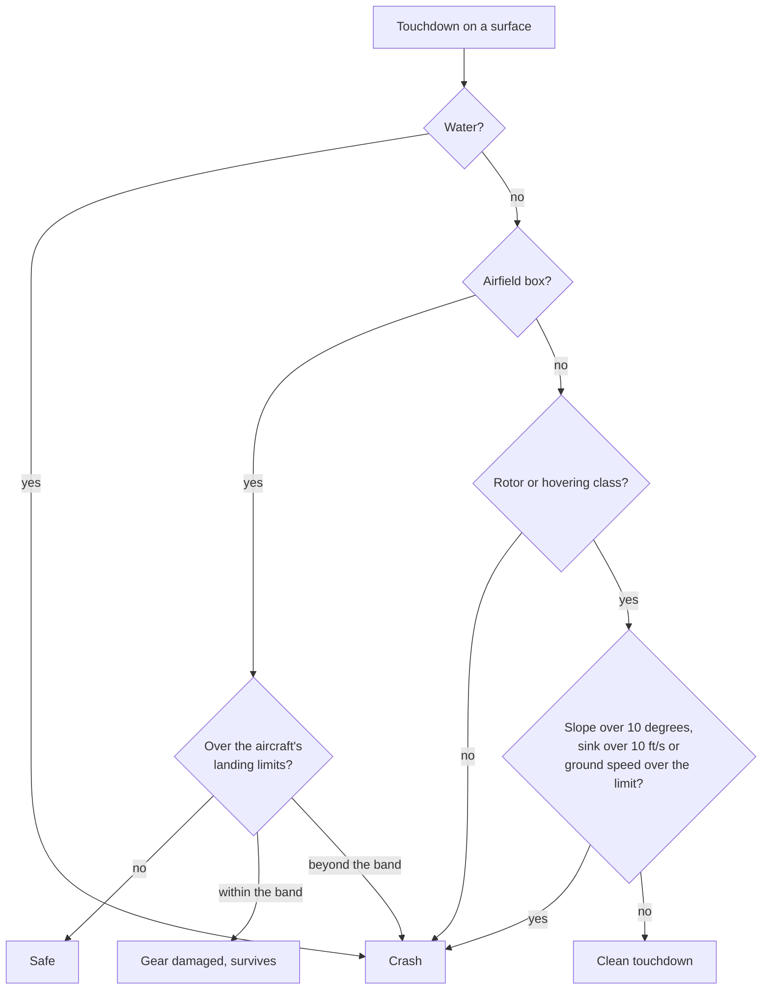

# Touchdown away from an airfield

> **T.O.R.E: Tasteful Opinionated Reverse Engineered.**
> The thing being reverse engineered is the *experience*, not the executable. We
> trace what a player does and what the game does back, down to the numbers they
> would notice. How the original code achieved it is history: useful evidence,
> never a blueprint. If a sentence below reads like an instruction to reproduce
> the original's internals, it is out of date.
> <!-- tore-header v2 -->

Implementation mode, bug B21, requested by John on 2026-10-12. Fighters Anthology
never let a player fly a helicopter, so none of this is original behaviour: the
limits and the gear-damage rule are **opinionated** (John, 2026-10-12) and the
band numbers and thresholds are **fitted** agent decisions, labelled below.

## What the player sees and does

Helicopters, the V-22 in helicopter mode and the AV-8 and Yak-141 in a hover can
put down anywhere that is level, dry and solid enough: open ground, the roof of a
building, a hangar, a bunker. Come down gently and the aircraft settles, sits, and
takes off again. Come down too hard, or too fast over the ground, or on a steep
slope, or on water, and it is a crash: off an airfield there is no middle ground.

On an airfield, for every aircraft, a landing a little over the aircraft's own
landing limits (a hard landing) damages the gear and the aircraft survives; a
landing well over them is a crash.

Everything else is as it was. A fixed-wing aircraft (and the V-22 in airplane mode,
the AV-8 and Yak-141 in wingborne flight) that touches anything other than an
airfield still crashes. Flying into the side of a building, or under its roof,
still crashes every aircraft.

## Numbers

| Rule | Value | Label |
| --- | --- | --- |
| Clean sink rate | at most 10 ft/s (600 ft/min) | opinionated, John 2026-10-12 |
| Clean ground speed, helicopters and the V-22 in helicopter mode | at most 20 kt | opinionated, John 2026-10-12 |
| Clean ground speed, AV-8 and Yak-141 in a hover | at most 10 kt | opinionated, John 2026-10-12 |
| Steepest ground or roof | 10 degrees | opinionated, John 2026-10-12 |
| Water | never | opinionated, John 2026-10-12 |
| Off an airfield, over any limit above | crash | opinionated, John 2026-10-12 |
| Hard landing on an airfield, every aircraft | over the aircraft's own landing limits (forward, side and sink speed, roll, pitch) but within the band: gear damaged, aircraft survives | opinionated, John 2026-10-12 |
| The band | sink and side speed up to 2 times the limit; forward speed, roll and pitch up to 1.5 times it; beyond any of them, a crash | fitted (agent) |
| V-22 counts as a helicopter | nacelles at 75 degrees or more of 97.5 (straight up is 90; its helicopter preset is 87) | fitted (agent) |
| AV-8 or Yak-141 counts as hovering | nozzles at 60 degrees or more from aft (90 is straight down; the short takeoff stops are 60, 40 and 20) | fitted (agent) |
| Smallest roof | a flat top at least 16 ft across each way, so a pole or mast is not a pad | fitted (agent) |
| Airfield roof | on an airfield only a structure at least 8 ft above the runway counts as a roof, so low markings never turn the runway into limited ground | fitted (agent) |

The limits are "at most": a sink of exactly 10 ft/s is still clean. Ground speed
is the speed over the ground, wind aside. The aircraft's own roll and pitch
landing limits and the gear-down check still apply as on a runway; its record's
forward, side and sink limits (a fighter's) are replaced off the airfield by the
rows above.

A hard landing on an airfield jams the landing gear (the "Landing gear jammed"
system fault, which on the retractable-gear aircraft keeps the gear down) and says
"Hard landing: gear damaged". Before 2026-10-12 every touchdown over the landing
limits was a crash; the band is John's change. For example, a landing limit of
30 ft/s sink damages the gear from 30 to 60 ft/s and crashes beyond 60. The
gear-up check and the surface checks (water, not an airfield for a fixed-wing
aircraft) are unchanged and still crash.

## One rule for the player and the AI

One function, `touchdown::assess`, answers "may this aircraft touch down on this
surface?". Ground contact, the AI's ejection check on a final ("a crash within a
second is catastrophic") and the AI's go-around check on a final all ask it, so
they cannot disagree.

## Which surfaces count

- **Open ground.** The terrain, with its slope read from the terrain triangle under
  the aircraft and water read from the terrain class (the outside of the map is
  water, as in the original's collision query).
- **Flat tops of objects.** Any standing object whose collision box has a top face
  tilted under 10 degrees: buildings, hangars, bunkers, ships' hulls as placed.
  City fill buildings count too. The aircraft rests at the roof height plus its
  wheel clearance, and can lift off again; sliding off the edge drops it. Only an
  aircraft that is above the roof counts it as ground; one beside or under the roof
  meets a wall, which crashes as before. A destroyed object is no surface.
- Surface units are placed with the collision boxes the scene gives them, so a ship
  is landable where it was placed, not where it has steamed to (the existing
  collision has the same limit).

## Unknown

- Whether retail's helicopters would have had a gear-damage step: retail never
  flew them.
- Moving decks: ships and columns have no collision that follows them, so a moving
  ship's deck is not a landing surface. A moving-deck rule is future work.
- The AI does not land on roofs: its surface query has no altitude, so the AI's
  rule covers open ground and airfields only.

## Source notes

Implementation: `crates/tore-sim/src/touchdown.rs` (the rule),
`crates/tore-sim/src/research.rs` (`Research::contact`),
`crates/tore-sim/src/ejection.rs` and `crates/tore-sim/src/ai/mission.rs` (the AI
checks), `crates/tore-world/src/terrain.rs` (`Terrain::surface` fills `water` and
`slope_deg`; `Terrain::surface_over` adds roofs), `crates/tore-world/src/world/plane.rs`
(the player's plane step). Tests: `touchdown.rs`, `flight/powered/touchdown_tests.rs`,
`world/touchdown_tests.rs`, and the battery scenario `flight-powered-touchdown-offfield`.
Related: [powered-lift flight](powered-lift-flight.md#ground-interaction),
[takeoff and ground contact](takeoff-ground-contact.md).
